# Haruka Engine 하위 코어 결함 전수 진단 및 기술 안정화 명세서

> **[검증 상태 · 2026-08-24]** 이 문서는 github.com/carbonengine 저장소 원본 및
> `src/` 코드와 대조하여 정정되었습니다. 정정 근거와 전체 내역은
> [Carbon_Source_Audit.md](archive/Carbon_Source_Audit.md)를 참조하십시오.
> 계층 구분은 [Layer_Architecture.md](Layer_Architecture.md)를 따릅니다.

> **문서 목적**: VR 엔진 코어를 완성하기에 앞서, 현재 Haruka Engine의 **Layer 1 코어 계층(렌더러 SSBO 동기화, 메모리 할당기, 모바일 Vulkan 호환성, 객체 수명주기, 그리고 Layer 2를 막고 있는 경계 누출 지점)**에 존재하는 결함과 병목을 전수 진단하고 해결 방안을 명세합니다.

> **결함 ID 규약**: 이 문서의 `DEF-01`부터 `DEF-15`까지는 [Core_Defects_Task_Spec.md](Core_Defects_Task_Spec.md)의 요약 매트릭스와 **ID, 심각도, 해결 여부 표기가 동일합니다.** 두 문서가 어긋나면 안 되므로, 한쪽을 고칠 때는 반드시 다른 쪽도 함께 고치십시오. `DEF-16`부터 `DEF-22`까지는 [Layer_Architecture.md](Layer_Architecture.md) 4절의 경계 누출 지점을 결함으로 등재한 것이며, 아직 `Core_Defects_Task_Spec.md`에는 반영되어 있지 않습니다. `DEF-23`부터 `DEF-30`까지는 2026-08-25 DEF-01 수정 작업 중에 발견되어 새로 등재된 항목이며, `Core_Defects_Task_Spec.md`의 요약 매트릭스에도 **동일한 ID와 심각도로 반영되어 있습니다.** `DEF-31`과 `DEF-32`는 2026-08-25 DEF-25 수정 작업에서 도출된 VR 스테레오 컬링 요구사항이며, 같은 규약에 따라 두 문서에 동일하게 반영되어 있습니다. `DEF-33`부터 `DEF-35`까지는 2026-08-25 DEF-24 수정 작업에서 도출된 라이팅 항목이며, 역시 두 문서에 동일한 ID와 심각도로 반영되어 있습니다. `DEF-36`부터 `DEF-46`까지는 2026-08-25 설계 검토에서 도출된 신규 항목이며, 같은 규약에 따라 두 문서에 동일한 ID와 심각도로 반영되어 있습니다. 이 가운데 `DEF-39`, `DEF-40`, `DEF-43`, `DEF-44`는 **미검증 항목이므로 착수 전에 실측이 필요합니다.** 미검증 표기 역시 두 문서가 동일해야 합니다. `DEF-47`과 `DEF-48`은 2026-08-25 머티리얼 작업에서 도출된 신규 항목이며 **등재와 동시에 해결되었습니다.** 같은 규약에 따라 두 문서에 동일하게 반영되어 있습니다.

---

## 1. Layer 1 코어 결함 진단 맵

**[정정]** 이전 판은 결함을 6개로 묶고 결함 1을 "컬링 여부만 다른 두 카운터", 결함 2를 CRITICAL, 결함 4를 미해결로 그렸습니다. 아래 맵은 코드 실측에 맞추어 결함을 분해하고 심각도를 다시 잡은 것입니다.

```mermaid
graph TD
    subgraph S1["DEF-01 렌더러 SSBO 인덱스 동기화 붕괴 (해결됨 2026-08-25)"]
        D1["buildDrawCommands가 인덱스를 배정하는 유일한 지점이 됨<br/>RenderView.materialRows로 O(1) 역참조, World 재순회 제거<br/>부수 해소: 깊이 프리패스와 컬러 패스의 LOD 불일치"]
    end

    subgraph S1B["DEF-23 스피어 인덱스 도메인 불일치 (해결됨 2026-08-25)"]
        D1B["DEF-01의 직계 형제, 네 번째 경로<br/>cull.comp가 opaque 위치와 전역 transform 행을 같은 id로 읽음<br/>RenderView.opaqueSpheres로 도메인 통일"]
    end

    subgraph S2["DEF-02 Zone C Ring 버퍼 펜스 추적 부재 (MEDIUM · 잠재)"]
        D2["펜스 추적은 실제로 없으나 실사용이 64MB 중 약 0.5MB<br/>랩어라운드가 약 128프레임 주기라 현재는 충돌 불가"]
    end

    subgraph S3["DEF-03 / DEF-04 모바일 Vulkan 피처 무조건 요구 (HIGH)"]
        D3["drawIndirectCount와 synchronization2를 조건 없이 요구<br/>드로우가 아니라 vkCreateDevice 단계에서 실패"]
    end

    subgraph S4["DEF-05 스왑체인 리사이즈 GPU 인플라이트 (해결됨)"]
        D4["Renderer_swap.cpp:59-60이 진입 즉시 vkDeviceWaitIdle 호출"]
    end

    subgraph S5["DEF-06 MSAA 지연 할당 메모리 속성 누락 (HIGH)"]
        D5["TRANSIENT_ATTACHMENT_BIT는 이미 있음<br/>빠진 것은 LAZILY_ALLOCATED 메모리 속성뿐"]
    end

    subgraph S6["DEF-07 액터 수명주기 통지 미연결 (해결됨 2026-08-26)"]
        D6["onActorDestroyed 이벤트는 존재하나 구독자가 0곳<br/>틱 중 파괴 지연 큐는 이미 구현되어 있음"]
    end

    subgraph S7["DEF-08~DEF-15 코어 인프라 결함"]
        D7["안드로이드 진입점, 멀티뷰 절반 구현, 이중 상한,<br/>셰이더 빌드, 런타임 게임 루프, FrameUBO, 셰이더 중복 선언"]
    end

    subgraph S8["DEF-16~DEF-22 Layer 2 경계 누출 (Layer_Architecture 4절)"]
        D8["인스턴싱 하드코딩, 패스 레지스트리 부재, EngineContext 렌더러 부재,<br/>물리 힘 API 부재, 디지털 전용 입력, 오일러각 카메라, 직렬화 하드코딩"]
    end

    subgraph S9["DEF-26~DEF-30 2026-08-25 신규 발견 (미해결)"]
        D9["섀도 캐스터 라이트 선택 불일치,<br/>섀도 패스의 카메라 프러스텀 목록 사용, 머티리얼 null 드로우 강행,<br/>디바이스 레이어 설정, 투명 정렬의 매핑 메모리 읽기"]
    end

    subgraph S9C["DEF-24 라이트 개수 이중 계산 (해결됨 2026-08-25)"]
        D9C["kMaxLights를 16에서 256으로 상향, 상한은 하드웨어가 아니라 메모리 예산<br/>updateLightSSBO가 실제 기록 수를 반환하고 updateUBO가 인자로 받음<br/>pbr.frag의 evalLight에 얼리아웃 추가, 출력은 비트 단위로 동일"]
    end

    subgraph S9B["DEF-25 프리패스와 컬러 서브패스 가시 집합 불일치 (해결됨 2026-08-25)"]
        D9B["CPU는 월드 AABB, GPU는 바운딩 구로 컬링하던 도형 불일치<br/>회전 시 재계산된 AABB가 구보다 커져 판정이 갈림<br/>CPU를 sphereInFrustum으로 통일, 구를 한 번만 계산"]
    end

    subgraph S10["DEF-31~DEF-32 VR 스테레오 컬링 요구사항 (미해결)"]
        D10["두 눈 합집합 절두체 부재 (HIGH, 두 눈 절두체를 각각 판정)<br/>재투영 여유분만큼의 절두체 부풀리기 부재 (MEDIUM, 실기 측정 필요)<br/>착수 시점은 둘 다 OpenXR 세션 도입 시"]
    end

    subgraph S11["DEF-33~DEF-35 라이팅 후속 항목 (미해결)"]
        D11["라이트 선택 정책 부재 (MEDIUM, 착수: 상한에 실제로 걸릴 때)<br/>타일드 또는 클러스터드 라이팅 부재 (MEDIUM, 착수: 픽셀당 루프가 병목으로 측정될 때)<br/>evalLight의 0 나눗셈 가능성 (LOW)"]
    end

    subgraph S12["DEF-36~DEF-37 라이팅 정합 붕괴 (해결됨 2026-08-25)"]
        D12["섀도 샘플러 비교 규약을 LESS_OR_EQUAL로 정정 (원래 CRITICAL)<br/>지문 테스트로 확정: shadow 값을 직접 출력하니 물체가 거의 전부 검게 나옴<br/>IBL 조도 추정기의 코사인과 PI를 함께 제거 (원래 HIGH, B-1 방안)"]
        D12N["두 항목을 함께 처리하여 라이팅이 검증 가능한 상태가 되었습니다"]
    end

    subgraph S12B["DEF-38 라이트 직렬화 누락 (해결됨 2026-08-27)"]
        D12B["라이트 종류와 방향이 직렬화되지 않음 (HIGH, .hscene 왕복에서 소실)"]
    end

    subgraph S14["DEF-47~DEF-48 머티리얼 경로 (해결됨 2026-08-25)"]
        D14["glTF 스칼라 팩터를 한 번도 읽지 않던 문제 (원래 HIGH, 로드 시 픽셀로 굽기)<br/>SRGB 텍스처에 pow(2.2)를 한 번 더 적용하던 이중 디코드 (원래 MEDIUM)<br/>흰색에서는 이중 디코드가 드러나지 않아 반드시 한 묶음으로 처리해야 했습니다"]
    end

    subgraph S13["DEF-39~DEF-46 설계 검토 신규 (미해결)"]
        D13["콜라이더가 Transform.scale 미반영 (MEDIUM, 절차 도형 설계와 충돌),<br/>힙 축소 시 Zone 오프셋이 할당 범위 이탈 (MEDIUM, Quest 포팅 전 필수),<br/>에디터 float 스텝 0.01 고정 (MEDIUM, 단위 논의의 실제 원인),<br/>uploadMesh 핸들 누수 (LOW)"]
        D13N["미검증 · 착수 전 실측 필요: 탄젠트 handedness, 라인 오버레이 버퍼 레이스,<br/>세터 안의 resetIfLive, RIGID의 enum 서수 직렬화"]
    end
```



---

## 2. 결함별 심층 분석 및 엔지니어링 해결 사양

---

### ✅ [DEF-01] [해결됨 · 2026-08-25] Transform SSBO 인덱스 동기화 붕괴

**상태**: **해결되었습니다 (2026-08-25).** 원래 심각도는 CRITICAL이었습니다.

* **수정 파일**: [`src/renderer/Renderer.hpp`](file:///e:/Haruka/src/renderer/Renderer.hpp), [`src/renderer/Renderer_render.cpp`](file:///e:/Haruka/src/renderer/Renderer_render.cpp)

#### 1) 현상 및 발생 메커니즘 (수정 전)

* **위치**: [`Renderer_render.cpp:L215`](file:///e:/Haruka/src/renderer/Renderer_render.cpp#L215) (`buildDrawCommands`), [`Renderer_render.cpp:L296`](file:///e:/Haruka/src/renderer/Renderer_render.cpp#L296) (`extractRenderView`의 `opaqueItems` 루프), [`Renderer_render.cpp:L313-L326`](file:///e:/Haruka/src/renderer/Renderer_render.cpp#L313-L326) (투명 머티리얼 역참조 루프)

**[정정]** 이전 판은 이 결함을 "컬링을 하는 쪽과 하지 않는 쪽, 두 카운터의 불일치"로 서술했으나, 실제로는 증가 조건이 서로 다른 **세 경로**가 존재하며 opaque와 transparent의 카운터 공유까지 얽혀 있습니다.

1. `buildDrawCommands`(L215)는 visible, mesh 유무, LOD, 프러스텀 판정을 **모두** 통과한 메시에 대해서만 `ssboIdx`를 증가시키고 트랜스폼 행렬을 기록합니다. 이때 **opaque와 transparent가 카운터 하나를 공유**하므로, 두 목록의 인덱스가 하나의 증가 수열 위에 섞여서 배치됩니다.
2. `extractRenderView`의 `opaqueItems` 빌드 루프(L296)는 프러스텀 컬링을 전혀 수행하지 않으면서 별도 카운터를 증가시킵니다.
3. 투명 머티리얼 역참조 루프(L313-L326)도 같은 구조의 세 번째 카운터를 사용하며, opaque 쪽이 카운터를 공유한다는 사실을 반영하지 않습니다.
4. **영향**: 세 경로의 증가 조건이 일치하지 않으므로 인덱스가 어긋납니다. `firstInstance`가 가리키는 SSBO 행과 실제 트랜스폼 데이터가 어긋나 오브젝트 위치가 뒤섞이고, 어긋난 폭이 커지면 SSBO 범위를 넘어서는 인덱싱이 발생합니다.

**[정정 · 2026-08-25]** 이전 판의 2번 항목은 "**머티리얼이 없거나 LOD가 없는 메시에 대해서도** 카운터를 증가시킨다"를 세 번째 근거로 들었습니다. **이 근거는 사실이 아니므로 삭제했습니다.** [`World.cpp:L72`](file:///e:/Haruka/src/core/World.cpp#L72)의 `World::getVisibleMeshes()`가 `m->visible && m->mesh && m->material`을 이미 걸러내므로, 머티리얼이 없는 메시는 애초에 순회 목록에 들어오지 않습니다. LOD 실패 경로도 같은 이유로 도달하지 않습니다. 실제로 존재하던 불일치 근거는 프러스텀 컬링 유무와 opaque·transparent 카운터 공유 두 가지뿐입니다. 이 오류는 `getVisibleMeshes()`의 필터 조건을 코드로 확인하지 않고 호출부의 루프 형태만 보고 추정하여 쓴 데서 비롯되었습니다.

#### 2) 적용된 해결 내용 (2026-08-25)

**[정정]** 이전 판은 `meshMaterialMap[dc.firstInstance]` 같은 식별자를 쓰는 예시 코드를 실었으나, 그 식별자는 코드베이스에 존재하지 않으므로 삭제했습니다.

* `RenderView`에 `std::vector<const MaterialHandle*> materialRows`를 추가했습니다. 이 벡터의 인덱스가 곧 `GpuDrawCmd::firstInstance`이자 transform SSBO의 행 번호입니다.
* `buildDrawCommands`가 네 번째 출력 인자 `materialRowsOut`을 받고, `uint32_t idx = ssboIdx++;` 직후에 `materialRowsOut.push_back(mc->material)`을 수행합니다. 행 배정과 push 사이에 분기가 없으므로 `materialRows.size() == ssboIdx`가 항상 유지됩니다.
* `extractRenderView`의 World 재순회 두 루프를 **완전히 제거**했습니다. 이제 `toItems` 람다가 `opaqueDraws`와 `transpDraws`를 순회하면서 `materialRows[dc.firstInstance]`로 O(1) 역참조하여 `opaqueItems`와 `transparentItems`를 만듭니다. 항목이 드로우 커맨드에서 필드 단위로 파생되므로 둘이 어긋나는 것이 구조적으로 불가능합니다.
* `materialForRow`에 assert를 추가했고, `buildDrawCommands` 진입 시 `opaqueOut`과 `transpOut`도 clear하도록 했습니다.

#### 3) 부수 해소: 깊이 프리패스와 컬러 패스의 LOD 불일치

별도 ID를 부여하지 않고 이 항목에 함께 기록합니다.

* 수정 전 `extractRenderView`는 `getMeshForDistanceSq(0.f)`를 호출하여 **항상 최고 LOD**를 골랐습니다. 반면 `buildDrawCommands`는 실제 거리로 LOD를 선택합니다.
* 따라서 같은 오브젝트에 대해 깊이 프리패스와 컬러 패스가 **서로 다른 LOD 메시**를 그릴 수 있었습니다. 실루엣이 다른 두 메시가 겹치면 프리패스가 기록한 깊이와 컬러 패스의 정점이 어긋나 가장자리에서 픽셀이 탈락하거나 z-fighting이 나타납니다.
* World 재순회 루프를 제거하면서 `getMeshForDistanceSq(0.f)` 호출 자체가 사라졌으므로 이 불일치도 함께 해소되었습니다. 이제 LOD는 `buildDrawCommands` 한 곳에서만 선택됩니다.

#### 4) 검증 결과 (2026-08-25)

* Release 빌드를 통과했고 신규 경고는 0건입니다. 기존 `uploadCubemapMip` 미참조 경고 1건만 남아 있습니다.
* Debug 빌드를 통과했고 신규 경고는 0건입니다.
* 실행 스모크 테스트가 정상 기동했고 런타임 에러는 0건입니다.
* **검증 레이어 위반은 0건입니다.** 수정 전후의 stderr가 동일하며, 남은 것은 DEF-29로 등재한 기존 문제인 `VUID-VkDeviceCreateInfo-enabledLayerCount-12384` 1건뿐입니다.
* assert는 발동하지 않았습니다.

> **주의**: DEF-01만으로는 인덱스 도메인 문제가 전부 해결되지 않았습니다. 동일한 패턴이 GPU 컬링 경로에 하나 더 남아 있었으며, 이는 아래 2-B절의 **DEF-23**으로 등재했습니다.

---

### ⚠️ [DEF-02] [MEDIUM · 잠재] `HarukaAllocator` Zone C Ring Buffer 펜스 추적 부재

#### 1) 현상 및 발생 메커니즘

* **위치**: [`HarukaAllocator.cpp:L177-L199`](file:///e:/Haruka/src/memory/HarukaAllocator.cpp#L177-L199) (`allocC`)

**[정정]** 이전 판은 이 항목을 CRITICAL로 분류하고 즉시 발생하는 데이터 레이스로 서술했으나, 실사용량을 고려하면 현재 조건에서 실제 충돌이 일어날 가능성은 사실상 없습니다. 구조적 결함은 실재하므로 항목은 유지하되, 프레임당 사용량이 커질 때의 잠재 리스크로 재분류합니다.

1. `allocC`는 Zone C 링버퍼 공간을 선형 할당하며, 끝에 도달하면 시작 오프셋으로 Wrap-around 합니다. **펜스 추적이 없다는 것은 사실입니다.**
2. 그러나 `HarukaAllocator.hpp:9`의 주석에 따르면 Zone C 실사용량은 64MB 중 약 0.5MB이며, 이는 약 128배의 여유입니다.
3. 따라서 랩어라운드는 약 128프레임마다 한 번 일어나고, 그때 덮어쓰는 영역은 128프레임 전에 기록된 데이터입니다. 프레임 인플라이트 깊이가 2인 상황에서 GPU가 128프레임 전 데이터를 아직 읽고 있을 수는 없습니다.
4. **실제 리스크가 성립하는 조건**: 프레임당 Zone C 사용량이 32MB에 근접하면 랩어라운드 주기가 2프레임 수준으로 줄어들어 인플라이트 영역과 겹치기 시작합니다. 대량 인스턴싱(DEF-16), 동적 정점 스트리밍, 프레임당 SSBO 업로드량 증가 같은 변경이 이 문턱을 넘길 수 있습니다.

#### 2) 정밀 해결 사양

* 우선순위는 DEF-03, DEF-04, DEF-08, DEF-09보다 낮습니다. (DEF-01, DEF-24, DEF-25는 2026-08-25에 해결되어 이 목록에서 제외했습니다.) 다만 사용량이 늘어난 뒤에 고치면 원인 추적이 어려운 종류의 결함이므로, 그 전에 처리하는 것이 좋습니다.
* **감시 장치를 먼저 넣으십시오.** 프레임당 Zone C 소비량과 랩어라운드 주기를 계측하여, 주기가 `MAX_FRAMES`의 몇 배 이내로 떨어지면 경고를 남기도록 합니다. 이것만으로도 잠재 리스크가 실제 리스크로 바뀌는 시점을 잡을 수 있습니다.
* **옵션 A**: Zone C를 `MAX_FRAMES`개의 독립 슬롯으로 파티셔닝하고, 각 프레임 인덱스 전용 오프셋에서만 할당한 뒤 해당 프레임의 펜스가 완료될 때 리셋합니다.
* **옵션 B**: 프레임 펜스로 확인된 안전 오프셋까지만 링 헤드가 전진할 수 있도록 테일 추적 가드를 도입합니다.

#### 3) 외장 GPU Fallback 시 `maxMemoryAllocationCount` 초과 위험 (원본 미확인)

**[정정]** 이전 판은 `HarukaAllocator.cpp:L230-258`에서 이미지마다 `alloc.auxMem`으로 `vkAllocateMemory`를 개별 호출하며 드라이버 한도가 약 4096개라고 단정했습니다. **이번 감사에서 해당 라인 범위도 할당 한도 수치도 확인하지 못했으므로 원본 미확인으로 표기합니다.**

* 절 자체는 유지합니다. 이미지별 개별 디바이스 메모리 할당이 실제로 존재하는지, 그리고 `VkPhysicalDeviceLimits::maxMemoryAllocationCount`가 대상 기기에서 얼마인지를 **먼저 실측하십시오.**
* 실측으로 확인되기 전까지는 이 항목을 근거로 텍스처 전용 풀 같은 구조를 도입하지 마십시오. 확인된 사실이 없는 상태에서 만든 풀은 1GB 예산만 선점합니다.

---

### ✅ [DEF-03] [해결됨 · 2026-10-04, 원래 HIGH] `drawIndirectCount` 무조건 요구 및 폴백 부재

#### 1) 현상 및 발생 메커니즘

* **위치**: [`GeometryPass.cpp:L507`](file:///e:/Haruka/src/renderer/passes/GeometryPass.cpp#L507) (`vkCmdDrawIndexedIndirectCount` 호출), [`Renderer.cpp:L599-L613`](file:///e:/Haruka/src/renderer/Renderer.cpp#L599-L613) (디바이스 피처 요구)

**[정정]** 이전 판은 이 결함이 드로우 시점에 나타난다고 서술했으나, 실제 실패는 그보다 훨씬 앞선 **디바이스 생성 단계**에서 일어납니다.

* `Renderer.cpp:524`가 `VK_API_VERSION_1_4`를 요구하고, 디바이스 피처 체인은 `VkPhysicalDeviceVulkan14Features{pushDescriptor}` 다음 `Vulkan13Features{synchronization2}` 다음 `Vulkan12Features{drawIndirectCount}`로 이어집니다.
* `Renderer.cpp:599-613`이 이 체인을 **조건 없이** 요구합니다. 따라서 `drawIndirectCount`를 제공하지 않는 디바이스에서는 드로우까지 가지 못하고 `vkCreateDevice` 단계에서 실패합니다. 현재 코드는 폴백이 없는 정도가 아니라 해당 기기에서 아예 초기화되지 않습니다.
* `GeometryPass.cpp:507`의 호출은 분기 없이 이루어집니다. 디바이스 생성 조건을 완화하는 순간 이 호출이 두 번째 실패 지점이 됩니다.

#### 2) 정밀 해결 사양

* 수정 순서가 중요합니다. 먼저 `Renderer.cpp:599-613`의 피처 요구를 **필수 항목과 선택 항목으로 분리**하고, 선택 항목은 지원 여부를 질의한 결과를 런타임 플래그로 보관하십시오.
* 그다음 `GeometryPass.cpp:507`에 그 플래그로 분기하는 폴백 경로를 두고, 미지원 시 `vkCmdDrawIndexedIndirect`를 드로우 개수만큼 반복 호출하거나 CPU가 개수를 확정해 기록하는 경로를 쓰십시오.
* 피처 분리 없이 드로우 분기만 추가하면 디바이스 생성 단계에서 여전히 실패하므로 효과가 없습니다.

> **주의**: Quest Pro의 Adreno 드라이버가 `drawIndirectCount`를 지원하는지 여부는 이 문서 작성 시점에 **실기로 확인되지 않았습니다**. 이전 판의 "일부 Adreno 드라이버 버전에서 미지원되거나 심각한 성능 저하를 유발한다"는 서술은 근거가 확인되지 않은 추정이므로 삭제했습니다. 폴백 경로 자체는 실기 확인과 무관하게 필요하지만, 지원 여부를 단정한 서술은 실측 전까지 사용하지 마십시오.

---

### ⚠️ [DEF-04] [HIGH] `vkCmdPipelineBarrier2` (Synchronization2) 무조건 호출

#### 1) 현상 및 발생 메커니즘

* **위치**: [`RenderContext.cpp:L167`](file:///e:/Haruka/src/renderer/RenderContext.cpp#L167), [`CullPass.cpp:L166`](file:///e:/Haruka/src/renderer/passes/CullPass.cpp#L166), [`CullPass.cpp:L194`](file:///e:/Haruka/src/renderer/passes/CullPass.cpp#L194), 디바이스 피처 요구는 [`Renderer.cpp:L599-L613`](file:///e:/Haruka/src/renderer/Renderer.cpp#L599-L613)

**[정정]** 이전 판은 호출 지점을 `RenderContext.cpp`의 `transitionImage` 한 곳으로만 적고 문제를 "호환 레이어 부재"로 뭉뚱그렸으나, 실제 호출 지점은 세 곳이며 실패는 DEF-03과 마찬가지로 디바이스 생성 단계에서 먼저 일어납니다.

* `vkCmdPipelineBarrier2`가 위 세 곳에서 **무조건** 호출됩니다.
* `Renderer.cpp:599-613`이 `Vulkan13Features{synchronization2}`를 조건 없이 요구하므로, 이 피처가 없는 디바이스에서는 `vkCreateDevice`부터 실패합니다.

#### 2) 정밀 해결 사양

* DEF-03과 동일한 순서를 따르십시오. `Renderer.cpp:599-613`의 피처 요구를 선택 항목으로 내리고 런타임 플래그를 보관한 뒤, 호출 지점에 분기를 넣습니다.
* 호출 지점이 세 곳이므로 배리어 발행을 얇은 래퍼 함수 하나로 모은 뒤 그 안에서만 분기하는 편이 안전합니다. 세 곳에 각각 분기를 복사하면 이후 호출 지점이 늘어날 때 누락이 생깁니다.
* 래퍼는 `VkImageMemoryBarrier2`를 받아 미지원 시 `VkImageMemoryBarrier`와 `vkCmdPipelineBarrier`로 변환하는 형태가 됩니다. `VkPipelineStageFlags2`의 상위 비트 스테이지에는 1.0 대응이 없으므로, 변환 표를 만들 때 어느 스테이지를 어떻게 근사할지 명시적으로 결정하십시오.

---

### ✅ [DEF-05] [해결됨] 스왑체인 리사이즈 시 GPU In-Flight 자원 파괴 위험

#### 1) 상태: 이미 해결되어 있습니다

* **위치**: [`Renderer_swap.cpp:L59-L60`](file:///e:/Haruka/src/renderer/Renderer_swap.cpp#L59-L60)

**[정정]** 이전 판은 이 항목을 미해결 HIGH 결함으로 분류하고 대상 파일을 `Renderer_render.cpp`로 적었으나, 두 가지 모두 사실과 다릅니다. `recreateSwapChain`은 `Renderer_swap.cpp`에 있으며, 요구하던 수정은 이미 코드에 들어 있습니다.

* **근거**: `Renderer_swap.cpp:59-60`의 `recreateSwapChain`이 함수 진입 직후 `vkDeviceWaitIdle(device)`를 호출한 뒤에 `cleanupSwapChain()`을 실행합니다. 즉 크기 의존 자원을 파괴하기 전에 GPU가 모든 작업을 마치도록 보장하고 있습니다.

#### 2) 후속 조치

* 이 항목에 대해 새로 작성할 코드는 없습니다.
* 남는 작업은 검증뿐입니다. 크기 의존 자원을 해제하는 새로운 경로를 추가할 때 그 경로가 `recreateSwapChain`을 거치는지 확인하십시오. `vkDeviceWaitIdle`은 `recreateSwapChain` 진입부에만 있으므로, 이 함수를 우회하여 자원을 해제하면 같은 위험이 되살아납니다.

---

### ⚠️ [DEF-06] [HIGH] MSAA `LAZILY_ALLOCATED` 메모리 속성 누락

#### 1) 현상 및 발생 메커니즘

* **위치**: [`GeometryPass.cpp:L239`](file:///e:/Haruka/src/renderer/passes/GeometryPass.cpp#L239)

**[정정]** 이전 판은 타일 메모리 최적화가 통째로 빠져 있다고 서술했으나, 절반은 이미 되어 있습니다. `VK_IMAGE_USAGE_TRANSIENT_ATTACHMENT_BIT`는 `GeometryPass.cpp:239`에 **이미 들어 있습니다.**

* 실제로 빠진 것은 메모리 속성 한 가지뿐입니다. `VK_MEMORY_PROPERTY_LAZILY_ALLOCATED_BIT`는 코드베이스 전체에서 검색 결과가 0건입니다.
* MSAA 컬러 버퍼는 서브패스 진행 중 타일 내부에서만 쓰이고 Resolve 후 버려지므로, 사용 플래그만으로는 실제 물리 메모리 커밋을 피할 수 없습니다. 지연 할당 메모리 타입에 바인딩해야 타일 기반 GPU(TBR)가 백업 저장소를 생략하고 대역폭과 배터리를 아낍니다.

#### 2) 정밀 해결 사양

* 작업 범위는 **메모리 타입 선택 한 곳**입니다. 사용 플래그는 건드릴 필요가 없습니다.
* MSAA 이미지의 메모리 타입을 고를 때 `VK_MEMORY_PROPERTY_LAZILY_ALLOCATED_BIT`를 가진 타입을 먼저 탐색하고, 없으면 기존 경로로 내려가도록 하십시오. 데스크톱 GPU에는 이 메모리 타입이 대체로 존재하지 않으므로 폴백이 반드시 필요합니다.
* 현재 MSAA 이미지가 Zone B에 할당되고 있으므로, 지연 할당 메모리는 `HarukaAllocator`의 Zone 경로를 우회하는 별도 할당이 됩니다. 해제 경로가 어느 쪽으로 가는지 함께 정리하십시오.
* 깊이 이미지도 서브패스 밖으로 나가지 않는다면 같은 처리 대상입니다. 다만 현재 깊이 이미지가 서브패스 밖에서 읽히는지는 확인되지 않았으므로, 확인 후에 적용하십시오.

---

### ✅ [DEF-07] [해결됨 · 2026-08-26, 원래 MEDIUM] `onActorDestroyed` 구독자 부재로 인한 댕글링 포인터

> **해결(2026-08-26, Roadmap A-1):** `EditorApp` 이 `onActorDestroyed` 를 구독해 커맨드 스택과 선택 포인터를 정리하고,
> 물리·오디오는 `notifyDestroy` → `onDestroy` 로 정리합니다. 아래는 등재 당시의 분석입니다(2026-10-02 대조).

#### 1) 현상 및 발생 메커니즘

* **위치**: [`World.hpp:L27`](file:///e:/Haruka/src/core/World.hpp#L27) (이벤트 선언), [`World.cpp:L27`](file:///e:/Haruka/src/core/World.cpp#L27) (브로드캐스트)

**[정정]** 이전 판은 이 결함을 통지 구조 자체가 없는 문제로 서술하고 곧바로 `uint64_t` 핸들 전면 전환을 해결책으로 제시했으나, 인프라는 이미 절반이 지어져 있습니다. 빠진 것은 구조가 아니라 연결입니다.

* **이미 있는 것 (1)**: `onActorDestroyed` 이벤트가 `World.hpp:27`에 선언되어 있고 `World.cpp:27`에서 실제로 브로드캐스트됩니다.
* **이미 있는 것 (2)**: 틱 도중에 들어온 파괴 요청을 지연시키는 큐가 이미 구현되어 있습니다. 즉 틱 중간에 컨테이너가 변형되는 종류의 문제는 이미 막혀 있습니다. (해당 코드의 정확한 위치는 이 문서에서 확인하지 않았습니다.)
* **빠진 것**: `onActorDestroyed`의 **구독자가 한 곳도 없습니다.** 이벤트는 매번 발행되지만 아무도 듣지 않으므로, `PhysicsSystem`의 바디 핸들, 오디오 쪽 핸들, 에디터의 선택 포인터와 언두 스택에 남은 `Actor*`가 그대로 남습니다.
* 따라서 크래시 경로는 파괴 시점의 컨테이너 변형이 아니라, 파괴 이후에 무효화되지 않은 참조를 역참조하는 시점입니다.

#### 2) 정밀 해결 사양

* 새 수명주기 구조를 설계하기 전에, **먼저 기존 이벤트에 구독자를 붙이십시오.** 작업량이 훨씬 적고 즉시 효과가 있습니다.
* 최소 구독자 목록은 다음과 같습니다.
  * `PhysicsSystem`: 해당 액터의 바디를 제거하고 동기화 목록에서 뺍니다.
  * 에디터: 선택 포인터가 파괴된 액터를 가리키면 비웁니다.
  * 에디터 언두/리두 스택: 파괴된 액터를 참조하는 항목을 무효화하거나 스택을 잘라냅니다.
* `Actor*` 생포인터를 `uint64_t` 핸들로 전면 전환하는 방안은 여전히 유효하지만, 규모가 큰 변경이므로 위 연결 작업 이후의 별도 과제로 분리하십시오.

---

### ⚠️ [DEF-08] [HIGH] 안드로이드 빌드 불가 (`GlfwWindow` 무조건 생성)

* **위치**: [`main.cpp:L38`](file:///e:/Haruka/src/main.cpp#L38), [`CMakeLists.txt:L186-L191`](file:///e:/Haruka/CMakeLists.txt#L186-L191)
* **문제점**: `main.cpp:38`이 `GlfwWindow`를 조건 없이 생성합니다. `AndroidWindow`는 `CMakeLists.txt:186-191`에서 컴파일되지만 어디서도 인스턴스화되지 않습니다. 즉 Quest 런타임 진입점이 존재하지 않습니다.
* **해결 사양**: `IWindow` 생성을 플랫폼 팩토리 뒤로 옮기고, 안드로이드용 별도 진입점을 두십시오. 이것은 [Layer_Architecture.md](Layer_Architecture.md) 6절 1단계의 첫 항목입니다.

---

### ⚠️ [DEF-09] [HIGH] 멀티뷰 절반 구현 (피처만 켜지고 경로 없음)

* **위치**: [`Renderer.cpp:L599-L605`](file:///e:/Haruka/src/renderer/Renderer.cpp#L599-L605), [`Renderer_render.cpp:L169`](file:///e:/Haruka/src/renderer/Renderer_render.cpp#L169), [`Renderer.hpp:L167-L170`](file:///e:/Haruka/src/renderer/Renderer.hpp#L167-L170)
* **문제점**: 멀티뷰 피처는 `Renderer.cpp:599-605`에서 켜지지만, `Renderer_render.cpp:169`가 `viewProj[1] = viewProj[0]`으로 두고, 어떤 렌더패스도 `viewMask`를 설정하지 않으며, 모든 셰이더가 `viewProj[0]`만 인덱싱합니다. `Renderer.hpp:167-170`의 FFR 멤버는 선언만 되고 쓰이지 않습니다.
* **해결 사양**: `viewMask` 설정, 셰이더의 `gl_ViewIndex` 인덱싱, 이미지 `arrayLayers`를 함께 도입해야 합니다. 셋 중 하나만 하면 동작하지 않습니다.

---

### ⚠️ [DEF-10] [MEDIUM · 2026-10-04 초과 진단 추가] `kMaxDraws` / `kMaxBodies` 이중 상한

* **위치**: [`RenderTypes.hpp:L12`](file:///e:/Haruka/src/renderer/RenderTypes.hpp#L12) (`kMaxDraws = 1024`), [`PhysicsSystem.cpp:L81`](file:///e:/Haruka/src/physics/PhysicsSystem.cpp#L81) (`kMaxBodies = 4096`)
* **문제점**: 렌더러와 물리 양쪽에 독립된 상한이 박혀 있어, 다수 객체를 쓰는 도메인이 두 한도에 모두 걸립니다. 두 값이 서로를 모르므로 한쪽만 올리면 다른 쪽에서 조용히 잘립니다.
* **해결 사양**: 상한을 컴파일 타임 상수에서 설정 값으로 내리고, 초과 시 조용히 자르지 말고 진단을 남기도록 하십시오.

---

### ✅ [DEF-11] [해결됨 · 2026-10-04, 원래 MEDIUM] 셰이더 빌드 파이프라인 결함

* **위치**: [`CMakeLists.txt:L94-L108`](file:///e:/Haruka/CMakeLists.txt#L94-L108), `shaders/include/`
* **문제점**:
  1. `GLSL_SHADERS` 목록이 파일명으로 하드코딩되어 있습니다.
  2. `shaders/include/noise.glsl`과 `sdf.glsl`은 존재하지만 어떤 셰이더도 `#include` 하지 않습니다.
  3. `add_custom_command`의 `DEPENDS`에 include 파일이 없어서, include를 쓰기 시작하면 include 수정이 재컴파일을 유발하지 않고 낡은 SPIR-V를 배포하게 됩니다.
  4. `triangle` 셰이더는 CMake 목록에 없는 고아 파일입니다.
* **해결 사양**: 목록을 글롭으로 바꾸고 `DEPENDS`에 include 파일을 넣으십시오. 3번은 지금 고치지 않으면 나중에 원인 추적이 매우 어려운 종류의 결함입니다.

---

### ⚠️ [DEF-12] [MEDIUM] `World::tick`이 에디터 Play 상태에서만 실행

* **위치**: [`main.cpp:L115-L119`](file:///e:/Haruka/src/main.cpp#L115-L119)
* **문제점**: `World::tick`과 `ModuleManager::tickAll`이 에디터가 Play 상태일 때만 돕니다. 따라서 에디터를 걷어낸 런타임 빌드에는 게임 루프가 없습니다.
* **해결 사양**: 틱 구동 책임을 에디터 상태에서 분리하여 런타임 진입점(DEF-08)이 자체적으로 틱을 돌릴 수 있게 하십시오.

---

### 🔍 [DEF-13] [LOW] `FrameUBO`에 `invViewProj` 부재

* **위치**: [`RenderTypes.hpp:L16-L24`](file:///e:/Haruka/src/renderer/RenderTypes.hpp#L16-L24)
* **문제점**: `FrameUBO`에 `invViewProj`가 없습니다. 레이마칭 배경이나 화면 공간 굴절에 필요합니다.
* **해결 사양**: 필드를 추가하고 CPU 측에서 채우십시오. 정렬과 UBO 크기 변경이 셰이더 선언과 함께 가야 합니다.

---

### ✅ [DEF-14] [해결됨 · 2026-10-04, 원래 LOW] `GpuTransform` 셰이더 4곳 중복 선언

* **위치**: [`pbr.vert:L25`](file:///e:/Haruka/shaders/pbr.vert#L25), [`depth.vert:L18`](file:///e:/Haruka/shaders/depth.vert#L18), [`shadow.vert:L18`](file:///e:/Haruka/shaders/shadow.vert#L18), [`triangle.vert:L19`](file:///e:/Haruka/shaders/triangle.vert#L19)
* **문제점**: 동일한 구조체가 네 셰이더에 각각 선언되어 있고 공유 GLSL include가 없습니다. C++ 측 `RenderTypes.hpp:27-29`의 정의와도 따로 놉니다. 한 곳을 바꾸면 나머지가 조용히 어긋납니다.
* **참고**: `pbr.vert:36`이 정점마다 `transpose(inverse(mat3(model)))`를 계산합니다. 공유 include를 도입할 때 함께 정리할 대상입니다.
* **해결 사양**: 공유 include로 통합하십시오. 다만 DEF-11의 `DEPENDS` 문제를 먼저 고치지 않으면 이 통합이 곧바로 낡은 SPIR-V 배포로 이어집니다. **순서가 중요합니다.**

---

### ✅ [DEF-15] [해결됨 · 2026-10-04, 원래 LOW] `prevViewProj` 선언만 존재, TAA 입력 미비

* **위치**: [`post.frag:L48-L51`](file:///e:/Haruka/shaders/post.frag#L48-L51) 외 4개 셰이더
* **문제점**: `prevViewProj`가 셰이더 5곳에 선언되어 있으나 읽는 곳이 없습니다. 현재 TAA는 모션 벡터도, 깊이 샘플링도, 투영 지터도 없습니다.
* **해결 사양**: TAA를 실제로 쓸 것인지 먼저 결정하십시오. 쓴다면 모션 벡터와 투영 지터가 함께 들어가야 하고, 쓰지 않는다면 죽은 선언을 제거하는 편이 낫습니다.

---

## 2-A. Layer 2 경계 누출 결함 (DEF-16 ~ DEF-22)

아래 항목은 [Layer_Architecture.md](Layer_Architecture.md) 4절이 정리한 경계 누출 지점을 결함으로 등재한 것입니다. **모두 지금 코드에 존재하는 구조적 결함이며, Layer 2(우주 도메인)에서 우회할 수 없습니다.** 심각도는 해당 문서의 "치명적"을 CRITICAL로, "심각"을 HIGH로 옮긴 것입니다.

### 🚨 [DEF-16] [CRITICAL · 경계] 인스턴싱 `instanceCount = 1` 하드코딩

* **위치**: [`Renderer_render.cpp:L243`](file:///e:/Haruka/src/renderer/Renderer_render.cpp#L243), [`GeometryPass.cpp:L530`](file:///e:/Haruka/src/renderer/passes/GeometryPass.cpp#L530), [`GeometryPass.cpp:L556`](file:///e:/Haruka/src/renderer/passes/GeometryPass.cpp#L556), [`ShadowPass.cpp:L192`](file:///e:/Haruka/src/renderer/passes/ShadowPass.cpp#L192)
* **문제점**: `instanceCount = 1`이 다섯 곳에 리터럴로 박혀 있고, `GeometryPass::DrawItem`에는 `instanceCount` 멤버 자체가 없습니다. 인스턴싱이 원리상 불가능합니다.
* **해결 사양**: `DrawItem`에 인스턴스 수를 싣고 다섯 지점을 그 값으로 대체하십시오. DEF-01의 SSBO 인덱스 배정과 직결되므로 **DEF-01을 먼저 정리한 뒤에 착수하십시오. 이 선결 조건은 2026-08-25에 충족되었습니다.** 다만 `materialRows`와 `opaqueSpheres`가 드로우 커맨드당 한 행을 전제하므로, 인스턴스 수를 늘릴 때 행 배정 규칙을 어떻게 바꿀지 함께 결정해야 합니다. 인스턴싱이 켜지면 Zone C 프레임당 사용량이 늘어 DEF-02의 잠재 리스크가 실제 리스크로 바뀔 수 있습니다.

### 🚨 [DEF-17] [CRITICAL · 경계] 패스 레지스트리 부재

* **위치**: [`HPass.hpp:L8-L15`](file:///e:/Haruka/src/renderer/passes/HPass.hpp#L8-L15)
* **문제점**: `HPass`가 의도적으로 `create()`와 `record()`를 제외한 수명주기 전용 인터페이스입니다. 패스 레지스트리가 없고 여섯 패스가 `Renderer`의 구체 멤버로 여섯 곳에서 손으로 열거됩니다. **새 렌더 패스를 Layer 2에서 추가할 수 없습니다.**
* **해결 사양**: 패스 등록 구조와 `record(RenderView&)` 진입점을 도입하십시오. [Layer_Architecture.md](Layer_Architecture.md) 6절 2단계의 첫 항목입니다.

### 🚨 [DEF-18] [CRITICAL · 경계] `EngineContext`에 렌더러 참조 없음

* **위치**: [`IGameModule.hpp:L9-L14`](file:///e:/Haruka/src/core/IGameModule.hpp#L9-L14)
* **문제점**: `EngineContext`에 렌더러 참조가 없어 게임 모듈이 렌더러에 닿을 수 없습니다. DEF-17을 고쳐 패스를 등록할 수 있게 만들어도, 게임 모듈에서 등록할 통로가 없습니다.
* **해결 사양**: DEF-17과 **같은 작업 단위로 묶어서** 처리하십시오. 한쪽만 고치면 어느 쪽도 쓸 수 없습니다.

### 🚨 [DEF-19] [HIGH · 경계] 물리 힘·임펄스·속도·레이캐스트 API 부재

* **위치**: [`PhysicsSystem.cpp:L103`](file:///e:/Haruka/src/physics/PhysicsSystem.cpp#L103) (중력 하드코딩), [`PhysicsSystem.cpp:L232-L238`](file:///e:/Haruka/src/physics/PhysicsSystem.cpp#L232-L238) (동기화 루프)
* **문제점**: 중력이 `JPH::Vec3(0.f, -9.81f, 0.f)`로 하드코딩되어 있고 세터가 없습니다. **힘, 임펄스, 속도, 레이캐스트 API가 하나도 없습니다.** 게다가 동기화 루프가 매 프레임 Dynamic 바디의 Actor 트랜스폼을 덮어씁니다. Jolt의 `JPH_DOUBLE_PRECISION`은 `CMakeLists.txt:56-68`에서 켜져 있지 않습니다.
* **해결 사양**: 중력 세터와 힘/임펄스/속도/레이캐스트 API를 코어에 추가하십시오. 이것 없이는 무중력 컨트롤러든 일반 VR 상호작용이든 바디를 밀 방법이 없습니다.

### 🚨 [DEF-20] [HIGH · 경계] 디지털 전용 입력 (아날로그 축·VR 포즈 부재)

* **위치**: [`HInputSystem.cpp:L22-L42`](file:///e:/Haruka/src/input/HInputSystem.cpp#L22-L42), [`IWindow.hpp:L51-L62`](file:///e:/Haruka/src/platform/IWindow.hpp#L51-L62)
* **문제점**: `HInputSystem`이 `win.isKeyDown`만 호출하는 디지털 전용입니다. `IWindow`에 아날로그 축도 VR 포즈도 없습니다. VR 컨트롤러의 스틱, 트리거, 6DOF 포즈를 받을 수 없습니다.
* **해결 사양**: `IWindow`에 아날로그 축과 포즈 질의를 추가하고 `HInputSystem`이 이를 소비하도록 하십시오. [Layer_Architecture.md](Layer_Architecture.md) 6절 1단계 항목입니다.

### 🚨 [DEF-21] [HIGH · 경계] 오일러각 카메라 (6DOF 자세 불가)

* **위치**: [`CameraComponent.cpp:L6-L14`](file:///e:/Haruka/src/components/CameraComponent.cpp#L6-L14)
* **문제점**: `CameraComponent::viewMatrix`가 yaw/pitch 오일러각으로 뷰를 만들고 `owner->transform.rotation`을 무시하며, `worldPosition()`이 아니라 `owner->transform.position`을 씁니다. 6DOF 자유 자세도, 롤도, 머리와 몸체의 분리도 불가능합니다.
* **해결 사양**: 뷰 행렬을 쿼터니언 자세와 월드 위치에서 유도하도록 바꾸십시오. HMD 포즈를 카메라에 넣으려면 선결 조건입니다.

### 🚨 [DEF-22] [HIGH · 경계] `SceneSerializer` 컴포넌트 하드코딩

* **위치**: [`SceneSerializer.hpp:L18-L40`](file:///e:/Haruka/src/assets/SceneSerializer.hpp#L18-L40)
* **문제점**: `ActorData`가 컴포넌트 5종을 구조체 필드로 하드코딩합니다. 새 컴포넌트는 `.hscene`과 `.hprefab` 왕복이 불가능합니다.
* **해결 사양**: 컴포넌트별 직렬화를 타입 등록 기반으로 바꾸십시오. Layer 2 컴포넌트를 씬에 저장할 수 없다면 도메인 레이어가 성립하지 않습니다.

---

## 2-B. 2026-08-25 DEF-01 수정 작업 중 발견된 결함 (DEF-23 ~ DEF-30)

아래 항목은 DEF-01을 수정하면서 같은 코드 경로를 실측하는 과정에서 발견한 것입니다. **전부 Layer 1(코어)에 속합니다.** DEF-23, DEF-24, DEF-25는 같은 날 해결했고, DEF-26부터 DEF-30까지는 미해결입니다.

### ✅ [DEF-23] [해결됨 · 2026-08-25] 스피어 인덱스 도메인 불일치

**상태**: **해결되었습니다 (2026-08-25).** 원래 심각도는 CRITICAL이었습니다.

* **위치**: [`cull.comp:L54`](file:///e:/Haruka/shaders/cull.comp#L54), [`cull.comp:L57`](file:///e:/Haruka/shaders/cull.comp#L57), `CullPass::uploadInput`, [`GeometryPass.cpp:L88`](file:///e:/Haruka/src/renderer/passes/GeometryPass.cpp#L88)
* **수정 파일**: `src/renderer/Renderer.hpp`, `src/renderer/Renderer_render.cpp`, `src/renderer/passes/CullPass.cpp`

#### 1) DEF-01의 직계 형제입니다

이 결함은 DEF-01과 **완전히 동일한 패턴**이 네 번째 경로에 남아 있던 것입니다. 즉 하나의 인덱스가 두 개의 서로 다른 도메인에서 발급되어 소비 측에서 같은 값으로 취급되는 구조입니다.

**DEF-01 수정만으로 부족했던 이유**는 다음과 같습니다. DEF-01의 수정은 CPU 측 세 경로(드로우 커맨드, opaque 항목, transparent 항목)를 `materialRows`라는 단일 인덱스 도메인으로 통일했습니다. 그러나 GPU 컬링에 넘기는 바운딩 스피어는 그 세 경로 어디에도 속하지 않는 별도의 업로드 경로를 타므로, 통일 대상에서 빠져 있었습니다. CPU 항목들이 전부 정합해진 뒤에도 GPU만 다른 행을 읽는 상태가 남았습니다.

#### 2) 발생 메커니즘

1. `cull.comp:54`와 `cull.comp:57`이 `spheres[id]`와 `inDraws[id]`를 **같은 `id`**로 읽습니다. `id`의 범위는 `inputCount`, 즉 `opaqueDraws.size()`입니다.
2. `inDraws`는 `CullPass::uploadInput`이 `opaque.data()`를 오프셋 0부터 memcpy하므로 **opaque 목록 내 위치**로 인덱싱됩니다.
3. 그런데 스피어는 `sphData[idx]`로, 즉 **전역 transform 행 번호**로 기록되고 있었습니다. 두 도메인은 투명 메시가 하나도 없을 때만 우연히 일치합니다. 투명 메시가 한 개라도 앞선 행을 차지하면 즉시 어긋납니다.
4. **증상**: 잘못 컬링된 불투명 메시가 깊이 프리패스에서 빠집니다. 그런데 컬러 서브패스는 [`GeometryPass.cpp:L88`](file:///e:/Haruka/src/renderer/passes/GeometryPass.cpp#L88)에서 `depthWriteEnable = VK_FALSE`이므로, 그 메시의 깊이가 **어디에도 기록되지 않습니다.** 결과적으로 더 먼 오브젝트가 앞의 것을 덮어씁니다.

#### 3) 적용된 해결 내용

* `RenderView`에 `std::vector<GpuBoundSphere> opaqueSpheres`를 추가했습니다.
* `buildDrawCommands`가 `opaqueOut.push_back(cmd)`과 **같은 자리에서** `opaqueSpheresOut.push_back(...)`을 수행합니다. 두 벡터가 같은 문장 흐름에서 자라므로 도메인이 구조적으로 일치합니다.
* `CullPass::uploadInput(fi, opaque, spheres)`가 둘을 함께 업로드하고 크기 일치를 assert합니다.
* `CullPass::sphereData()` 접근자는 제거했습니다. 외부에서 스피어 버퍼에 직접 쓰는 통로를 남겨 두면 같은 결함이 재발할 수 있기 때문입니다.
* 검증 결과는 DEF-01 4)절과 동일한 실행에서 확인했습니다.

> **주의**: 스피어 인덱스를 고쳐도 프리패스와 컬러 서브패스의 가시 집합 불일치 자체는 남았습니다. 판정 기준이 CPU와 GPU에서 서로 달랐기 때문이며, 이는 DEF-25로 별도 등재하여 **같은 날 해결했습니다.**

---

### ✅ [DEF-24] [해결됨 · 2026-08-25] 라이트 개수 이중 계산 (원래 HIGH)

* **위치**: [`Renderer_render.cpp`](file:///e:/Haruka/src/renderer/Renderer_render.cpp) (`updateUBO` / `updateLightSSBO`), [`Renderer.hpp`](file:///e:/Haruka/src/renderer/Renderer.hpp), [`RenderTypes.hpp`](file:///e:/Haruka/src/renderer/RenderTypes.hpp), [`pbr.frag`](file:///e:/Haruka/shaders/pbr.frag)
* **원래 메커니즘**: `updateUBO`가 `lights.size()`를 그대로 UBO의 `miscParams.x`에 넣는데, `updateLightSSBO`는 `kMaxLights`에서 break합니다. `pbr.frag`가 `miscParams.x`까지 순회하므로 상한을 넘는 라이트가 있으면 SSBO 범위 밖을 읽습니다.
* **구조적 원인**: `updateUBO`가 `updateLightSSBO`보다 먼저 호출되어 UBO 측이 개수를 독자적으로 재계산할 수밖에 없었습니다. 하나의 값이 두 곳에서 따로 계산되는, DEF-01과 같은 형태의 문제입니다.

> **[정정 · 2026-08-25]** 이전 판은 이 결함을 `kMaxLights = 16`과 "라이트가 17개 이상이면 범위 밖 읽기"라는 구체 수치로 서술했습니다. **그 전제는 더 이상 유효하지 않습니다.** 상한은 현재 256이며(`RenderTypes.hpp`), 애초에 16이라는 값에는 근거가 없었습니다. `pbr.frag`의 `lights[]`는 **크기 없는 SSBO**이고 디스크립터도 `VK_WHOLE_SIZE`로 바인딩하므로 셰이더 쪽에는 상한이 존재하지 않습니다. 상한을 만드는 것은 CPU의 상수 하나뿐이었습니다.

#### 수정 내용

1. **상한 상향.** `kMaxLights`를 16에서 **256**으로 올리고, 그 값이 하드웨어 제약이 아니라 메모리 예산 상한임을 근거와 함께 주석으로 남겼습니다. 비용은 `kMaxLights * sizeof(GpuLight)(64B) * MAX_FRAMES`이므로 256개에 32KB이고, Zone C(64MB, 실사용 약 0.5MB) 기준으로 무시할 수준입니다.
2. **단일 계산 지점화.** `updateLightSSBO`가 `uint32_t`를 반환해 실제로 채운 개수를 알려주고, `updateUBO(World&, uint32_t lightCount)`가 그 값을 인자로 받습니다. 호출 순서를 뒤집어 `extractRenderView`에서 `const uint32_t lightCount = updateLightSSBO(world); updateUBO(world, lightCount);`로 만들었습니다. 계약은 `Renderer.hpp`의 선언 주석에 명시되어 있습니다.
3. **셰이더 얼리아웃.** `pbr.frag`의 `evalLight`에서 사거리 밖이거나 스팟 원뿔 밖이면(`atten <= 0.0`), 그리고 표면이 라이트를 등지고 있으면(`NdotL <= 0.0`) 즉시 반환합니다. 최종식이 `... * NdotL * atten`이므로 **출력은 비트 단위로 동일하며** 낭비 계산만 사라집니다. 성능 제한이 아니라 오히려 라이트를 많이 켤 수 있게 하는 변경입니다.

#### 설계 방침

이 단계에서는 **인위적인 성능 상한을 두지 않습니다.** 가능한 최대 성능을 먼저 확인한 뒤 기기에 맞추는 방향이며, PC 구동 가능성도 고려한 결정입니다. 따라서 기기별 실용 상한은 Quest 실기에서 프레임 타임을 측정한 뒤 **런타임 설정으로 낮추는 것이 맞고, `kMaxLights` 상수를 조이는 것이 아닙니다.** 실제 병목은 개수가 아니라 `pbr.frag`의 픽셀당 루프입니다.

#### 검증

Release/Debug 빌드 통과, 신규 경고 0, 실행 정상, 검증 레이어 위반 0건(기존 `VUID-VkDeviceCreateInfo-enabledLayerCount-12384` 1건만), assert 미발동.

---

### ⚠️ [DEF-33] [MEDIUM] 라이트 선택 정책 부재

* **착수 조건**: 라이트 수가 상한에 실제로 걸리기 시작할 때입니다. 상한을 256으로 올려 당장은 걸릴 일이 없으므로, 실측 없이 지금 만들 항목이 아닙니다.
* **메커니즘**: `updateLightSSBO`는 `World::getLights()`가 돌려준 순서, 즉 **액터 생성 순서**대로 앞에서부터 채우고 상한에서 자릅니다. 거리나 화면 기여도를 보지 않습니다. 따라서 상한에 걸리는 씬에서는 가까운 조명이 꺼지고 먼 조명이 켜지는 현상이 납니다.
* **수정 가이드라인**: 카메라 거리와 화면 기여도로 비용을 매겨 상위 N개를 고르십시오. Carbon Engine의 `audio` 저장소에 있는 `SoundPrioritization`이 오디오에서 같은 문제를 푸는 구조이며, 거리 제곱을 비용으로 삼고 특징을 감산 보너스로 처리합니다. 상세는 [Carbon_Source_Audit.md](archive/Carbon_Source_Audit.md)를 참조하십시오.

---

### ⚠️ [DEF-34] [MEDIUM] 타일드 또는 클러스터드 라이팅 부재

* **착수 조건**: `pbr.frag`의 픽셀당 루프가 병목으로 **측정될 때**입니다. 실측 데이터 없이 착수할 항목이 아닙니다.
* **메커니즘**: `pbr.frag`가 픽셀마다 전체 라이트 배열을 순회합니다. 거리 컬링도 타일 분할도 없으므로, 화면 구석의 작은 점광원 하나가 모든 픽셀에서 평가됩니다. 얼리아웃(DEF-24 수정)으로 라이트당 비용은 줄었으나 순회 자체는 남아 있습니다.
* **수정 가이드라인**: 화면을 타일로 나누고 타일마다 영향을 주는 라이트 목록만 순회하는 구조로 바꾸면 라이트 개수 상한이 사실상 의미를 잃습니다. Trinity가 `Tr2LightManager`의 `LightBuffer`와 `LightIndexBuffer`로 같은 방식을 씁니다. 다만 이것은 렌더러 구조 변경이므로, [Layer_Architecture.md](Layer_Architecture.md) 6절 기준으로 VR 코어 완성보다 뒤입니다.

---

### ✅ [DEF-35] [해결됨 · 2026-10-04, 원래 LOW] `evalLight`의 0 나눗셈 가능성

* **위치**: [`pbr.frag`](file:///e:/Haruka/shaders/pbr.frag) `evalLight`
* **메커니즘**: 점광원 또는 스팟 처리에서 `lightDir = toLight / dist`를 계산합니다. 라이트와 표면점이 정확히 일치하면 `dist`가 0이 되어 `lightDir`이 NaN이 됩니다.
* **판단**: 극단적인 경우이므로 DEF-24 수정 시 함께 손대지 않았습니다. 파티클이나 발광체 내부처럼 광원이 표면과 겹칠 수 있는 연출을 넣을 때 재검토하십시오.

---

### ✅ [DEF-25] [해결됨 · 2026-08-25] 깊이 프리패스와 컬러 서브패스의 가시 집합 불일치

**상태**: **해결되었습니다 (2026-08-25).** 원래 심각도는 HIGH였습니다.

* **위치**: [`GeometryPass.cpp:L330`](file:///e:/Haruka/src/renderer/passes/GeometryPass.cpp#L330) (subpass 0의 `depthWriteEnable = TRUE`), [`GeometryPass.cpp:L88`](file:///e:/Haruka/src/renderer/passes/GeometryPass.cpp#L88) (subpass 1의 `depthWriteEnable = FALSE`)
* **수정 파일**: `src/renderer/Renderer_render.cpp`, `src/renderer/Renderer.hpp`

#### 1) 진짜 원인은 인덱스가 아니라 바운딩 도형의 불일치였습니다

CPU와 GPU가 **서로 다른 바운딩 도형**으로 컬링하고 있었습니다.

1. CPU의 `aabbInFrustum`은 로컬 AABB의 여덟 꼭짓점을 월드로 변환한 뒤 그것을 다시 축 정렬 상자로 감싸고, 그 상자에 positive-vertex 테스트를 적용했습니다.
2. GPU의 [`shaders/cull.comp`](file:///e:/Haruka/shaders/cull.comp)에 있는 `sphereInFrustum`은 바운딩 구로 판정했습니다.
3. 구는 로컬 AABB를 감싸도록 만들어집니다([`GpuScene.cpp:L78-L79`](file:///e:/Haruka/src/renderer/GpuScene.cpp#L78-L79)의 `boundCenter = (aabbMin + aabbMax) * 0.5`, `boundRadius = length(aabbMax - boundCenter)`).

#### 2) 회전이 두 판정을 갈라놓는 기하학적 이유

회전이 없으면 구가 AABB보다 관대하므로 GPU가 CPU보다 덜 버립니다. 그러나 **물체가 회전하면 CPU가 재계산한 월드 AABB가 구보다 커질 수 있습니다.** 축 정렬 상자는 회전한 형상을 다시 감싸면서 부피가 늘어나는 반면, 구는 회전에 불변이기 때문입니다.

수치로 보면 이렇습니다. 10x1x1 크기의 메시를 Z축으로 45도 회전시키면 구의 반지름은 약 **5.05**인데, 재계산된 월드 AABB의 대각 반경은 약 **5.52**입니다. 그 차이만큼의 띠에서 **CPU는 살리고 GPU는 버립니다.**

#### 3) 그 결과가 심각했던 이유

두 판정 결과가 서로 다른 서브패스의 그리기 집합이 되기 때문입니다. GPU 컬링 결과는 subpass 0(깊이 프리패스, `depthWriteEnable = TRUE`, [`GeometryPass.cpp:L330`](file:///e:/Haruka/src/renderer/passes/GeometryPass.cpp#L330))이 그리고, CPU 결과는 subpass 1(컬러, `depthWriteEnable = FALSE`, [`GeometryPass.cpp:L88`](file:///e:/Haruka/src/renderer/passes/GeometryPass.cpp#L88))이 그립니다. GPU가 버린 메시는 **깊이를 어디에도 기록하지 못한 채** 컬러 패스에서만 그려지므로, 나중에 그려지는 더 먼 오브젝트가 그 위를 덮어씁니다. 그리기 순서가 깊이 순서를 이깁니다.

#### 4) 적용된 해결 내용

* `aabbInFrustum`을 제거하고 `sphereInFrustum`으로 교체했습니다. [`shaders/cull.comp`](file:///e:/Haruka/shaders/cull.comp)의 `sphereInFrustum`과 **동일한 판정식**입니다(`dot(plane.normal, center) + plane.d < -radius`이면 컬링합니다). CPU의 `extractFrustumPlanes`가 이미 평면을 정규화하고 있으므로 구 판정에 그대로 쓸 수 있습니다.
* 월드 공간 바운딩 구를 `buildDrawCommands` 안에서 **한 번만** 계산하여 컬링 판정과 `opaqueSpheres` 업로드에 함께 씁니다. 두 곳에서 따로 계산하면 그것이 곧 DEF-01, DEF-23과 같은 불일치의 씨앗이 되기 때문입니다.
* 구는 회전에 불변이므로, 물체가 회전할 때 프레임마다 컬링 판정이 흔들리던 현상도 함께 사라졌습니다.
* **부수 효과**: 투명 메시는 GPU 2차 컬링을 받지 않으므로 컬링이 소폭 헐거워집니다. 불투명은 CPU 판정 뒤에 GPU가 한 번 더 거르므로 실질 손해가 거의 없습니다.

#### 5) 검증 결과 (2026-08-25)

* Release 빌드와 Debug 빌드를 모두 통과했고 신규 경고는 0건입니다.
* 실행이 정상이며 검증 레이어 위반은 0건입니다. 남은 것은 DEF-29로 등재한 기존 문제인 `VUID-VkDeviceCreateInfo-enabledLayerCount-12384` 1건뿐입니다.

#### 6) 재발 방지 계약 (반드시 지켜야 합니다)

> [`src/renderer/Renderer_render.cpp`](file:///e:/Haruka/src/renderer/Renderer_render.cpp)의 `sphereInFrustum`과 [`shaders/cull.comp`](file:///e:/Haruka/shaders/cull.comp)의 `sphereInFrustum`은 **항상 같은 입력에 대해 같은 판정을 내려야 합니다. 한쪽을 고치면 반드시 다른 쪽도 같이 고쳐야 합니다.**

이 계약이 필요한 이유는 두 판정 결과가 단순히 성능만 다르게 만드는 것이 아니라 **서로 다른 서브패스의 그리기 집합이 되기 때문입니다.** CPU 판정은 컬러 서브패스(subpass 1)의 집합을 정하고, GPU 판정은 깊이 프리패스(subpass 0)의 집합을 정합니다. subpass 1이 `depthWriteEnable = FALSE`로 도는 것은 "프리패스가 모든 가시 메시의 깊이를 이미 기록했다"는 계약에 기대는 것이므로, 두 판정이 한 메시에 대해 갈리는 순간 그 메시의 깊이가 통째로 사라집니다. 판정식이 어긋나면 성능이 조금 나빠지는 것이 아니라 화면이 깨집니다.

프러스텀 평면 추출 방식(`extractFrustumPlanes`의 정규화 여부), 바운딩 구의 정의([`GpuScene.cpp:L78-L79`](file:///e:/Haruka/src/renderer/GpuScene.cpp#L78-L79)), 부호 규약 가운데 어느 하나를 바꿀 때도 같은 규칙이 적용됩니다.

---

### ✅ [DEF-26] [해결됨 · 2026-08-27] 섀도 캐스터 라이트 선택 불일치

* **해결**: `updateLightSSBO`가 SSBO 를 채우는 **같은 루프에서** 섀도 캐스터(첫 Directional +
  `castShadows`)의 슬롯 번호(`shadowCasterSlot_`)와 방향(`shadowCasterDir_`)을 기록합니다. `updateUBO`
  가 그 방향으로 섀도 VP 를 만들고, `miscParams.w` 에 그 **슬롯 번호**(없으면 -1)를 실어 보냅니다.
  `pbr.frag` 는 슬롯 0 을 가정하지 않고 `shadowIdx=miscParams.w` 를 읽어, 그림자를 **그 라이트의
  기여에만** 곱합니다(라이트 루프 안 `if(i==shadowIdx) c*=shadow`). 선택·채우기가 한 루프라
  어긋날 수 없고, `Lo *= shadow` 의 전역 곱 문제도 함께 사라졌습니다. 적대적 검증(셰이더·캐스터
  슬롯 렌즈) 통과.
* **위치**: [`Renderer_render.cpp:L181`](file:///e:/Haruka/src/renderer/Renderer_render.cpp#L181), [`pbr.frag:L163`](file:///e:/Haruka/shaders/pbr.frag#L163), [`pbr.frag:L165`](file:///e:/Haruka/shaders/pbr.frag#L165), `updateLightSSBO`
* **메커니즘**:
  1. `Renderer_render.cpp:181`은 월드 순서상 **첫 Directional** 라이트로 섀도 카메라를 만듭니다.
  2. 그런데 `pbr.frag:163`은 **슬롯 0이 Directional**이기를 요구합니다.
  3. `updateLightSSBO`는 타입과 무관하게 월드 순서로 슬롯을 채웁니다. 따라서 포인트 라이트가 먼저 등록되면 섀도 맵 자체는 정상적으로 렌더링되는데 셰이더 가드가 실패하여 **그림자가 통째로 사라집니다.**
* **별개 결함 (같은 셰이더의 인접 지점)**: `pbr.frag:165`의 `Lo *= shadow`가 디렉셔널 그림자를 **모든 라이트의 기여**에 곱합니다. 포인트 라이트가 비추는 영역까지 디렉셔널 그림자로 어두워집니다. 위 슬롯 문제와 원인이 다르므로 함께 고칠 때 별도로 다루십시오.
* **수정 가이드라인**: 섀도 캐스터로 선택한 라이트의 **슬롯 번호를 UBO로 셰이더에 전달**하여, 셰이더가 슬롯 0을 가정하지 않도록 하십시오. 또는 `updateLightSSBO`가 Directional을 슬롯 0에 오도록 정렬하고, 선택 지점과 채우기 지점이 같은 규칙을 쓰는지 assert로 고정하십시오. `Lo *= shadow`는 해당 라이트의 기여에만 그림자를 곱하도록 라이트 루프 안으로 옮겨야 합니다.

---

### ✅ [DEF-27] [해결됨 · 2026-08-27] 섀도 패스가 카메라 프러스텀으로 걸러진 목록을 사용

* **해결**: `buildDrawCommands`를 프러스텀별로 일반화했습니다. 카메라 가시성(`inCam`)과 라이트
  프러스텀 가시성(`inLight`, `sCurLightViewProj` 의 ortho 박스)을 따로 판정하고, 섀도 캐스터는
  **라이트 프러스텀으로 걸러 `RenderView::shadowDraws` 로** 별도 생성합니다. `drawFrame` 이 그
  목록을 섀도 패스에 넘기므로, 카메라를 돌려 캐스터가 화면 밖으로 나가도 그림자가 유지됩니다.
  transform SSBO 행은 **카메라 우선 2단계**로 배정합니다(1단계 카메라 가시분, 2단계 라이트 전용
  캐스터를 남은 예산에만). 덕분에 행 배정 지점은 여전히 하나이고(DEF-01 원칙), 카메라∪라이트
  합집합이 `kMaxDraws` 를 넘겨도 라이트 전용 행이 컬러 패스의 카메라 드로우를 밀어내지 못합니다.
  적대적 검증(행 배정·렌더 불변 렌즈, 재검증 포함) 통과.
* **위치**: `Renderer_render.cpp`의 `drawFrame`이 `view.opaqueDraws`를 `shadow_.record`에 전달하는 지점, `buildDrawCommands`
* **메커니즘**: `drawFrame`이 `view.opaqueDraws`를 그대로 `shadow_.record`에 넘기는데, 그 목록은 `buildDrawCommands`에서 **카메라** 프러스텀으로 걸러진 것입니다. 라이트 프러스텀 안에 있지만 카메라 프러스텀 밖에 있는 캐스터는 목록에 없으므로 그림자를 던지지 못합니다.
* **증상**: 카메라를 돌리면 그림자가 나타났다 사라집니다. 오브젝트 자체가 화면에 없는 상태에서 그 그림자만 보여야 하는 경우가 특히 두드러집니다.
* **수정 가이드라인**: 섀도 패스에는 **라이트 프러스텀으로 걸러진 별도의 드로우 목록**을 만들어 넘기십시오. `buildDrawCommands`를 프러스텀을 인자로 받도록 일반화하여 카메라용과 라이트용을 각각 호출하는 방식이 자연스럽습니다. 다만 두 호출이 transform SSBO 행을 공유해야 하므로, 행 배정 지점이 하나로 유지되는지(DEF-01의 원칙) 반드시 확인하십시오.

---

### ✅ [DEF-28] [해결됨 · 2026-10-04, 원래 MEDIUM] 머티리얼 null 항목의 드로우 강행

* **위치**: [`GeometryPass.cpp:L526`](file:///e:/Haruka/src/renderer/passes/GeometryPass.cpp#L526), [`GeometryPass.cpp:L552`](file:///e:/Haruka/src/renderer/passes/GeometryPass.cpp#L552)
* **메커니즘**: 두 지점의 `if (item.material)` 가드가 **푸시 디스크립터 바인딩만 건너뛰고** `vkCmdDrawIndexed`는 그대로 실행합니다. 따라서 직전 항목의 set 3이 남아 있으면 엉뚱한 텍스처로 그려지고, 해당 항목이 첫 항목이면 미바인딩 상태에서 드로우가 발행됩니다.
* **현재 도달 가능성**: `World::getVisibleMeshes()`가 `World.cpp:72`에서 머티리얼 없는 메시를 걸러내므로 **현재는 도달 불가입니다.** 그러나 `DrawItem`의 계약이 `material == nullptr`을 허용하는 형태로 열려 있으므로, 다른 경로로 항목을 만들면 즉시 발현합니다.
* **수정 가이드라인**: 두 지점 모두 `if (!item.material) continue;`로 바꾸십시오. 한 줄이면 끝납니다. 나아가 `DrawItem`이 애초에 null 머티리얼을 담을 수 없도록 계약을 좁히거나, 기본 머티리얼로 대체하는 규칙을 명시하는 편이 낫습니다.

---

### ✅ [DEF-29] [해결됨 · 2026-10-04, 원래 LOW] `VkDeviceCreateInfo`의 검증 레이어 설정

* **위치**: [`Renderer.cpp:L625-L626`](file:///e:/Haruka/src/renderer/Renderer.cpp#L625-L626)
* **메커니즘**: `Renderer.cpp:625-626`이 `VkDeviceCreateInfo`에 검증 레이어를 넣습니다. 이 필드는 Vulkan 1.0부터 무시되며, 검증 레이어가 `VUID-VkDeviceCreateInfo-enabledLayerCount-12384`로 경고합니다. 2026-08-25 시점에 stderr에 남아 있는 **유일한 검증 레이어 위반**입니다.
* **수정 가이드라인**: 두 줄을 삭제하면 끝납니다. 인스턴스 쪽(`Renderer.cpp:533-534`)의 레이어 설정은 올바르므로 건드리지 마십시오.

---

### ✅ [DEF-30] [해결됨 · 2026-10-04, 원래 LOW] 투명 정렬 comparator의 매핑 메모리 읽기

* **위치**: `Renderer_render.cpp`의 투명 정렬 comparator
* **메커니즘**: comparator가 `tfData[...].model[3]`을 직접 읽어 깊이를 비교합니다. `tfData`는 HOST_VISIBLE 매핑 메모리이며 uncached이므로, 정렬 과정에서 **N log N 번의 uncached read**가 발생합니다. 정렬 대상이 늘어날수록 CPU 프레임 시간에 비선형으로 반영됩니다.
* **수정 가이드라인**: 정렬 전에 각 항목의 위치를 로컬 `std::vector`에 캐시하고, comparator는 그 로컬 벡터만 읽도록 하십시오. 기능 변화가 없는 순수 성능 수정이므로 위험도가 낮습니다.

---

## 2-C. VR 스테레오 컬링 요구사항 (DEF-31 ~ DEF-32)

DEF-25를 수정하면서 CPU와 GPU의 컬링 판정을 하나로 통일했습니다. 그런데 통일된 그 판정은 **단안 절두체 하나**를 전제합니다. 이 엔진의 목적은 Vulkan 기반 VR이므로, 컬링 코드는 스테레오에서 반드시 다르게 동작해야 합니다. 아래 두 항목은 그 요구사항을 결함으로 등재한 것입니다. **둘 다 Layer 1(코어)에 속하며 미해결입니다.**

두 항목의 **착수 시점은 OpenXR 세션 도입 시**입니다. 그 전에는 검증할 대상 자체가 없습니다.

---

### ⚠️ [DEF-31] [HIGH] 두 눈 합집합 절두체 부재 (단안 절두체로 스테레오를 컬링함)

* **위치**: [`Renderer_render.cpp`](file:///e:/Haruka/src/renderer/Renderer_render.cpp)의 `extractRenderView`가 채우는 `RenderView::cullViewProj`, [`CullPass.cpp:L179-L181`](file:///e:/Haruka/src/renderer/passes/CullPass.cpp#L179-L181)의 `CullPush`
* **착수 시점**: **OpenXR 세션 도입 시 필수입니다.**
* **메커니즘**:
  1. `RenderView::cullViewProj`가 현재 `viewProj[0]` 하나를 그대로 씁니다. 즉 컬링 절두체가 **한쪽 눈의 것**입니다.
  2. `CullPass::record`도 push constant로 `mat4` 하나만 받습니다(`CullPass.cpp:179-181`의 `CullPush`). 자료 구조 자체가 절두체 하나를 전제합니다.
  3. 스테레오에서 한쪽 눈 절두체로 컬링하면, 그 절두체 밖이지만 반대쪽 눈 절두체 안에 있는 물체가 버려집니다. 결과적으로 **한쪽 눈에만 물체가 사라져 양안 경합(binocular rivalry)이 발생합니다.**
* **평면 화면과 다른 점**: 평면 게임에서 같은 오류는 화면 가장자리의 팝인으로 끝납니다. 그러나 스테레오에서는 두 눈이 서로 다른 장면을 보게 되므로 **즉각적인 불쾌감으로 이어집니다.** 심각도를 HIGH로 잡은 이유가 이것입니다.
* **수정 가이드라인**:
  * 좌우 두 절두체를 **모두 감싸는 합집합 절두체**에서 평면을 뽑아야 합니다.
  * (2026-10-04 정정) 예전 판은 Quest Pro 화면이 안쪽으로 기울어져(canted) 있다고 적었지만 사실이 아닙니다. HMD 기하 데이터베이스에서 Quest 2·Pro·3 의 두 눈 시야 회전은 0° 이고 시야가 비대칭일 뿐입니다(기울어진 화면은 Valve Index 등). 권장은 두 눈 절두체를 각각 판정해 하나라도 통과하면 그리는 방식입니다. 정확하고, 기울어진 기기에도 그대로 맞습니다.
  * `cullViewProj` 하나를 넘기는 구조 대신 **컬링 평면 집합 자체를 넘기는 구조**로 바꾸는 편이 자연스럽습니다. 그러면 `CullPush`의 `mat4` 전제도 함께 정리됩니다.
  * **DEF-25의 재발 방지 계약이 그대로 적용됩니다.** 합집합 절두체를 도입하면 CPU와 GPU 양쪽의 평면 입력이 동시에 바뀌므로, `Renderer_render.cpp`와 `shaders/cull.comp`를 반드시 같이 고쳐야 합니다.
* **관련 항목**: 멀티뷰 완성(DEF-09)과 같은 작업 단위로 묶는 것이 합리적입니다.

---

### ⚠️ [DEF-32] [MEDIUM] 재투영 여유분만큼의 절두체 부풀리기 부재

* **위치**: [`Renderer_render.cpp`](file:///e:/Haruka/src/renderer/Renderer_render.cpp)의 `extractFrustumPlanes`가 만드는 평면 집합
* **착수 시점**: **OpenXR 세션 도입 시**입니다. 다만 값을 확정하려면 실기 측정이 선행되어야 합니다.
* **메커니즘**:
  1. VR은 `xrLocateViews`가 준 **예측 포즈**로 렌더하고, 런타임이 스캔아웃 직전에 실제 포즈로 재투영합니다.
  2. 예측과 실제가 다르면, 렌더 시점에 화면 밖이던 영역이 재투영 후 화면 안으로 들어옵니다.
  3. 그 영역을 컬링해 버렸다면 **주변부에 빈 곳이 생깁니다.** 머리가 빠르게 돌수록 그 폭이 커집니다.
* **수정 가이드라인**:
  * 판정이 평면 기반이므로, 각 평면의 `d` 값만 조정하면 절두체를 바깥으로 부풀릴 수 있습니다. 구조 변경 없이 값 하나로 처리됩니다.
  * **여유분의 크기는 실기에서 실제 재투영 폭을 측정한 뒤에만 정할 수 있는 값이며, 미리 정할 수 없습니다.** 문서나 코드에 임의의 숫자를 먼저 박아 두지 마십시오. 측정 없이 넣은 값은 너무 작으면 빈 곳을 못 막고, 너무 크면 컬링 이득을 통째로 없앱니다.
  * 측정 방법을 먼저 마련하십시오. 예측 포즈와 재투영 시점의 실제 포즈 차이를 프레임마다 기록하고, 그 차이가 만드는 화면 공간 이동량의 상위 분위수를 보는 방식이 적절합니다.
  * **DEF-25의 재발 방지 계약이 여기에도 적용됩니다.** 평면의 `d`를 부풀리는 조정은 CPU와 GPU가 동일하게 적용해야 하며, 한쪽만 부풀리면 두 판정이 다시 갈라집니다.

---

## 2-D. VR 컬링 설계 지침 (결함이 아니라 판단 기준입니다)

아래 세 항목은 고칠 대상이 있는 결함이 아니라, **앞으로 컬링과 LOD를 설계할 때 따라야 할 판단 기준**입니다. 그러므로 결함 ID를 부여하지 않았습니다. 체크리스트에도 올리지 않으며, 대신 DEF-31, DEF-32를 포함한 모든 컬링 관련 작업이 이 지침 위에서 결정되어야 합니다.

### 1) 시야각이 넓어 컬링 효율이 애초에 낮습니다

평면 게임은 수평 FOV가 보통 60도에서 90도 사이인데, Quest Pro는 눈당 100도를 넘습니다. 절두체가 넓을수록 밖으로 나가는 물체가 적으므로, **프러스텀 컬링이 걸러 주는 양 자체가 평면보다 적습니다.** 렌더 부담은 스테레오라 두 배인데 컬링 이득은 오히려 줄어드는 구조입니다.

따라서 **컬링에만 기대는 성능 계획을 세우면 안 됩니다.** 드로우 콜 병합, 인스턴싱(DEF-16), 멀티뷰(DEF-09) 같은 다른 축을 함께 확보해야 목표 프레임을 맞출 수 있습니다.

### 2) 시간적 재사용 기법은 별도 검토가 필요합니다

이전 프레임의 깊이 버퍼를 재사용하는 오클루전 컬링(계층적 Z 버퍼 등)은 프레임 간 일관성을 전제합니다. **머리가 빠르게 도는 VR에서는 그 전제가 약합니다.** 또한 좌안에서 가려진 물체가 우안에서는 보일 수도 있으므로, 한쪽 눈의 결과를 다른 쪽에 그대로 쓸 수 없습니다.

도입 자체를 금지하는 것은 아니지만, 착수 전에 프레임 간 일관성과 양안 차이를 어떻게 다룰지 먼저 결정하십시오.

### 3) 거리 컬링과 LOD를 구분해야 합니다

이 둘을 하나로 묶어 생각하면 안 됩니다. 방향이 서로 반대이기 때문입니다.

* **LOD 감소는 거리에 따라 공격적으로 해도 됩니다.** 양안 시차는 대략 10미터에서 20미터를 넘으면 실질적으로 무의미해지므로, 먼 물체의 형상 디테일을 줄여도 입체감 손실이 거의 없습니다.
* **그러나 거리 컬링(제거)은 평면 게임보다 오히려 보수적이어야 합니다.** 이유는 세 가지입니다. 첫째, VR에서는 플레이어가 멈춰 서서 먼 곳을 응시할 수 있으므로 팝인이 그대로 보입니다. 둘째, 우주 씬은 대기가 없어 거리 안개로 팝인을 가릴 수 없습니다. 셋째, 물체가 갑자기 생기면 뇌가 그것을 깊이 단서로 오인하므로 입체 환경에서 더 거슬립니다.
* 제거할 때는 딱 끊지 말고 **페이드나 디더 전환**을 두는 편이 낫습니다.

---

## 2-E. 2026-08-25 설계 검토에서 도출된 결함 (DEF-36 ~ DEF-46)

아래 열한 항목은 2026-08-25 설계 검토에서 도출되어 새로 등재한 것입니다. **전부 Layer 1(코어)에 속합니다.**

**[갱신 · 2026-08-25 · 4차]** 이 가운데 **DEF-36과 DEF-37을 같은 날 해결했습니다.** 두 항목은 한 작업 단위였으며, 처리 결과 라이팅이 검증 가능한 상태가 되었습니다. 나머지 아홉 항목은 미해결입니다.

검증 상태가 두 갈래로 나뉘므로 반드시 구분하여 읽으십시오.

* **코드로 직접 대조하여 확인한 항목**: DEF-36, DEF-37, DEF-38, DEF-41, DEF-42, DEF-45, DEF-46입니다. 이 가운데 DEF-41과 DEF-45는 2026-08-25에 해결되었습니다.
* **미검증 · 착수 전 실측 필요**: DEF-40, DEF-43, DEF-44입니다(2026-10-02 셋 다 코드로 성립을 확인하고 같은 날 해결했습니다). DEF-39는 2026-08-25에 실측하여 주장이 성립함을 확인했고(범위는 여섯 면 전부로 더 넓었습니다) 수정했습니다. 검토자가 제시했으나 이 문서 작성 시점에 코드로 확인하지 않았습니다. **각 항목의 서술을 근거로 곧바로 코드를 고치지 마시고, 먼저 해당 파일을 열어 주장이 성립하는지 실측하십시오.**

---

### ✅ [DEF-36] [해결됨 · 2026-08-25] 섀도 샘플러 비교 규약 반전으로 직접광 전부 소실 (원래 CRITICAL)

**상태**: **해결되었습니다 (2026-08-25).** 원래 심각도는 CRITICAL이었으며, 이 문서에 등재된 결함 가운데 가장 심각한 항목이었습니다. 증상이 "그림자가 이상하다"에 그치지 않고 [`pbr.frag:L165`](file:///e:/Haruka/shaders/pbr.frag#L165)의 `Lo *= shadow`를 통해 **모든 라이트의 기여가 0이 되었기 때문입니다.** 화면에 남는 것은 앰비언트와 IBL뿐이었습니다.

* **위치**: [`ShadowPass.cpp:L37`](file:///e:/Haruka/src/renderer/passes/ShadowPass.cpp#L37)
* **문제였던 한 줄**: `si.compareOp = VK_COMPARE_OP_GREATER_OR_EQUAL;` 이고, 같은 줄의 주석은 `// 1.0=lit, 0.0=shadow` 였습니다. **주석과 코드가 정반대였습니다.**

#### 1) 근거 체인 (수정 전 진단)

이 판정은 다섯 갈래의 근거가 모두 같은 방향을 가리켜서 성립합니다. 하나씩 확인하십시오.

**(1) 엔진 전체가 정방향 Z입니다.** 리버스 Z를 쓰는 곳이 한 곳도 없습니다.

| 확인 지점 | 값 |
|---|---|
| [`GeometryPass.cpp`](file:///e:/Haruka/src/renderer/passes/GeometryPass.cpp) 깊이 클리어 | `{1.0f, 0}` |
| [`GeometryPass.cpp:L89`](file:///e:/Haruka/src/renderer/passes/GeometryPass.cpp#L89) | `LESS_OR_EQUAL` |
| [`GeometryPass.cpp:L331`](file:///e:/Haruka/src/renderer/passes/GeometryPass.cpp#L331) | `LESS` |
| [`ShadowPass.cpp:L132`](file:///e:/Haruka/src/renderer/passes/ShadowPass.cpp#L132) | `LESS` |
| [`ShadowPass.cpp:L165`](file:///e:/Haruka/src/renderer/passes/ShadowPass.cpp#L165) 클리어 | `{1.f, 0}` |

**(2) Vulkan 사양상 비교의 방향입니다.** 깊이 비교는 `D_ref <compareOp> D_texel` 로 평가됩니다. 따라서 `GREATER_OR_EQUAL` 은 "레퍼런스가 저장값보다 멀거나 같을 때 1.0"을 뜻하며, 이는 **가려졌을 때 밝음**이라 주석이 선언한 규약과 정확히 반대입니다.

**(3) 바이어스의 방향입니다.** [`pbr.frag:L74`](file:///e:/Haruka/shaders/pbr.frag#L74)가 `proj.z -= 0.003` 으로 레퍼런스를 **더 가깝게** 밉니다. 이것은 `LESS_OR_EQUAL` 규약에서 자기 그림자(shadow acne)를 피하는 방향입니다. `GREATER_OR_EQUAL` 규약이었다면 바이어스는 반대 방향이어야 합니다.

**(4) 앞면 컬링이 결정적 근거입니다.** [`ShadowPass.cpp:L115`](file:///e:/Haruka/src/renderer/passes/ShadowPass.cpp#L115)가 `rs.cullMode = VK_CULL_MODE_FRONT_BIT;` 이며 주석도 shadow acne 감소를 위한 front-face culling이라고 적혀 있습니다. 앞면을 컬링하므로 섀도맵에는 **뒷면의 깊이**, 즉 더 먼 값이 저장됩니다. 그 결과 라이트를 향한 표면은 `D_ref < D_texel` 이 되어 `GREATER_OR_EQUAL` 비교가 실패하고 `shadow = 0` 이 됩니다.

**(5) 가드 세 조건이 전부 열려 있습니다.** 즉 이 경로는 실제로 도달합니다.

* `miscParams.w` 는 `shadow_.valid()` 이며, `ShadowPass::valid()` 는 `image_ != VK_NULL_HANDLE` 이므로 `create()` 이후 항상 참입니다.
* `DefaultGameModule::onStart` 가 Sun을 첫 액터로 만들므로 슬롯 0이 Directional입니다.
* 따라서 셰이더의 그림자 분기가 건너뛰이지 않고 그대로 실행됩니다.

#### 2) 지문 테스트로 확정했습니다 (코드를 고치기 전에 실제로 수행한 절차)

**코드를 고치기 전에 실측으로 먼저 확정했습니다.** 근거 체인이 다섯 갈래로 강했으나, 이 프로젝트에서 서술만 믿고 고쳤다가 어긋난 전례가 있으므로 관찰을 선행했습니다.

수행한 방법은 다음과 같습니다. [`pbr.frag`](file:///e:/Haruka/shaders/pbr.frag) 에 `outColor = vec4(vec3(shadow), 1.0); return;` 를 임시로 넣어 **shadow 값을 그대로 화면에 출력했습니다.** 계산된 조명을 거치지 않고 비교 결과 자체를 보는 방식이므로 다른 요인이 끼어들 여지가 없습니다.

관찰 결과는 두 가지였고, 둘 다 결함 메커니즘이 예측한 그대로였습니다.

1. **물체가 거의 전부 검게 나왔습니다.** 이것은 `shadow = 0` 이 화면 전역에 적용되고 있었다는 직접 증거입니다. 근거 (4)의 앞면 컬링 논증이 예측한 결과와 일치합니다.
2. **검은 물체의 실루엣 가장자리에만 얇은 흰 테두리가 나타났습니다.** 이것이 결정적인 단서였습니다. `VK_CULL_MODE_FRONT_BIT` 때문에 섀도맵에는 뒷면 깊이가 저장되므로, 빛을 향한 면은 `D_ref < D_texel` 이 되어 `GREATER_OR_EQUAL` 비교가 실패하고 0이 됩니다. 그런데 **실루엣 가장자리에서는 앞면과 뒷면의 깊이가 수렴하여 `D_ref ≈ D_texel` 이 되므로** 비교가 통과하여 1이 됩니다. 흰 테두리가 정확히 그 지점에 나타났습니다. 결함이 아니라 다른 원인이었다면 이런 형태의 지문은 나올 수 없습니다.

**진단 코드는 확인 직후 즉시 되돌렸습니다.** 셰이더에 남기지 않았습니다.

> **참고 · 등재 당시 제안했던 20미터 지문**: 섀도맵은 원점을 중심으로 하는 40미터 상자이므로, 물체가 그 범위 밖으로 나가면 [`pbr.frag:L72`](file:///e:/Haruka/shaders/pbr.frag#L72)의 UV 범위 조기 반환이 걸려 `shadow = 1.0` 이 됩니다. 따라서 원점에서 20미터 이상 벗어나는 순간 물체가 갑자기 밝아지는 현상으로도 확정할 수 있었습니다. 실제로는 위의 직접 출력 방식이 더 짧고 해석의 여지가 없어 그쪽을 택했습니다. **두 지문은 같은 메커니즘의 서로 다른 관측면입니다.**

#### 3) 적용한 수정 내용

* **고친 곳은 샘플러 한 줄뿐입니다.** [`ShadowPass.cpp:L37`](file:///e:/Haruka/src/renderer/passes/ShadowPass.cpp#L37)의 `compareOp` 를 `VK_COMPARE_OP_GREATER_OR_EQUAL` 에서 **`VK_COMPARE_OP_LESS_OR_EQUAL`** 로 바꿨습니다.
* **셰이더와 바이어스는 건드리지 않았습니다.** 바이어스 방향(근거 3)과 `VK_BORDER_COLOR_FLOAT_OPAQUE_WHITE` 가 둘 다 `LESS_OR_EQUAL` 규약을 전제하고 있으므로, 샘플러를 고치는 순간 나머지가 전부 맞아 들어갔습니다. 셰이더까지 함께 뒤집었다면 반전이 두 번 일어나 원래대로 돌아갔을 것입니다.
* 같은 줄의 주석 `// 1.0=lit, 0.0=shadow` 는 수정 후에야 사실이 되었으므로 그대로 두었습니다.

#### 4) 재발 방지 계약 (세 요소가 한 묶음입니다)

> 다음 세 가지는 **전부 같은 규약을 전제하므로 하나만 뒤집으면 다시 깨집니다.** 이 사실을 [`ShadowPass.cpp`](file:///e:/Haruka/src/renderer/passes/ShadowPass.cpp) 의 주석에 남겨 두었습니다.
>
> 1. 샘플러의 비교 연산자 `VK_COMPARE_OP_LESS_OR_EQUAL`
> 2. [`pbr.frag`](file:///e:/Haruka/shaders/pbr.frag) 의 바이어스 `proj.z -= 0.003` (레퍼런스를 더 가깝게 미는 방향)
> 3. 샘플러의 `VK_BORDER_COLOR_FLOAT_OPAQUE_WHITE` (가장 먼 값이므로 섀도맵 밖은 항상 밝음)

셋 가운데 하나를 바꿀 일이 생기면 나머지 둘도 함께 재검토하십시오. 규약이 어긋나면 그림자가 조금 이상해지는 것이 아니라 직접광이 통째로 사라집니다.

#### 5) DEF-37과의 관계 (한 작업 단위로 함께 처리했습니다)

**DEF-36만 고쳐서는 라이팅을 확인할 수 없었습니다.** DEF-37의 IBL 조도 과다가 남아 있으면 앰비언트 대 직접광의 비가 약 4.4 대 1이 되어, 되살아난 방향광이 앰비언트에 묻혀 눈에 보이지 않기 때문입니다. 고쳤는데 화면이 거의 그대로라는 잘못된 결론에 이르기 쉬운 구조였습니다.

따라서 **DEF-36을 먼저 고쳐 지문 테스트로 확정한 뒤 DEF-37을 고치는 순서로 두 항목을 함께 처리했습니다.** 두 항목을 모두 처리한 뒤에야 라이팅 결과가 검증 가능한 상태가 되었습니다.

#### 6) 검증 (2026-08-25)

* 지문 테스트로 수정 전 상태를 확정했고, 진단 코드는 확인 후 즉시 되돌렸습니다.
* 수정 후 사용자가 육안으로 확인했으며 **"이제 명암이 보이네"** 로 명암 복귀가 확인되었습니다.

---

### ✅ [DEF-37] [해결됨 · 2026-08-25] IBL 조도 추정기의 코사인 중복 적용 (원래 HIGH)

**상태**: **해결되었습니다 (2026-08-25).** 원래 심각도는 HIGH였습니다. DEF-36과 한 작업 단위로 함께 처리했습니다.

* **위치**: [`src/renderer/Renderer.cpp`](file:///e:/Haruka/src/renderer/Renderer.cpp)의 IBL 조도 큐브맵 생성 몬테카를로 루프

#### 1) 현상 및 발생 메커니즘 (수정 전 진단)

문제의 세 줄은 다음과 같습니다.

* `float theta = std::acos(std::sqrt(1.f - r1));` 은 **코사인 가중 샘플링**이며, 이때 pdf는 `cosθ/π` 입니다.
* `irr += skyColor(L) * glm::dot(N, L);` 이 **cos를 한 번 더** 곱합니다.
* `irr = irr * (3.14159265f / kSamples);` 이 π까지 곱합니다.

코사인 가중 추정기의 올바른 식은 `(π/N) Σ L` 입니다. cosθ는 이미 pdf에 흡수되어 있으므로 다시 곱하면 안 됩니다. 현재 코드는 `(π/N) Σ L·cosθ` 를 계산하므로 실질적으로 `∫ L cos²θ dω` 를 구합니다.

균일 복사휘도에서 `∫ cos²θ dω = 2π/3 ≈ 2.094` 이므로 **저장값이 약 2.09배 과다합니다.** [`pbr.frag`](file:///e:/Haruka/shaders/pbr.frag)가 `kD * irradiance * albedo` 로 π 나눗셈 없이 사용하므로 이 과다가 그대로 화면에 나타납니다.

#### 2) 영향

앰비언트 대 직접광의 비가 약 4.4 대 1이 되었습니다. 그 결과 **DEF-36을 고쳐 직접광을 되살려도 방향광이 앰비언트에 묻혔습니다.** 위 DEF-36 5)절이 두 항목을 한 작업 단위로 묶은 이유가 이것입니다.

> **"약 4.4 대 1"은 실측이 아니라 추정입니다.** 당시 코드의 태양 강도 `0.85`와 하늘 스케일 없음을 전제로 반구 평균 휘도를 어림한 값이며, 유도 과정은 [Primitive_And_Lighting_Design.md](Primitive_And_Lighting_Design.md) 8-2절에 있습니다. **같은 날 밝기 밸런스가 바뀌었으므로(2-F절 끝의 기록) 현재 코드의 비율은 이 값과 다릅니다.** 반면 저장값이 약 2.09배 과다였다는 것은 추정기 수식에서 유도한 수치이므로 조명 값과 무관하게 성립합니다.

#### 3) 적용한 수정 내용 (B-1 방안, 두 곳을 동시에 고쳤습니다)

권고안이었던 **B-1을 채택했습니다.** 고친 곳은 정확히 두 곳입니다.

1. `irr += skyColor(L) * glm::dot(N, L);` 에서 **`* glm::dot(N, L)` 를 제거했습니다.** 코사인 가중 샘플링이므로 pdf가 `cosθ/π` 이고 cos 항이 이미 흡수되어 있기 때문입니다.
2. `irr = irr * (3.14159265f / kSamples);` 를 **`irr = irr * (1.f / kSamples);` 로 바꿨습니다.**

이로써 저장값의 의미를 **"그 방향에서 오는 평균 복사휘도"** 로 정의하여, [`pbr.frag`](file:///e:/Haruka/shaders/pbr.frag)의 `kD * irradiance * albedo` 를 그대로 쓸 수 있게 했습니다. **셰이더를 건드리지 않으므로 프리필터 큐브맵과 스페큘러 IBL 경로에 영향이 없습니다.** 이것이 B-2 대신 B-1을 택한 이유입니다.

#### 4) 왜 두 곳을 반드시 함께 고쳐야 했는가 (재발 방지)

> **한쪽만 고치면 결함이 더 커집니다.** `dot(N, L)` 만 제거하고 계수를 `π/N` 으로 두면 이번에는 **π배 과다**가 되어, 결함의 크기가 2.09배에서 3.14배로 오히려 커집니다. 반대로 계수만 `1/N` 으로 바꾸고 cos를 남기면 조도가 부족해집니다. **두 곳은 하나의 수식이며 항상 함께 맞춰야 합니다.** 이 경고를 코드 주석에 남겨 두었습니다.

참고로 채택하지 않은 대안은 다음과 같습니다. **B-2**는 `dot(N, L)` 만 제거하고 셰이더를 `kD * irr / PI * albedo` 로 바꾸는 방향이며, 셰이더까지 손대야 하므로 영향 범위가 넓어 택하지 않았습니다.

#### 5) 검증 (2026-08-25)

DEF-36 수정과 함께 확인했습니다. 앰비언트가 정상 크기로 내려오면서 되살아난 방향광이 묻히지 않게 되었고, 사용자가 육안으로 명암을 확인했습니다.

---

### ✅ [DEF-38] [해결됨 · 2026-08-27, 원래 HIGH] 라이트 종류와 방향이 직렬화되지 않음

> **해결(2026-08-27, 라이팅 Phase 0):** `LIGHT:` 줄이 타입·반경·Cone 각·방향을 기록하고 읽습니다. 아래는 등재 당시의 분석입니다(2026-10-02 대조).

* **위치**: [`src/assets/SceneSerializer.cpp`](file:///e:/Haruka/src/assets/SceneSerializer.cpp)의 `LIGHT:` 기록 경로 및 복원 경로

#### 1) 현상 및 발생 메커니즘

* 기록하는 것은 `color.r`, `color.g`, `color.b`, `intensity`, `ambient`, `enabled` 여섯 필드입니다.
* **빠진 것은 `lightType` 과 `direction` 입니다.** 복원 경로도 같은 여섯 값만 되돌립니다.

#### 2) 영향

* 방향광의 방향과 광원 종류가 `.hscene` 왕복에서 **소실됩니다.**
* 복원 시 전부 기본값인 Directional과 `normalize(1, 2, 1.5)` 로 되돌아갑니다.
* 스팟과 포인트는 종류 자체를 잃으므로 씬을 저장하고 다시 여는 것만으로 조명 구성이 무너집니다.

#### 3) 정밀 해결 사양

* `lightType` 과 `direction` 을 기록과 복원 양쪽에 추가하십시오.
* **`range`, `spotInnerDeg`, `spotOuterDeg` 도 함께 추가하십시오.** 이 세 필드는 `LightComponent.hpp` 에 존재하지만 `LIGHT:` 기록 경로와 복원 경로 어디에도 없다는 점을 검수에서 코드로 확인했습니다. 스팟 라이트는 이 세 값이 없으면 종류를 복원해도 형상이 달라집니다.
* 이 항목은 **이 문서 2-A절의 DEF-22(SceneSerializer 컴포넌트 하드코딩)** 와 같은 파일을 건드립니다. DEF-22의 타입 등록 기반 직렬화를 먼저 하면 이 결함이 구조적으로 사라지지만, DEF-22는 규모가 큰 변경이므로 **필드 추가를 먼저 하여 데이터 소실을 막는 편이 낫습니다.**

---

### ✅ [DEF-39] [해결됨 · 2026-08-25] `defaultCube` 탄젠트 handedness 반전 (원래 MEDIUM · 미검증)

**상태**: **해결되었습니다 (2026-08-25).** 미검증으로 등재되었던 항목이며, 실측 결과 주장이 성립했습니다. 다만 **범위가 검토자의 주장보다 넓어 여섯 면 전부**였습니다. 상세 근거와 재발 방지는 `Core_Defects_Task_Spec.md` 11-4절에 있습니다.


* **위치(주장)**: [`src/assets/GltfLoader.cpp`](file:///e:/Haruka/src/assets/GltfLoader.cpp)의 `defaultCube`
* **주장 내용**: `defaultCube` 의 탄젠트 handedness가 **여섯 면 전부** 엔진 규약과 반대라는 것입니다.
* **착수 전 실측 항목**:
  * 엔진의 탄젠트 handedness 규약이 무엇인지 먼저 확정하십시오. 규약이 명시된 곳이 없다면 그것부터 정해야 합니다.
  * `defaultCube` 여섯 면의 탄젠트 부호를 실제로 계산하여 규약과 대조하십시오.
  * 노멀 맵을 입힌 상태에서 조명 방향에 따라 요철이 반대로 보이는지 관찰하십시오. 이것이 handedness 반전의 전형적인 증상입니다.
* **주의**: 확인되기 전에는 부호를 뒤집지 마십시오. 규약 자체를 잘못 잡은 상태에서 뒤집으면 다른 모든 메시가 반대로 깨집니다.

---

### ✅ [DEF-40] [해결됨 · 2026-10-02] 라인 오버레이 정점 버퍼의 GPU 인플라이트 레이스 (원래 MEDIUM)

> **수정했습니다(2026-10-02).** 라인·기즈모 삼각형 정점 버퍼를 프레임 슬롯마다 두고, 펜스로 보호되는 지금 슬롯의 버퍼에만 씁니다.

> **확인(2026-10-02):** 정점 버퍼 하나에 기록 중 `memcpy` 하고, 렌더 루프는 현재 슬롯 펜스만 기다립니다. 기즈모 삼각형 버퍼도 같습니다.

> **미검증 항목입니다.** 설계 검토자가 제시했으나 코드로 확인하지 않았습니다. **먼저 실측하십시오.**

* **위치(주장)**: [`src/renderer/passes/GeometryPass.cpp`](file:///e:/Haruka/src/renderer/passes/GeometryPass.cpp) 및 [`GeometryPass.hpp`](file:///e:/Haruka/src/renderer/passes/GeometryPass.hpp)의 라인 오버레이 정점 버퍼
* **주장 내용**: 해당 정점 버퍼가 **단일 버퍼**인데 매 프레임 덮어쓰므로, GPU가 이전 프레임의 내용을 아직 읽는 중에 CPU가 새 내용을 쓰는 레이스가 발생한다는 것입니다. 성격은 **DEF-02와 같은 유형**입니다.
* **착수 전 실측 항목**:
  * 버퍼가 실제로 `MAX_FRAMES` 개로 나뉘어 있지 않고 하나인지 확인하십시오.
  * 기록 시점과 제출 시점 사이에 펜스 대기가 있는지 확인하십시오. 프레임 펜스로 이미 보호되고 있다면 레이스가 성립하지 않습니다.
  * 증상은 라인 오버레이가 간헐적으로 깜빡이거나 이전 프레임의 선이 섞여 보이는 형태로 나타납니다.
* **수정 방향(확인된 뒤에)**: 프레임 인덱스별 버퍼로 나누는 것이 가장 단순합니다. DEF-02의 옵션 A와 같은 구조입니다.

---

### ✅ [DEF-41] [해결됨 · 2026-08-25] 콜라이더가 `Transform.scale` 을 반영하지 않음 (원래 MEDIUM)

**상태**: **해결되었습니다 (2026-08-25).** 절차 도형 작업의 선결 조건이었습니다. Box 는 성분별로, Sphere 와 Capsule 은 최대 성분 보수 근사와 경고로 처리합니다. 남은 한계(생성 후 스케일 변경이 바디에 반영되지 않음)는 11-6절에 적었습니다.

* **위치**: [`src/physics/PhysicsSystem.cpp`](file:///e:/Haruka/src/physics/PhysicsSystem.cpp)의 바디 생성 지점

#### 1) 현상 및 발생 메커니즘

* 셰이프를 `rb->halfExtent` 로만 만듭니다. 구체적으로 `SphereShapeSettings(r)`, `CapsuleShapeSettings(rb->halfExtent.y, r)`, `BoxShapeSettings(Vec3(halfExtent.x/y/z))` 입니다.
* 액터의 `transform.rotation` 은 읽지만 **`transform.scale` 은 어디에도 쓰이지 않습니다.**
* 따라서 에디터에서 물체를 키우면 **렌더 메시만 커지고 콜리전은 원래 크기로 남습니다.**

#### 2) 절차 도형 설계와 정면으로 충돌합니다

이 항목을 단순한 편의 결함으로 보면 안 됩니다. **크기 변경을 `Transform.scale` 로 처리하기로 결정했기 때문입니다.** 그 결정 아래에서는 스케일이 곧 물체의 크기이므로, 콜라이더가 스케일을 무시한다는 것은 **절차 도형으로 만든 모든 물체의 충돌 크기가 틀린다는 뜻입니다.**

> **따라서 절차 도형 작업에 착수하기 전에 이 결함을 처리하십시오.** 순서를 뒤집으면 절차 도형으로 배치한 모든 물체가 잘못된 콜리전을 갖게 되고, 나중에 고칠 때 이미 저장된 씬의 크기 해석까지 함께 흔들립니다.

#### 3) 정밀 해결 사양

* 셰이프 생성 시 `transform.scale` 을 반영하십시오. Jolt의 `ScaledShapeSettings` 로 감싸거나, 셰이프 치수에 스케일을 직접 곱하는 두 가지 방법이 있습니다.
* **비균일 스케일을 어떻게 다룰지 먼저 결정하십시오.** 구와 캡슐은 비균일 스케일을 그대로 표현할 수 없으므로, 금지할지 최대 성분으로 근사할지 규칙을 명시해야 합니다. 규칙 없이 구현하면 같은 값이 두 곳에서 다르게 해석되는 이 프로젝트의 반복 결함 유형이 그대로 재현됩니다.
* 스케일이 런타임에 바뀔 때 바디를 어떻게 갱신할지도 함께 정하십시오. 이 지점은 DEF-43(미검증)의 `resetIfLive` 주장과 맞닿아 있으므로 함께 보십시오. (2026-10-02 DEF-43 의 트랜스폼 확정 훅으로 해결: 스케일이 바뀌면 바디를 다시 만듭니다.)

---

### 🔍 [DEF-42] [MEDIUM] 힙이 1GB 미만일 때 Zone 오프셋이 실제 할당 범위를 넘음

* **위치**: [`src/memory/HarukaAllocator.cpp`](file:///e:/Haruka/src/memory/HarukaAllocator.cpp)의 init 경로, [`HarukaAllocator.hpp`](file:///e:/Haruka/src/memory/HarukaAllocator.hpp)의 Zone 상수

#### 1) 현상 및 발생 메커니즘

1. init 경로가 `heapSize = std::min(kHeapTarget, avail * 3 / 4);` 로 시작합니다. 즉 가용 메모리가 적으면 목표보다 작은 힙을 잡습니다.
2. 할당에 실패하면 `while (hHeap == VK_NULL_HANDLE && heapSize >= kHeapTarget / 4) { ... heapSize /= 2; }` 로 절반씩 줄이며 재시도합니다. **실제 힙이 1GB보다 작아질 수 있습니다.**
3. 그런데 `kZoneAOffset`, `kZoneBOffset`, `kZoneCOffset` 은 **컴파일 타임 상수**이며, `static_assert` 가 합이 `kHeapTarget` 과 같음을 강제합니다. 즉 오프셋은 항상 1GB 힙을 전제합니다.
4. **영향**: 힙이 축소되면 Zone B와 Zone C의 기점이 **실제 할당 범위 밖**을 가리킵니다. `heapSize < kHeapTarget` 일 때 경고 로그는 출력되지만 **Zone 오프셋은 조정되지 않습니다.**

#### 2) 정밀 해결 사양

* **Quest 실기에서 1GB를 받지 못할 가능성이 있으므로 포팅 전에 처리해야 합니다.** 데스크톱에서는 힙 축소 경로가 거의 타지 않으므로 결함이 드러나지 않다가, 실기에서 처음 발현할 수 있는 종류입니다.
* Zone 오프셋을 실제 `heapSize` 에서 유도되는 런타임 값으로 바꾸는 것이 정공법입니다. 컴파일 타임 `static_assert` 는 비율 관계를 검사하는 형태로 바꾸십시오.
* 대안으로 힙 축소를 허용하지 않고 `kHeapTarget` 확보 실패 시 초기화를 중단하는 방법도 있습니다. 다만 이 경우 실기에서 아예 기동하지 못할 수 있으므로, **어느 쪽을 택할지 실기 가용 메모리를 실측한 뒤에 결정하십시오.**
* 어느 쪽을 택하든 축소 경로에 assert를 넣어, 조정되지 않은 오프셋이 사용되는 상태가 조용히 지나가지 않도록 하십시오.

---

### ✅ [DEF-43] [해결됨 · 2026-10-02] 세터 안의 `resetIfLive` 로 인한 매 프레임 바디 재생성 (원래 LOW)

> **수정했습니다(2026-10-02).** 세터는 값만 바꾸고, 바디 재생성은 편집 확정 훅(`Component::onPropsCommitted`)에서 한 번 합니다.
> 트랜스폼 확정 훅(`onTransformCommitted`)도 함께 두어 스케일 변경은 재생성, 위치·회전 변경은 바디 이동으로 반영합니다.

> **확인(2026-10-02):** 드래그 중 세터가 매번 불려 플레이 중에는 매 프레임 바디를 다시 만듭니다. 반영되지 않는 쪽(Friction 등)은 DEF-81.

> **미검증 항목입니다.** 설계 검토자가 제시했으나 코드로 확인하지 않았습니다. **먼저 실측하십시오.**

* **위치(주장)**: [`src/components/RigidBodyComponent.cpp`](file:///e:/Haruka/src/components/RigidBodyComponent.cpp)의 `resetIfLive`
* **주장 내용**: `resetIfLive` 가 세터 안에 있어서, 에디터에서 슬라이더를 드래그하는 동안 **매 프레임 Jolt 바디를 파괴하고 재생성한다**는 것입니다.
* **착수 전 실측 항목**:
  * `resetIfLive` 가 실제로 세터에서 호출되는지, 값이 바뀌지 않아도 호출되는지 확인하십시오.
  * 슬라이더 드래그 중 바디 생성 횟수를 계측하십시오. 로그 한 줄이면 확인됩니다.
  * 증상은 드래그 중 물체가 튀거나 속도가 초기화되는 형태로 나타납니다.
* **수정 방향(확인된 뒤에)**: 값이 실제로 바뀐 경우에만 리셋하도록 비교를 넣거나, 리셋을 프레임 끝으로 지연시키는 방법이 있습니다. DEF-41의 스케일 반영 작업과 같은 지점을 건드리므로 함께 보십시오.

---

### ✅ [DEF-44] [해결됨 · 2026-10-02] `RIGID:` 의 enum 서수 직렬화 (원래 LOW)

> **수정했습니다(2026-10-02).** `RIGID:box static` 처럼 이름으로 기록하고, 옛 순번(0~2)도 읽습니다. 모르는 값은 오류 한 줄과 기본값.

> **확인(2026-10-02):** 저장 파일에 `RIGID:0 1` 처럼 순번이 기록됩니다.

> **미검증 항목입니다.** 설계 검토자가 제시했으나 코드로 확인하지 않았습니다. **먼저 실측하십시오.**

* **위치(주장)**: [`src/assets/SceneSerializer.cpp`](file:///e:/Haruka/src/assets/SceneSerializer.cpp)의 `RIGID:` 기록 경로
* **주장 내용**: `RIGID:` 가 enum 서수를 그대로 기록하므로, `EPhysicsShape` 에 값을 **중간 삽입**하면 기존 씬이 조용히 깨진다는 것입니다.
* **착수 전 실측 항목**:
  * `RIGID:` 가 실제로 정수 서수를 기록하는지 확인하십시오.
  * `EPhysicsShape` 의 값이 명시적으로 고정되어 있는지 확인하십시오. 명시 값이 박혀 있다면 중간 삽입이 서수를 밀지 않으므로 주장이 성립하지 않습니다.
* **수정 방향(확인된 뒤에)**: 문자열 태그로 기록하거나, enum 값을 명시적으로 고정하고 그 사실을 주석으로 못 박으십시오. 이 항목은 DEF-38과 같은 파일을 건드리므로 함께 처리하는 편이 효율적입니다.

---

### ✅ [DEF-45] [해결됨 · 2026-08-25] `uploadMesh` 의 핸들 누수 (원래 LOW)

**상태**: **해결되었습니다 (2026-08-25).** 용량 검사를 `new` 앞으로 옮겼고, 같은 작업에서 `MeshHandle::vertexCount` 추가와 80 % 사용률 경고를 함께 넣었습니다.

* **위치**: [`src/renderer/GpuScene.cpp`](file:///e:/Haruka/src/renderer/GpuScene.cpp)의 `uploadMesh`
* **메커니즘**: `auto* h = new MeshHandle();` 가 **용량 검사보다 앞**에 있습니다. 검사에 실패하면 `throw std::runtime_error("Mega buffer overflow! ...")` 로 예외를 던지므로 `h` 가 누수됩니다.
* **정밀 해결 사양**: 용량 검사를 `new` 보다 앞으로 옮기거나, `h` 를 스마트 포인터로 잡고 성공 시에만 소유권을 넘기십시오. 어느 쪽이든 한 곳의 수정으로 끝나며 위험도가 없습니다.

---

### ✅ [DEF-46] [해결됨 · 2026-10-04, 원래 MEDIUM] 에디터 float 스텝이 0.01로 고정되어 1cm 미만을 편집할 수 없음

* **위치**: [`src/core/Reflect.hpp`](file:///e:/Haruka/src/core/Reflect.hpp)의 `PropDesc`, 필드 `float step {0.01f};`

#### 1) 배경: 이 항목이 단위 변경 논의를 촉발한 실제 원인입니다

사용자가 "1cm 단위로 갈 수 없나, 작은 것을 만들어야 할 수도 있다"고 물었고, 그 검토 끝에 **길이 단위는 미터로 유지하고 에디터를 개선하는 방향으로 확정되었습니다.** 근거는 다음과 같습니다.

* **부동소수점 정밀도는 스케일 불변입니다.** 1cm 물체를 미터로 `0.01` 에 담으면 그 값의 ULP가 약 0.93나노미터이고, cm로 `1.0` 에 담으면 1.19e-7 cm, 즉 약 1.19나노미터입니다. 물리량으로 환산하면 사실상 같습니다. **단위를 바꿔서 얻는 정밀도 이득도 손해도 없으므로, 정밀도는 이 결정의 논거가 되지 못합니다.** 미터를 택하는 근거는 아래 세 가지입니다.
* **OpenXR은 규약이 아니라 정의상 미터입니다.** cm 월드는 엔진 경계 전체에 단위 변환 계층을 요구하며, 이는 이 프로젝트에서 반복된 결함 유형인 "같은 값을 두 곳에서 다르게 해석"을 구조적으로 심는 것과 같습니다. DEF-01, DEF-23, DEF-24가 전부 그 유형이었습니다.
* **Jolt의 내부 허용 오차가 전부 미터 기준 절대값입니다.** penetration slop, convex radius, speculative contact distance, collision tolerance가 모두 그러하므로 cm 월드에서는 허용 오차가 100배 빡빡해집니다.
* **VR은 헤드셋이 실제 IPD를 미터로 보고합니다.** 월드 스케일이 어긋나면 크기 항상성(size constancy)이 깨집니다.

> **결론**: **문제는 단위가 아니라 UI였습니다.** 단위가 미터로 확정된 이상, 이제 해법은 이 항목을 고치는 것입니다.

#### 2) 현상 및 발생 메커니즘

* `PropDesc` 의 `step` 이 `0.01f` 로 고정되어 있고, `XPROP_Float`, `XPROP_FloatMin`, `XPROP_FloatClamp` 매크로가 스텝을 **선언 시점에 고정**합니다.
* 미터 단위에서 0.01은 1cm입니다. 따라서 **5mm짜리 물체를 슬라이더로 만들 수 없습니다.**
* 반대로 100m짜리 구조물을 배치할 때는 같은 스텝이 지나치게 잘아서 쓸 수 없습니다. 한 값이 양쪽 끝을 모두 감당하지 못하는 구조입니다.

#### 3) 정밀 해결 사양 (두 갈래를 함께 검토하십시오)

**(1) 표시 단위 분리**

* 내부는 **항상 미터로 저장**하고, 에디터가 값의 크기에 따라 표시 단위를 고릅니다. 예를 들어 `0.005` 는 `"5 mm"`, `0.35` 는 `"35 cm"`, `12.0` 은 `"12 m"` 로 표시합니다.
* 입력도 `5mm` 같은 형태로 받아 내부에서 미터로 변환합니다.
* **저장 형식과 엔진 경계는 미터 그대로이므로 단위 변환 계층이 생기지 않습니다.** 변환이 에디터 표시 계층 안에서만 일어난다는 점이 이 방향의 핵심입니다.

**(2) 적응형 스텝**

* 현재 값의 크기에 따라 스텝을 조정합니다. 값이 0.005면 0.0001, 값이 50이면 0.5 같은 식입니다.
* **`PropDesc::step` 이 선언 시점 고정이므로 지금 구조로는 불가능합니다.** 스텝을 상수 필드가 아니라 현재 값에서 유도되는 함수로 바꾸는 구조 변경이 선행되어야 합니다.

두 방향은 배타적이지 않습니다. 표시 단위 분리가 사용자 경험을 직접 개선하고, 적응형 스텝이 그 아래의 구조 제약을 풉니다. 다만 (2)는 `Reflect.hpp` 의 매크로 계약을 바꾸므로 영향 범위를 먼저 조사하십시오.

---

## 2-F. 2026-08-25 머티리얼 작업에서 도출된 결함 (DEF-47 ~ DEF-48)

아래 두 항목은 DEF-36과 DEF-37을 처리하여 라이팅이 검증 가능해진 직후, 머티리얼 경로를 실측하는 과정에서 발견한 것입니다. **둘 다 Layer 1(코어)에 속하며 등재와 동시에 해결했습니다 (2026-08-25).**

> **★ 두 항목은 반드시 한 묶음으로 읽으십시오.** DEF-48의 sRGB 이중 디코드는 **흰색에서는 `pow(1, 2.2) = 1` 이라 증상이 전혀 드러나지 않습니다.** 그래서 오래 남아 있었습니다. DEF-47을 고쳐 머티리얼에 색이 들어가는 순간 드러날 문제였으므로, DEF-47만 고치고 DEF-48을 남겨 두었다면 "팩터를 읽게 만들었더니 색이 이상해졌다"는 잘못된 인과로 이어졌을 것입니다. **하나를 고치는 작업이 다른 하나를 노출시키는 관계이므로 함께 처리했습니다.**

---

### ✅ [DEF-47] [해결됨 · 2026-08-25] glTF 스칼라 팩터를 한 번도 읽지 않음 (원래 HIGH)

**상태**: **해결되었습니다 (2026-08-25).** 원래 심각도는 HIGH입니다.

* **위치**: [`src/assets/GltfLoader.cpp`](file:///e:/Haruka/src/assets/GltfLoader.cpp)의 머티리얼 추출 경로

#### 1) 현상 및 발생 메커니즘

로더가 `baseColorTexture` 등 **텍스처만 읽고** `baseColorFactor`, `metallicFactor`, `roughnessFactor`, `emissiveFactor` 를 **한 번도 읽지 않았습니다.**

glTF에서는 텍스처 없이 팩터만 지정한 머티리얼이 매우 흔합니다. 그런 머티리얼은 값이 통째로 버려진 채 `GpuScene::uploadMaterial` 의 1x1 폴백으로 넘어갔고, albedo 폴백이 흰색 `kWhite` 이므로 **전부 순백으로 렌더링되었습니다.**

#### 2) 적용한 해결 방식: 로드 시점에 픽셀로 굽습니다

셰이더와 디스크립터를 바꾸지 않고 **로드 시점에 팩터를 픽셀에 구워 넣는 방식**을 택했습니다. 팩터는 머티리얼당 상수이므로 이 방식이 수학적으로 정확합니다.

* 텍스처가 있으면 팩터를 픽셀에 곱합니다.
* 텍스처가 없으면 팩터만으로 1x1 텍스처를 만듭니다.
* 항등 팩터면 픽셀 순회를 건너뜁니다.

추가한 헬퍼는 `srgbToLinear`, `linearToSrgb`, `toByte`, `applyColorFactor`, `applyMetalRoughFactor` 입니다.

#### 3) ★ 색 공간 처리 규칙 (이 코드를 손대는 사람은 반드시 읽으십시오)

**팩터를 픽셀에 곱할 때 텍스처마다 처리 순서가 다릅니다. 이 규칙이 어긋나면 색이 조용히 틀어집니다.**

| 대상 | 업로드 포맷 | 저장 바이트의 상태 | 팩터 적용 방법 |
|---|---|---|---|
| albedo | `VK_FORMAT_R8G8B8A8_SRGB` | sRGB 인코딩 | **디코드 → 곱 → 인코드** |
| emissive | `VK_FORMAT_R8G8B8A8_SRGB` | sRGB 인코딩 | **디코드 → 곱 → 인코드** |
| albedo의 알파 | 위와 같음 | 어느 쪽에서도 sRGB가 아님 | **그대로 곱함** |
| metallicRoughness | UNORM | 선형 | **직접 곱함** (B=metallic, G=roughness) |

* albedo와 emissive는 `VK_FORMAT_R8G8B8A8_SRGB` 로 업로드되므로 **저장 바이트가 sRGB 인코딩 상태여야 하는데 팩터는 선형입니다.** 따라서 sRGB 바이트를 선형으로 디코드하고, 선형 팩터를 곱한 뒤, 다시 sRGB로 인코드해야 합니다. 인코드를 빠뜨리면 화면이 어두워지고, 디코드를 빠뜨리면 색이 밝은 쪽으로 왜곡됩니다.
* **알파는 sRGB 전달 함수의 대상이 아닙니다.** glTF에서도 Vulkan의 sRGB 포맷에서도 알파 채널은 선형이므로 디코드와 인코드 없이 그대로 곱합니다.
* metallicRoughness는 UNORM(선형)이며 glTF 규약상 **B 채널이 metallic, G 채널이 roughness** 입니다. 선형이므로 전달 함수 없이 직접 곱하고, 채널 배치를 뒤집지 않도록 주의하십시오.

#### 4) 손대지 않은 것

`normalTexture.scale` 과 `occlusionTexture.strength` 는 처리하지 않았습니다. 둘 다 **셰이더 지원이 필요하여 범위가 커지기 때문입니다.** 픽셀로 굽는 방식으로는 해결되지 않으므로, 아래 "엔진 내 머티리얼 편집" 요구와 함께 다루는 것이 자연스럽습니다.

---

### ✅ [DEF-48] [해결됨 · 2026-08-25] sRGB 이중 디코드 (원래 MEDIUM)

**상태**: **해결되었습니다 (2026-08-25).** 원래 심각도는 MEDIUM입니다. **DEF-47과 같은 작업 단위입니다.**

* **위치**: [`shaders/pbr.frag`](file:///e:/Haruka/shaders/pbr.frag)의 albedo 및 emissive 샘플링

#### 1) 현상 및 발생 메커니즘

albedo와 emissive 텍스처는 `VK_FORMAT_R8G8B8A8_SRGB` 로 업로드되므로 **샘플러가 하드웨어 단계에서 이미 선형 값을 돌려줍니다.** 그런데 셰이더가 `pow(rgb, vec3(2.2))` 로 **한 번 더 디코드**하여 감마가 이중으로 적용되었습니다. 색이 들어간 머티리얼이 실제보다 어둡게 나옵니다.

#### 2) 왜 오래 남아 있었는가 (DEF-47과의 관계)

**흰색에서는 `pow(1, 2.2) = 1` 이라 증상이 전혀 드러나지 않습니다.** DEF-47 때문에 모든 머티리얼이 순백으로 렌더링되고 있었으므로, 이중 디코드가 화면에 아무 흔적도 남기지 못했습니다. **DEF-47을 고쳐 색이 들어가는 순간 드러날 문제였고, 그래서 두 항목을 반드시 함께 처리해야 했습니다.**

#### 3) 적용한 수정 내용

albedo와 emissive 양쪽에서 `pow(..., 2.2)` 를 제거했습니다.

#### 4) 함께 확인한 것

`normalMap`, `metalRough`, `ao` 는 **전부 UNORM 포맷이며 셰이더에서 감마 처리를 하지 않으므로 정상입니다.** 이들에 `pow` 를 넣으면 반대 방향의 결함이 됩니다.

---

### 📌 [정책 · 결함 아님] 머티리얼이 비어 있어도 엔진은 값을 대체하지 않습니다

**이것은 결함이 아니라 정책 결정이므로 DEF 번호를 부여하지 않았습니다.**

#### 1) 관찰된 사실

DEF-47을 고치는 과정에서 로더에 진단 로그를 추가하여 테스트 모델을 실측했습니다.

```
[Asset]   mat "Material.001"  baseColor(1, 1, 1, 1)  metallic=1  roughness=1  tex[albedo=- normal=- mr=- ao=- emis=-]
```

`assets/models/model.glb` 의 머티리얼은 **텍스처가 하나도 없고 모든 팩터가 glTF 기본값입니다.** 제작 도구에서 머티리얼을 만들기만 하고 값을 지정하지 않은 상태입니다.

glTF 규약의 기본값이 `metallic = 1`, `roughness = 1` 이므로 완전 금속에 완전 거침이 되고, [`pbr.frag`](file:///e:/Haruka/shaders/pbr.frag)에서 `kD = (1-F)*(1-metallic)` 이 0이 되어 **확산광이 통째로 사라집니다.** IBL 반사도 `mipLevel = roughness * 4.0` 으로 가장 흐린 밉을 쓰므로 방향성이 거의 남지 않아 음영 없는 평평한 표면으로 보입니다. **즉 엔진이 파일 내용대로 정확히 그린 결과이며 결함이 아닙니다.**

#### 2) 검토한 세 가지 안

| 안 | 내용 | 판단 |
|---|---|---|
| (가) | glTF 규약을 그대로 유지하고 아무것도 하지 않습니다 | 왜 평평한지 알 방법이 없습니다 |
| (나) | 팩터가 전부 기본값이고 텍스처도 없으면 엔진 기본값으로 대체합니다 | **기각** |
| (다) | 규약을 유지하되 경고 로그를 남깁니다 | **채택** |

#### 3) 사용자 결정과 근거

**사용자가 (다)로 확정했습니다.** 근거는 다음과 같습니다.

**엔진이 파일 내용을 몰래 바꾸면, 제대로 만든 에셋을 넣었을 때 왜 다르게 보이는지 추적할 수 없게 됩니다.** 그리고 그것은 이 프로젝트에서 반복된 결함 유형, 즉 **값이 조용히 바뀌어 두 곳이 서로 다른 것을 믿게 되는 상황**과 정확히 같은 형태입니다. DEF-01, DEF-23, DEF-25, DEF-36이 전부 그 유형이었습니다. 눈에 보이는 증상을 없애기 위해 추적 불가능한 층을 하나 더 얹는 거래이므로 (나)를 기각했습니다.

#### 4) 구현

[`GltfLoader.cpp`](file:///e:/Haruka/src/assets/GltfLoader.cpp) 에서 **텍스처가 하나도 없고 모든 팩터가 glTF 기본값이면 경고를 출력합니다.** 경고는 왜 평평하게 보이는지와 **엔진이 값을 대체하지 않는다는 사실**을 함께 설명합니다. 머티리얼 정보를 요약하는 진단 로그도 상시 출력하도록 남겼습니다.

---

### 📌 [요구 등재 · 결함 아님] 엔진 내 머티리얼 편집

사용자가 **"언젠가는 엔진이 Material을 수정할 수 있으면 좋겠다"** 고 요청했습니다. **결함이 아니라 기능 요구이므로 DEF 번호를 부여하지 않고 등재만 합니다. 지금 착수할 항목이 아닙니다.**

현재 상태는 다음과 같습니다.

* `MaterialHandle` 은 `TexSlot` 다섯 개(albedo, normalMap, metalRough, ao, emissive)만 가지며 **스칼라 팩터를 보관하지 않습니다.** 팩터는 DEF-47의 해결 방식에 따라 **로드 시점에 픽셀로 구워지므로 이후 조정할 수 없습니다.**
* `StaticMeshComponent` 는 `MaterialHandle*` 를 들고 있을 뿐 편집 가능한 속성이 없습니다.
* 따라서 에디터 디테일 패널에 머티리얼 속성이 노출되지 않습니다.
* 머티리얼은 `SceneSerializer` 에도 저장되지 않습니다.

이것은 Layer 1(코어)의 범용 에디터 기능이며 **우주 도메인과 무관합니다.** 구현하려면 팩터를 픽셀에 굽는 현재 방식 대신 **머티리얼 상수를 런타임에 유지하고 셰이더에 전달하는 경로**가 필요하므로, **DEF-47의 구현 방식을 재검토해야 합니다.** DEF-47에서 손대지 않은 `normalTexture.scale` 과 `occlusionTexture.strength` 도 같은 경로가 생겨야 처리할 수 있습니다.

---

### 📌 [기록 · 결함 아님] 2026-08-25 밝기 밸런스 변경 (문서 기록 없이 코드에만 있던 것)

> **⚠️ 이 변경은 어느 문서에도 기록되지 않은 채 코드에만 들어가 있었습니다.** 2026-08-25 검수에서 발견하여 등재합니다. 결함 수정이 아니라 **의도된 튜닝**이므로 DEF 번호를 부여하지 않았습니다. 아래 수치는 해당 코드와 코드 주석에서 그대로 옮긴 것이며, **별도의 실측 기록은 확인되지 않았습니다.**

DEF-36과 DEF-37을 고친 뒤에도 대비가 부족하여 **세 값을 한 세트로 움직였습니다.**

| 지점 | 이전 | 현재 | 코드 |
|---|---|---|---|
| 방향광 기본 강도 | `0.85f` | **`3.0f`** | [`LightComponent.hpp`](file:///e:/Haruka/src/components/LightComponent.hpp)의 `intensity` |
| 하늘 복사휘도 스케일 | 없음 | **`kSkyRadianceScale = 0.30f`** | [`Renderer.cpp:L268`](file:///e:/Haruka/src/renderer/Renderer.cpp#L268), `skyColor` 반환값에 곱합니다 |
| 톤매핑 노출 | `1.0f` | **`0.4f`** | [`PostPass.cpp:L158`](file:///e:/Haruka/src/renderer/passes/PostPass.cpp#L158)의 `PostPC` 세 번째 필드 |

* 프리필터 큐브맵의 평균 앰비언트 상수에도 같은 스케일을 적용했습니다([`Renderer.cpp:L398`](file:///e:/Haruka/src/renderer/Renderer.cpp#L398)). 빠뜨리면 거칠기가 높은 밉에서 예전 하늘 밝기가 스페큘러 IBL로 되돌아옵니다.
* **★ 세 값은 한 세트입니다.** 강도만 올리고 노출을 그대로 두면 ACES 숄더에 올라타 밝기만 커지고 대비는 늘지 않습니다.
* 상세는 [Primitive_And_Lighting_Design.md](Primitive_And_Lighting_Design.md) 8-12절, 작업 지시서 쪽 기록은 [Core_Defects_Task_Spec.md](Core_Defects_Task_Spec.md) 11-16절입니다.

---

## 3. Layer 1 코어 기술 안정화 마스터 체크리스트

> **⚠️ 체크박스보다 코드 확인이 우선입니다.**
> 이전 판은 `0-1` (Transform SSBO 동기화)을 `[x]` 완료로 표기하고 있었으나, `Renderer_render.cpp:215`, `:296`, `:313-326`을 실측한 결과 **수정이 전혀 반영되어 있지 않았습니다.** 왜 완료로 표기되었는지는 확인되지 않습니다. 따라서 이 체크리스트의 항목을 완료로 판단하기 전에 반드시 해당 라인을 직접 열어 확인하십시오. 반대로 `DEF-05`처럼 미해결로 적혀 있었으나 실제로는 이미 해결된 항목도 있었습니다. **양방향 모두 신뢰할 수 없습니다.**
>
> **[2026-08-25]** DEF-01과 DEF-23은 이번에 실제로 코드를 수정하여 해결했으며, 빌드와 실행 스모크, 검증 레이어 확인까지 마쳤습니다. 근거는 각 항목의 본문에 파일과 행으로 적어 두었습니다.
>
> **[2026-08-25 · 2차]** DEF-25도 같은 방식으로 해결했습니다. 그 수정 과정에서 도출된 VR 스테레오 컬링 요구사항을 DEF-31과 DEF-32로 신규 등재하여 1단계에 넣었습니다. 결함이 아닌 판단 기준은 2-D절의 **VR 컬링 설계 지침**에 따로 두었으므로 체크리스트에는 없습니다.
>
> **[2026-08-25 · 3차]** 설계 검토에서 도출된 DEF-36부터 DEF-46까지를 2-E절에 등재하고 아래 체크리스트에 반영했습니다. **DEF-36과 DEF-37은 라이팅 확인의 전제이므로 0단계 최상단에 두었습니다.** 두 항목을 처리하기 전에는 어떤 라이팅 변경도 결과를 확인할 방법이 없습니다. 그리고 **DEF-39, DEF-40, DEF-43, DEF-44는 미검증 항목이므로 체크박스를 채우기 전에 반드시 실측하십시오.** 실측 결과 주장이 성립하지 않으면 항목을 완료가 아니라 **기각**으로 표기하고 근거를 남기십시오.
>
> **[2026-08-25 · 4차]** **DEF-36과 DEF-37을 한 작업 단위로 해결했습니다.** DEF-36은 코드를 고치기 전에 지문 테스트로 확정했으며, 근거는 2-E절 DEF-36 2)절에 남겼습니다. 그 직후 머티리얼 경로에서 발견한 **DEF-47과 DEF-48을 2-F절에 신규 등재하고 같은 날 해결했습니다.** 두 항목도 한 묶음이며 이유는 2-F절 서두에 있습니다. 머티리얼이 비어 있을 때 **엔진이 값을 대체하지 않는다는 정책 결정**과 **엔진 내 머티리얼 편집 요구**는 결함이 아니므로 DEF 번호 없이 2-F절 끝에 두었고, 아래 체크리스트에도 넣지 않았습니다.
>
> **[2026-10-02 · 종합 오류 검출]** 코드와 다시 대조해 DEF-07 · DEF-38 을 해결됨으로, DEF-40 · DEF-43 · DEF-44 를
> "코드로 성립 확인" 으로 고쳤습니다. 바로 아래 문단은 2026-08-25 당시의 기록이라 그 두 항목을 아직 남은 것으로 셉니다.
> 에디터·입력 계열 신규 결함(DEF-73 ~ DEF-91)은 [Core_Defects_Task_Spec.md](Core_Defects_Task_Spec.md) 끝의 두 절에 있습니다
> (DEF-73 ~ DEF-75 는 자동 조작 환경의 산물로 닫음).
>
> **[2026-10-02 · 종합 오류 검출 수정]** 같은 날 DEF-40 · DEF-43 · DEF-44 를 해결했습니다(아래 체크리스트 반영). 에디터·입력
> 계열은 DEF-76 ~ DEF-90 과 신규 DEF-92 · DEF-93(UI 정점 버퍼, DEF-40 과 같은 유형)을 해결했고, 남은 것은 기반 공사 묶음과 DEF-91 입니다. 상세는
> [Core_Defects_Task_Spec.md](Core_Defects_Task_Spec.md) 끝 "수정 결과" 절에 있습니다. 바로 아래 문단의 "0단계에 남은 항목" 은
> 2026-08-25 당시의 기록이라 DEF-38 · DEF-07 · DEF-40 을 아직 남은 것으로 셉니다.

> **0단계에 남은 항목**은 다음과 같습니다. HIGH가 DEF-03, DEF-04, DEF-06, DEF-38의 네 건이고, MEDIUM이 DEF-02, DEF-26, DEF-27, DEF-28, DEF-07, DEF-42, DEF-46, DEF-40의 여덟 건입니다 (DEF-41과 DEF-39는 2026-08-25 절차 도형 작업에서 해결했습니다). **0단계의 CRITICAL은 전부 해소되었습니다.** 라이팅 계열에서는 DEF-38(라이트 직렬화 누락)이 가장 앞이며, 그 다음이 DEF-26(섀도 캐스터 슬롯과 `Lo *= shadow` 범위)입니다. 이제 라이팅 결과를 화면으로 확인할 수 있으므로 두 항목의 검증도 가능해졌습니다.

단계 구분은 [Layer_Architecture.md](Layer_Architecture.md) 6절을 따릅니다.

```
[0단계: 코어 무결성 — 다른 모든 것이 이 위에 올라갑니다]
 ├── [x] DEF-36. [해결됨]   섀도 샘플러 compareOp를 LESS_OR_EQUAL로 정정  2026-08-25
 │                          (원래 CRITICAL. 고친 곳은 ShadowPass.cpp의 샘플러 한 줄뿐이며
 │                           셰이더와 바이어스는 건드리지 않았습니다)
 │                          (★ 지문 테스트로 확정 후 수정: pbr.frag에 shadow를 직접 출력시키니
 │                           물체가 거의 전부 검게 나왔고, 실루엣 가장자리에만 흰 테두리가 났습니다.
 │                           FRONT_BIT 컬링으로 뒷면 깊이가 저장되어 D_ref<D_texel이 되는 메커니즘이
 │                           예측한 그대로입니다. 진단 코드는 확인 후 즉시 되돌렸습니다)
 │                          (재발 방지: 비교 연산자 · proj.z -= 0.003 바이어스 ·
 │                           BORDER_COLOR_FLOAT_OPAQUE_WHITE 셋이 한 묶음. 하나만 뒤집으면 깨집니다)
 ├── [x] DEF-37. [해결됨]   IBL 조도 추정기의 코사인 중복 제거  2026-08-25
 │                          (원래 HIGH. B-1 방안: dot(N,L) 제거 + π/N을 1/N으로. 셰이더는 그대로)
 │                          (★ 두 곳을 동시에 고쳐야 합니다. 한쪽만 고치면 2.09배 과다가
 │                           π배 과다로 오히려 커집니다)
 │                          (DEF-36과 한 작업 단위로 처리하여 라이팅이 검증 가능해졌습니다)
 ├── [x] DEF-47. [해결됨]   glTF 스칼라 팩터를 로드 시점에 픽셀로 굽기 (GltfLoader.cpp)  2026-08-25
 │                          (원래 HIGH. baseColor/metallic/roughness/emissive 팩터를 한 번도
 │                           읽지 않아 텍스처 없는 머티리얼이 전부 순백으로 렌더링되었습니다)
 │                          (★ 색 공간 규칙: albedo와 emissive는 SRGB 포맷이므로 디코드→곱→인코드,
 │                           알파는 sRGB가 아니므로 그대로 곱함, metalRough는 UNORM이라 직접 곱함.
 │                           상세는 2-F절 DEF-47 3)절)
 │                          (미처리: normalTexture.scale, occlusionTexture.strength. 셰이더 지원 필요)
 ├── [x] DEF-48. [해결됨]   pbr.frag의 sRGB 이중 디코드 제거  2026-08-25
 │                          (원래 MEDIUM. SRGB 포맷이라 샘플러가 이미 선형인데 pow(2.2)를 또 적용)
 │                          (★ DEF-47과 한 묶음. 흰색에서는 pow(1,2.2)=1이라 드러나지 않으므로
 │                           DEF-47을 고쳐 색이 들어가는 순간 드러날 문제였습니다)
 ├── [x] DEF-01. [해결됨]   Transform SSBO 인덱스 동기화 붕괴 (세 경로 통합)  2026-08-25
 │                          (근거: Renderer.hpp의 RenderView.materialRows,
 │                           Renderer_render.cpp의 buildDrawCommands materialRowsOut,
 │                           extractRenderView의 World 재순회 제거)
 │                          (부수 해소: getMeshForDistanceSq(0.f)로 인한 프리패스·컬러 LOD 불일치)
 ├── [x] DEF-23. [해결됨]   스피어 인덱스 도메인 불일치 (DEF-01의 직계 형제)   2026-08-25
 │                          (근거: RenderView.opaqueSpheres,
 │                           CullPass::uploadInput(fi, opaque, spheres)의 크기 assert,
 │                           CullPass::sphereData() 접근자 제거. 대상: cull.comp:54,57)
 ├── [x] DEF-03. [해결됨]   drawIndirectCount 요구 제거  ✅ 2026-10-04 (장치 버전 전제는 DEF-97)
 ├── [ ] DEF-04. [HIGH]     synchronization2 피처 분리 및 배리어 래퍼
 ├── [ ] DEF-06. [HIGH]     MSAA LAZILY_ALLOCATED 메모리 타입 탐색 및 폴백
 ├── [x] DEF-38. [해결됨]   LIGHT: 직렬화에 lightType과 direction 추가  ✅ 2026-08-27 (라이팅 Phase 0, 2026-10-02 대조)
 ├── [x] DEF-24. [해결됨]   라이트 개수 단일 계산 지점화  2026-08-25
 │                          (근거: updateLightSSBO가 uint32_t 반환, updateUBO가 인자로 수신,
 │                           호출 순서 역전. kMaxLights 16→256, pbr.frag evalLight 얼리아웃)
 ├── [x] DEF-25. [해결됨]   프리패스와 컬러 서브패스의 가시 집합 통일               2026-08-25
 │                          (근거: Renderer_render.cpp의 aabbInFrustum 제거 및
 │                           shaders/cull.comp와 동일한 sphereInFrustum으로 교체,
 │                           buildDrawCommands가 월드 바운딩 구를 한 번만 계산하여
 │                           컬링 판정과 opaqueSpheres 업로드에 공용)
 │                          (재발 방지 계약: 두 sphereInFrustum은 항상 같은 판정이어야 하며
 │                           한쪽을 고치면 반드시 다른 쪽도 고칠 것. 2-B절 DEF-25 6)절 참조)
 ├── [x] DEF-05. [해결됨]   스왑체인 리사이즈 GPU In-Flight 대기
 │                          (근거: Renderer_swap.cpp:59-60의 vkDeviceWaitIdle)
 ├── [ ] DEF-02. [MEDIUM]   Zone C 랩어라운드 주기 계측 후 파티셔닝 또는 테일 가드
 ├── [x] DEF-26. [해결됨]   섀도 캐스터 라이트 슬롯 전달 및 Lo *= shadow 범위 축소  2026-08-27
 ├── [x] DEF-27. [해결됨]   섀도 패스용 라이트 프러스텀 드로우 목록 분리(카메라 우선 2단계)  2026-08-27
 ├── [x] DEF-28. [해결됨]   머티리얼 null → 자홍색 오류 머티리얼 + 액터별 경고  ✅ 2026-10-04
 ├── [x] DEF-07. [해결됨]   onActorDestroyed 구독자 연결  ✅ 2026-08-26 (Roadmap A-1, 2026-10-02 대조)
 ├── [ ] DEF-42. [MEDIUM]   힙 축소 시 Zone 오프셋 조정 (HarukaAllocator init 경로 및 Zone 상수)
 │                          (Quest 실기에서 1GB를 못 받을 수 있으므로 포팅 전에 처리할 것)
 ├── [x] DEF-41. [MEDIUM]   콜라이더에 Transform.scale 반영 (PhysicsSystem.cpp 바디 생성 지점)  ✅ 2026-08-25
 │                          (★ 절차 도형 작업 선결 조건입니다. 크기 변경을 Transform.scale로
 │                           처리하기로 했으므로, 이것 없이 절차 도형을 얹으면
 │                           배치한 모든 물체의 콜리전 크기가 틀립니다)
 │                          (비균일 스케일 규칙을 먼저 확정할 것)
 ├── [x] DEF-46. [해결됨]   단위 종류(PropUnit) · UE 식 수정 키 · 표시 규칙  ✅ 2026-10-04
 │                          (★ 절차 도형 작업 선결 조건입니다. 미터 단위에서 0.01은 1cm이므로
 │                           5mm짜리 물체를 슬라이더로 만들 수 없습니다)
 │                          (단위는 미터로 확정되었으므로 해법은 이쪽입니다. 배경은 2-E절 DEF-46 1)절)
 │                          (두 갈래: 표시 단위 분리 / 적응형 스텝. 후자는 구조 변경이 선행됨)
 ├── [x] DEF-39. [MEDIUM]   defaultCube 탄젠트 handedness 확인 (GltfLoader.cpp)  ✅ 2026-08-25 (여섯 면 전부 성립)
 │                          (★ 미검증 · 착수 전 실측 필요. 규약을 먼저 확정하고 부호를 대조할 것)
 └── [x] DEF-40. [MEDIUM]   라인·기즈모 정점 버퍼를 프레임별로 분리 (GeometryPass)  ✅ 2026-10-02
                            (2026-10-02 코드로 성립 확인. 기즈모 삼각형 버퍼도 같은 구조)

[1단계: VR 엔진으로서의 코어 완성 — 엔진의 정의에 해당합니다]
 ├── [ ] DEF-08. [HIGH]     Quest 런타임 진입점 (IWindow 팩토리, AndroidWindow 인스턴스화)
 ├── [ ] DEF-12. [MEDIUM]   런타임 게임 루프 (World::tick을 에디터 Play 상태에서 분리)
 ├── [ ] DEF-09. [HIGH]     멀티뷰 완성 (viewMask, gl_ViewIndex, arrayLayers)
 ├── [ ] DEF-31. [HIGH]     두 눈 합집합 절두체 (착수: OpenXR 세션 도입 시)
 │                          (Quest 2·Pro·3 의 두 눈 시야는 평행·비대칭. 두 절두체를 각각 판정)
 │                          (대상: RenderView.cullViewProj, CullPass.cpp:179-181의 CullPush)
 ├── [ ] DEF-32. [MEDIUM]   재투영 여유분만큼 절두체 부풀리기 (착수: OpenXR 세션 도입 시)
 │                          (여유분 크기는 실기 재투영 폭 측정 후에만 확정 가능)
 ├── [ ] DEF-20. [HIGH]     VR 입력 (아날로그 축, 6DOF 포즈)
 └── [ ] DEF-21. [HIGH]     6DOF 카메라 자세 (쿼터니언 기반 뷰 행렬)

[2단계: Layer 2를 가능하게 하는 확장 지점]
 ├── [ ] DEF-17. [CRITICAL] 패스 레지스트리와 record(RenderView&) 진입점
 ├── [ ] DEF-18. [CRITICAL] EngineContext에 렌더러 참조 추가 (DEF-17과 동일 작업 단위)
 ├── [ ] DEF-16. [CRITICAL] 인스턴싱 경로 (DrawItem.instanceCount, 리터럴 다섯 곳 제거)
 ├── [ ] DEF-19. [HIGH]     물리 힘·임펄스·속도·레이캐스트 API 및 중력 세터
 ├── [x] DEF-11. [해결됨]   depfile 로 include 추적, 목록 밖 셰이더 경고  ✅ 2026-10-04
 ├── [ ] DEF-22. [HIGH]     SceneSerializer 타입 등록 기반 직렬화
 ├── [ ] DEF-10. [MEDIUM]   kMaxDraws / kMaxBodies 이중 상한 설정화 (초과 진단은 2026-10-04 완료)
 └── [ ] DEF-13. [LOW]      FrameUBO.invViewProj 추가

[정리 작업 — 순서 의존성에 주의]
 ├── [x] DEF-29. [해결됨]   VkDeviceCreateInfo의 검증 레이어 삭제  ✅ 2026-10-04
 ├── [x] DEF-30. [해결됨]   투명 정렬 키를 미리 계산  ✅ 2026-10-04
 ├── [x] DEF-14. [해결됨]   공용 헤더 haruka_shared.h + static_assert  ✅ 2026-10-04
 ├── [x] DEF-15. [해결됨]   가짜 TAA 잔재와 prevViewProj 제거  ✅ 2026-10-04
 ├── [x] DEF-45. [LOW]      uploadMesh의 용량 검사를 new보다 앞으로 이동 (GpuScene.cpp)  ✅ 2026-08-25
 ├── [x] DEF-43. [LOW]      RigidBodyComponent의 resetIfLive 를 드래그 끝으로 이동  ✅ 2026-10-02 (편집 확정 훅)
 │                          (2026-10-02 코드로 성립 확인, 플레이 중에만. DEF-81 과 같은 지점)
 └── [x] DEF-44. [LOW]      RIGID: 를 이름으로 기록하고 옛 숫자도 읽기 (SceneSerializer.cpp)  ✅ 2026-10-02
                            (2026-10-02 저장 파일로 성립 확인: RIGID:0 1)
```

---

## 4. 결론

**이 문서가 다루는 결함은 전부 Layer 1(코어)의 문제입니다.** 우주 도메인 고유의 결함은 하나도 없습니다. 인스턴싱(DEF-16)이나 패스 레지스트리(DEF-17)처럼 파편장 구현을 계기로 발견된 항목도, 결함의 소재지는 코어이고 성격은 범용입니다. [Layer_Architecture.md](Layer_Architecture.md) 2절의 판정 기준에 따르면, 엔진의 자료 구조나 셰이더 계약을 바꾸는 항목은 이름이 무엇이든 Layer 1입니다.

체크리스트의 0단계는 [Layer_Architecture.md](Layer_Architecture.md) 6절의 **0단계(코어 무결성)**와 같은 것입니다. 1단계와 2단계도 그 문서의 단계 구분을 그대로 따릅니다. 두 문서가 어긋나면 [Layer_Architecture.md](Layer_Architecture.md) 쪽을 기준으로 삼으십시오.

**[정정]** 이전 판은 결론을 "상위 우주 기능 구현 이전에 6대 결함을 격파해야 한다"로 맺었으나, 이는 선결 조건의 범위를 실제보다 좁게 잡은 것입니다. 정확히는 **VR 엔진 코어 완성 이전에** 격파해야 합니다. 우주 기능만이 아니라 OpenXR 세션, 스테레오 스왑체인, Multiview, VR 입력, 6DOF 카메라를 포함한 **VR 기능 전부가 이 결함들 위에 올라가기 때문입니다.**

구체적으로 다음과 같은 의존이 성립합니다.

* Multiview(DEF-09)를 완성해도 SSBO 인덱스가 어긋나 있으면 양쪽 눈 모두에서 오브젝트가 잘못된 위치에 그려집니다. 이 선결 조건은 DEF-01과 DEF-23을 2026-08-25에 해결하여 충족되었습니다. 깊이 정합 문제(DEF-25)도 같은 날 해결하여, CPU와 GPU가 동일한 `sphereInFrustum` 판정을 쓰게 되었습니다.
* 그러나 그 통일된 판정은 **단안 절두체 하나**를 전제합니다. 스테레오에서는 한쪽 눈 절두체로 컬링한 결과가 반대쪽 눈에서 물체 소실로 나타나므로, OpenXR 세션을 도입하는 시점에 DEF-31(두 눈 합집합 절두체)과 DEF-32(재투영 여유분)를 함께 처리해야 합니다. 컬링 이득 자체가 넓은 FOV 때문에 평면보다 작다는 점은 2-D절의 설계 지침에 적어 두었으므로, 성능 계획을 컬링에만 의존하여 세우지 마십시오.
* **라이팅은 2026-08-25에 검증 가능한 상태가 되었습니다.** DEF-36의 섀도 샘플러 비교 규약 반전이 `Lo *= shadow`를 통해 모든 라이트의 기여를 0으로 만들고 있었고, DEF-37의 IBL 조도 과다가 앰비언트를 약 2.09배로 부풀리고 있었습니다. 두 결함이 겹쳐 있는 동안에는 라이팅과 관련된 어떤 변경도 결과를 확인할 방법이 없었으므로 **두 항목을 한 작업 단위로 처리했습니다.** DEF-36은 코드를 고치기 전에 2-E절의 지문 테스트로 확정했으며, 관찰된 지문(전역적인 검은 표면과 실루엣 가장자리의 흰 테두리)이 결함 메커니즘의 예측과 일치했습니다. 이어서 머티리얼 경로의 DEF-47과 DEF-48도 같은 날 해결하여, 이제 색이 들어간 머티리얼의 명암을 화면으로 판단할 수 있습니다. **남은 라이팅 항목은 DEF-38(라이트 종류와 방향의 직렬화)과 DEF-26(섀도 캐스터 슬롯 및 `Lo *= shadow` 범위)이며, 두 항목은 이제 결과를 눈으로 확인하면서 처리할 수 있습니다.**
* Quest 실기에서는 `drawIndirectCount`와 `synchronization2`(DEF-03, DEF-04)의 피처 분리 없이는 `vkCreateDevice`부터 실패할 수 있으므로, VR 기능을 실기에서 검증하는 것 자체가 불가능합니다. Quest 포팅 전에는 힙 축소 시 Zone 오프셋이 조정되지 않는 DEF-42도 함께 처리해야 합니다.
* HMD 포즈를 받아도 입력 계층(DEF-20)과 카메라 자세(DEF-21)가 오일러각 디지털 구조에 묶여 있으면 6DOF를 표현할 방법이 없습니다.
* Quest 런타임 진입점(DEF-08)과 런타임 게임 루프(DEF-12)가 없으면 에디터 밖에서 엔진이 돌지 않습니다.

따라서 **VR 엔진 코어를 완성하기 이전에 위 결함들을 순차적으로 격파하여 Layer 1의 무결성을 확보하는 것**이 엔지니어링 관점에서 가장 필수적인 단계입니다. 우주 도메인(Layer 2)은 그 위의 4단계이며, 코어가 단단해진 뒤에 얹는 첫 번째 응용입니다.

---

## 2-G. 2026-08-25 절차 도형 착수 작업 기록

이 절은 결함이 아니라 **작업 기록**입니다. 절차 도형(Tier 0)을 착수하면서 함께 처리한 항목을 한자리에 모읍니다.

### 해결한 결함

| ID | 내용 | 파일 |
|---|---|---|
| DEF-39 | `defaultCube` 탄젠트 handedness. 여섯 면 전부 `+1` 이었고 전부 `-1` 이어야 합니다 | `src/assets/GltfLoader.cpp` |
| DEF-41 | 콜라이더가 `Transform.scale` 을 반영하지 않던 문제. 절차 도형의 선결 조건이었습니다 | `src/physics/PhysicsSystem.cpp` |
| DEF-45 | `uploadMesh` 의 핸들 누수. 용량 검사를 `new` 앞으로 옮겼습니다 | `src/renderer/GpuScene.cpp` |

### 새로 만든 것

| 파일 | 내용 |
|---|---|
| `src/geometry/PrimitiveDesc.hpp` / `.cpp` | 도형의 정체성, 정규화, 캐시 키, 세그먼트 래더, LOD desc, 물리 대응 |
| `src/geometry/PrimitiveBuilder.hpp` / `.cpp` | 순수 CPU 생성. Box, Plane, Sphere. Vulkan 의존 0 |
| `src/core/Bounds.hpp` | `MeshBounds`. 렌더러와 지오메트리가 공유하므로 어느 한쪽에 두지 않았습니다 |
| `src/assets/MeshSource.hpp` | `MeshSourceData` / `MeshSourceVertex` / `TexSourceData`. `Gltf*` 에서 리네임 |
| `tests/GeometryTest.cpp` | 규약 테스트. 디바이스 없이 돕니다. `HarukaGeometryTest` 타깃 |

### 리네임 (D8)

`GltfMeshData` → `MeshSourceData`, `GltfVertex` → `MeshSourceVertex`, `GltfTexData` → `TexSourceData` 로 바꿨습니다. 절차 생성기가 같은 구조체를 반환하므로 `Gltf` 라는 이름이 사실과 맞지 않게 되었기 때문입니다. `GassetCache` 의 바이너리 포맷은 필드 구성이 그대로라 영향이 없습니다. 동작 변경은 0입니다.

### 새로 파생된 항목 (미등재 · 다음 작업에서 판단)

1. (**2026-10-02 해결**: DEF-43 의 트랜스폼 확정 훅이 스케일 변경 때 바디를 다시 만듭니다.) **생성 후 스케일 변경이 물리 바디에 반영되지 않습니다.** DEF-41 을 고쳐 생성 시점에는 반영되지만, 에디터에서 기즈모로 스케일을 바꿔도 이미 만들어진 바디는 그대로입니다. `RigidBodyComponent::resetIfLive` 가 `halfExtent` 세터에만 걸려 있기 때문이며, DEF-43(커밋 훅)과 같은 작업 묶음입니다.
2. **`Plane` 과 `Box` 의 +Y 면 UV 방향이 서로 반대입니다.** `Plane` 은 V=0 이 +Z 쪽이고 `Box` 의 윗면은 V=0 이 -Z 쪽입니다. 둘 다 `Primitive_And_Lighting_Design.md` 4-5절에 따로 명시된 규약이므로 결함이 아닙니다. 다만 두 도형의 체커가 180 도 돌아 보이므로 결함으로 오인하기 쉽습니다.
3. **`AssetManager::clear()` 가 키 접두사로 소유권을 구분합니다.** 절차 도형의 머티리얼은 `primMaterials` 가 소유하고 여러 도형이 공유하므로, `@prim/` 로 시작하는 캐시 항목에서는 머티리얼을 해제하지 않습니다. 접두사 규약이 깨지면 이중 해제입니다.

---

## 2-H. 2026-08-25 프레임 시간 조사 기록

### 관측 1회차 (계측 심기 전)

```
83 FPS (제목) / 91 FPS (오버레이)
Shadow 0.01  Main 0.07  Post 0.25  UI 0.03  Total 0.37 ms
```

### 확인된 계측 결함 — 수정 완료

`Renderer_render.cpp` 가 타임스탬프를 **6 개 기록하고 5 개만 판독**하고 있었습니다.
그 결과 라벨과 실제 측정 구간이 전부 어긋나 있었습니다.

| 옛 라벨 | 실제 구간 | 새 라벨 |
|---|---|---|
| `Post` | 투명 서브패스 + MSAA resolve + AO + Bloom 9패스 | `AO+Bloom` |
| `UI` | 톤매핑 단독 | `Tonemap` |
| (없음) | **UI 패스 전체가 측정되지 않음** (`ts[5]` 미판독) | `UI` |
| `Total` | `ts[4]-ts[0]`. TAA 블릿과 UI 패스 누락 | `ts[5]-ts[0]` |

내부 합(0.01+0.07+0.25+0.03 = 0.36 ≈ 0.37)이 맞아떨어져 **겉으로는 정합해 보였습니다.**
`Total` 이 같은 네 구간의 합이라 자기 검증이 되지 않는 구조였기 때문입니다.
이 프로젝트에서 반복된 "같은 값을 두 곳에서 다르게 계산" 유형입니다.

### 기각된 가설

- **주사율 vsync**: 실측 결과 이 머신에 90 Hz 패널이 없습니다 (119 Hz / 164 Hz).
  83~91 FPS 는 두 격자(120/60/40, 164/82/55) 어디에도 없습니다.
- **스왑체인 매 프레임 재생성**: 조사의 1 순위 가설이었으나 **`recreate/s` 계측 결과 0 입니다. 기각합니다.**
  `GlfwSwapchain.cpp:160-162` 가 `VK_SUBOPTIMAL_KHR` 을 무조건 재생성으로 승격하는 구조 자체는
  남아 있으므로, 증상이 재발하면 이 값을 가장 먼저 보십시오.
- **HSlate 위젯 트리 매 프레임 재구성**: `EditorApp.cpp:192-195` 가 액터 수와 선택 변화로 가드합니다.
- **Output Log 무한 누적**: `EditorContext.hpp:23` `kMaxLogLines = 200` 상한이 있습니다.
- **프레임 루프의 sleep / 프레임 리미터**: `src/` 전체에 0 건입니다.

### 관측 2회차 (계측 심은 뒤) — **원인 미상으로 정상 복귀**

```
491 FPS  |  Draw: 5  Culled: 1  |  Swapchain recreate/s: 0
GPU   Shadow 0.01  Main 0.37  AO+Bloom 0.84  Tonemap 0.12  UI 0.17  Total 1.52
CPU   Fence 0.00  Acquire 0.00  ImgFence 1.57  Extract 0.01  Record 0.21 (UI 0.14)  Submit 0.03  Present 0.12
LOOP  Poll 0.00  Tick 0.00  Input 0.05  DrawFrame 1.96  |  Frame 2.02 ms
```

> **이 복귀는 코드 변경으로 설명되지 않습니다.** 두 관측 사이의 코드 변경은 계측 추가와
> 라벨 교정, FPS 카운터 시간축 수정뿐이며 어느 것도 성능에 영향을 주지 않습니다.
> 따라서 1 회차의 11 ms 는 **외부 요인**(다른 모니터, 화면 캡처/스트리밍 경로, 전원 상태,
> 배경 프로세스)이었을 가능성이 높고, **원인은 확정되지 않았습니다.**
> 재발하면 `Swapchain recreate/s` 와 `CPU` 줄을 한 번 보는 것으로 판정됩니다.

### 현재 상태의 해석

- `ImgFence 1.57` ≈ `GPU Total 1.52` 입니다. **GPU 바운드입니다.** 정상이며 건강한 상태입니다.
- **`AO+Bloom` 이 GPU 시간의 55 %** 입니다. 드로우 5 개짜리 씬에서 이 비중은 과합니다.
  화면 해상도에만 비례하는 비용이므로 Quest Pro 에서 그대로 지배항이 됩니다.
- `UI` 0.17 ms 는 이번에 **처음 측정된 값**입니다. GPU 시간의 11 % 입니다.

---

## 2-I. 2026-08-25 섀도 품질 조사 기록 (조사 중단됨)

> **이 절의 내용은 적대적 검증이 완료되지 않았습니다.** 조사 워크플로가 세션 한도로
> 중단되어 분석 12 건은 나왔으나 반증 8 건과 종합이 실패했습니다. 완료된 반증만
> 표기했고, 나머지는 **미검증**입니다. 착수 전에 실측하십시오.

### 검증이 완료되어 확정된 것

| 항목 | 내용 | 크기 |
|---|---|---|
| `depthBiasConstantFactor = 1.25` 가 **무효** | `ShadowPass.cpp:118`. D32_SFLOAT 은 최소 표현 단위 r 을 프리미티브 깊이 지수에서 유도합니다. 이 씬의 `z_ndc` 0.43~0.50 에서 `r = 2^-25` 이므로 `1.25 x 2.98e-8 = 3.7e-8` NDC = **0.0019 mm** 입니다 | 텍셀의 1/10000. 육안 0 |
| `World::getLights()` 가 `isEnabled()` 를 보지 않음 | 렌더링 영향은 **0 %** (기본값이 enabled 이고 끄는 UI 경로가 사실상 없음). 다만 **에디터의 라이트 On/Off 토글이 아무 일도 하지 않습니다.** 별건의 UI 결함 | 렌더 0, UI 실재 |
| `Lo *= shadow` 의 범위 (DEF-26 후반) | 현재 씬 오차 **정확히 0**. 에디터의 `+ Light` 기본값도 Directional 이라 그때도 0 입니다. Point/Spot 으로 바꾸고 위치를 옮기는 3 단계를 거쳐야 발현합니다 | 발현 조건이 좁음 |
| `ProbePlane` 이 섀도맵에 기록되지 않음 | 앞면 컬링 때문에 맞습니다. 다만 손실 면적이 4 m² 가 아니라 **0.072 m²** 이고 가시 띠 폭 18 mm 는 텍셀 19.5 mm 보다 좁아 PCF 에 뭉개집니다 | 육안 무시 가능 |

### **검증자끼리 결론이 갈린 항목 — 실측이 필요합니다**

`pbr.frag` 의 상수 바이어스 `0.003` 이 육안으로 보이는가에 대해 판정이 엇갈렸습니다.

- 물리적 크기는 **양쪽이 동의**합니다. `0.003 NDC x 49.9 m = 149.7 mm`.
  깊이 범위가 `ortho(-20,20,-20,20, 0.1, 50)` 이므로 1 NDC = 49.9 m 입니다.
  광원 고도각 47.97 도에서 수평 이탈 약 100~135 mm 입니다.
- **보인다는 쪽**: 모든 도형과 그림자 사이에 폭 약 100 mm 의 밝은 틈이 생기고,
  1~2 m 도형 기준 지름의 7~14 % 라 한눈에 들어옵니다.
- **안 보인다는 쪽**: `VK_CULL_MODE_FRONT_BIT` 의 second-depth 때문에 이 씬의 최소 차폐
  간격이 444.9 mm 여서 누출 면적이 **정확히 0** 입니다. 누출이 시작되는 임계는 지름
  67.3 cm 이하인데 씬 최소 입체는 지름 1 m 입니다.

> **결정적 실험은 한 줄이고 즉시 되돌릴 수 있습니다.** 상수를 줄이고 화면을 보십시오.
> 그림자가 물체 발밑에 붙으면 전자가 맞고, 아무 변화가 없으면 후자가 맞으며 원인은 다른 데 있습니다.
> **2026-08-25 에 `0.003` 에서 `0.0004`(= 19.96 mm, 텍셀 하나)로 낮췄습니다. 결과 미관측.**

### 미검증 (반증이 실패해 확인되지 않음)

| 항목 | 주장 | 상태 |
|---|---|---|
| PCF 실효 커널 | 하드웨어 PCF(`sampler2DShadow` + LINEAR)와 3x3 루프가 겹쳐 실효 지지폭이 **4x4 텍셀 = 78.1 mm** 가 되고, 그 폭이 거리와 무관하게 고정됩니다 | **미검증** |
| 섀도 박스 과대 | 40x40 m 고정인데 씬의 라이트 공간 바운드는 약 21x17 m. 프러스텀을 맞추면 텍셀이 19.53 → 10.35 mm 로 **1.89 배** 좋아집니다 | **미검증** (반증자가 수치만 재산정) |
| 깊이 범위 과대 | 49.9 m 인데 실제 필요는 약 21 m. 모든 NDC 바이어스를 월드에서 2.4 배 부풀립니다 | 부분 반증 (독립 결함이 아니라 곱셈 인자) |
| DEF-26 실패 양상 | "부분 오류"가 아니라 **그림자 전면 OFF** 로 실패한다는 주장 | **미검증** |
| DEF-27 | 카메라 프러스텀으로 걸러진 목록을 섀도 캐스터로 넘김. 현재는 잠복이고 **카메라를 조금만 돌리면 즉시 나타남** | 메커니즘은 실측 확인, 증상 크기 미검증 |
| 그림자 내부 색 | 하늘 IBL 단독이라 채도 높은 청회색이고 내부가 완전히 평탄합니다 | **미검증** |
| D32_SFLOAT + LINEAR | 포맷의 필터 지원 여부를 확인하지 않습니다. Quest Pro 이식 위험 | **미검증** |

### 인접 조사와의 연계

같은 날 별도 조사에서 **SSAO 가 사실상 무효**임이 확인되었습니다(2-J 절 참조).
접촉부를 어둡게 해 주는 요소가 없어서 그림자가 떠 보이는 인상이 증폭됩니다.
**따라서 SSAO 부호 수정 전의 화면은 그림자 품질을 판정할 기준선이 아닙니다.**

---

## 2-J. 2026-08-25 AO / Bloom 비용 조사 기록

### 실측으로 확정된 것

`AO 0.57 ms` 가 관측되었고 조사가 예측한 구간 0.46~0.68 안입니다. **비용 모델이 맞았습니다.**

```
GPU  Shadow 0.01  Main 0.46  AO 0.57  Bloom 0.13  Tonemap 0.12  TAA 0.12  UI 0.05  Total 1.45
```

`AO` 가 GPU 시간의 **39 %** 입니다.

### 확정된 결함

| ID | 내용 | 상태 |
|---|---|---|
| **D-1** | `ssao.frag:33` 의 법선과 `:67` 의 비교 부호가 **둘 다 반전되어 정확히 상쇄**됩니다. 셰이더를 C++ 로 재현해 전 화면을 돌린 결과 화면 평균 감쇠가 **0.65 %** 입니다. AO 체인 전체가 순수 낭비였습니다 | **2026-08-25 수정** |
| **D-2** | `ssao.frag:40` 의 배경 조기 탈출 `depth <= 0.0` 이 죽어 있었습니다. `linDepth.frag:17` 이 배경(깊이 클리어 1.0)에서 **정확히 zFar** 를 내기 때문입니다. 하늘 픽셀에도 70 탭을 전부 돌렸습니다 | **2026-08-25 수정** (`zFar` 를 UBO 에 추가) |
| **D-3** | 노이즈 회전이 전 화면 상수입니다. `AOPass.cpp` 의 CLAMP_TO_EDGE + full-res 기준 `noiseScale` 인데 타깃은 half-res 라 `x >= 2` 부터 텍셀 (3,3) 에 고정됩니다 | 미수정 |
| **D-4** | 블룸 누적이 끊겨 있습니다. 업샘플 알파가 1.0 이라 블렌드가 no-op 이고, 최종 블룸이 **1/32 밉 한 장을 4 회 확대한 것**입니다. down[0..3] 은 결과에 0 을 기여합니다 | 미수정 |
| **D-5** | TAA 히스토리에 노출이 적용되지 않습니다. 출력이 `0.9 x 0.4X + 0.1X = 0.46X` 로 의도보다 **15 % 밝습니다.** 13:20 에 들어간 exposure 0.4 가 원래 의도대로 동작한 적이 없습니다 | 미수정 |
| **A-4** | GPU 컬링 패스가 아무도 걸러내지 않습니다. CPU 가 이미 `sphereInFrustum` 으로 거른 목록을 같은 행렬·같은 구로 GPU 에 올립니다 | 미수정 |

### 전제 정정 — 데스크톱 최대 항목

**씬이 뷰포트가 아니라 창 전체에 그려집니다.** 렌더 해상도가 **2005x1050** 이고 그중
**51.3 % 가 불투명 UI 패널 밑에 깔립니다.** `GeometryPass.cpp:484` 가 `rc_->extent`
(= 스왑체인 크기)를 렌더 영역으로 쓰고, `viewportWidget_` 은 투명 테두리 위젯일 뿐입니다.

씬 렌더 타깃을 뷰포트 크기로 분리하면 GPU 가 **1.52 → 0.92 ms** 입니다.
**VR 에서는 이득이 정확히 0 입니다** (눈 버퍼 위에 UI 패널이 없습니다). 데스크톱 에디터 전용입니다.

### Quest Pro 외삽 — 구조 재설계가 필요합니다

가정은 1800x1920/눈, 90 Hz(11.1 ms), 현재 구조 그대로, Adreno 650 계열 공개 스펙입니다.
**실기 미검증입니다.**

| 항목 | 시간 | 예산 % |
|---|---|---|
| SSAO (양안 121 M 탭) | 6~8 ms | **54~70 %** |
| Bloom | 1.5 ms | 13 % |
| 톤매핑 | 1.4 ms | 12 % |
| 소계 | **9~11 ms** | **81~99 %** |

**메인 패스와 섀도를 시작도 하기 전에 예산이 끝납니다.** 대역폭은 더 나쁩니다.
프레임당 약 **660 MB**, 90 Hz 면 59.5 GB/s 로 LPDDR5 약 51 GB/s 의 **116 %** 입니다.
지오메트리·머티리얼 텍스처·섀도맵·컴포지터 읽기를 하나도 세지 않은 값입니다.

지배 항목은 SSAO 64 탭(예산의 54~70 %), 4x MSAA 깊이의 STORE + SAMPLED_BIT(대역폭의 20 %,
그중 104 MB 가 순수 낭비), TAA 히스토리 blit(대역폭의 20 %)입니다.

> **현재 구조는 Quest Pro 90 Hz 에서 산술적으로 불가능합니다. 부족분이 10~20 % 가 아니라 자릿수입니다.**

또한 `AOPass::CameraParams` 가 `invProj` 를 **하나만** 받습니다. AO / 블룸 / 포스트는
스테레오에서 전부 재작업 대상입니다. multiview 는 피처만 켜져 있고 `viewMask` 사용처가 0 건입니다.

---

## 2-K. 2026-08-26 Quest Pro 이식 판정 재검증 — 2-J 의 "구조 불가피"를 뒤집음

2-J 절이 "현재 구조는 Quest Pro 90 Hz 에서 산술적으로 불가능, 부족분이 자릿수, 구조를
바꿔야 한다"고 결론지었습니다. **이 판정을 적대적으로 재검증한 결과 성립하지 않습니다.**

### 무엇이 틀렸나

| 이전 주장 | 재검증 | 확신도 |
|---|---|---|
| 산술적으로 불가능 | **거짓.** 지배 항목이 상수/패스 조정으로 닫힘 | 높음(분류), 중간(절대 ms) |
| 부족분이 자릿수(10배) | **거짓.** 최악 단일 항목(SSAO)이 예산 대비 최대 ~2배, 대역폭이 최대 ~1.35배. 자릿수 아님 | 높음 |
| 상수 조정으로 안 됨 | **거짓.** `NUM_SAMPLES 64→24` 한 줄로 SSAO ×0.43 | 높음 |

### 근거

- **SSAO(불가능성의 linchpin)**: 현재 양안 half-res 121M 페치 → T1(64→24탭) + T2(half→quarter)
  + T3(픽셀당 `inverse(invProj)` 제거)로 페치 ~13M, 예산의 54~70% 였다던 것이 **5~13%** 로 내려옴.
  전부 `ssao.frag` 상수/해상도 조정이고 구조가 아님.
- **대역폭**: 660 MB 중 P1(MSAA 깊이 STORE ~110MB) + P2(TAA 히스토리 blit ~110MB)가
  패스 변경으로 제거되어 잔여 440 MB = **39.6 GB/s**, 예산(44~51 GB/s) 이내. 게다가 660 MB
  자체가 즉시모드 가정 과대계상 — 타일러에서 MSAA 컬러는 GMEM 에 머물러 DRAM 에 안 나감
  (`GeometryPass.cpp:121` 이 이미 DONT_CARE + TRANSIENT).
- **하드웨어 정정**: Adreno 650 @ 587 MHz, FP32 902~1202 GFLOPS, 대역폭 44~51 GB/s.
  정정 폭이 전부 ±25~33% 라 "자릿수" 판정과 직교. 어떻게 잡아도 안 뒤집힘.

### 남는 진짜 항목 — 성능이 아니라 완성도

| # | 항목 | 성격 |
|---|---|---|
| **S1** | 모노→스테레오 + OpenXR 프레젠트 경로 | **미완성.** 스테레오를 전혀 렌더하지 않음(`Renderer_render.cpp:174-175` 가 두 눈 슬롯에 동일 모노 카메라). `AndroidWindow::createSurface`(`AndroidWindow.cpp:53`)가 예외 throw 스텁, OpenXR 구현 0건. **현재 빌드를 Quest 에서 그냥 돌리는 것 자체가 불가능.** multiview 는 피처만 켜짐 |
| **S2** | FFR (fragment density map / VRS) | 구조적 기능 추가(선택). 양안 프래그먼트 청구서를 공략하는 유일한 레버. **PC 화질과 분리 가능** — 모바일 경로에서만 활성 |
| — | 포워드 vs 디퍼드 | 포워드 유지가 옳음. MSAA 호환 + 모바일 대역폭 절약. **변경 불필요** |

### 확정 못 한 것

- **포워드 PBR 지오메트리 픽셀 비용**(양안 6.9 Mpx × 4x MSAA). 예산 적합의 진짜 게이팅
  변수인데 실기 미검증. 상수로 안 줄고 렌더스케일/FFR 로만 줄어듦.
- **실기 per-pass ms 일체.** 디바이스 실행 경로가 없어 0 건 측정.

> **정리**: "불가능하다는 증명이 사라졌다"이지 "확정적으로 예산에 든다"는 아닙니다.
> 확정은 실기 측정으로만 가능하고, 그 측정을 하려면 S1(최소 프레젠트 경로)부터 필요합니다.
