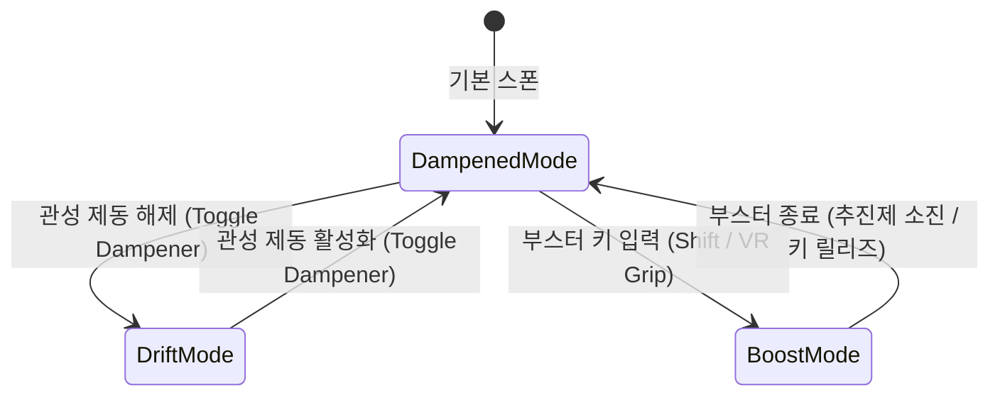

# Carbon Engine $\times$ Space VR 심층 기술 사양서 (Deep Technical Specification)

> **[검증 상태 · 2026-08-24]** 이 문서는 github.com/carbonengine 저장소 원본 및
> `src/` 코드와 대조하여 정정되었습니다. 정정 근거와 전체 내역은
> [Carbon_Source_Audit.md](archive/Carbon_Source_Audit.md)를 참조하십시오.
> 계층 구분은 [Layer_Architecture.md](Layer_Architecture.md)를 따릅니다.

> **문서 목적**: Carbon Engine(`destiny`, `math`, `trinity`)의 물리·수학 모델에서 실제로 차용할 수 있는 부분과 Breathedge 스타일의 1인칭 무중력 우주 VR 인터랙션 메커니즘을 결합하기 위한 **엔지니어링 사양 및 수학적 명세서**

> **[정정]** 이전 판은 이 문서를 "Carbon Engine의 정밀 수학·물리 알고리즘을 결합한 초정밀 명세"로 소개했으나, 실제로 Carbon에서 검증된 차용 대상은 destiny의 1차 항력 ODE 폐쇄형 적분, trinity의 Reverse-Z 전역 상태 오버라이드, mesh의 QTangent 정점 압축 세 가지입니다. Dual Quaternion을 비롯한 나머지 항목은 Carbon 저장소에 원본이 존재하지 않으며, 이 프로젝트가 자체적으로 설계하고 검증해야 하는 부분입니다.

> **[계층 지위 · 2026-08-24 추가] 이 문서는 Layer 2 명세입니다.** 여기 적힌 무중력 비행 역학, 생존 규칙, 파편 상호작용, 우주 비주얼은 모두 Haruka 코어(Layer 1) 위에 얹는 우주 및 무중력 도메인의 사양이며 엔진의 정의가 아닙니다. Haruka는 Vulkan 기반 VR 엔진이고, 이 문서가 서술하는 것은 그 코어의 첫 번째 응용입니다. 계층 판정 기준은 [Layer_Architecture.md](Layer_Architecture.md) 2절과 3절을 따릅니다.
>
> 다만 이 문서 안에는 Layer 1에 속하는 항목이 섞여 있습니다. 감쇠 운동 적분기(§1-1), Floating Origin과 배정밀도 좌표(§2), QTangent 정점 패킹과 법선 행렬 이관(§3-3), Reverse-Z를 포함한 깊이 정책(§4)이 그렇습니다. 이들은 엔진의 자료 구조나 셰이더 계약을 바꾸므로 코어의 범용 기능으로 흡수되며, **이 문서는 그것을 소비하는 쪽입니다.** 해당 절마다 같은 취지를 다시 표시해 두었습니다.

### 이 명세를 구현하기 위한 Layer 1 선결 조건

아래 코어 기능이 먼저 있어야 이 문서의 내용을 구현할 수 있습니다. "현재 상태"는 2026-08-24에 `E:\Haruka\src`를 직접 읽어 확인한 결과입니다. 착수 순서는 [Layer_Architecture.md](Layer_Architecture.md) 6절을, 로드맵 대응은 [Roadmap.md](Roadmap.md)를 따릅니다.

| Layer 1 선결 기능 | 현재 상태 | 이 문서에서 소비하는 곳 | 로드맵 대응 |
|---|---|---|---|
| 물리 힘·임펄스·속도·레이캐스트 API와 중력 벡터 세터 | **없음.** 중력이 `PhysicsSystem.cpp:103`에 하드코딩되어 있고 세터가 없습니다 | §1-4, §5-1 | Roadmap 5-3 |
| 아날로그 축과 6DOF 컨트롤러 포즈 입력 | **없음.** `HInputSystem`이 디지털 전용입니다 | §1-2, §5-1 | Roadmap 4-7 |
| 6DOF 카메라 자세 (쿼터니언) | **없음.** `CameraComponent`가 yaw/pitch 오일러각만 씁니다 | §1-3, §5-1 | Roadmap 4-8 |
| 감쇠 운동 적분기 (dt 독립 폐쇄형) | 미구현. 코어 유틸로 도입 예정 | §1-1, §1-2 | Roadmap 6-1 |
| 깊이 규약 정책 (Reverse-Z 포함) | 미구현. 전역 렌더 상태 오버라이드 방식으로 도입 | §4 | Roadmap 6-4 |
| Floating Origin과 배정밀도 월드 좌표 **옵션** | 미구현. 기본값은 float 유지이고 옵트인입니다 | §2 | Roadmap Phase 6 후순위 후보 |
| 정점 패킹 (QTangent) | 미구현 | §3-3 | Roadmap 6-2 |
| 인스턴싱 경로 (`instanceCount`) | **막힘.** 다섯 곳에 `1`이 리터럴로 박혀 있습니다 | §1-4의 파편이 다수일 때 | Roadmap 5-2 |
| 패스 확장 지점 (패스 레지스트리) | **없음.** 새 렌더 패스를 코어 밖에서 추가할 수 없습니다 | 우주 배경과 도메인 연출 패스 | Roadmap 5-1 |

이 표의 항목이 비어 있는 자리를 도메인 쪽에서 우회하지 마십시오. 우회는 코어를 우주 전용으로 오염시키며, 우회해야 한다는 사실 자체가 코어의 확장 지점이 부족하다는 신호입니다.

---

## 1. 무중력 6DOF 비행 역학 & VR 물리 시스템 (Destiny $\rightarrow$ VR EVA)

```
                       +Y (Up / Lift)
                         ^
                         |   +Z (Forward / Thrust)
                         |  /
                         | /
   -X (Left / Strafe) <--+--> +X (Right / Strafe)
                        /|
                       / |
                     -Z  v -Y (Down)
                   (Back)

   [3축 회전 자유도]
   • Pitch (X축 회전)  • Yaw (Y축 회전)  • Roll (Z축 회전)
```

---

### 1-1. 지수 감쇠 관성 및 6DOF 추진 물리 (Viscous Fluid Mechanics)

> **[계층 · Layer 1 유틸 + Layer 2 파라미터]** 아래 2)가 서술하는 폐쇄형 감쇠 적분기 자체는 **Layer 1 코어 기능이며 이 문서는 그것을 소비합니다.** 델타타임에 독립적인 적분은 부드러운 감속이 필요한 모든 제어에 유용하므로 우주 전용이 아닙니다. 이 문서가 소유하는 것은 우주복 질량, RCS 추력, 시정수 같은 **파라미터**뿐입니다. 코어 도입 항목은 [Roadmap.md](Roadmap.md) 6-1이고, 판정 근거는 [Layer_Architecture.md](Layer_Architecture.md) 3절입니다.

Carbon Engine의 `destiny` 물리 모델을 1인칭 우주복(EVA 수트)의 RCS(Reaction Control System) 추진기에 적용합니다.

#### 1) 핵심 물리 파라미터 정의

> **[정정] 이 표의 수치는 Carbon에서 차용한 값이 아닙니다.** 이전 판은 이 값들을 "권장 표준값"으로 제시하여 destiny에서 유래한 검증된 상수처럼 읽히게 했으나, 표의 어떤 항목도 carbonengine 저장소에 존재하지 않습니다. 이 표는 **이 프로젝트가 스스로 정해야 할 설계 목표값**이며, 실제 플레이 감각에 맞추어 튜닝해야 합니다.

> **[정정] 표가 자기 수식과 맞지 않습니다.** $\vec{F}_{\text{RCS}} = (300, 300, 500)$, $m = 200$, $\tau = 1.15$를 표에 적힌 $v_{\max} = \frac{\|\vec{F}_{\text{RCS}}\|}{m} \cdot \tau$에 대입하면 $\|\vec{F}\| \approx 655.7\,\text{N}$이므로 $v_{\max} \approx 3.8\,\text{m/s}$가 나옵니다. 표에 적힌 $8.0 \sim 15.0\,\text{m/s}$와 일치하지 않습니다. 세 값 중 최소 하나를 재튜닝해야 하며, 아래 3)에서 설명하는 역산 방식으로 저작하면 이 종류의 불일치가 구조적으로 발생하지 않습니다.

| 기호 | 파라미터명 | 기본 단위 | 설계 목표값 (튜닝 대상, Carbon 차용 아님) | 비고 |
|---|---|---|---|---|
| $m$ | 우주복 + 착용자 질량 | $\text{kg}$ | $150.0 \sim 250.0$ | 우주복 $100\text{kg}$ + 인체 $80\text{kg}$ 가정 |
| $A$ | 기민도 계수 (Agility, 무차원) | 없음 | 미정 (튜닝 필요) | 값이 클수록 묵직하고 느리게 반응 |
| $k$ | 항력 계수 (Friction) | $\text{kg/s}$ | 미정 (튜닝 필요) | destiny에서는 park 전역 스칼라 |
| $\tau$ | **1차 시정수 (Time Constant)** | $\text{s}$ | $\mathbf{0.8} \sim \mathbf{1.5}$ | $\tau = \frac{m \cdot A}{k}$ |
| $\vec{F}_{\text{RCS}}$ | RCS 추진기 최대 추력 벡터 | $\text{N}$ | $(\pm 300, \pm 300, \pm 500)$ | 전/후 추력이 횡/수직보다 강함 |
| $v_{\max}$ | 추진기 가동 시 최고 속력 | $\text{m/s}$ | $8.0 \sim 15.0$ (위 불일치 참조) | $v_{\max} = \frac{\|\vec{F}_{\text{RCS}}\|}{m} \cdot \tau$ |
| $\alpha_{\max}$ | 자세 제어 최대 각가속도 | $\text{rad/s}^2$ | $1.5 \sim 3.0$ | 멀미 방지를 위한 상한선 |
| $\omega_{\max}$ | 자세 제어 최대 각속도 | $\text{rad/s}$ | $1.0 \sim 2.0$ ($\approx 60^\circ \sim 115^\circ/\text{s}$) | VR 시각적 안전 한계 |

> **[정정] $\tau$의 단위 표기가 틀렸습니다.** 이전 판은 관성 보정 계수 $I$의 단위를 $10^{-6}\text{s/kg}$로 적고 $\tau = \frac{m \cdot I}{10^6}$이라고 썼으나, destiny의 실제 정의는 `tau = mMass * mAgility / mFriction`입니다. `mAgility`는 질량에 곱해지는 **무차원 계수**이고, $10^6$이라는 크기는 기민도가 아니라 **항력 계수 `mFriction`(단위 $\text{kg/s}$)** 쪽에 있습니다. `mFriction`은 하드코딩된 정규화 상수가 아니라 `Ballpark`의 변경 가능한 멤버이며 `Ballpark.cpp:100`에서 `1000000.0`으로 초기화되고 Python에 "friction, 우주의 마찰 계수"로 노출됩니다. 즉 항력 계수는 그 자체로 튜닝 대상입니다. 또한 엔진은 $\tau$를 저장하지 않고 `mTimeFactor = exp(-mFriction * dt / (mMass * mAgility))`를 저장합니다.

> **각주: 저장소에 실재하는 유일한 파라미터 세트.** `python/destiny/test/helpers.py:207`에 mass $13{,}000{,}000\,\text{kg}$, Agility $0.9$, maxVelocity $10.0\,\text{m/s}$, radius $2.0\,\text{m}$, speedFraction $0.95$가 있으며 이때 $\tau = 11.7\,\text{s}$입니다(저장소 자체 골든 테스트로 $11.6999996900558\,\text{s}$까지 검증됨). 이 값은 우주선 규모를 상정한 것이므로 우주복 규모의 값으로 그대로 옮길 수 없습니다. 참고 가능한 것은 수치가 아니라 **모델의 형태**뿐입니다.

---

#### 2) 선형 운동 미분방정식 및 해석적 적분 해 (Analytical Solution)

입력 추력 $\vec{F}_{\text{thrust}}(t)$에 대한 목표 평형 속도 $\vec{v}_{\text{target}}$:
$$\vec{v}_{\text{target}} = \frac{\vec{F}_{\text{thrust}}}{m} \cdot \tau$$

프레임 델타타임 $\Delta t$ 동안의 정확한 해석적 속도 및 위치 적분식 (오일러 근사 대신 엄밀해 사용):

$$\vec{v}(t + \Delta t) = \vec{v}_{\text{target}} + \left(\vec{v}(t) - \vec{v}_{\text{target}}\right) e^{-\Delta t / \tau}$$

$$\vec{x}(t + \Delta t) = \vec{x}(t) + \vec{v}_{\text{target}} \Delta t + \left(\vec{v}(t) - \vec{v}_{\text{target}}\right) \tau \left(1 - e^{-\Delta t / \tau}\right)$$

> **수학적 이점**: 가변 프레임레이트($\Delta t$) 환경에서도 수치적 발산이나 오차 누적이 전혀 없이 결정론적(Deterministic) 궤적을 보장합니다.

> **[검증됨] 이 절의 수식은 원본과 대조하여 옳은 것으로 확인되었습니다.** 위 두 식은 destiny의 `Ballpark::Integrate`와 대수적으로 동일합니다. 이것은 1차 선형 항력 ODE $m\frac{d\vec{v}}{dt} = \vec{F} - k\vec{v}$의 표준 폐쇄형 해이며, destiny도 오일러나 RK4가 아니라 이 폐쇄형을 1초 틱으로 적용합니다. destiny가 이 방식을 택한 이유도 같습니다: 임의의 시각으로 결정론적 재시뮬레이션이 가능해야 하기 때문입니다. destiny 저장소는 이 성질을 하드코딩된 골든 float 궤적 약 6,100줄의 Python 회귀 테스트로 검증합니다. 저장소에는 이 해를 오일러 근사와 나란히 유도한 Maple 워크시트 `Equations.mws`도 포함되어 있습니다.
>
> 다만 한 가지는 주의해야 합니다. destiny는 이 폐쇄형 덕분에 **1초라는 긴 틱**을 쓸 수 있지만, VR은 렌더 프레임마다 자세를 갱신해야 하므로 틱 길이를 그대로 가져올 수 없습니다. 가져와야 할 것은 틱 길이가 아니라 "$\Delta t$가 얼마든 정확하다"는 폐쇄형의 성질입니다.

---

#### 3) 저작 방향에 대한 권고: 추력이 아니라 최고 속력을 입력으로 삼습니다

destiny는 추력을 입력으로 받아 최고 속력을 계산하지 않습니다. **방향이 반대입니다.** `mMaxVel`이 저작 입력이고 추력을 역산합니다(`Ballpark.cpp:1408`):

$$F_{\max} = \frac{k \cdot s_{\text{frac}} \cdot v_{\max}}{m \cdot A}$$

여기서 $s_{\text{frac}}$은 speedFraction입니다. 이 방향을 권고합니다. 디자이너가 실제로 감각적으로 판단할 수 있는 값은 뉴턴 단위의 추력이 아니라 "이 수트는 최고 몇 m/s로 움직이는가"이기 때문이며, 위 1)에서 지적한 표와 수식의 불일치도 이 방향으로 저작하면 애초에 발생하지 않습니다. 즉 $m$, $A$, $k$, $v_{\max}$를 저작 값으로 두고 $\vec{F}_{\text{RCS}}$를 파생 값으로 계산합니다.

---

### 1-2. 3가지 RCS 비행 제어 모드 상태 머신



1. **관성 제동 모드 (Inertial Dampened Mode — 기본값)**:
   * 입력이 $0$일 때 $\vec{v}_{\text{target}} = \vec{0}$, $\vec{\omega}_{\text{target}} = \vec{0}$으로 설정.
   * 선형 속도와 각속도가 지수 감쇠하여 수초 내에 자연스럽게 정지 $\rightarrow$ **VR 시각-전정기관 불일치(멀미) 최소화**.
2. **무한 관성 표류 모드 (Decoupled / Drift Mode)**:
   * 감쇠 계수 $\tau \rightarrow \infty$ (저항 $0$).
   * $\vec{a} = \frac{\vec{F}_{\text{thrust}}}{m}$ (순수 뉴턴 제2법칙). 입력 중단 시 현재 속도 $\vec{v}$와 회전 각속도 $\vec{\omega}$를 영구 보존합니다.
   * 우주선 잔해 사이를 무동력으로 스쳐 지나가는 우주 유영 연출에 사용합니다.
3. **오버클록 부스트 모드 (Boost Mode)**:
   * 산소(추진제) 소모율 $3\times$, $\vec{F}_{\text{thrust}} \times 2.5$, $\tau \times 0.6$ (급격한 가속과 빠른 제동).

> **[정정] Drift 모드는 destiny에서 가져온 것이 아니라 이 프로젝트의 발명입니다.** 이전 판은 세 모드를 모두 destiny 물리 모델의 적용인 것처럼 서술했으나, destiny에는 Drift에 해당하는 모드가 없습니다. `DSTBALLMODE` 열거형은 13개 항목이고 그중 무저항 표류에 해당하는 것이 없으며, `mFriction`이 park 전역 스칼라라서 바디별로 항력을 끌 수도 없습니다. `DSTBALL_STOP`도 댐프너가 아니라 추력을 0으로 두고 항상 켜져 있는 항력이 감속시키는 것입니다.

> **구현 힌트(destiny 코드에서 유도).** Drift를 별도 코드 경로로 만들 필요가 없습니다. destiny의 `Integrate()`에는 `if (k < 1e-10 * m * t)` 테일러 분기가 있고, 이 분기는 항력이 무시할 수준일 때 폐쇄형을 $\vec{p} \mathrel{+}= \vec{v}t + \frac{1}{2}\vec{a}t^2$으로 퇴화시킵니다. 이것이 정확히 무저항 극한입니다. 따라서 destiny와 달리 **항력 계수 $k$를 전역이 아니라 바디별 값으로 두면**, Drift 모드는 그 바디의 $k$를 0으로 설정하는 것만으로 구현되고 위 테일러 분기가 자동으로 선택됩니다. 지수 감쇠 경로와 무저항 경로를 한 코드 경로가 처리하므로 두 모드 사이에 속도 불연속이 생기지 않습니다.

---

### 1-3. VR 멀미(VR Sickness) 억제 수학 메커니즘

1. **동적 시야각 비네팅 (Dynamic FOV Tunneling)**:
   * 각가속도 $\alpha = \|\frac{d\vec{\omega}}{dt}\|$ 및 횡방향 가속도 $a_{\text{lateral}} = \|\vec{a} - (\vec{a} \cdot \hat{f})\hat{f}\|$에 비례하여 주변부 렌더링 컷오프 반경 $R_{\text{vignette}}$ 축소:
   $$R_{\text{vignette}} = \text{clamp}\left(1.0 - \left(k_\omega \|\vec{\omega}\| + k_\alpha \|\alpha\| + k_a \|a_{\text{lateral}}\|\right), 0.35, 1.0\right)$$
2. **독립 머리 회전 분리 (Decoupled Head & Body Orientation)**:
   * 우주복 몸체 쿼터니언 $\mathbf{q}_{\text{body}}$와 HMD 머리 쿼터니언 $\mathbf{q}_{\text{head}}$를 분리.
   * 몸체 회전은 스틱 조작으로만 천천히 회전하고, HMD는 $0\text{ms}$ 즉각 반영합니다.

> **[검증됨] "HMD는 0ms 즉각 반영"이라는 서술은 옳습니다.** HMD 자세에는 어떤 형태의 시간적 평활화도 적용하면 안 됩니다. 머리를 돌렸을 때 화면이 한 프레임이라도 뒤처지면 그것이 곧 시각과 전정기관의 불일치이며 멀미의 직접 원인이 됩니다. 평활화가 필요한 것은 몸체 자세 $\mathbf{q}_{\text{body}}$뿐입니다.
>
> **각주:** [VR_Transition_Masterplan.md](VR_Transition_Masterplan.md) §2-1도 같은 결론에 도달했습니다. 이전 판은 그 문서가 HMD 시선 회전에 Slerp를 적용하라고 적고 있었으나, 같은 검증 과정에서 정정되어 현재는 **Slerp를 우주복 몸체(아바타) 자세에만 쓰고 HMD 자세에는 쓰지 않는다**고 명시합니다. 두 문서가 어긋나지 않습니다. HMD에 Slerp를 걸면 헤드 트래킹에 인위적 지연이 생기고, Quest 런타임이 스캔아웃 시점에 재투영하므로 뒤처진 자세는 부드러움이 아니라 저더로 나타납니다.

---

### 1-4. 우주 파편 상호작용 및 뉴턴 제3법칙 반작용 물리

1. **무중력 그랩 & 견인 (Tractor / Spring Grab)**:
   * 댐핑 스프링 힘: $\vec{F}_{\text{grab}} = -k_{\text{spring}} (\vec{P}_{\text{debris}} - \vec{P}_{\text{target}}) - c_{\text{damper}} (\vec{v}_{\text{debris}} - \vec{v}_{\text{player}})$
2. **뉴턴 제3법칙 질량 반작용 (Newton's 3rd Law Feedback)**:
   * 플레이어가 거대 우주선 잔해($M = 50,000\text{kg}$)를 손으로 밀었을 때:
     $$\vec{a}_{\text{debris}} = \frac{\vec{F}_{\text{push}}}{M} \approx \vec{0}, \quad \vec{a}_{\text{player}} = -\frac{\vec{F}_{\text{push}}}{m_{\text{player}}}$$
   * **결과**: 거대 잔해는 거의 안 움직이고 플레이어가 반대 방향으로 튕겨 나가는 우주 특유의 물리 연출이 나옵니다.

> **[검증됨] 이 절의 개념은 유효합니다.** 스프링 그랩과 질량비 반작용은 물리적으로 타당하며 Carbon과 무관하게 성립합니다.

> **[정정] 다만 destiny의 충돌 응답은 가져오면 안 됩니다.** 이전 판은 이 절을 destiny 물리의 연장선으로 읽히게 두었으나, destiny의 충돌 응답은 VR 접촉 인터랙션에 쓸 수 있는 모델이 아닙니다. destiny는 관통 깊이에서 유도한 가속도를 접촉 법선 방향으로만 주고 0.85로 감쇠시킨 뒤 항력 적분기에 넣습니다. **접선 미끄러짐이 없고 반발 계수도 없습니다.** 설계 주석 자체가 "The ball senses other balls as solids which cannot be traversed, so any movement of the balls will avoid each other or be stuck"라고 적고 있고, `Ballpark.cpp`에는 "EEEEK! ball heading for infinite recursion into ball"라는 에러 로깅이 있습니다. 즉 **끼임이 문서화된 실패 모드**입니다. 손으로 잔해를 밀고 표면을 따라 미끄러지는 인터랙션은 이 모델로 만들 수 없습니다.

> **권고: 접촉과 충돌 응답은 Jolt에 맡깁니다.** destiny에서 가져올 것은 항력 적분과 결정론적 폐쇄형뿐이고, 접촉 매니폴드, 마찰, 반발은 Jolt의 것을 씁니다.

> **[선결 조건] Haruka의 현재 `PhysicsSystem`으로는 이 절을 구현할 수 없습니다.** `PhysicsSystem`에는 **힘, 임펄스, 속도, 레이캐스트 API가 하나도 없습니다.** 중력은 `PhysicsSystem.cpp:103`에서 `JPH::Vec3(0.f, -9.81f, 0.f)`로 하드코딩되어 있고 세터도 없으므로 무중력 환경 자체를 아직 표현할 수 없습니다. 게다가 동기화 루프(`PhysicsSystem.cpp:232-238`)가 매 프레임 Dynamic 바디의 Actor 트랜스폼을 덮어쓰므로, 그랩 중에 게임플레이 코드가 위치를 조정하는 방식도 그대로는 동작하지 않습니다. 따라서 이 명세를 구현하기 전에 **Layer 1 배관이 먼저 필요합니다**: 중력 벡터 세터, `AddForce` / `AddImpulse` / `SetLinearVelocity` / `SetAngularVelocity` 노출, 레이캐스트와 셰이프캐스트 질의, 그리고 물리와 Actor 트랜스폼 사이의 소유권 규칙 정리입니다.

---

## 2. 대규모 우주 공간 좌표계 & Floating Origin 수학

> **[계층 · Layer 1]** 이 장이 다루는 Floating Origin과 배정밀도 월드 좌표는 **Layer 1 코어 기능(옵션)이며 이 문서는 그것을 소비합니다.** `Transform`과 `World`의 자료형을 바꾸는 변경이고, 대규모 씬은 우주 전용 문제가 아니기 때문입니다. 기본값은 float 유지이고 옵트인입니다. 좌표 정밀도 정책의 소유자는 코어이며, 이 문서는 우주 규모에서 그 정책이 어떤 결과를 내는지만 정리합니다. 판정 근거는 [Layer_Architecture.md](Layer_Architecture.md) 3절입니다.

```
[64-bit Solar System World Space (dvec3)]
Origin (0, 0, 0)
   |-------------------- 100,000,000 km --------------------> [Space Station (dvec3)]
                                                                  |
                                      [Camera Position (dvec3)]   |
                                                 o <--------------+ (P_world - P_cam)
                                                 |
                                     [GPU 32-bit Float Space]
                                     Camera is at (0, 0, 0)
                                     Max float error < 0.0001 mm!
```

---

### 2-1. 부동소수점 정밀도 한계 및 Floating Origin 유도

* **32-bit Float 정밀도 문제**:
  * 가수부(Mantissa) 23비트 $\rightarrow$ 유효숫자 약 7자리 ($2^{-23} \approx 1.19 \times 10^{-7}$).
  * 원점에서 $100\text{km}$ ($10^5\text{m}$)만 떨어져도 정밀도 오차는 $\approx 1.2\text{cm}$ $\rightarrow$ **VR 손/도구의 심각한 떨림(Jittering) 발생**.
* **64-bit Double 정밀도**:
  * 가수부 52비트 $\rightarrow$ 유효숫자 약 16자리 ($2^{-52} \approx 2.22 \times 10^{-16}$).
  * 원점에서 $1\text{AU}$ ($1.5 \times 10^{11}\text{m}$) 떨어져도 오차는 $\approx 0.03\mu\text{m}$ (마이크로미터 이하).

#### 렌더링 상대 변환 행렬 유도
월드 상의 64-bit 액터 위치 $\vec{P}_{\text{actor}} \in \mathbb{R}^3$, 64-bit 카메라 위치 $\vec{P}_{\text{cam}} \in \mathbb{R}^3$:
$$\vec{P}_{\text{relative}} = \text{vec3}\left(\vec{P}_{\text{actor}} - \vec{P}_{\text{cam}}\right)$$
$$\mathbf{M}_{\text{relative}} = \begin{bmatrix} 
\mathbf{R}_{3\times 3} \mathbf{S}_{3\times 3} & \vec{P}_{\text{relative}} \\ 
\mathbf{0}_{1\times 3} & 1 
\end{bmatrix}$$
$$\text{gl\_Position} = \mathbf{V}_{\text{cam0}} \cdot \mathbf{M}_{\text{relative}} \cdot \vec{v}_{\text{in}}$$
*(여기서 $\mathbf{V}_{\text{cam0}}$은 카메라 위치가 $(0,0,0)$인 순수 회전 View 행렬)*

> **[검증됨] 위 수학 자체는 옳습니다.** float32 정밀도 계산과 상대 변환 행렬 유도에 오류가 없습니다.

> **[정정] 그러나 destiny의 실제 방식은 이것이 아닙니다.** 이전 판은 이 방식을 Carbon의 Floating Origin 구현인 것처럼 서술했으나, **destiny는 시뮬레이션을 재기준화하지 않습니다.** 위치는 한 `Ballpark`(즉 한 성계) 안에서 절대 double로 유지되며, "모든 오브젝트에서 카메라 위치를 뺀다"는 단계가 destiny에는 존재하지 않습니다. destiny가 노출하는 것은 두 가지입니다: `IEveReferencePoint::GetReferencePoint`(플레이어 ego ball의 절대 위치)와 `IEveBallpark::Delta`(ego ball의 틱당 이동량, `AsVector3()`로 float 축소). 렌더러가 자기 float 원점을 유지하면서 델타만큼 밀어 주는 **증분식(incremental) floating origin**입니다. 또한 destiny의 좌표 타입은 glm이 아니라 자체 `Vector3d`(`src/Vector3d.h`, double x, y, z)입니다.

> **[규모 검토] Haruka 규모에서는 매 프레임 재기준화 기계장치가 당장 필요하지 않습니다.** 이 문서의 다이어그램은 $10^8\,\text{km}$ 규모의 성계를 상정하지만, 실제 타깃 콘텐츠는 수 km 규모의 난파선입니다. float32는 $10\,\text{km}$ 지점에서 약 $1\,\text{mm}$ 정밀도를 가지므로, VR 손과 도구의 떨림 문제가 이 규모에서는 발생하지 않습니다. 따라서 double 월드 좌표와 매 프레임 재기준화를 지금 도입하는 것은 얻는 것 없이 코드 전체를 오염시키는 선택이 됩니다. 이 절은 **성계 규모로 확장할 때를 위한 예비 설계**로 남겨 두고, 그때까지는 float32 월드 좌표를 유지하는 편이 낫습니다.

> **권고: destiny의 명시적 내로잉 규율을 먼저 도입합니다.** 나중에 double 좌표를 도입하더라도, destiny의 규율만은 지금부터 따를 가치가 있습니다. destiny는 float에서 double로의 확장은 암시적으로 허용하되 **double에서 float로의 축소에는 반드시 명시적 `AsVector3()` 호출을 요구합니다.** 정밀도를 잃는 지점이 코드에 전부 눈으로 보이게 되므로, 어디서 정밀도가 사라졌는지 추적할 수 없는 사태를 막습니다. 암시적 축소를 허용하는 순간 이 종류의 버그는 사실상 찾을 수 없게 됩니다.

> **[선결 조건] Jolt의 `JPH_DOUBLE_PRECISION`이 켜져 있지 않습니다.** `CMakeLists.txt:56-68`에서 설정되지 않으므로, 렌더링 측에서 double 월드 좌표를 도입하더라도 물리 측은 여전히 float32 좌표로 시뮬레이션합니다. 렌더러만 double로 바꾸면 물리와 렌더의 좌표계가 갈라지므로, 도입한다면 양쪽을 함께 결정해야 합니다.

---

## 3. Dual Quaternion 트랜스폼 및 셰이더 압축 사양

> **[정정] 이 장의 전제가 여러 겹으로 틀렸습니다.** 이전 판은 Dual Quaternion을 "Carbon Engine의 핵심 기술"로 제시하고 4x4 행렬 64바이트 대비 32바이트로 **50% 절감**한다고 주장했습니다. 네 가지가 잘못되었습니다.
>
> 1. **Carbon에 원본이 없습니다.** `carbonengine/math`의 include와 src 어디에도 Dual Quaternion 타입, 파일, 함수가 존재하지 않습니다. `Quaternion`은 float x, y, z, w 네 멤버(16바이트)이고 함수는 `IdentityQuaternion`, `LengthSq`, `Length`, `Normalize`, `Inverse`, `Conjugate`, `Exp`, `Dot`, `RotationQuaternion` 3종, `Slerp`, `GetAxisAngle`뿐입니다. destiny에도 없으며 `src/Quaternion.h`에 double 쿼터니언 `QuaternionD`만 있습니다. `carbonengine/mesh`의 스키닝도 Dual Quaternion 스키닝이 아니라 **선형 블렌드 스키닝(LBS)**입니다(`geometryprepass.comp:475-478`이 4개 `mat4x4` 본 행렬의 가중합을 계산하며, 저장소 전체에 `dualquat` 검색 결과가 0건입니다).
> 2. **비교 기준이 틀렸습니다.** 강체 변환과 스케일을 담는 데 `mat4`(64바이트)가 필요하지 않습니다. 마지막 행은 항상 $(0,0,0,1)$이므로 `mat3x4` 48바이트면 충분합니다. 따라서 정직한 비교는 64 대 32가 아니라 **48 대 32이고 절감은 50%가 아니라 33%**입니다.
> 3. **스케일을 표현할 수 없습니다.** Dual Quaternion은 강체 변환(회전과 이동)만 담습니다. 비균일 스케일은 물론이고 균일 스케일도 담기지 않으므로 별도 필드가 필요하며, 그 필드를 더하는 순간 33%의 절감마저 줄어듭니다. 더 심각한 문제는 `Renderer_render.cpp:234-237`이 **모델 행렬의 열 길이에서 스케일을 추출해 컬링 반경을 계산한다**는 점입니다. 트랜스폼을 Dual Quaternion으로 바꾸면 이 값이 항상 1.0이 되어 컬링이 조용히 깨집니다.
> 4. **대역폭 논거 자체가 성립하지 않습니다.** Haruka의 드로 상한은 `kMaxDraws = 1024`(`RenderTypes.hpp:12`)이므로, 트랜스폼 버퍼의 실제 크기는 $1024 \times 64\text{B} = 64\text{KB}$이며 이는 프레임당 값입니다. 여기서 32KB를 아끼는 것은 어떤 GPU에서도 측정 가능한 이득이 아닙니다. 대역폭을 이야기하려면 **드로 수가 아니라 정점 수에 비례하는 데이터**를 봐야 합니다.

> **결론: Dual Quaternion 도입을 권고하지 않습니다.** 아래 3-1과 3-2의 수학은 Dual Quaternion 자체의 표준 정의로서는 정확하지만, Haruka에 도입할 근거가 되지 못합니다. 절감 폭이 33%에 그치고, 대상 버퍼가 64KB에 불과하며, 스케일을 잃고, 기존 컬링 코드를 깨뜨리기 때문입니다. 참고 자료로만 남깁니다. 실제 대역폭 이득이 있는 곳은 아래 3-3에 정리합니다.

```
[강체 4x4 Matrix: 64 Bytes — 단, 마지막 행은 항상 (0,0,0,1)]
[ m00 m01 m02 m03 ]
[ m10 m11 m12 m13 ]  --> 실질 정보는 48B
[ m20 m21 m22 m23 ]
[  0   0   0   1  ]  <-- 저장할 필요 없음

[정직한 비교 대상: mat3x4 = 48 Bytes]
[Dual Quaternion: 32 Bytes → 48 대비 33% 절감, 단 스케일 표현 불가]
[ Real Quaternion:   qr.x, qr.y, qr.z, qr.w ] (회전: 16B)
[ Dual Quaternion:   qd.x, qd.y, qd.z, qd.w ] (이동: 16B)

[대상 버퍼 실제 크기: kMaxDraws(1024) x 64B = 64KB / 프레임]
```

---

### 3-1. Dual Quaternion 수학적 정의 및 변환 수식

회전 쿼터니언 $\mathbf{q}_r = (x, y, z, w)$ (단위 사원수, $\|\mathbf{q}_r\| = 1$), 이동 벡터 $\vec{t} = (t_x, t_y, t_z)$:

1. **Dual Quaternion 인코딩 ($\mathbf{q}_r, \vec{t} \rightarrow \hat{\mathbf{q}}$)**:
   $$\mathbf{q}_d = \frac{1}{2} \mathbf{t}_{\text{quat}} \otimes \mathbf{q}_r \quad \left(\text{단, } \mathbf{t}_{\text{quat}} = (t_x, t_y, t_z, 0)\right)$$
   $$\hat{\mathbf{q}} = \mathbf{q}_r + \epsilon \mathbf{q}_d \quad (\epsilon^2 = 0)$$

2. **Dual Quaternion 디코딩 ($\hat{\mathbf{q}} \rightarrow \mathbf{q}_r, \vec{t}$)**:
   $$\mathbf{q}_r = \text{normalize}(\hat{\mathbf{q}}.\text{real})$$
   $$\mathbf{t}_{\text{quat}} = 2 \cdot \left(\hat{\mathbf{q}}.\text{dual} \otimes \mathbf{q}_r^*\right) \implies \vec{t} = (\mathbf{t}_{\text{quat}}.x, \mathbf{t}_{\text{quat}}.y, \mathbf{t}_{\text{quat}}.z)$$

---

### 3-2. GPU GLSL 버텍스 셰이더 내 직접 정점 변환 공식

행렬로 복원하지 않고 정점 $\vec{p}$를 Dual Quaternion으로 직접 회전+이동 변환:
$$\vec{p}' = \vec{p} + 2 \cdot \vec{q}_r \times \left(\vec{q}_r \times \vec{p} + q_r.w \vec{p}\right) + \vec{t}$$

```glsl
// GLSL Dual Quaternion 직접 변환 함수
vec3 transformDQ(vec4 qr, vec4 qd, vec3 p) {
    // 1. 이동 벡터 복원
    vec4 tQuat = 2.0 * quatMul(qd, vec4(-qr.xyz, qr.w));
    vec3 t = tQuat.xyz;
    
    // 2. 쿼터니언 회전 적용 (Rodriguez formula 최적화)
    vec3 t2 = 2.0 * cross(qr.xyz, p);
    vec3 rotated = p + qr.w * t2 + cross(qr.xyz, t2);
    
    // 3. 평행이동 결합
    return rotated + t;
}
```

*(위 3-1과 3-2는 Dual Quaternion의 표준 정의로서 정확하지만, 위 [정정]에서 밝힌 이유로 Haruka에 도입하지 않습니다. 참고용으로 보존합니다.)*

---

### 3-3. 실제 대역폭 이득이 있는 두 지점

> **[계층 · Layer 1]** 이 절의 두 항목은 모두 **Layer 1 코어 기능이며 이 문서는 그것을 소비합니다.** QTangent 정점 패킹은 `Vertex.hpp`와 모든 정점 셰이더의 계약을 바꾸고, 정점당 법선 행렬 제거는 `GpuTransform` 레이아웃을 바꾸기 때문입니다. 정점 대역폭 절감은 장르와 무관한 이득이므로 우주 전용 기능으로 취급하지 않습니다. 코어 도입 항목은 [Roadmap.md](Roadmap.md) 6-2입니다.

Dual Quaternion이 노리던 이득은 프레임당 32KB였습니다. 반면 아래 두 항목은 정점 수에 비례하므로 실제로 측정 가능한 크기입니다.

#### 1) QTangent 정점 압축 (`carbonengine/mesh`에 실재하는 기법)

Haruka의 `Vertex.hpp`는 속성 4개의 **48바이트 float 레이아웃**입니다. `carbonengine/mesh`는 이 문제를 QTangent로 해결하며, 이것은 Carbon 저장소에 실제로 구현되어 있는 몇 안 되는 차용 가능 기법입니다(`include/cmf/tangents.h`, 자체 설명 "Quaternion-based compression using 16-bit signed normalized integers").

원리는 TBN 정규직교 기저를 단위 쿼터니언으로 바꾸는 것입니다. $w$ 성분은 저장하지 않고 언팩 때 복원하며, 비워진 자리에 handedness 부호를 넣습니다. 결과적으로 **`Int16Norm` 4개(8바이트)에 Normal, Tangent, Binormal 세 벡터 전부**가 들어갑니다.

mesh의 패킹된 정적 정점 레이아웃은 다음과 같습니다:

| 속성 | 포맷 | 크기 |
|---|---|---|
| Position | `Float32x3` | 12 B |
| PackedTangent (QTangent) | `Int16Normx4` | 8 B |
| TexCoord | `Float16x2` | 4 B |
| **합계** | | **24 B** |

Haruka의 48바이트를 이 24바이트 레이아웃으로 옮기면 정점 대역폭이 절반이 됩니다. 드로 하나가 수만 정점을 갖는 난파선 메시에서는 이것이 프레임당 32KB와 비교할 수 없는 크기입니다.

두 가지를 주의해야 합니다. 첫째, 이것은 **옥타헤드럴 인코딩이 아닙니다**(옥타헤드럴은 노멀 하나만 다루므로 범주가 다르며, mesh 저장소에 `octahedr` 검색 결과가 0건입니다). 둘째, mesh는 **위치를 양자화하지 않습니다.** Position은 무조건 `Float32x3`이고, v1 포맷에 scale/bias/origin/extent 필드가 없어 디코더가 복원할 방법 자체가 없습니다. 16비트 위치 양자화를 하려면 포맷을 직접 설계해야 합니다.

#### 2) 정점당 법선 행렬 계산 제거

`pbr.vert:36`이 **정점마다** `transpose(inverse(mat3(model)))`를 계산합니다. `mat3` 역행렬과 전치를 정점당 수행하는 비용은 트랜스폼 표현을 32바이트로 줄여서 얻는 이득과 자릿수가 다릅니다. 이 값은 드로마다 한 번만 바뀌므로 CPU에서 미리 계산해 트랜스폼 구조체에 넣어야 합니다.

여기서 트랜스폼 구조체 크기에 대한 결론이 뒤집힙니다. 법선 행렬을 미리 계산해 넣으면 구조체는 **작아지는 것이 아니라 커집니다**(모델 행렬 + 법선 행렬). 그럼에도 이것이 옳은 선택입니다. 프레임당 수십 KB를 더 쓰는 대신 정점당 역행렬 계산을 없애기 때문입니다. Dual Quaternion 논거가 최적화 대상을 잘못 골랐다는 것이 여기서 가장 분명하게 드러납니다.

---

## 4. 우주 스케일 렌더링: Reverse-Z & Logarithmic Depth

> **[계층 · Layer 1]** 깊이 규약은 엔진 전역 정책이므로 이 장이 다루는 Reverse-Z는 **Layer 1 코어 기능이며 이 문서는 그것을 소비합니다.** 우주가 아니어도 대규모 실내나 원거리 지형에서 필요하고, 셰이더와 파이프라인 열여덟 곳을 관통하므로 Layer 2에서 켤 수 없습니다(전체 목록은 아래 4-4). 이 문서는 정밀도 특성과 영향 범위를 정리해 둘 뿐이며, 코어 도입 항목은 [Roadmap.md](Roadmap.md) 6-4입니다. 판정 근거는 [Layer_Architecture.md](Layer_Architecture.md) 3절입니다.

---

### 4-1. 부동소수점 비트 정밀도 분포 비교

```
[Standard Vulkan Z: Near=0.0, Far=1.0]
0.0 (Near) [====== 비트 밀집 ======] 0.1 ---------- 1.0 (Far) [비트 고갈 -> Z-Fight 발생]

[Reverse-Z Vulkan: Near=1.0, Far=0.0]
1.0 (Near) ------------------------- 0.1 [====== 비트 밀집 ======] 0.0 (Far)
* 원거리 영역에 부동소수점 가수부 비트가 재배치되어 Z-Fighting이 크게 줄어듭니다.
* 단, 이 이득은 부동소수점 깊이 포맷(D32_SFLOAT)에서만 발생합니다. 아래 [정정] 참조.
```

> **[정정] "Z-Fighting 완전 박멸"과 "원거리 100만km"라는 서술이 과장입니다.** Reverse-Z는 깊이 분포를 개선하지만 정밀도를 무한히 주지 않습니다. 정량적 한계는 4-3에 정리합니다.

---

### 4-2. Reverse-Z 투영 행렬 (Infinite Far Plane Projection)

FOV $y$, 종횡비 $a = w/h$, 근평면 $z_{\text{near}}$ ($z_{\text{far}} \rightarrow \infty$):

$$\mathbf{P}_{\text{RevZ}} = \begin{bmatrix}
\frac{1}{a \cdot \tan(\text{fov}/2)} & 0 & 0 & 0 \\
0 & -\frac{1}{\tan(\text{fov}/2)} & 0 & 0 \\
0 & 0 & 0 & z_{\text{near}} \\
0 & 0 & -1 & 0
\end{bmatrix}$$

* Vulkan Depth Compare Op: `VK_COMPARE_OP_GREATER` (또는 `GREATER_OR_EQUAL`)
* Clear Depth Value: `0.0f` (기존 `1.0f`에서 반전)

> **[검증됨] 위 투영 행렬과 비교 연산자, 클리어 값은 옳습니다.** trinity도 실제로 Reverse-Z를 씁니다. `Tr2Renderer::GetReversedDepthProjectionTransform()`(`Tr2Renderer.cpp:477-483`)이 `proj._33 = -proj._33 - 1.f; proj._43 = -proj._43;`로 기존 투영을 뒤집고, 씬 전역에는 `EveSpaceSceneRenderDriver.cpp:446`의 `SetInvertedDepthTest(true)`로 적용합니다. 섀도 경로에도 "we flip near and far plane for reverse z"라는 주석이 있습니다(`EveSpaceScene.cpp:2571`, `:4129`).

> **[정정] 단, trinity는 무한 원평면을 쓰지 않습니다.** `PerspectiveFovMatrix(fov, aspect, zn, zf)`와 `PerspectiveOffCenterMatrix(l, r, b, t, zn, zf)` 모두 **유한 far를 인자로 받습니다.** 이 문서가 다른 곳에서 인용해 온 "0.1m ~ 1,000,000 km"라는 범위는 carbonengine 저장소 어디에도 없습니다. 또한 `carbonengine/math`의 `PerspectiveFovMatrix`는 표준 Z(near→0, far→1)이며 Reverse-Z가 아닙니다. Reverse-Z는 math 라이브러리가 아니라 trinity 렌더러 계층에서 만들어집니다.

---

### 4-3. 정밀도 주장의 정정과 깊이 포맷 경고

> **[정정] 이전 판의 정밀도 주장이 자릿수 단위로 틀렸습니다.** 이전 서술은 Reverse-Z 무한 원평면에서 원거리에도 서브밀리미터 정밀도가 유지되는 것처럼 읽혔으나, 실제 계산은 그렇지 않습니다. 무한 원평면 Reverse-Z에서 깊이 값은 $d = z_{\text{near}} / z$이므로, float32 깊이 버퍼의 가수부 해상도 $2^{-24}$을 대입하면 거리 해상도는 대략 $\Delta z \approx z \cdot 2^{-24}$입니다. 따라서 $z = 10^8\,\text{m}$에서 깊이 해상도는 **약 6m**이며 서브밀리미터가 아닙니다.
>
> 실용적으로 이것이 문제가 되지는 않습니다. 100,000km 떨어진 물체 사이의 6m 깊이 오차는 화면에서 구별되지 않기 때문입니다. 정정해야 하는 것은 결론이 아니라 근거입니다. "무한히 정밀하다"가 아니라 "거리에 비례해 오차가 커지되 각해상도 기준으로는 일정하다"가 옳은 서술입니다.

> **[경고] `D24_UNORM` 포맷에서는 Reverse-Z 이득이 정확히 0입니다.** Reverse-Z의 이득은 전적으로 **부동소수점 깊이 포맷의 지수부 분포**를 투영의 비선형성과 상쇄시키는 데서 나옵니다. `D24_UNORM`은 고정소수점이므로 깊이 값이 $[0, 1]$에 균일하게 분포하며, 방향을 뒤집어도 분포가 그대로 뒤집힐 뿐 정밀도 배분이 전혀 바뀌지 않습니다.
>
> **`Renderer_swap.cpp:15`의 깊이 포맷 폴백 목록에 `D24_UNORM`이 들어 있습니다.** 즉 현재 코드는 디바이스가 `D32_SFLOAT`을 주지 않으면 조용히 `D24_UNORM`으로 떨어지고, 그 경우 Reverse-Z 전환 작업 전체가 아무 이득 없이 남습니다. Reverse-Z를 도입한다면 `D32_SFLOAT`을 필수 요구로 승격하거나, 최소한 폴백이 발생했을 때 경고를 남기고 원거리 렌더링 전략을 바꾸어야 합니다.

---

### 4-4. Reverse-Z 전환의 실제 영향 범위

> **[정정] 이전 판은 Reverse-Z를 투영 행렬과 비교 연산자만 바꾸면 되는 국소 변경처럼 서술했습니다.** 실제로 Haruka에서 함께 바꾸어야 하는 지점은 **열여덟 곳입니다.** 하나라도 빠뜨리면 깊이 테스트가 조용히 반전되어 디버깅이 매우 어려워집니다. 전체 목록은 다음과 같습니다.

| 지점 | 내용 |
|---|---|
| `CameraComponent.cpp:17-18` | `glm::perspective` 후 `proj[1][1] *= -1` |
| `GeometryPass.cpp:89` | 깊이 비교 `LESS_OR_EQUAL` |
| `GeometryPass.cpp:331` | 깊이 비교 `LESS` |
| `GeometryPass.cpp:477` | 깊이 클리어 `1.0f` |
| `ShadowPass.cpp:121` | 깊이 비교 `LESS` |
| `ShadowPass.cpp:154` | 깊이 클리어 `1.0f` |
| `ShadowPass.cpp:26` | 섀도 샘플러 `compareOp` `GREATER_OR_EQUAL` |
| `ShadowPass.cpp:106-108` | `depthBias` 상수와 기울기 인자, **부호를 뒤집어야 함** |
| `ShadowPass.cpp:24` | `borderColor` |
| `linDepth.frag:17` | 깊이 선형화 식 |
| `pbr.frag:72`, `:74` | `proj.z > 1.0` 판정과 `proj.z -= 0.003` 바이어스 |
| `cull.comp:32-33` | Gribb-Hartmann 근/원 평면 행 |
| `Renderer_render.cpp:86-87` | 위 컬링 로직의 CPU 사본 |
| `Renderer_render.cpp:181` | 섀도 ortho 투영 |
| `EditorApp.cpp:1477-1478` | 피킹의 NDC z 리터럴 `0.f`와 `1.f` |
| `ssao.frag:19` | 하드코딩 NDC `z=1.0` (현재는 우연히 안전) |
| `Renderer_swap.cpp:15` | 깊이 포맷 폴백 목록에 `D24_UNORM` 포함 (4-3 경고 참조) |
| `post.vert:7`, `ui.vert:19` | NDC `z=0.0` (현재는 깊이 테스트가 꺼져 있어 잠복) |

> **권고: trinity처럼 전역 렌더 상태 오버라이드로 처리합니다.** trinity가 Reverse-Z를 켜는 방식의 핵심은 투영 행렬이 아니라 **`Tr2EffectStateManager::SetInvertedDepthTest`라는 전역 렌더 상태 오버라이드 테이블**입니다. 각 깊이 비교 함수를 대응하는 반전 함수로 매핑하는 배열을 두고, 플래그 하나로 파이프라인 생성 시점에 일괄 변환합니다.
>
> 위 표에서 `GeometryPass`, `ShadowPass`의 비교 연산자와 클리어 값처럼 **기계적으로 대응되는 항목들은 이 방식으로 한 곳에 모을 수 있습니다.** 그러면 각 패스가 개별적으로 `LESS`와 `GREATER`를 알 필요가 없어지고, 새 패스를 추가할 때 반전을 빠뜨리는 사고도 구조적으로 막힙니다. 셰이더 안의 NDC 리터럴과 `depthBias` 부호처럼 자동 변환이 불가능한 항목만 손으로 처리하면 됩니다.

---

## 5. Haruka Engine C++ 구조체 및 인터페이스 명세서

### 5-1. `ZeroGControllerComponent.hpp` 인터페이스 설계

> **[검증됨] 이 인터페이스 설계 자체는 유효합니다.** 모드 열거형, 물리 속성과 실시간 상태의 분리, 축 입력을 $[-1, 1]$로 정규화해 받는 방식은 모두 타당합니다. 아래 두 가지만 정정합니다.

> **[정정] `inertiaModifier`의 주석과 `getTimeConstant()`가 잘못된 단위 모델을 따릅니다.** §1-1의 정정에 맞추어, `inertiaModifier`(무차원 agility)와 `dragCoefficient`(단위 kg/s)를 분리하고 $\tau = \frac{m \cdot A}{k}$로 계산해야 합니다. 아래 코드의 `1e-6f` 스케일은 항력 계수를 $10^6$으로 고정한 것과 같으므로, 항력 계수를 튜닝 가능한 멤버로 승격하십시오. §1-2의 구현 힌트대로 이 멤버를 0으로 두는 것이 곧 Drift 모드가 됩니다.

> **[선결 조건] Haruka의 현재 입력 계층과 카메라로는 이 컴포넌트를 구동할 수 없습니다.**
>
> 1. **입력이 디지털 전용입니다.** `HInputSystem`은 `HInputSystem.cpp:22-42`에서 `win.isKeyDown`만 호출하며, `IWindow`(`IWindow.hpp:51-62`)에 아날로그 축도 VR 포즈도 없습니다. `setLinearThrustInput`과 `setAngularTorqueInput`이 요구하는 $[-1, 1]$ 연속 값을 공급할 경로가 아직 존재하지 않으므로, 아날로그 축과 컨트롤러 포즈를 `IWindow`에 먼저 추가해야 합니다.
> 2. **`CameraComponent`가 6DOF 자세를 표현할 수 없습니다.** `CameraComponent::viewMatrix`(`CameraComponent.cpp:6-14`)는 yaw/pitch 오일러각으로 뷰를 만들고 `owner->transform.rotation`을 **무시합니다.** 오일러 yaw/pitch에는 roll이 없으므로 무중력 6DOF 자세를 담을 수 없고, 짐벌락도 발생합니다. 또한 `worldPosition()`이 아니라 `owner->transform.position`을 쓰므로 부모 계층이 있는 액터에 붙일 수 없습니다. 이 명세의 $\mathbf{q}_{\text{body}}$와 $\mathbf{q}_{\text{head}}$ 분리(§1-3)를 구현하려면 **카메라를 쿼터니언 기반 트랜스폼으로 먼저 전환해야 합니다.**
> 3. 물리 측 선결 조건은 §1-4의 [선결 조건] 항목을 참조하십시오.

```cpp
#pragma once
#include "../core/Component.hpp"
#define GLM_FORCE_RADIANS
#include <glm/glm.hpp>
#include <glm/gtc/quaternion.hpp>

class ZeroGControllerComponent : public Component {
public:
    enum class EFlightMode { Dampened, Drift, Boost };

    // ── 수트 물리 속성 ──────────────────────────────────────────
    float mass             = 180.0f;     // 우주복+인체 질량 (kg)
    float inertiaModifier  = 6000.0f;    // 관성 계수 (10^-6 s/kg)
    glm::vec3 maxThrust    { 300.f, 300.f, 600.f }; // RCS 최대 추력 (N)
    float maxRotSpeed      = 1.5f;       // 최대 각속도 (rad/s)
    float boostMultiplier  = 2.5f;       // 부스트 추력 배율

    // ── 실시간 상태 ─────────────────────────────────────────────
    glm::vec3   linearVelocity  { 0.0f }; // m/s
    glm::vec3   angularVelocity { 0.0f }; // rad/s
    EFlightMode currentMode     = EFlightMode::Dampened;

    // ── 생존 환경 파라미터 (Breathedge) ─────────────────────────
    float oxygenLevel      = 100.0f;     // 산소 잔여량 (0~100%)
    float oxygenDepletionRate = 0.5f;    // 초당 산소 소모율 (%/s)
    float temperature      = 20.0f;      // 체온 (도)
    float radiationLevel   = 0.0f;       // 방사선 피폭량 (mSv)

    // ── 입력 인터페이스 (VR 컨트롤러 / 키보드) ─────────────────
    void setLinearThrustInput(const glm::vec3& thrustAxis); // [-1, 1] 3축
    void setAngularTorqueInput(const glm::vec3& rotAxis);   // [-1, 1] 3축
    void toggleDampener() {
        currentMode = (currentMode == EFlightMode::Dampened) ? EFlightMode::Drift : EFlightMode::Dampened;
    }
    void setBoost(bool active) {
        if (active && oxygenLevel > 5.0f) currentMode = EFlightMode::Boost;
        else if (currentMode == EFlightMode::Boost) currentMode = EFlightMode::Dampened;
    }

    void tick(float dt) override;
    const char* typeName() const override { return "ZeroGControllerComponent"; }

private:
    float getTimeConstant() const { return (mass * inertiaModifier) * 1e-6f; }
};
```

---

### 5-2. `GpuTransform` 메모리 레이아웃 명세

> **[정정] 이 절이 제안하던 `GpuDualQuatTransform`은 채택하지 않습니다.** 이전 판은 이 구조체를 Haruka의 `GpuTransform` 대체안으로 제시했으나, §3의 [정정]에서 밝힌 대로 절감 폭이 33%에 그치고 대상 버퍼가 프레임당 64KB에 불과하며 스케일을 표현할 수 없습니다. 특히 `Renderer_render.cpp:234-237`이 모델 행렬의 열 길이에서 스케일을 추출해 컬링에 쓰므로, 이 구조체로 바꾸면 스케일이 항상 1.0이 되어 컬링이 조용히 깨집니다. 참고를 위해 원안을 남겨 둡니다.

```cpp
// [미채택] 32-Byte Packed Dual Quaternion Structure for GPU SSBO
struct alignas(16) GpuDualQuatTransform {
    glm::vec4 realQuat; // Rotation (qx, qy, qz, qw) - 16 Bytes
    glm::vec4 dualQuat; // Translation encoded (dx, dy, dz, dw) - 16 Bytes
};
static_assert(sizeof(GpuDualQuatTransform) == 32, "GpuDualQuatTransform must be 32 bytes");
```

**대신 권고하는 방향**은 구조체를 줄이는 것이 아니라 **정점당 계산을 옮겨 담는 것**입니다(§3-3 참조). 현재 `GpuTransform`(`RenderTypes.hpp:27-29`)은 `glm::mat4 model` 하나뿐이고, `pbr.vert:36`이 정점마다 `transpose(inverse(mat3(model)))`를 계산합니다. 이 법선 행렬을 CPU에서 미리 계산해 구조체에 추가하면 구조체는 **커지지만** 정점당 역행렬 계산이 사라집니다. 프레임당 수십 KB를 더 쓰는 대신 정점 수에 비례하는 비용을 없애는 교환이므로 이쪽이 유리합니다.

> **부수 과제:** `GpuTransform`은 현재 셰이더 4곳에 중복 선언되어 있습니다(`pbr.vert:25`, `depth.vert:18`, `shadow.vert:18`, `triangle.vert:19`). 공유 GLSL include가 없기 때문입니다. 레이아웃을 바꾸기 전에 공유 include로 통합해야 하며, 이때 CMake `add_custom_command`의 `DEPENDS`에 include 파일을 추가해야 합니다. 현재는 include 파일이 `DEPENDS`에 없어서, include를 쓰기 시작하면 include 수정이 재컴파일을 유발하지 않아 낡은 SPIR-V를 배포하게 됩니다.

---

## 6. 결론 및 요약

> **[정정] 이전 판의 결론이 근거를 과대평가했습니다.** 이전 판은 이 문서를 "Carbon Engine의 핵심 기술(점성 우주 물리, Dual Quaternion, Floating Origin, Reverse-Z)을 완벽히 매핑"하고 "파라미터 표준값"을 확정한 "완벽한 청사진"으로 요약했습니다. 네 항목 중 Carbon에 원본이 확인된 것은 두 개뿐이며, 파라미터 표는 표준값이 아니라 이 프로젝트가 정할 목표값이고, 자기 수식과도 맞지 않습니다.

본 명세서는 Carbon Engine에서 실제로 차용 가능한 기법과 이 프로젝트가 자체적으로 설계해야 하는 부분을 구분하여, Breathedge 스타일의 1인칭 무중력 우주 VR 환경을 위한 설계 방향을 정리한 문서입니다.

### 6-1. 출처별 정리

| 항목 | Carbon 원본 | 판정 |
|---|---|---|
| 1차 항력 ODE 폐쇄형 적분 (§1-1) | destiny `Ballpark::Integrate` | **차용 가능.** 수식이 대수적으로 동일하며 검증됨 |
| 최고 속력을 입력으로 삼는 저작 방향 (§1-1) | destiny `Ballpark.cpp:1408` | **차용 권고** |
| Drift 모드 (§1-2) | 없음 | **이 프로젝트의 발명.** 단, 무저항 극한을 처리하는 테일러 분기는 destiny 코드에서 유도 가능 |
| VR 멀미 억제 (§1-3) | 없음 (trinity에 VR 지원이 전무함) | **이 프로젝트의 설계.** HMD 무지연 원칙은 유효 |
| 그랩과 반작용 (§1-4) | destiny 충돌 응답은 부적합 | **개념 유효, 구현은 Jolt.** Layer 1 배관 선행 필요 |
| Floating Origin (§2) | destiny는 증분식이며 재기준화하지 않음 | **수학은 유효하나 현 규모에서는 불필요.** 명시적 내로잉 규율만 도입 |
| Dual Quaternion (§3) | 없음 (math/destiny/mesh 전부) | **미채택.** 근거가 성립하지 않음 |
| QTangent 정점 압축 (§3-3) | `carbonengine/mesh` `include/cmf/tangents.h` | **차용 권고.** 48B → 24B, 실제 대역폭 이득 |
| Reverse-Z (§4) | trinity `Tr2Renderer.cpp:477-483` | **차용 가능.** 단 정밀도 주장 정정 필요, 영향 지점 열여덟 곳 |

### 6-2. 남은 선결 조건

이 명세를 구현하기 전에 Haruka 측에서 먼저 해결해야 하는 항목입니다.

1. `PhysicsSystem`에 힘, 임펄스, 속도, 레이캐스트 API를 노출하고 중력 벡터 세터를 추가합니다(§1-4).
2. `IWindow`와 `HInputSystem`에 아날로그 축과 VR 컨트롤러 포즈를 추가합니다(§5-1).
3. `CameraComponent`를 오일러각에서 쿼터니언 기반 트랜스폼으로 전환합니다(§5-1).
4. 셰이더의 `GpuTransform` 중복 선언 4곳을 공유 GLSL include로 통합하고, CMake `DEPENDS`에 include를 추가합니다(§5-2).
5. Reverse-Z를 도입한다면 `D32_SFLOAT`을 필수 요구로 승격하고, 전역 렌더 상태 오버라이드 방식을 먼저 만듭니다(§4-3, §4-4).

> **[계층 · 2026-08-24 추가]** 위 다섯 항목은 전부 **Layer 1 코어 작업이며 이 문서의 범위 밖입니다.** 착수 순서와 계층 판정은 [Layer_Architecture.md](Layer_Architecture.md) 6절을, 각 항목의 로드맵 대응은 [Roadmap.md](Roadmap.md)의 Phase 5와 Phase 6을 참조하십시오. 이 명세 자체에 해당하는 로드맵 항목은 Phase 7입니다. 서두의 선결 조건 표가 이 목록을 계층 관점에서 다시 정리한 것입니다.
