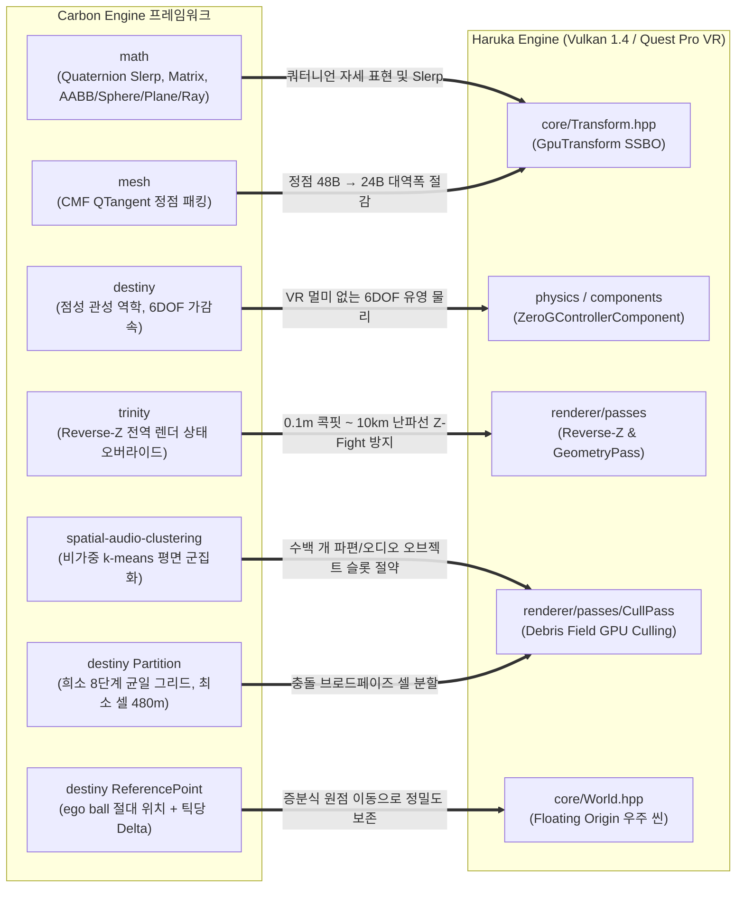
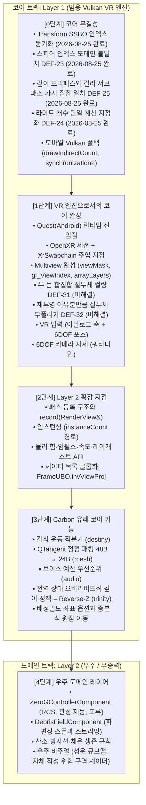

# Carbon Engine $\times$ Haruka Engine: 차용 전략 및 VR 전환 마스터 분석 보고서

> **[검증 상태 · 2026-08-24]** 이 문서는 github.com/carbonengine 저장소 원본 및
> `src/` 코드와 대조하여 정정되었습니다. 정정 근거와 전체 내역은
> [Carbon_Source_Audit.md](archive/Carbon_Source_Audit.md)를 참조하십시오.
> 계층 구분은 [Layer_Architecture.md](Layer_Architecture.md)를 따릅니다.

> **[갱신 · 2026-08-25]** **0단계-A(Transform SSBO 인덱스 동기화 수정)가 완료되었습니다.**
> 같은 날 동일 패턴의 네 번째 경로였던 스피어 인덱스 도메인 불일치(`DEF-23`)도 함께 해결되었습니다.
> 이 문서 §3과 §4와 §5의 관련 서술을 현재 상태에 맞추어 정정했습니다.

> **[갱신 · 2026-08-25 · 2차]** **깊이 프리패스와 컬러 서브패스의 가시 집합 불일치(`DEF-25`)가 해결되었습니다.**
> CPU의 `aabbInFrustum`을 제거하고 `shaders/cull.comp`와 동일한 `sphereInFrustum` 판정으로 통일했습니다.
> 그 수정 과정에서 도출된 VR 스테레오 컬링 요구사항은 `DEF-31`(두 눈 합집합 절두체, HIGH)과
> `DEF-32`(재투영 여유분만큼의 절두체 부풀리기, MEDIUM)로 신규 등재되었으며, 둘 다 **착수 시점이
> OpenXR 세션 도입 시**이므로 코어 트랙 1단계에 속합니다. 결함이 아닌 판단 기준(넓은 FOV로 인한
> 컬링 효율 저하, 시간적 재사용 기법 주의, 거리 컬링과 LOD의 구분)은 결함 ID 없이
> [Core_Stabilization_Spec.md](Core_Stabilization_Spec.md) 2-D절과
> [Core_Defects_Task_Spec.md](Core_Defects_Task_Spec.md) 10절의 **VR 컬링 설계 지침**에 있습니다.

> **엔진 정체성**: Haruka는 **Vulkan 기반 VR 엔진**입니다. 우주와 무중력 기능은 그 코어 위에 얹는 도메인 레이어이며, 첫 번째 응용이지 엔진의 정의가 아닙니다.

> **[정정] 이 문서의 전제가 바뀌었습니다.** 이전 판의 서두는 "Carbon의 우주 시뮬레이션 프레임워크를 차용하여 Haruka를 Breathedge 스타일의 우주 VR 엔진으로 진화시킨다"였고, 차용 항목 전부가 우주 프로젝트를 위한 것으로 서술되어 있었습니다. 확정된 정체성에 따라 전제를 다시 세웁니다.

### 이 문서의 구조: 차용은 두 갈래로 나뉩니다

Carbon에서 가져올 것은 하나의 목적을 갖지 않습니다. 아래 두 갈래로 갈라지며, **어느 쪽인지가 도입 순서와 소유 계층을 결정합니다.**

* **갈래 A: 코어 강화 (Layer 1).** 우주가 아닌 VR 프로젝트에서도 쓰이거나, 엔진의 자료 구조와 셰이더 계약을 바꾸는 것입니다. QTangent 정점 패킹, 감쇠 운동 적분기, 깊이 규약 정책(Reverse-Z), 배정밀도 좌표 옵션, 보이스 예산이 여기에 속합니다. 이것들은 우주 프로젝트를 걷어내도 남아야 하며, 범용 Vulkan VR 엔진의 일부로 흡수합니다.
* **갈래 B: 우주 레이어 (Layer 2).** 우주에서만 쓸모 있는 파라미터와 정책, 연출입니다. 우주복 질량과 RCS 추력 값, 파편장 셀 크기 튜닝, 위험 구역 셰이더, 생존 규칙이 여기에 속합니다. 이것들은 코어를 고치지 않고 코어의 확장 지점을 소비하는 형태로만 존재해야 합니다.

계층 판정 기준 자체는 [Layer_Architecture.md](Layer_Architecture.md) 2절과 3절을 따릅니다. 아래의 모든 차용 항목에 계층 표시를 붙였습니다.

---

## 1. 아키텍처 프레임워크 1:1 비교 및 차용 맵

> **[정정]** 이전 판의 math 노드는 "Dual Quat, SIMD, Fast Intersection"이라고 적었으나
> 세 항목이 모두 원본에 없습니다. destiny 노드의 "Bubble 반발"도 잘못이며, Bubble은
> 물리가 아니라 AOI 및 네트워크 리플리케이션 범위이고 아무것도 밀어내지 않습니다.
> "Large-World Grid (Floating Origin dvec3)"는 서로 다른 두 시스템을 한 노드로 뭉뚱그린
> 것이어서 Partition(충돌 브로드페이즈용 균일 그리드)과 ReferencePoint(ego ball 기준점)로
> 분리했습니다. trinity 노드의 "Log Depth"와 "SDF 셰이더"도 원본에 없어 제거했습니다.

### 차용 항목의 계층 판정

위 화살표들이 모두 같은 성격은 아닙니다. 아래 표가 각 항목의 소속 계층을 확정합니다. 판정 근거는 [Layer_Architecture.md](Layer_Architecture.md) 3절의 판정표와 같습니다.

| 차용 항목 | 출처 | 계층 | 판정 근거 |
|---|---|---|---|
| QTangent 정점 패킹 | `mesh` tangents.h | **Layer 1** | `Vertex.hpp`와 모든 정점 셰이더의 계약을 바꿉니다. 대역폭 이득은 장르와 무관합니다 |
| 폐쇄형 감쇠 운동 적분기 | `destiny` Ballpark::Integrate | **Layer 1 (유틸)** | dt에 독립적인 감속은 부드러운 제어가 필요한 모든 곳에 쓰입니다 |
| 우주복 질량, RCS 추력, 시정수 값 | `destiny` 파라미터 세트 | **Layer 2** | 적분기에 채워 넣는 데이터일 뿐이며 엔진 계약을 건드리지 않습니다 |
| 깊이 규약 정책 (Reverse-Z와 전역 상태 오버라이드) | `trinity` Tr2EffectStateManager | **Layer 1** | 깊이 극성은 엔진 전역 정책이고 셰이더와 파이프라인 십여 곳을 관통합니다 |
| 증분식 floating origin, 명시적 내로잉 규율 | `destiny` ReferencePoint, Vector3d | **Layer 1 (옵션)** | `Transform`과 `World`의 자료형을 바꿉니다. 대규모 씬은 우주 전용 문제가 아니므로 기본값 float 유지에 옵트인으로 둡니다 |
| 희소 균일 그리드 공간 분할 | `destiny` Partition | **Layer 1 구조 + Layer 2 셀 크기** | 브로드페이즈 분할 구조는 범용이고, 480m 셀은 성계 규모라 도메인에서 다시 잡습니다 |
| 클러스터 정체성 유지와 게인 보간 | `spatial-audio-clustering` | **Layer 1 보이스 예산 + Layer 2 정책** | 예산 관리는 코어, 파편장 특화 튜닝은 도메인입니다 |
| 복합 충돌 프록시 (MiniBall/MiniBox/MiniCapsule) | `destiny` | **Layer 1** | 충돌 메시를 상주시키지 않는 근사 기법은 장르와 무관합니다 |
| 저작 방향 역전 (최고 속도를 입력으로 추력 역산) | `destiny` GotoThrust | **Layer 1 (API 형태) + Layer 2 (값)** | 파라미터를 받는 방식은 코어 API의 설계이고 값은 도메인입니다 |
| Slerp 회전 보간 | `math` Quaternion | **Layer 1 (수학) / 적용은 Layer 2** | 함수 자체는 코어 수학이지만 적용 대상은 우주복 아바타 자세입니다. HMD 자세에는 쓰지 않습니다(2-1 참조) |
| ~~Dual Quaternion 트랜스폼~~ | 원본 부재 | **도입 보류** | Carbon에 존재하지 않고, 스케일을 표현하지 못하며, 대상 버퍼가 프레임당 64KB입니다 |
| ~~SDF 및 절차적 셰이더~~ | 원본 부재 | **차용 불가** | trinity 저장소의 셰이더 수학은 0바이트입니다. Haruka가 직접 작성해야 하며 그 결과물은 Layer 2입니다 |

---

## 2. Carbon Engine 5대 핵심 영역 심층 분석 & VR 차용 전략

### 2-1. 수학 계층 (`carbonengine/math`, `carbonengine/mesh`) $\rightarrow$ 트랜스폼 및 대역폭 최적화

> **계층: Layer 1 (코어).** 정점 레이아웃과 쿼터니언 수학은 엔진 계약이므로 코어가 소유합니다.

| Carbon Engine 기술 | 원본의 실제 내용 | Haruka VR 엔진 차용점 및 기대효과 |
|---|---|---|
| ~~**Dual Quaternion**~~ **[정정] 원본에 존재하지 않음** | `carbonengine/math`의 include/ 27개 헤더와 src/ 전체에 Dual Quaternion 타입, 파일, 함수가 없습니다. Quaternion은 `float x, y, z, w` 4개 멤버(16B, alignas 없음)이며 함수 목록은 Identity, LengthSq, Length, Normalize, Inverse, Conjugate, Exp, Dot, RotationQuaternion 3종, Slerp, GetAxisAngle뿐입니다. | 차용할 대상이 없습니다. 게다가 대역폭 논거 자체가 성립하지 않습니다: `kMaxDraws = 1024`(RenderTypes.hpp:12)이고 `GpuTransform`이 `mat4` 하나이므로 Transform SSBO 전체가 **프레임당 64KB**입니다. 이것을 절반으로 줄여도 90fps 방어에 기여하는 양이 아닙니다. |
| **QTangent 정점 패킹** (`carbonengine/mesh`, 위 행의 대체안) | TBN 정규직교 기저를 단위 쿼터니언으로 압축합니다(include/cmf/tangents.h, "Quaternion-based compression using 16-bit signed normalized integers"). w는 버리고 언팩 때 복원하며 그 자리에 handedness 부호를 넣습니다. `Int16Norm x 4 = 8바이트`에 N, T, B 세 벡터를 전부 담습니다. | 이쪽이 실재하는 대역폭 이득입니다. Haruka의 `Vertex.hpp`는 현재 속성 4개에 **48바이트**입니다. mesh의 패킹된 정적 정점 레이아웃은 Position Float32x3(12B) + PackedTangent Int16Normx4(8B) + TexCoord Float16x2(4B) = **24바이트**입니다. 정점 스트림을 절반으로 줄이므로 Quest Pro의 UMA 대역폭에 직접 작용합니다. |
| **기본 교차 판정 타입** | **[정정]** 이전 판은 SAT와 SIMD 벡터화를 근거로 들었으나, math에는 SIMD 인트린식이 없습니다(immintrin.h, arm_neon.h, xmmintrin.h 모두 없고 아키텍처 분기 `#if`도 없습니다). OBB 타입도 Frustum 타입도 Capsule도 없습니다. 실제로 있는 것은 AxisAlignedBox, AxisAlignedEllipsoid, Sphere, Plane, Ray입니다. Requirements.h가 DirectXMath를 포함하지만 저장소 전체에서 DirectXMath 연산 호출은 `src/Quaternion.cpp`의 `XMQuaternionRotationRollPitchYaw` 하나뿐이고, Vector3가 12바이트라 XMVECTOR를 담지 못하므로 DirectXMath는 연산이 아니라 상호변환용입니다. | 교차 판정 자체는 Haruka가 이미 갖추고 있으므로 차용 가치가 낮습니다. 대신 참고할 점은 **Carbon도 SIMD 없이 스칼라로 처리한다**는 사실이며, Haruka가 ARM64 NEON 최적화를 검토할 때 Carbon을 근거로 삼을 수 없습니다. |
| **Slerp 회전 보간** | **[정정]** math에 NLERP는 없고 `Slerp`만 있습니다. 그리고 이전 판은 이 함수의 적용 대상에 "VR HMD 시선 회전"을 넣었는데, **이것은 해로운 항목입니다.** | HMD 자세는 `xrLocateViews`가 예측 표시 시각(predicted display time)에 맞춰 이미 정확한 값을 돌려줍니다. 여기에 보간을 덧대면 지연이 추가되고 실제 머리 움직임과 화면이 어긋나 전정 감각과 불일치하며 멀미를 유발합니다. 게다가 Quest 런타임이 스캔아웃 시점에 재투영(reprojection)하므로, 보간으로 뒤처진 자세는 부드러움이 아니라 **저더(judder)로 나타납니다.** Slerp는 **우주복 몸체(아바타) 자세**에만 씁니다: 몸체는 시뮬레이션 틱 사이를 메워야 하고 전정 감각과 직접 결합되지 않습니다.[^hmd] |

[^hmd]: 이 점은 [Deep_Space_VR_Specification.md](Deep_Space_VR_Specification.md) §1-3이 옳게 적고 있습니다. 두 문서가 충돌할 경우 해당 절을 따르십시오.

---

### 2-2. 물리/항법 계층 (`carbonengine/destiny`) $\rightarrow$ 무중력 6DOF 우주 유영 시스템

> **계층: Layer 1 적분기 + Layer 2 파라미터.** 감쇠 운동 적분기와 물리 힘 API는 코어가 제공하고, 우주복 질량과 추력 값은 도메인이 채웁니다.

EVE Online의 물리 엔진인 `Destiny`는 진공에 점성이 존재하는 **유체-관성 모델**을 사용하여 급격한 가속에 의한 멀미를 억제하고 묵직한 조작감을 제공합니다. 이 모델은 1차 선형 항력 ODE를 오일러나 RK4가 아니라 **폐쇄형(해석해)으로** 풀며, 틱 간격은 1초입니다. destiny는 뼈대가 아니라 src/ 약 22,200줄의 완전히 동작하는 시뮬레이션이고, Python 회귀 테스트가 하드코딩된 골든 float 궤적으로 검증합니다.

#### 1) 1차 시정수 기반 6DOF 가감속 모델 (Inertial Dampener)
* **물리 수식**:
  $$\vec{v}(t + \Delta t) = \vec{v}(t) + (\vec{v}_{\text{target}} - \vec{v}(t)) \cdot \left(1 - e^{-\Delta t / \tau}\right) \quad \left(\tau = \frac{m_{\text{Mass}} \cdot m_{\text{Agility}}}{m_{\text{Friction}}}\right)$$
* **[정정]** 이전 판은 시정수를 $\tau = m \cdot I / 10^6$으로 적어 $10^6$을 하드코딩된 정규화 상수처럼 서술했으나, 실제 분모는 `mFriction`이며 이것은 상수가 아니라 Ballpark의 **변경 가능한 멤버**입니다. `Ballpark.cpp:100`에서 `1000000.0`으로 초기화될 뿐이고 Python에 "friction, 우주의 마찰 계수"로 노출되어 튜닝할 수 있습니다. 단위는 kg/s입니다.
* **구현상의 세부**: 엔진은 $\tau$를 저장하지 않고 $m_{\text{TimeFactor}} = \exp(-m_{\text{Friction}} \cdot \Delta t / (m_{\text{Mass}} \cdot m_{\text{Agility}}))$를 저장합니다. 저장소의 골든 테스트가 이 식을 확인해 줍니다: mass 13,000,000 kg, Agility 0.9이면 $\tau$ = 11.6999996900558초입니다.
* **저작 방향이 반대라는 점에 유의하십시오**: destiny는 추력을 입력으로 받지 않고 `mMaxVel`을 입력으로 받아 추력을 역산합니다. `maxThrust = k * speedFraction * maxVel / (m * agility)`(Ballpark.cpp:1408). Haruka에서 RCS 추진기를 설계할 때도 "최고 속도와 도달 시간"을 저작 파라미터로 두는 편이 조율하기 쉽습니다.
* **VR 게임플레이 적용**:
  * **Dampener ON (기본 유영)**: 스틱에서 손을 떼면 지수적으로 감속하여 정지 (VR 시각적 멀미 원천 차단). 이것이 destiny의 기본 거동에 해당합니다.
  * **Dampener OFF (비상 표류)**: **[정정]** 이전 판은 이 모드를 destiny에서 차용한다고 서술했으나, **destiny에 그런 모드가 없습니다.** `DSTBALLMODE`는 13개 항목이고 그중 표류(Drift)에 해당하는 것이 없습니다. `DSTBALL_STOP`은 댐프너를 끄는 것이 아니라 추력을 0으로 두고 항상 켜져 있는 항력이 감속시키는 것입니다. `mFriction`은 Ballpark 전역 스칼라라서 바디별로 끌 수도 없습니다. 따라서 **순수 뉴턴 표류는 이 프로젝트의 발명입니다.**
  * 다만 구현 힌트는 원본에 있습니다. `Integrate()`에 `if (k < 1e-10 * m * t)` 테일러 분기가 있고 이 경로가 $p \mathrel{+}= v t + \tfrac{1}{2} a t^2$으로 퇴화합니다. 즉 항력 계수 $k$를 park 전역이 아니라 **바디별 멤버**로 두면 Dampener ON과 OFF를 분기 없이 한 경로로 처리할 수 있습니다.

#### 2) 충돌 응답: 원본을 그대로 가져오면 안 됩니다
* **[정정]** 이전 판은 이 절을 "구면 반발(Sphere Repulsion) 충돌 처리: 끼임 없이 표면을 따라 미끄러지는 부드러운 반발"이라고 적었으나, **원본이 정반대를 말합니다.** `Ball.h`의 설계 주석이 "The ball senses other balls as solids which cannot be traversed, so any movement of the balls will avoid each other or be stuck"라고 적고 있습니다. 즉 끼임은 회피 대상이 아니라 허용된 결과이고, `Ballpark.cpp`는 해석기가 무한 재귀에 빠질 때 "EEEEK! ball heading for infinite recursion into ball"이라고 로깅합니다.
* **실제 동작**: 관통 깊이에서 유도한 가속도를 접촉 법선 방향으로 주고 0.85로 감쇠시킨 뒤 항력 적분기에 넣습니다. **접선 미끄러짐이 없고 반발 계수도 없습니다.**
* **VR에서의 결론**: 1인칭 손과 몸이 우주선 외벽을 따라 미끄러지는 감각은 destiny에서 얻을 수 없으므로 Haruka가 직접 구현해야 합니다. Haruka는 이미 Jolt를 쓰고 있으므로 접촉 해결은 Jolt에 맡기고, destiny에서는 항력 적분기(시정수 모델)만 가져오는 편이 맞습니다.
* 참고로 destiny는 `MiniBall` / `MiniBox` / `MiniCapsule` 복합 충돌 프록시를 갖고 있으며, 충돌 검출 자체는 자체 구현입니다(Collision.cpp, Capsule.cpp, OrientedBox.cpp, BoxShape.cpp, Triangle.cpp, AABB.cpp). Havok을 쓰지 않습니다.

---

### 2-3. 공간 및 좌표계 (`carbonengine/destiny` ReferencePoint) $\rightarrow$ 거대 우주 공간 지원

> **계층: Layer 1 (옵션).** 배정밀도 월드 좌표는 `Transform`과 `World`의 자료형을 바꾸므로 코어에 두되, 기본값은 float으로 유지하고 옵트인으로 켭니다.

* **문제점**: 32-bit 부동소수점(`float`)은 원점에서 멀어질수록 정밀도가 떨어져, 거대 우주선 난파선 주변에서 VR 컨트롤러/손이 떨리는 지터링(Jitter) 발생.
* **[정정] destiny의 실제 방식은 재기준화가 아니라 증분식입니다.** 이전 판은 "모든 오브젝트에서 카메라 위치를 뺀다"는 매 프레임 재기준화 단계를 destiny에서 차용한다고 서술했으나, **그 단계는 destiny에 없습니다.** destiny는 시뮬레이션을 재기준화하지 않습니다. 위치는 한 Ballpark(= 한 성계) 안에서 절대 double로 유지됩니다. destiny가 바깥에 노출하는 것은 두 가지뿐입니다.
  * `IEveReferencePoint::GetReferencePoint`: 플레이어 ego ball의 **절대 위치**.
  * `IEveBallpark::Delta`: ego ball의 **틱당 이동량**이며 `AsVector3()`로 float으로 축소해 넘깁니다.
  * 렌더러가 자기 float 원점을 유지하고 매 틱 이 델타만큼 밀어 주는 **증분식 floating origin**입니다.
* **[정정] 표기도 틀렸습니다.** destiny의 좌표 타입은 `glm::dvec3`가 아니라 자체 타입 `Vector3d`(double x, y, z, `src/Vector3d.h`)입니다. **Carbon은 glm을 쓰지 않습니다**(math의 vcpkg 의존성은 gtest와 directxmath 둘뿐입니다). float에서 double로는 암시적 확장이고, double에서 float로는 명시적 `AsVector3()`를 요구하여 축소를 눈에 보이게 만듭니다. 이 비대칭 자체가 차용할 만한 설계입니다.
* **Haruka 측 적용**: Haruka는 glm을 쓰므로 월드 시뮬레이션 좌표를 `glm::dvec3`로 두는 선택 자체는 유지합니다. 다만 이것은 Haruka의 결정이지 Carbon에서 가져온 것이 아닙니다. 그리고 매 프레임 전체 오브젝트를 순회하며 카메라를 빼는 대신, 아래 증분식을 씁니다.
  $$\vec{P}_{\text{render}}(t) = \vec{P}_{\text{render}}(t-1) - \text{vec3}\left(\Delta_{\text{ego}}\right)$$
* **선결 조건**: Jolt의 `JPH_DOUBLE_PRECISION`이 `CMakeLists.txt:56-68`에서 켜져 있지 않습니다. 물리 좌표를 double로 올릴지, 아니면 물리는 float 로컬 공간에 두고 렌더 원점만 이동시킬지를 먼저 결정해야 합니다.

---

### 2-4. 렌더링 및 깊이 버퍼 (`carbonengine/trinity`) $\rightarrow$ 우주 스케일 렌더링

> **계층: 깊이 규약은 Layer 1, 위험 구역 셰이더는 Layer 2.** 깊이 극성은 엔진 전역 정책이라 도메인에서 켤 수 없고, 절차적 연출은 코어의 패스 확장 지점을 소비하는 도메인 자산입니다.

* **Reverse-Z Depth Buffer (Near=1.0, Far=0.0)**: **원본에서 확인된 항목입니다.**
  * 부동소수점의 특성(0 근처에 비트 밀집)을 활용해 원거리 정밀도를 극대화합니다.
  * 구현 위치: `Tr2Renderer::GetReversedDepthProjectionTransform()`(Tr2Renderer.cpp:477-483)이 `proj._33 = -proj._33 - 1.f; proj._43 = -proj._43;`로 투영 행렬을 뒤집고, 씬 전역으로는 `EveSpaceSceneRenderDriver.cpp:446`의 `SetInvertedDepthTest(true)`가 켭니다. 섀도 경로 주석에도 "we flip near and far plane for reverse z"가 있습니다.
  * **차용할 것은 켜는 방식입니다.** trinity는 호출부마다 비교 함수를 고쳐 쓰지 않고 `Tr2EffectStateManager::SetInvertedDepthTest`라는 **전역 렌더 상태 오버라이드 테이블**(각 비교 함수를 대응 함수로 매핑하는 배열)로 한 번에 뒤집습니다. Haruka에서 Reverse-Z 전환이 위험한 이유가 정확히 이것이며, 함께 바꿔야 하는 지점이 셰이더와 CPU 코드에 걸쳐 열몇 곳입니다(구체 목록은 [Trinity_Rendering_Analysis.md](archive/Trinity_Rendering_Analysis.md) 참조).
  * **효과와 한계**: 헬멧 앞 0.1m 손/도구와 10km 밖 잔해를 단일 렌더패스에서 Z-Fighting 없이 렌더링할 수 있습니다. 다만 무한 원평면 구성에서 $d = z_{\text{near}}/z$이므로 깊이 간격은 대략 $z \cdot 2^{-24}$이며, $z = 10^8\,\text{m}$에서 깊이 해상도는 약 **6m**입니다. 서브밀리미터가 아닙니다. 또한 trinity 자체는 무한 원평면을 쓰지 않고 `PerspectiveFovMatrix`와 `PerspectiveOffCenterMatrix` 모두 유한 far를 받습니다.
* **Math over Textures 셰이더 (SDF & Procedural Shaders)**: **[정정] 원본에 존재하지 않습니다.**
  * 이전 판은 방사선 필드, 산소 누출 구역, 우주 성운을 trinity의 SDF 및 절차적 셰이더에서 차용한다고 서술했으나, **trinity 저장소에 SDF 셰이더가 없습니다.** "signed distance", "sdf", "hexagon", "hexgrid" 검색 결과가 0건입니다. 이름이 비슷한 `EveDistanceField`는 셰이더가 아니라 CPU측 근접·경계 추적기이며, 카메라 거리로 볼륨 안개 영역 크기를 정합니다(히스테리시스 in 0.25s / out 2.0s).
  * **성운도 절차적 생성이 아니라 큐브맵 텍스처입니다.** `EveSpaceScene.cpp:2988`의 주석이 "the environment cubemap (aka nebula)"이고 헤더에 `m_lowQualityNebulaResPath`, `m_lowQualityNebula`, `m_lowQualityNebulaMixResPath`, `m_lowQualityNebulaMix`가 있습니다. 레이마칭이 아닙니다.
  * **더 근본적으로, 셰이더 파일 자체가 저장소에 없습니다.** `.fx`, `.hlsl`, `.fxh`, `.glsl`을 검색하면 trinityal 안의 Metal 파일 2개만 나옵니다. 렌더러가 로드하는 94개 이펙트는 전부 `res:/Graphics/Effect/Managed/Space/PostProcess/ToneMapping.fx` 같은 **런타임 리소스 경로**이고 그 번들은 공개되지 않았습니다. 즉 trinity에서 공개된 것은 오케스트레이션이며, **셰이더 수학은 0바이트입니다.** 어떤 셰이더 코드도 이 저장소에서 차용할 수 없습니다.
  * **대체 방향**: 절차적 위험 구역 표현은 Haruka가 직접 작성해야 합니다. 착수 지점은 이미 있습니다: `shaders/include/noise.glsl`과 `sdf.glsl`이 존재하지만 **어떤 셰이더도 include 하지 않습니다.** 다만 이것을 쓰기 시작하기 전에 CMake `add_custom_command`의 `DEPENDS`에 include 파일을 추가해야 합니다. 지금 상태로는 include를 고쳐도 재컴파일이 일어나지 않아 낡은 SPIR-V가 배포됩니다. 그리고 `FrameUBO`(RenderTypes.hpp:16-24)에 `invViewProj`가 없어서 레이마칭 배경이나 화면 공간 굴절을 만들 수 없습니다.
  * 참고로 trinity는 Forward+(타일드) 렌더러이며 G-buffer가 없고, 문서가 그동안 언급하지 않은 실제 기능으로 TAA, ACES 톤매퍼 3종, 히스토그램 동적 노출, froxel 볼류메트릭 안개, SH 2차 바운스 조명, 섀도맵 아틀라스 패커, `Tr2GpuResourcePool`(트랜지언트 리소스 풀)이 있습니다. VR 지원은 전무합니다(multiview, OpenXR, stereo, foveat 전부 0건).

---

### 2-5. 공간 군집화 (`carbonengine/spatial-audio-clustering`, `destiny` Partition) $\rightarrow$ 우주 파편장 최적화

> **계층: 구조는 Layer 1, 튜닝은 Layer 2.** 보이스 예산과 공간 분할 구조는 코어가 소유하고, 파편장 셀 크기와 군집화 정책은 도메인이 정합니다.

**[정정]** 이전 판은 이 절에서 "공간 계층 트리(Hierarchical Bounding Sphere)"라는 하나의 자료구조를 서술했으나, 실제로는 저장소가 다른 **두 개의 별개 시스템**이고 둘 다 계층 트리가 아닙니다. 아래에 나누어 적습니다.

#### 1) `carbonengine/spatial-audio-clustering`: 비가중 k-means (오디오)
* 알고리즘 전체가 `SpatialClustering.cpp` 약 410줄이며 **평면 분할 k-means(Lloyd 반복, 최대 20회)와 거리 게이트**입니다. $k = \lfloor\sqrt{N}\rfloor$입니다. 덴드로그램도, 연결 기준도, 병합 트리도 없습니다.
* **에너지 가중이 아닙니다.** `calculateCentroid()`는 위치를 그냥 더해 개수로 나누는 비가중 산술 평균입니다. 입력 구조체가 `ObjectPosition { AkVector position; AkAudioObjectID key; }`뿐이라 **볼륨 값을 받지도 않습니다.** 유일한 가중치는 `initializeCentroids()`에서 시드 중심 하나를 구할 때 쓰는 가우시안 공간 밀도 커널이며, 이마저 첫 반복에서 비가중 평균으로 덮어써집니다.
* **DSP를 전혀 하지 않습니다.** 파라미터가 `DISTANCE_THRESHOLD` 하나뿐이고 LPF도 피치 조절도 없습니다. 플러그인은 라우팅과 믹싱만 합니다.
* **목적이 다르다는 점이 중요합니다.** 고갈되는 자원은 Wwise 보이스가 아니라 **시스템 공간 오디오 오브젝트 슬롯**입니다(Dolby, Sonic, DTS 계열이 동시 128개). 보이스 예산은 다른 저장소의 다른 시스템(`carbonengine/audio`의 SoundPrioritization)이 담당합니다.
* **성능 주의**: `initializeCentroids`는 $O(N^2)$이며 $N^2$회 `std::exp()`를 호출하고 매 오디오 콜백마다 처음부터 다시 계산하며 실시간 오디오 스레드에서 힙 할당을 합니다. 그대로 옮기면 안 됩니다.
* **실제로 가져갈 것**: 프레임 간 클러스터 정체성 유지와, 멤버가 바뀔 때의 게인/행렬 보간(`GeneratedObject::volumeMatrix`에 이전 볼륨 행렬을 캐시)입니다. 이것 없이는 멤버가 바뀔 때마다 파형 불연속이 생깁니다.

#### 2) `destiny`의 Partition: 희소 균일 그리드 (충돌 브로드페이즈)
* 파편장의 공간 분할에 참고할 것은 오디오 쪽이 아니라 이쪽입니다. Partition은 **희소 8단계 균일 그리드**이며 최소 셀 480m, 키는 `int64 (i, j, k, level)` 해시입니다. **계층적 바운딩 스피어 트리가 아닙니다.**
* Haruka 적용: 부유 파편장의 브로드페이즈와 GPU 컬링 입력 분할에 균일 그리드가 맞습니다. 가까운 파편만 정밀 물리를 돌리고 먼 파편은 셀 단위로 묶어 드로우콜을 압축한다는 목표 자체는 유지되지만, 자료구조는 계층 트리가 아니라 희소 해시 그리드입니다.

---

## 3. Haruka 진화 로드맵: 코어 트랙과 도메인 트랙

> **[정정] 로드맵의 구조 자체를 바꿉니다.** 이전 판은 Phase 1부터 Phase 5까지 하나의 사슬이었고, 그 안에서 코어 작업(Transform SSBO 수정, Reverse-Z, OpenXR)과 도메인 작업(우주 유영 컨트롤러, 파편장, 우주 비주얼)이 뒤섞여 있었습니다. 그 결과 OpenXR과 Multiview가 우주 기능들보다 **뒤에** 놓여, VR 엔진의 정의에 해당하는 항목이 첫 번째 응용의 뒤로 밀리는 순서가 되어 있었습니다. 아래는 [Layer_Architecture.md](Layer_Architecture.md) 6절의 순서를 그대로 따라 코어 트랙과 도메인 트랙으로 분리한 것입니다.

### 트랙을 나누는 이유

코어 트랙은 우주 프로젝트를 걷어내도 그대로 남아야 하는 부분입니다. 0단계부터 3단계까지가 끝나면 Haruka는 그 자체로 쓸 수 있는 범용 Vulkan VR 엔진이 됩니다. 도메인 트랙은 그 위에 얹는 첫 번째 응용이며, 코어를 고치지 않고 코어의 확장 지점만 소비해야 합니다.

순서를 지켜야 하는 실무적 이유는 다음과 같습니다. 4단계를 먼저 쓰더라도 **동작시킬 방법이 없습니다.** `ZeroGControllerComponent`를 완성해도 추력을 넣을 아날로그 입력 계층이 없고 바디를 밀 물리 힘 API가 없으며, 파편장을 만들어도 `instanceCount`가 다섯 곳에 리터럴 `1`로 박혀 있어 인스턴싱이 원리상 불가능하고, 위험 구역 셰이더를 써도 패스 레지스트리가 없어 새 렌더 패스를 등록할 수 없습니다. 근거가 되는 실측 목록은 [Layer_Architecture.md](Layer_Architecture.md) 4절에 있습니다.

### 단계별 정정 사항

* **[완료 · 2026-08-25] 0단계-A (Transform SSBO 인덱스 동기화 수정)가 해결되었습니다.** 수정 파일은 `src/renderer/Renderer.hpp`와 `src/renderer/Renderer_render.cpp`입니다. `RenderView`에 `std::vector<const MaterialHandle*> materialRows`를 두어 인덱스가 곧 `GpuDrawCmd::firstInstance`이자 transform SSBO 행이 되게 했고, `buildDrawCommands`가 `uint32_t idx = ssboIdx++;` 직후에 `materialRowsOut.push_back(mc->material)`을 수행하므로 행 배정과 push 사이에 분기가 없습니다. `extractRenderView`의 World 재순회 두 루프는 완전히 제거했고, 이제 `toItems` 람다가 드로우 커맨드를 순회하며 `materialRows[dc.firstInstance]`로 O(1) 역참조합니다. 항목이 드로우 커맨드에서 필드 단위로 파생되므로 둘이 어긋나는 것이 구조적으로 불가능합니다. 부수적으로, 기존 `extractRenderView`가 `getMeshForDistanceSq(0.f)`를 호출해 항상 최고 LOD를 고르던 문제도 함께 사라졌습니다. 이 항목은 [Core_Stabilization_Spec.md](Core_Stabilization_Spec.md)와 [Core_Defects_Task_Spec.md](Core_Defects_Task_Spec.md)의 `DEF-01`이며, 양쪽 모두 해결됨으로 표기되어 이 문서와 일치합니다.
* **[정정] 이전 판이 원인으로 적은 세 가지 중 하나는 부정확했습니다.** "머티리얼이나 LOD가 없을 때도 카운터가 증가한다"는 서술이 그것입니다. `World::getVisibleMeshes()`가 `World.cpp:72`에서 `m->visible && m->mesh && m->material`을 이미 걸러내므로 머티리얼 없는 메시는 순회 목록에 들어오지 않고, LOD 실패 경로도 같은 이유로 도달하지 않습니다. 실제 원인은 `buildDrawCommands`만 프러스텀 컬링을 적용했다는 점과 그 카운터를 opaque와 transparent가 공유했다는 점, 두 가지입니다.
* **[완료 · 2026-08-25] 같은 날 스피어 인덱스 도메인 불일치(`DEF-23`, CRITICAL)도 해결되었습니다.** 동일한 패턴이 네 번째 경로에 남아 있던 것입니다. `shaders/cull.comp:54`와 `:57`이 `spheres[id]`와 `inDraws[id]`를 같은 `id`로 읽는데, `inDraws`는 `CullPass::uploadInput`이 `opaque.data()`를 오프셋 0부터 memcpy하므로 opaque 목록 위치로 인덱싱되는 반면 스피어는 전역 transform 행 번호로 기록되고 있었습니다. `RenderView`에 `std::vector<GpuBoundSphere> opaqueSpheres`를 추가하고 `buildDrawCommands`가 드로우 커맨드와 같은 자리에서 스피어를 push하도록 고쳤으며, `CullPass::uploadInput(fi, opaque, spheres)`가 둘을 함께 업로드하고 크기 일치를 assert합니다.
* **[완료 · 2026-08-25 · 2차] 깊이 프리패스와 컬러 서브패스의 가시 집합 불일치(`DEF-25`, 원래 HIGH)가 해결되었습니다.** 원인은 인덱스가 아니라 **바운딩 도형의 불일치**였습니다. CPU의 `aabbInFrustum`은 로컬 AABB의 여덟 꼭짓점을 월드로 변환한 뒤 다시 축 정렬 상자로 감싸 positive-vertex 테스트를 했고, GPU의 `shaders/cull.comp`는 바운딩 구로 판정했습니다. 회전이 없으면 구가 더 관대하지만 물체가 회전하면 재계산된 월드 AABB가 구보다 커질 수 있어(10x1x1 메시를 Z축 45도로 돌리면 구 반지름 약 5.05 대 AABB 대각 반경 약 5.52) CPU는 살리고 GPU는 버리는 띠가 생겼습니다. GPU 결과는 subpass 0(깊이 프리패스, `depthWriteEnable = TRUE`)이, CPU 결과는 subpass 1(컬러, `depthWriteEnable = FALSE`)이 그리므로, GPU가 버린 메시는 깊이를 어디에도 기록하지 못한 채 컬러 패스에서만 그려져 나중에 그려지는 더 먼 오브젝트가 그 위를 덮어썼습니다. `src/renderer/Renderer_render.cpp`와 `src/renderer/Renderer.hpp`에서 `aabbInFrustum`을 제거하고 `cull.comp`와 **동일한 판정식**의 `sphereInFrustum`으로 통일했으며, 월드 공간 바운딩 구를 `buildDrawCommands` 한 곳에서만 계산해 컬링 판정과 `opaqueSpheres` 업로드에 함께 씁니다. 상세는 [Core_Stabilization_Spec.md](Core_Stabilization_Spec.md) 2-B절과 [Core_Defects_Task_Spec.md](Core_Defects_Task_Spec.md) 8-3절에 있습니다.
* **[신설 · 2026-08-25 · 2차] 통일된 그 판정은 단안 절두체 하나를 전제하므로, 스테레오 요구사항 두 건이 1단계에 새로 놓입니다.** `DEF-31`(HIGH)은 `RenderView::cullViewProj`가 `viewProj[0]` 하나를 그대로 쓰고 `CullPass::record`도 push constant로 `mat4` 하나만 받는다는 것입니다. 한쪽 눈 절두체로 컬링하면 반대쪽 눈에만 물체가 사라져 **양안 경합**이 되며, 평면 화면의 가장자리 팝인과 달리 즉각적인 불쾌감으로 이어집니다. **Quest Pro는 디스플레이가 안쪽으로 기울어져 있어(canted) 두 절두체가 평행하지 않으므로, 한쪽 절두체를 좌우로 넓히는 근사는 쓸 수 없고 실제 합집합을 보수적으로 감싸야 합니다.** `DEF-32`(MEDIUM)는 `xrLocateViews`가 준 예측 포즈로 렌더한 뒤 런타임이 실제 포즈로 재투영하므로, 렌더 시점에 화면 밖이던 영역이 화면 안으로 들어와 주변부가 빌 수 있다는 것입니다. 평면 판정이라 각 평면의 `d`만 조정하면 부풀릴 수 있으나 **여유분의 크기는 실기에서 재투영 폭을 측정한 뒤에만 정할 수 있는 값이므로 임의의 숫자를 먼저 박아 두지 마십시오.** 두 항목 모두 `DEF-25`의 재발 방지 계약이 그대로 적용되어 CPU와 GPU를 반드시 같이 고쳐야 합니다.
* **[신설] 0단계에는 아직 남은 항목이 있습니다.** 라이트 개수 미클램프(`DEF-24`, HIGH)는 `updateUBO`가 UBO의 `miscParams.x`에 넣는 라이트 수와 `updateLightSSBO`가 `kMaxLights`에서 잘라 실제로 채운 수가 어긋나면 `pbr.frag`의 라이트 루프가 SSBO 범위 밖을 읽는다는 것입니다. 나머지 다섯 건(`DEF-26` ~ `DEF-30`)의 상세는 결함 문서에 있습니다.
* **[정정] 이전 판의 Phase 1-B "Dual Quaternion Transform 도입"은 도입 보류로 확정합니다.** 재검토 대상이 아니라 도입하지 않는 것으로 결론이 났습니다. 근거가 된 Carbon의 Dual Quaternion이 원본에 없고(§2-1), 대역폭 논거도 성립하지 않습니다(Transform SSBO 전체가 프레임당 64KB). 게다가 `Renderer_render.cpp:234-237`이 모델 행렬의 열 길이에서 스케일을 추출하고 있어, Dual Quaternion으로 바꾸면 이 값이 항상 1.0이 되어 **컬링이 깨집니다.** Dual Quaternion은 회전과 이동만 표현하고 비균등 스케일을 담지 못하기 때문입니다. 스키닝을 도입할 때 다시 판단합니다.
* **그 자리는 QTangent 정점 패킹이 대신합니다(3단계, Layer 1).** 대역폭을 실제로 줄이는 쪽은 트랜스폼이 아니라 정점 스트림입니다. 48바이트 정점을 24바이트로 줄이는 이득은 우주와 무관하므로 코어에 넣습니다.
* **[정정] 이전 판이 Phase 5 앞에 "Phase 4.5 선결 조건"으로 몰아 두었던 항목들은 코어 트랙 1단계와 2단계로 옮겨 앞으로 당겼습니다.** OpenXR과 Multiview는 Layer 1이 갖춰지기 전에는 착수할 수 없고, Layer 1은 우주 기능보다 앞섭니다. 현재 상태는 다음과 같습니다.
  * 물리: `PhysicsSystem.cpp:103`에서 중력이 하드코딩되어 있고 세터가 없으며, **힘, 임펄스, 속도, 레이캐스트 API가 하나도 없습니다.** 동기화 루프(`PhysicsSystem.cpp:232-238`)가 매 프레임 Dynamic 바디의 Actor 트랜스폼을 덮어씁니다. 4단계의 6DOF 컨트롤러가 이 API에 직접 의존합니다.
  * 입력: `HInputSystem`은 디지털 전용이고(`HInputSystem.cpp:22-42`가 `win.isKeyDown`만 호출), `IWindow`(IWindow.hpp:51-62)에 **아날로그 축도 VR 포즈도 없습니다.**
  * 카메라: `CameraComponent::viewMatrix`(CameraComponent.cpp:6-14)가 yaw/pitch 오일러각으로 뷰를 만들고 `owner->transform.rotation`을 무시합니다. HMD 자세는 쿼터니언으로 들어오므로 이 경로를 먼저 쿼터니언 기반으로 바꿔야 합니다.
  * 플랫폼: `main.cpp:38`이 `GlfwWindow`를 조건 없이 생성합니다. `AndroidWindow`는 `CMakeLists.txt:186-191`에서 컴파일되지만 어디서도 인스턴스화되지 않습니다.
  * 멀티뷰는 현재 절반만 되어 있습니다. 피처는 `Renderer.cpp:577-583`에서 켜지지만 `Renderer_render.cpp:169`가 `viewProj[1] = viewProj[0]`으로 두고, 어떤 렌더패스도 `viewMask`를 설정하지 않으며, 모든 셰이더가 `viewProj[0]`만 인덱싱합니다. `Renderer.hpp:167-170`의 FFR 멤버는 선언만 되어 있습니다.
* **[신설] 우주 유영 컨트롤러(4단계) 앞에는 Layer 1 선결 조건 세 가지가 반드시 먼저 놓입니다.** 이 셋이 없으면 `ZeroGControllerComponent`는 코드로만 존재하고 실행되지 않습니다.
  1. **물리 힘·임펄스·속도·레이캐스트 API**(2단계). RCS 추력을 바디에 넣을 수단입니다. 지금은 `PhysicsSystem`에 하나도 없고 중력조차 하드코딩되어 세터가 없으며, 동기화 루프(`PhysicsSystem.cpp:232-238`)가 매 프레임 Dynamic 바디의 트랜스폼을 덮어써 외부에서 민 결과를 지웁니다.
  2. **아날로그 축과 6DOF 포즈 입력**(1단계). 추력의 세기와 방향을 받는 수단입니다. 디지털 온오프로는 점성 관성 모델의 조작감이 성립하지 않습니다.
  3. **6DOF 카메라 자세**(1단계). 머리와 몸체를 분리하려면 뷰가 쿼터니언 자세를 받아야 합니다. yaw/pitch 오일러각으로는 롤도, 자유 자세도, 우주복 몸체와 시선의 분리도 표현하지 못합니다.

---

## 4. 즉시 착수 가능한 첫 번째 과제 제안

아래 세 과제는 위 로드맵의 어느 단계에 속하는지를 함께 적었습니다. 첫 번째는 2026-08-25에 완료되었고, 나머지 둘은 선행 조건이 붙습니다.

1. **[0단계 · Layer 1] 기존 `Renderer_render.cpp`의 [CRITICAL] Transform SSBO 동기화 버그 해결** (**완료 2026-08-25**)
   - 렌더러의 인스턴스 인덱싱 기반을 다지는 작업이었습니다. `buildDrawCommands`가 인덱스를 배정하는 유일한 지점이 되고 `extractRenderView`는 그 결과를 읽기만 하도록 바뀌었으며, World 재순회 두 루프는 제거되었습니다. 수정 파일은 `src/renderer/Renderer.hpp`와 `src/renderer/Renderer_render.cpp`입니다.
   - 검증 결과는 Release와 Debug 빌드 통과, 신규 경고 0건, 실행 스모크 정상 기동, 런타임 에러 0건, 검증 레이어 위반 0건, assert 미발동입니다. 남은 검증 레이어 경고는 수정 전에도 있던 `VUID-VkDeviceCreateInfo-enabledLayerCount-12384` 한 건뿐이며 `DEF-29`가 이를 다룹니다.
   - **[갱신 · 2026-08-25 · 2차]** 깊이 프리패스·컬러 서브패스 가시 집합 일치(`DEF-25`)도 같은 날 해결되었습니다. 따라서 0단계의 남은 항목은 라이트 개수 클램프 단일화(`DEF-24`)와 모바일 Vulkan 폴백입니다. `DEF-25` 수정에서 도출된 스테레오 컬링 요구사항(`DEF-31`, `DEF-32`)은 0단계가 아니라 1단계, 즉 OpenXR 세션 도입 시점의 과제입니다.
2. **[정정] [3단계 · Layer 1] ~~Dual Quaternion 수학 구조 연동~~ → `Vertex.hpp`에 QTangent 정점 패킹 도입**
   - 이전 판은 Carbon의 Dual Quaternion 구조를 도입한다고 적었으나 원본에 그런 구조가 없고, 트랜스폼 SSBO는 프레임당 64KB라 절감 여지가 없으며, 스케일 추출 코드(`Renderer_render.cpp:234-237`)가 깨집니다.
   - 대신 `carbonengine/mesh`의 QTangent 방식을 도입합니다. 현재 48바이트인 정점을 Position Float32x3(12B) + PackedTangent Int16Normx4(8B) + TexCoord Float16x2(4B) = **24바이트**로 줄입니다. 함께 손봐야 할 지점은 `GpuTransform`이 셰이더 4곳(pbr.vert:25, depth.vert:18, shadow.vert:18, triangle.vert:19)에 중복 선언되어 있고 공유 GLSL include가 없다는 점이며, 정점 레이아웃도 같은 문제를 반복하지 않도록 include로 한 곳에 모읍니다.
3. **[4단계 · Layer 2] 6DOF 무중력 우주 유영 컨트롤러(`ZeroGControllerComponent`) 구현**
   - 질량과 관성 시정수($\tau = m_{\text{Mass}} \cdot m_{\text{Agility}} / m_{\text{Friction}}$), RCS 추진기, 관성 제동(Inertial Dampener)을 갖춘 실시간 조작계를 구축합니다. 다만 시정수 적분기 자체는 코어(3단계)의 감쇠 운동 유틸이고, 이 컴포넌트가 담당하는 것은 **우주복 파라미터를 채워 넣는 일**입니다.
   - **선행 조건이 있습니다.** §3의 선결 조건 세 가지, 즉 `PhysicsSystem`의 힘·임펄스·속도 API(2단계), `HInputSystem`과 `IWindow`의 아날로그 축 및 6DOF 포즈(1단계), `CameraComponent`의 쿼터니언 자세(1단계)가 먼저 들어와야 합니다. 이 셋 없이는 착수해도 실행할 수 없습니다.

---

## 5. 확정된 방향과 다음 착수 지점

**[정정]** 이전 판은 이 자리에서 "이 세부 로드맵과 분석 방향성에 대해 어떻게 생각하시나요? 동의하시면 첫 번째 단계부터 시작하겠습니다"라고 승인을 구하며 끝났습니다. 방향은 이미 확정되었으므로 그 문장은 더 이상 맞지 않습니다.

**확정된 것은 다음 세 가지입니다.**

1. **Haruka는 Vulkan 기반 VR 엔진입니다.** 우주와 무중력은 코어 위에 얹는 도메인 레이어이고 첫 번째 응용이지 엔진의 정의가 아닙니다. 코어는 우주 프로젝트를 걷어내도 그 자체로 쓸 수 있어야 합니다.
2. **Carbon 차용은 코어 강화(Layer 1)와 우주 레이어(Layer 2) 두 갈래로 나뉩니다.** 판정 기준은 "우주가 아닌 VR 프로젝트에서도 쓰이는가"와 "엔진의 자료 구조나 셰이더 계약을 바꾸는가"입니다. 이 기준에 따라 Reverse-Z, 배정밀도 좌표, QTangent 정점 패킹, 감쇠 운동 적분기는 전부 **Layer 1의 범용 기능으로 흡수합니다.** 이전 판본들에 미결로 남아 있던 이 논점은 확정되었습니다.
3. **Dual Quaternion 트랜스폼은 도입하지 않습니다.** 원본 부재, 스케일 표현 불가, 대상 버퍼 64KB의 세 가지 이유가 겹칩니다. 스키닝을 도입할 때 다시 판단합니다.

**0단계-A(Transform SSBO 인덱스 동기화 수정)는 2026-08-25에 완료되었습니다.** `buildDrawCommands`가 인덱스를 배정하는 유일한 지점이 되었고 `extractRenderView`는 그 결과를 읽기만 합니다. 같은 날 스피어 인덱스 도메인 불일치(`DEF-23`)도 함께 해결되었습니다. 이 항목은 [Core_Stabilization_Spec.md](Core_Stabilization_Spec.md)의 `DEF-01`이며, 그 문서와 [Core_Defects_Task_Spec.md](Core_Defects_Task_Spec.md) 양쪽 모두 **해결됨**으로 표기되어 이 문서와 일치합니다.

**깊이 프리패스와 컬러 서브패스의 가시 집합 일치(`DEF-25`)도 2026-08-25에 완료되었습니다.** CPU의 AABB positive-vertex 테스트와 GPU의 구 판정 가운데 **구 쪽으로 통일**했으며, 구는 회전에 불변이므로 회전하는 물체에서 프레임마다 판정이 흔들리던 현상도 함께 사라졌습니다. 이 항목 역시 [Core_Stabilization_Spec.md](Core_Stabilization_Spec.md)와 [Core_Defects_Task_Spec.md](Core_Defects_Task_Spec.md) 양쪽에 **해결됨**으로 표기되어 이 문서와 일치합니다.

**다음 착수 지점은 0단계의 남은 항목입니다.** [Layer_Architecture.md](Layer_Architecture.md) 6절의 순서대로, 0단계를 완결한 뒤에야 1단계로 넘어갑니다. 남은 항목은 두 갈래입니다. 첫째는 라이트 개수 클램프 단일화(`DEF-24`)이며, `updateLightSSBO`가 실제로 채운 개수를 반환해 UBO가 그 값을 쓰게 하는 것이 `DEF-01`에서 확립한 단일 계산 지점 원칙과 일치합니다. 둘째는 모바일 Vulkan 폴백(`drawIndirectCount`, `synchronization2`)입니다. 섀도 경로의 두 결함(`DEF-26`, `DEF-27`)과 잔여 정리 항목(`DEF-28` ~ `DEF-30`)은 같은 트랙에서 뒤이어 처리합니다.

**그리고 1단계에는 스테레오 컬링 요구사항 두 건이 새로 붙었습니다.** 두 눈 합집합 절두체(`DEF-31`, HIGH)와 재투영 여유분만큼의 절두체 부풀리기(`DEF-32`, MEDIUM)는 OpenXR 세션이 실제 눈 포즈를 주기 시작해야 검증할 대상이 생기므로, Multiview 완성과 같은 작업 단위로 묶는 것이 합리적입니다. 아울러 **컬링에만 기대는 성능 계획을 세우면 안 됩니다.** Quest Pro는 눈당 수평 FOV가 100도를 넘어 절두체가 넓으므로 프러스텀 컬링이 걸러 주는 양 자체가 평면 게임보다 적은데, 렌더 부담은 스테레오라 두 배입니다. 이 판단 기준의 전문은 두 결함 문서의 **VR 컬링 설계 지침**에 있습니다.

그 다음은 코어 트랙 1단계, 즉 Quest 런타임 진입점과 OpenXR 세션 및 `XrSwapchain` 주입 지점이며, 이어서 Multiview 완성과 VR 입력과 6DOF 카메라 자세가 따라옵니다. 우주 도메인은 코어 트랙 3단계가 끝난 뒤에 시작합니다.

---

## 6. 관련 문서

| 문서 | 관계 |
|---|---|
| [Layer_Architecture.md](Layer_Architecture.md) | 계층 경계와 작업 순서의 기준 문서입니다. 이 문서와 충돌하면 그쪽을 따릅니다 |
| [Carbon_Source_Audit.md](archive/Carbon_Source_Audit.md) | 이 문서의 모든 정정에 대한 1차 자료 근거입니다 |
| [Deep_Space_VR_Specification.md](Deep_Space_VR_Specification.md) | Layer 2 명세입니다. §1-3이 HMD 자세 보간 문제를 옳게 다루고 있으며, 이 문서 §2-1의 정정과 결론이 같습니다 |
| [Trinity_Rendering_Analysis.md](archive/Trinity_Rendering_Analysis.md) | Reverse-Z 전환 시 함께 바꿔야 하는 지점의 구체 목록입니다 |
| [Core_Stabilization_Spec.md](Core_Stabilization_Spec.md) | 0단계 코어 무결성 작업의 상세입니다. `DEF-01`, `DEF-23`, `DEF-25`는 그 문서에서 해결됨(2026-08-25)으로 표기되어 있으며, 미해결 결함 `DEF-24`와 `DEF-26` ~ `DEF-30`, 그리고 스테레오 컬링 요구사항 `DEF-31`·`DEF-32`도 그 문서에 등재되어 있습니다. 결함 ID가 붙지 않은 **VR 컬링 설계 지침**은 그 문서 2-D절에 있습니다 |
| [Core_Defects_Task_Spec.md](Core_Defects_Task_Spec.md) | 위 결함들의 요약 매트릭스와 정밀 작업 지시서입니다. `DEF-31`·`DEF-32`의 작업 지시서는 9절, **VR 컬링 설계 지침**은 10절에 있습니다 |
