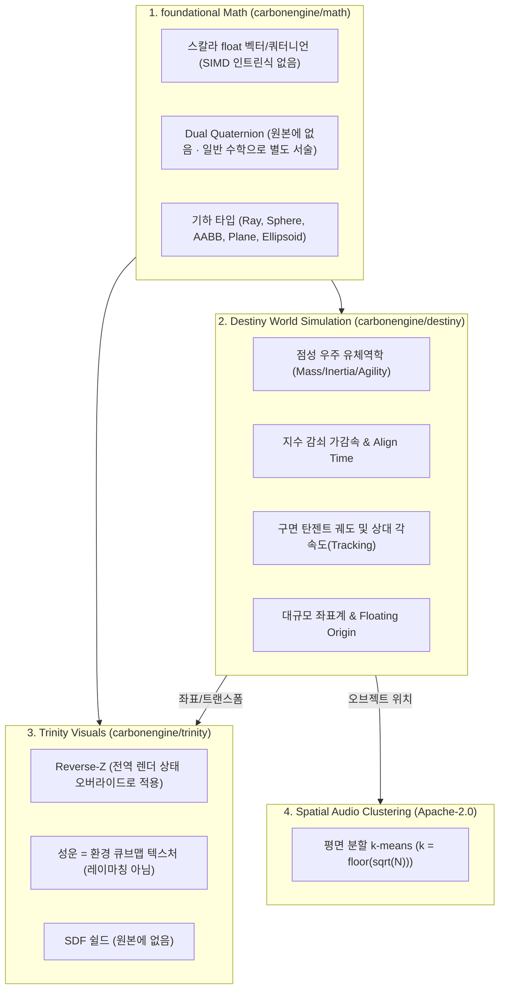

# Carbon Engine (EVE Online) 핵심 수학 및 물리 개념 심층 분석

> **[검증 상태 · 2026-08-24]** 이 문서는 github.com/carbonengine 저장소 원본 및
> `src/` 코드와 대조하여 정정되었습니다. 정정 근거와 전체 내역은
> [Carbon_Source_Audit.md](Carbon_Source_Audit.md)를 참조하십시오.

> 대상: `carbonengine/math` (MIT), `carbonengine/destiny` (MIT), `carbonengine/trinity` (MIT),
> `carbonengine/spatial-audio-clustering` (**Apache-2.0**)  
> 목표: EVE Online 기반 Carbon Engine의 수학적 모델을 분석하고 **Haruka Engine**에 적용할 핵심 수학 원리 도출

**[정정]** 이전 판은 대상 저장소를 세 개로만 적었으나, 아래 2-6절이 실제로 다루는 대상은
`carbonengine/spatial-audio-clustering`이므로 범위에 포함해야 합니다. 이 저장소만
라이선스가 Apache-2.0이고 나머지 셋은 MIT입니다. Apache-2.0은 NOTICE 파일 보존과
변경 사항 고지를 요구하므로, 코드를 실제로 차용할 경우 MIT 저장소들과는 다른 의무가 붙습니다.

---

## 1. Carbon Engine 핵심 아키텍처 및 수학적 도메인 지도



**[정정]** 이전 판의 이 지도는 `math`에 SIMD 연산과 Dual Quaternion이 있다고 적었고,
trinity에 로그 깊이 버퍼와 볼류메트릭 성운 레이마칭과 SDF 쉴드가 있다고 적었으나,
넷 모두 저장소에 존재하지 않습니다. 위 노드 이름은 실제 내용으로 교체하였고,
2-6절이 다루는 `spatial-audio-clustering`을 네 번째 도메인으로 추가하였습니다.

---

## 2. 세부 수학적 개념 및 공식 분석

### 2-1. 점성 우주 비행 역학 (Inertia & Exponential Acceleration)

EVE Online의 `Destiny` 물리 엔진은 순수 뉴턴 진공 역학 대신 **점성 유체 모델(Sub-marine Physics)**을 사용합니다. 함선이 엔진을 끄면 저항에 의해 감속하여 정지하며, 질량($m$)과 기민성($\text{agility}$)과 항력 계수($k$)에 의해 시정수($\tau$)가 결정됩니다. Destiny는 이 1차 선형 항력 상미분방정식을 오일러나 RK4로 적분하지 않고 **폐쇄형 해석해로** 풀며, 틱 간격은 1초입니다.

#### 1) 1차 시정수 (Time Constant $\tau$)
$$\tau = \frac{m_{\text{Mass}} \cdot m_{\text{Agility}}}{m_{\text{Friction}}} \quad (\text{단위: 초})$$

**[정정]** 이전 판은 분모를 하드코딩 상수 $10^6$으로 서술했으나, 실제로는 `Ballpark`의
변경 가능한 멤버 `mFriction`입니다. `Ballpark.cpp:100`에서 `1000000.0`으로 초기화될 뿐이고
Python에는 "friction, 우주의 마찰 계수"로 노출되어 런타임에 튜닝할 수 있습니다.
단위는 kg/s이며 정규화 상수가 아닙니다.

또한 엔진은 $\tau$ 자체를 저장하지 않고, 틱 감쇠 계수를 미리 계산해 보관합니다:
$$m_{\text{TimeFactor}} = \exp\left(-\frac{m_{\text{Friction}} \cdot \Delta t}{m_{\text{Mass}} \cdot m_{\text{Agility}}}\right)$$

저장소의 골든 테스트가 이 값을 고정합니다: `mass` 13,000,000 kg, `Agility` 0.9,
`mFriction` 기본값이면 $\tau = 11.6999996900558\text{s}$입니다.
(`python/destiny/test/helpers.py:207`의 유일한 실제 파라미터 세트: mass 13,000,000 kg,
Agility 0.9, maxVelocity 10.0 m/s, radius 2.0 m, speedFraction 0.95.)

추가로 저작 방향이 일반적인 물리 엔진과 반대입니다. 최고 속력 $v_{\max}$가 입력이고
추력을 역산합니다: $\text{maxThrust} = k \cdot \text{speedFraction} \cdot v_{\max} / (m \cdot \text{agility})$
(`Ballpark.cpp:1408`).

#### 2) 가속 및 최고 속도 도달 공식
시간 $t$에서 함선의 속력 $v(t)$:
$$v(t) = v_{\max} \cdot \left(1 - e^{-t / \tau}\right)$$

#### 3) 정렬 판정 (Align to Warp — 75% 최고속도 조건)
함선이 목표 방향을 바라보며 최고 속도의 75%에 도달해야 워프에 진입할 수 있다는 조건 자체는
실재합니다. `Ball::IsAlignedForWarp`(`Ball.cpp:1912`)가 제곱값 $0.5625 = 0.75^2$을 씁니다.

$$0.75 = 1 - e^{-t_{\text{align}} / \tau} \implies t_{\text{align}} = \tau \cdot \ln(4) \approx 1.386294 \cdot \tau$$

**[정정]** 이전 판은 위 폐쇄형을 엔진의 정렬 시간 계산식으로 서술했으나, 이 식은
**엔진 어디에도 존재하지 않습니다.** 수학적으로는 위 감쇠 모델에서 옳게 유도되지만,
Destiny는 정렬 시간을 미리 계산하지 않습니다. 대신 매 틱 두 조건을 함께 폴링합니다.

* 방향 조건: 현재 진행 방향과 목표 방향의 내적이 1에서 0.01 이내입니다.
* 속력 조건: 속력의 제곱이 $0.5625 \cdot v_{\max}^2$보다 큽니다.

그리고 폴링이 수렴하지 않는 경우를 위해 `MAX_ALIGN_TICKS = 180`(`Ball.h:43`)이라는
강제 워프 탈출구가 있습니다. 즉 정렬은 해석적으로 예측되는 값이 아니라 술어 폴링과
상한 틱 수로 구현된 상태 전이입니다. Haruka가 이 동작을 옮길 때에도 폐쇄형 시간을
계산해 타이머를 거는 대신 술어 폴링과 상한을 두는 쪽이 원본과 같습니다.

#### 4) 임의 목표 속도 벡터로의 상태 미분방정식 (Vector Interpolation)
목표 속도 벡터 $\vec{v}_{\text{target}}$에 대해 매 프레임($\Delta t$):
$$\frac{d\vec{v}}{dt} = \frac{\vec{v}_{\text{target}} - \vec{v}}{\tau}$$
$$\vec{v}(t + \Delta t) = \vec{v}(t) + (\vec{v}_{\text{target}} - \vec{v}(t)) \cdot \left(1 - e^{-\Delta t / \tau}\right)$$

---

### 2-2. 궤도 및 상대 속도/사격 추적 기하학 (Orbital & Tracking Geometry)

```
        V_rel (상대속도 벡터)
        ^
       /|
      / | V_transverse (횡방향 속도)
     /  |
    +---+
    |  /
    | / V_radial (방사형 속도)
    |/
 Target (거리 r) <----------------- Attacker (Origin)
```

#### 1) 횡방향 속도 ($v_t$) 및 각속도 ($\omega$)
타깃과의 상대 위치 벡터 $\vec{r}$, 상대 속도 벡터 $\vec{v}_{\text{rel}} = \vec{v}_{\text{target}} - \vec{v}_{\text{attacker}}$에 대해, 엔진은 **외적도 제곱근도 쓰지 않고** 각속도의 제곱을 직접 구합니다:

$$v_{\text{radial}} = \frac{\vec{v}_{\text{rel}} \cdot \vec{r}}{|\vec{r}|}, \qquad \omega^2 = \frac{|\vec{v}_{\text{rel}}|^2 - v_{\text{radial}}^2}{|\vec{r}|^2}$$

**[정정]** 이전 판은 외적의 크기 $|\vec{v}_{\text{rel}} \times \vec{r}| / |\vec{r}|$로 횡방향 속도를 구한 뒤
다시 $|\vec{r}|$로 나누는 형태로 서술했으나, 실제 구현은 위와 같이 내적 하나와 피타고라스
분해만 씁니다. 결과는 같은 값이면서 곱셈 횟수가 적고, 명중률 지수에 어차피 $\omega^2$이
들어가므로 제곱근을 한 번도 취하지 않습니다. Haruka에서 추적 계산을 옮길 때 이 형태를
그대로 쓰는 편이 더 싸고 정확합니다.

#### 2) 터렛 명중 확률 공식 (`Ballpark::GetAccuracy`, `Ballpark.cpp:5155`)
시그니처 반경 $S_t$, 터렛의 추적 속도 $T_k$, **호출자가 넘기는** 최적 시그니처 반경 $S_{\text{opt}}$, 최적 사거리 $R_{\text{opt}}$, 유효 감쇠 사거리 $R_{\text{fall}}$:

$$d_{\text{short}} = \max\left(0,\; |\vec{r}| - R_{\text{target}} - R_{\text{shooter}}\right)$$

$$P_{\text{hit}} = 2^{-\left[\left(\frac{\omega \cdot S_{\text{opt}}}{T_k \cdot S_t}\right)^2 + \left(\frac{\max(0,\; d_{\text{short}} - R_{\text{opt}})}{R_{\text{fall}}}\right)^2\right]}$$

**[정정] 두 가지가 틀렸습니다.**

1. 이전 판이 엔진 상수처럼 적은 `40000`은 **엔진에 존재하지 않습니다.** 이 값은
   `GetAccuracy`가 인자로 받는 `optimalSignatureRadius`이며, Dogma 및 Python 계층이
   정하는 밸런스 값입니다. 즉 수학이 아니라 데이터이고, Haruka가 자기 스케일에 맞게
   자유롭게 정해야 하는 값입니다. VR 스케일에서 EVE의 값을 그대로 쓰면 의미가 없습니다.
2. 거리 항의 $|\vec{r}|$은 중심 간 거리가 아니라 **표면 간 거리**입니다. 엔진은
   중심 거리에서 양쪽 반지름을 빼고 0에서 클램프한 `shortDist`를 씁니다. 큰 함선끼리는
   이 차이가 명중률을 크게 바꿉니다.

지수의 밑은 소스에서 `pow(2.0, exponent)` 형태이며 지수가 음수입니다. $0.5^{(\cdot)}$로 쓴
이전 판의 표기는 값이 같지만, 소스와 대조할 때 혼동을 줄이려고 위와 같이 $2^{-(\cdot)}$로 적습니다.

---

### 2-3. 거대 공간 좌표계 수학 (Large-Scale World Coordinates)

수광년~수천 AU 단위의 우주 스케일을 표현할 때 32-bit 부동소수점($\text{float32}$)의 정밀도 한계(약 7자리 유효숫자)로 인해 흔들림(Jitter)이 발생합니다.

#### 1) Double-Precision World Position
* 월드 좌표: Destiny 자체 타입 `Vector3d` (`src/Vector3d.h`, `double x, y, z`).
  약 15~17자리 유효숫자를 가지므로 성계 규모에서 밀리미터 정밀도가 유지됩니다.
* `float`에서 `double`로는 암시적 확장이 허용되지만, `double`에서 `float`로 줄일 때에는
  명시적으로 `AsVector3()`를 호출해야 합니다. 정밀도를 잃는 지점이 코드에 드러나도록
  강제하는 설계입니다.

**[정정]** 이전 판은 월드 좌표 타입을 `glm::dvec3`로 적었으나, **Carbon은 glm을 쓰지 않습니다.**
`math` 저장소의 vcpkg 의존성은 gtest와 directxmath 둘뿐이며 glm이 없습니다. Haruka가 glm을
쓰는 것은 Haruka의 선택이고, Carbon에서 차용한 것이 아닙니다.

#### 2) Floating Origin (증분식)
$$\vec{P}_{\text{render}} \mathrel{+}= \text{vec3}\left(\Delta_{\text{ego}}\right) \quad\text{(틱마다 누적)}$$

**[정정]** 이전 판은 "매 프레임 모든 오브젝트에서 카메라 위치를 뺀다"는 재기준화 방식으로
서술했으나, **Destiny에는 그런 단계가 없습니다.** Destiny는 시뮬레이션을 재기준화하지
않으며, 위치는 한 `Ballpark`(하나의 성계) 안에서 절대 `double`로 유지됩니다.
렌더러에 노출되는 것은 다음 두 가지뿐입니다.

* `IEveReferencePoint::GetReferencePoint`: 플레이어 ego ball의 절대 위치입니다.
* `IEveBallpark::Delta`: ego ball의 틱당 이동량이며 `AsVector3()`로 `float`까지 줄입니다.

즉 렌더러가 자기 `float` 원점을 따로 유지하고, 시뮬레이션은 틱마다 델타만 넘겨 줍니다.
큰 절대값을 빼는 연산이 프레임마다 일어나지 않으므로 상쇄 오차가 생기지 않는다는 것이
이 방식의 이점입니다. Haruka가 대규모 씬을 다룰 때 참고할 것은 "전부 빼기"가 아니라
이 **증분 전달 계약**입니다.

---

### 2-4. 우주 스케일 렌더링 깊이 수학 (Logarithmic Depth Buffer & Reverse-Z)

가까운 세부 디테일과 매우 먼 천체를 단일 렌더패스에서 Z-Fighting 없이 그리기 위한 깊이 계산법입니다.

**[정정]** 이전 판은 이 절의 대상 범위를 "0.1m부터 $10^9\text{m}$까지"로 적었으나, 그 수치는
저장소 어디에도 없습니다. 또한 trinity의 투영 행렬은 **유한 원평면**을 받습니다
(`PerspectiveFovMatrix(fov, aspect, zn, zf)`, `PerspectiveOffCenterMatrix(l, r, b, t, zn, zf)`).
무한 원평면 투영이 아닙니다.

#### 1) Reverse-Z Floating Point Depth
* Vulkan NDC 깊이: $z \in [0, 1]$ (Near=1.0, Far=0.0)
* 부동소수점 비트 특성상 0 근처에 비트가 집중되므로, Far 쪽의 정밀도가 크게 향상됩니다.
* **Carbon의 `math` 저장소 자체는 Reverse-Z가 아닙니다.** `PerspectiveFovMatrix`는 표준 Z
  (near → 0, far → 1)를 만듭니다: `m[2][2] = zf/(zn-zf)`, `m[2][3] = -1.0f`,
  `m[3][2] = (zf*zn)/(zn-zf)`.
* Reverse-Z는 그 위에서 trinity가 적용합니다. `Tr2Renderer::GetReversedDepthProjectionTransform()`
  (`Tr2Renderer.cpp:477-483`)이 `proj._33 = -proj._33 - 1.f; proj._43 = -proj._43;`로 뒤집고,
  씬 전역으로는 `EveSpaceSceneRenderDriver.cpp:446`의 `SetInvertedDepthTest(true)`가 켭니다.
* **차용할 가치가 있는 것은 행렬 조작이 아니라 켜는 방식입니다.**
  `Tr2EffectStateManager::SetInvertedDepthTest`는 각 깊이 비교 함수를 대응 함수로 매핑하는
  배열, 즉 전역 렌더 상태 오버라이드 테이블입니다. Haruka는 현재 Reverse-Z 관련 상수가
  열여덟 곳에 흩어져 있어(비교 함수, 클리어 값, depthBias 부호, 셰이더의 NDC z 리터럴 등)
  한 번에 뒤집을 수 없습니다. 이 테이블 방식이 그 문제의 해법입니다.

#### 2) Logarithmic Depth
**[정정]** 이 항목은 근거가 없어 내용을 교체합니다. 이전 판은 로그 깊이 수식을
Carbon에서 도출한 것처럼 서술했으나, **trinity 저장소에는 셰이더 파일 자체가 없습니다.**
렌더러가 로드하는 94개 이펙트는 전부 `res:/Graphics/Effect/...` 형태의 런타임 리소스
경로이고 그 번들은 공개되지 않았습니다. 즉 공개된 것은 오케스트레이션뿐이며 셰이더
수학은 확인할 수 없습니다. 로그 깊이 수식은 일반적으로 알려진 기법이며 Carbon에서
차용한 것이 아닙니다.

Haruka 쪽 실측을 덧붙입니다. 무한 원평면에서 $d = z_{\text{near}} / z$이므로 깊이 해상도는
대략 $z \cdot 2^{-24}$입니다. $z = 10^8\text{m}$에서는 약 **6m**이며 서브밀리미터가 아닙니다.
우주 스케일 씬에서 Reverse-Z만으로 충분하다고 가정하면 안 되는 이유입니다.
덧붙여 `Renderer_swap.cpp:15`의 깊이 포맷 폴백에 `D24_UNORM`이 포함되어 있는데,
고정소수점 포맷에서는 Reverse-Z의 정밀도 이득이 0입니다.

---

### 2-5. 듀얼 쿼터니언 (Dual Quaternions) 및 회전 수학

**[정정]** 이전 판은 이 절을 "`carbonengine/math`에서 강점을 보이는 Dual Quaternion"으로
서술했으나, **Dual Quaternion 타입도 파일도 함수도 저장소에 존재하지 않습니다.**
`include/`와 `src/` 양쪽 모두에 없습니다. 아래 수식은 Carbon에서 차용한 것이 아니라
일반적으로 알려진 Dual Quaternion 수학이며, 그 사실을 전제로 읽어야 합니다.

#### 1) `carbonengine/math`의 실제 내용

* `include/`에 헤더 27개가 평면 구조로 놓여 있습니다. 타입은 `AxisAlignedBox`,
  `AxisAlignedEllipsoid`, `CcpMath`, `Color`, `Float16`, `Matrix`, `NumConst`, `Plane`,
  `Quaternion`, `Ray`, `Requirements`, `Sphere`, `Vector2/3/4`입니다.
* `Quaternion`은 `float x, y, z, w` 네 멤버, 16바이트이며 `alignas`가 없습니다.
  함수는 `IdentityQuaternion`, `LengthSq`, `Length`, `Normalize`, `Inverse`, `Conjugate`,
  `Exp`, `Dot`, `RotationQuaternion`(3종), `Slerp`, `GetAxisAngle`뿐입니다. NLERP도 없습니다.
* **SIMD 인트린식이 없습니다.** `Requirements.h`가 유일한 진입점이고 `DirectXMath.h`와
  `DirectXPackedVector.h`만 포함합니다. `immintrin.h`, `arm_neon.h`, `xmmintrin.h`가 없고
  아키텍처 분기 `#if`도 없습니다.
* `Vector3`가 `float x, y, z` 12바이트라서 `XMVECTOR`를 담을 수 없습니다. 따라서
  DirectXMath는 **연산용이 아니라 상호변환용**입니다(`XMStoreFloat3`/`XMLoadFloat3` 왕복).
  저장소 전체에서 DirectXMath 연산 호출은 `src/Quaternion.cpp`의
  `XMQuaternionRotationRollPitchYaw` 단 하나이며 여기에도 `#if __APPLE__` 대체 경로가 붙어 있습니다.
* `Frustum`, `Capsule`, `OBB`, double 정밀도 벡터가 모두 없습니다.
* CMakePresets 대상은 x64-windows, x64-osx, arm64-osx입니다. **Android와 Linux 프리셋이 없습니다.**
* 저장소 자기 설명도 이 규모와 일치합니다:
  "Provides some basic math utilities for vectors, planes, quaternions etc."

#### 2) 일반적인 Dual Quaternion 수학 (Carbon 무관)

회전($\mathbf{q}_r$)과 평행이동($\mathbf{q}_d$)을 하나의 $8\text{D}$ 숫자로 결합합니다:
$$\hat{\mathbf{q}} = \mathbf{q}_r + \epsilon \mathbf{q}_d \quad (\epsilon^2 = 0)$$
* 이동 벡터 $\vec{t}$와 회전 쿼터니언 $\mathbf{q}_r$로부터:
  $$\mathbf{q}_d = \frac{1}{2} (0, \vec{t}) \otimes \mathbf{q}_r$$
* 알려진 장점은 행렬 대비 메모리 절반(8개 float 대 16개 float)과, 스키닝 시
  캔디 래퍼(Candy-wrapper) 비틀림 왜곡 제거입니다.

#### 3) Haruka에 그대로 적용할 수 없는 이유 (경고)

이전 판은 이 절에서 "Transform SSBO 대역폭 50% 절감 가능"이라는 결론을 냈으나,
Haruka 코드베이스 실측 결과 그대로는 성립하지 않습니다.

* `GpuTransform`(`RenderTypes.hpp:27-29`)은 `struct { glm::mat4 model; }`이며 64바이트입니다.
* `Renderer_render.cpp:234-237`이 **모델 행렬의 열 길이에서 스케일을 추출**합니다.
  Dual Quaternion은 회전과 평행이동만 담고 스케일을 담지 못하므로, 32바이트로 바꾸면
  이 지점에서 스케일이 항상 1.0이 되어 **컬링 경계 반지름이 틀어지고 컬링이 깨집니다.**
  비균등 스케일을 쓰는 액터는 화면에서 사라지거나 잘못 남습니다.
* Dual Quaternion으로 옮기려면 스케일을 별도 필드로 분리해야 하고, 그러면 실제 절감은
  64바이트에서 32바이트가 아니라 그보다 작아집니다. 절감 폭을 다시 계산해야 합니다.
* 부수적으로 `GpuTransform`은 셰이더 4곳(`pbr.vert:25`, `depth.vert:18`, `shadow.vert:18`,
  `triangle.vert:19`)에 중복 선언되어 있고 공유 GLSL include가 없습니다. 레이아웃을
  바꾸려면 네 곳을 동시에 고쳐야 하며, 이는 전환 비용에 포함해야 합니다.

즉 Dual Quaternion 전환은 Carbon에서 배울 것이 아니라 Haruka가 독자적으로 판단할
사안이며, 스케일 처리 방침을 먼저 정하기 전에는 착수하면 안 됩니다.

---

### 2-6. 대규모 공간 클러스터링 수학 (`spatial-audio-clustering`, Apache-2.0)

수많은 음원이 동시에 울릴 때 이를 개별적으로 처리하면 자원이 고갈되므로, 가까운 음원들을
하나의 가상 음원으로 합쳐야 한다는 문제 설정 자체는 옳습니다. 다만 원본이 그 문제를 푸는
방식이 이전 판의 서술과 다릅니다.

**[정정]** 이전 판이 이 절에 적은 **Hierarchical Bounding Sphere Clustering, 클러스터 간
거리 함수 $\text{Dist}(C_1, C_2)$, 가중 중심 $\sum w_i \vec{P}_i / \sum w_i$,
합성 음량 $I_{\text{cluster}} = \sqrt{\sum I_i^2}$는 넷 모두 원본에 존재하지 않습니다.**
아래가 실제 알고리즘입니다.

#### 1) 저장소의 실제 정체

`carbonengine/spatial-audio-clustering`은 빌드 가능한 **Wwise Object Processor 플러그인**입니다
(`AK::IAkOutOfPlaceObjectPlugin`, `bCanProcessObjects=true`, `bIsInPlace=false`,
CompanyID 64 / PluginID 6973, Wwise 2025.1 이상). 라이선스는 **Apache-2.0**이며 NOTICE 파일이
함께 있습니다. 알고리즘 전체가 `SpatialClustering.cpp` 약 410줄입니다.

목적도 이전 판의 서술과 다릅니다. README에 따르면 고갈되는 자원은 Wwise 보이스가 아니라
**시스템 공간 오디오 오브젝트 슬롯**입니다("Most spatial audio endpoints (Dolby, Sonic, DTS)
offer up to 128 concurrent spatial audio objects"). 보이스 예산 문제는 다른 저장소인
`carbonengine/audio`의 `SoundPrioritization`이 담당합니다.

#### 2) 실제 알고리즘: 평면 분할 k-means

계층 구조가 아닙니다. 덴드로그램도, 연결 기준도, 병합 트리도 없습니다. Lloyd 반복을
최대 20회 돌리는 평면 k-means에 거리 게이트를 붙인 것이며, 클러스터 개수는 고정입니다:

$$k = \left\lfloor \sqrt{N} \right\rfloor$$

중심은 **비가중 산술 평균**입니다. `calculateCentroid()`가 위치를 그냥 더해 개수로 나눕니다:

$$\vec{P}_{\text{cluster}} = \frac{1}{n}\sum_{i=1}^{n} \vec{P}_i$$

에너지 가중이 아닌 이유는 단순합니다. 입력 구조체가
`ObjectPosition { AkVector position; AkAudioObjectID key; }`뿐이라 **볼륨 값을 받지도 않습니다.**

가중치가 등장하는 곳은 단 하나, `initializeCentroids()`가 원점에 가까운 시드 중심 하나를
구할 때 쓰는 가우시안 공간 밀도 커널입니다:

$$w_i = \exp\left(-\frac{d_i^2}{2 r^2}\right)$$

이것도 음량이 아니라 거리 커널이고, 첫 반복에서 비가중 평균으로 덮어써집니다.

클러스터 음량에 대한 공식은 플러그인에 없습니다. 합성 결과는 Wwise의 `MixNinNChannels`가
각 멤버를 자기 `cumulativeGain` 램프와 함께 누적한 것이며, 이는 **선형 진폭 합**이지
제곱합의 제곱근이 아닙니다. 또한 `ObjectClusterFXParams.h`에
`static const AkUInt32 NUM_PARAMS = 1;`이고 유일한 파라미터가 `DISTANCE_THRESHOLD = 0`입니다.
LPF도 피치 조절도 리샘플링도 없습니다. **플러그인은 DSP를 전혀 수행하지 않고 라우팅과
믹싱만 합니다.** `ClusterState`도 `{AkUInt32 activeInputCount; AkUInt16 maxFrames;}`뿐이라
반경이나 바운딩 볼륨을 갖고 있지 않습니다.

#### 3) 성능 주의와 실제로 가져갈 것

* `initializeCentroids`는 $O(N^2)$이며 $N^2$회 `std::exp()`를 호출하고, 매 오디오 콜백마다
  처음부터 다시 계산합니다. 실시간 오디오 스레드에서 힙 할당도 합니다. 그대로 옮기면
  Quest Pro 오디오 스레드에서 문제가 됩니다.
* 반대로 반드시 가져가야 하는 것은 두 가지입니다. 하나는 **프레임 간 클러스터 정체성
  유지**이고, 다른 하나는 멤버가 바뀔 때의 **게인 및 볼륨 행렬 보간**입니다
  (`GeneratedObject::volumeMatrix`에 이전 볼륨 행렬을 캐시합니다). 이것 없이는 멤버
  구성이 바뀔 때마다 파형 불연속이 생깁니다.
* Haruka에 더 유용한 쪽은 `carbonengine/audio`의 `SoundPrioritization`입니다. 약 150줄,
  MIT이며, 위치와 불리언만 있으면 동작합니다. 거리 제곱을 비용으로 삼고 특징을 감산
  보너스로 처리해 정렬한 뒤 예산까지 살립니다. 다만 상수가 EVE 스케일로 보정되어
  있으므로(거리 제곱이 $10^{10}$을 넘어 보너스에 $10^7$ 배수가 필요합니다) VR 스케일에서는
  상수를 다시 잡아야 합니다.

---

## 3. Haruka Engine에 적용할 핵심 실전 청사진

**[정정]** 이전 판의 표는 존재하지 않는 기능(Dual Quaternion, `math`의 SIMD, SDF 쉴드)을
근거로 삼았고, 이미 검증된 제약(스케일 추출, 컬링 파손, Apache-2.0 의무)을 반영하지
않았습니다. 아래 표는 검증된 사실만으로 다시 작성한 것입니다. "출처" 열은 해당 항목이
Carbon에서 실제로 확인된 것인지, 아니면 일반 기법인지를 구분합니다.

| 개념 | 출처 | Haruka 적용 위치 | 실제 기대 효과와 선결 조건 |
|---|---|---|---|
| **1. Dual Quaternion Transform** | Carbon 무관 (원본에 없음) | `core/Transform.hpp`, `GpuTransform` (SSBO) | **선결 조건 미해결.** `Renderer_render.cpp:234-237`이 모델 행렬 열에서 스케일을 뽑으므로, 32B 전환 시 스케일이 1.0으로 고정되어 컬링이 깨집니다. 스케일을 별도 필드로 분리해야 하며 그만큼 절감 폭이 줄어듭니다. 셰이더 4곳의 중복 선언도 함께 고쳐야 합니다. |
| **2. 증분식 Floating Origin** | Carbon 확인 (destiny) | `core/World.hpp`, `Renderer::updateUBO` | 시뮬레이션은 성계 내 절대 `double`을 유지하고, 렌더러에는 틱당 델타만 `float`로 넘깁니다. 매 프레임 큰 값을 빼는 재기준화가 없어 상쇄 오차가 생기지 않습니다. 좌표 타입은 `glm::dvec3`를 쓰든 자체 타입을 쓰든 Haruka의 선택입니다(Carbon은 자체 `Vector3d`이며 glm을 쓰지 않습니다). |
| **3. 점성 진공 비행 역학** | Carbon 확인 (destiny) | `components/RigidBodyComponent` 또는 신규 `FlightComponent` | 1차 선형 항력을 폐쇄형으로 푸는 방식이라 틱마다 `exp` 한 번이면 됩니다. 항력 계수는 상수가 아니라 튜닝 가능한 멤버로 두십시오. 단 **충돌 응답은 가져오면 안 됩니다**(관통 깊이 기반 가속에 0.85 감쇠, 접선 미끄러짐도 반발 계수도 없음). Haruka는 이미 Jolt를 씁니다. |
| **4. Frustum Culling** | Carbon 확인 (trinity, CPU측) | `renderer/passes/CullPass.cpp`, `cull.comp` | **[정정]** "SIMD 기반 초고속"의 근거를 삭제합니다. `carbonengine/math`에는 SIMD 인트린식이 전혀 없고 `Frustum` 타입도 `OBB`도 없습니다. trinity의 컬링은 컴퓨트 셰이더가 아니라 TBB로 병렬화한 **CPU측 계층적 구 판정**(`EveInstancedMeshManager::PerformFrustumCulling`)이며, 화면 픽셀 크기 추정으로 LOD를 함께 정합니다. 참고할 것은 SIMD가 아니라 이 **컬링과 LOD 선택의 통합**입니다. |
| **5. Spatial Audio Clustering** | Carbon 확인 (Apache-2.0) | `audio/AudioSystem.cpp` | 알고리즘은 비가중 k-means($k = \lfloor\sqrt{N}\rfloor$)이고 계층적 바운딩 스피어가 아닙니다. 원본은 $O(N^2)$ 시드 계산을 매 오디오 콜백마다 반복하므로 그대로 옮기면 안 됩니다. 실제로 가져갈 것은 **프레임 간 클러스터 정체성 유지와 볼륨 행렬 보간**입니다. 코드를 차용할 경우 Apache-2.0이므로 NOTICE 보존과 변경 고지 의무가 따릅니다. |
| **5-b. 사운드 우선순위 예산** | Carbon 확인 (`audio`, MIT) | `audio/AudioSystem.cpp` | `SoundPrioritization` 약 150줄이 거리 제곱을 비용으로, 특징을 감산 보너스로 처리해 정렬 후 예산을 자릅니다. 5번보다 이식 비용이 낮고 MIT입니다. 상수는 VR 스케일로 다시 잡아야 합니다. |
| **6. Reverse-Z 전역 상태 오버라이드** | Carbon 확인 (trinity) | `renderer/` 전역 상태 계층, `shaders/pbr.vert`, `shaders/depth.vert` | **[정정]** SDF 쉴드 항목의 근거를 삭제합니다. trinity에 signed distance field 셰이더가 없고, 이름이 비슷한 `EveDistanceField`는 셰이더가 아니라 CPU측 근접 추적기입니다. 남는 것은 Reverse-Z이며, 배울 점은 행렬 조작이 아니라 **비교 함수 매핑 테이블 하나로 전역을 뒤집는 방식**입니다. Haruka는 관련 지점이 열여덟 곳에 흩어져 있어 지금은 한 번에 뒤집을 수 없고, 깊이 포맷 폴백의 `D24_UNORM`은 Reverse-Z 이득이 0입니다. |
