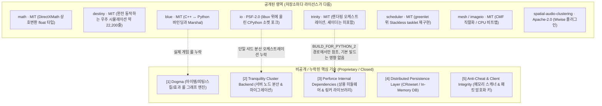

# Carbon Engine 비공개(Proprietary) 핵심 기술 해부 분석서

> **[검증 상태 · 2026-08-24]** 이 문서는 github.com/carbonengine 저장소 원본 및
> `src/` 코드와 대조하여 정정되었습니다. 정정 근거와 전체 내역은
> [Carbon_Source_Audit.md](Carbon_Source_Audit.md)를 참조하십시오.

> **문서 목적**: Carbon Engine의 오픈소스 릴리즈(2026년 Fenris Creations 공개)에서 **의도적으로 비공개로 유지되었거나 누락된 핵심 기술(Proprietary Exclusions)**을 규명하고, 실제로 공개된 것과의 경계를 분석. 공개분의 완성도는 저장소마다 크게 다르므로 "뼈대"라는 하나의 표현으로 묶지 않습니다

---

## 1. 공개 영역(Open Source) vs 비공개 영역(Proprietary) 경계도



**[정정]** 이전 판의 다이어그램은 destiny를 "물리/항법 인터페이스 & Ballpark 뼈대"로 적었으나, 실제로는 정반대입니다. destiny는 `src/`에 약 22,200줄이 들어 있는 완전히 동작하는 시뮬레이션이며, 이 저장소가 공개된 것 중 가장 값진 자산입니다. 상세는 아래 1-1절에 있습니다.

**[정정]** 이전 판은 destiny에서 Perforce 비공개 타깃으로 화살표를 그으며 "의존성 결여(빌드 차단)"라고 적었으나, `destiny/CMakeLists.txt`에는 `CCP_EVE_PERFORCE_BRANCH_PATH`가 아예 존재하지 않습니다. 이 검사는 trinity 한 곳에만 있고 그마저 조건부입니다. 상세는 2-3절에 있습니다.

**[정정]** 이전 판은 공개 영역 전체를 "Open Source / MIT" 하나로 묶었으나, 라이선스가 균일하지 않습니다. 아래 표를 확인하십시오.

### 1-1. destiny는 뼈대가 아니라 완성된 시뮬레이션입니다

이전 판이 destiny를 인터페이스 껍데기로 분류한 원인은 확인되었습니다. `destiny/include/`에는 파일이 두 개(`IEveBallpark.h`, `IEveReferencePoint.h`, 합계 854바이트)뿐이므로, 헤더 디렉터리만 훑으면 인터페이스만 공개된 것처럼 보입니다. 그러나 구현은 전부 `src/`에 있으며 그 규모와 완성도는 다음과 같습니다.

| 항목 | 실측 내용 |
|---|---|
| 코드 규모 | `src/` 약 22,200줄 C++. `Ballpark.cpp` 215KB, `Ball.cpp` 70KB, `Thunkers.cpp` 85KB |
| 회귀 검증 | Python 테스트 약 6,100줄이 하드코딩된 골든 float 궤적으로 결과를 대조합니다 |
| 운동 적분 | 1차 선형 항력 ODE를 폐쇄형(해석해)으로 풉니다. 오일러도 RK4도 아니며 틱은 1초입니다 |
| 시정수 | `tau = mMass * mAgility / mFriction`. 엔진은 tau 대신 `mTimeFactor = exp(-mFriction*dt/(mMass*mAgility))`를 저장합니다 |
| 충돌 | 자체 충돌 검출과 응답을 갖고 있습니다: `Collision.cpp`, `Capsule.cpp`, `OrientedBox.cpp`, `BoxShape.cpp`, `Triangle.cpp`, `AABB.cpp` |
| 공간 분할 | 희소 8단계 균일 그리드(최소 셀 480m, int64 (i,j,k,level) 해시 키) |
| 좌표 정밀도 | 자체 타입 `Vector3d`(double x, y, z) |
| 저장소 자기 설명 | "Core game world simulation engine for MMOs whose titles start with Eve." |

따라서 Carbon 공개분을 조사할 때 destiny를 건너뛰면 안 됩니다. 이 저장소를 뼈대로 오인하는 것이 이 문서 이전 판의 가장 큰 손실이었습니다.

### 1-2. 공개 저장소 라이선스 (균일하지 않음)

| 저장소 | 라이선스 | 비고 |
|---|---|---|
| math, destiny, blue, scheduler, core, mesh, imageio, imagetools, audio | MIT | |
| trinity | MIT | 라이선스 파일명이 `LICENSE.md`이며 저작권 표기는 여전히 "Copyright (c) 2026 CCP Games"입니다 |
| **io** | **PSF License Version 2** | CPython 3.12의 C socket·ssl 모듈 파생물이기 때문입니다 |
| **spatial-audio-clustering** | **Apache-2.0** | `LICENSE.txt`에 Apache 2.0 전문과 `NOTICE` 파일이 함께 있습니다 |

`io`의 PSF-2.0은 실무 의무가 MIT와 다르므로 별도로 유의해야 합니다.

* LICENSE.txt 첫 줄이 "PYTHON SOFTWARE FOUNDATION LICENSE VERSION 2"이고, "Copyright (c) 2001 Python Software Foundation"과 "Copyright (c) 2026 CCP Games"가 함께 표기되어 있으며 "This software is a derivative work incorporating Python as modified by CCP Games"라고 명시됩니다.
* 제2조는 PSF 저작권 고지를 유지할 것을 요구합니다.
* **제3조는 파생물을 배포할 때 Python에 가한 변경 사항의 요약(a brief summary of the changes made to Python)을 동봉할 것을 요구합니다.** Haruka가 io 계열 코드를 가져다 고쳐서 배포한다면 이 변경 요약 문서를 함께 내야 합니다. MIT에는 없는 의무이므로 io를 MIT로 착각한 채 취급하면 라이선스를 위반하게 됩니다.

---

## 2. 5대 비공개 핵심 기술 상세 해부

---

### 2-1. `Dogma`: EVE의 전설적인 아이템·속성·효과 그래프 엔진
* **정체**:
  * EVE Online의 모든 함선 피팅, 모듈, 스킬, 버프/디버프, 전자전(EWAR), 저항력 계산을 총괄하는 **핵심 비즈니스 룰 엔진**.
* **오픈소스 공개 현황**:
  * **비공개라는 결론은 실측으로 확인되었습니다.** 조직 github.com/carbonengine에 Dogma라는 이름의 저장소가 없고, vcpkg-registry의 63개 포트에도 해당 포트가 없습니다(부재로 확인).
  * **[정정]** 이전 판은 공개된 `parser`를 Dogma의 축소판인 것처럼 대비시키고 "수천만 개의 아이템 간 상호작용 의존성 그래프"라는 규모 수치를 적었으나, 그 수치는 근거가 없습니다. `carbonengine/parser`의 자기 설명은 "Math expression parser"이며, trinity가 `>=1.0.2`로 의존하고 용도는 셰이더와 커브 수식 평가입니다. 애초에 게임 룰 엔진의 일부가 아니므로 Dogma와 대비할 대상이 아닙니다.
  * 정적 데이터 쪽도 같은 상태입니다. `carbonengine/fsd`의 README는 "We do not plan on developing FSD further as we now prefer to use cFSD to handle our games' static data"라고 밝히는데, 그 cFSD는 조직에 공개되어 있지 않습니다.
* **왜 숨겼는가?**:
  * EVE Online 및 EVE Frontier의 게임 밸런스, 경제 시스템, 독점 게임플레이 로직의 핵심 지적재산권(IP)이기 때문입니다.

---

### 2-2. `Tranquility Cluster Backend`: 단일 샤드 분산 노드 오케스트레이터
* **정체**:
  * 성계(Solar System) 단위 시뮬레이션을 여러 물리 서버 노드로 배분하는 **SOL 노드 할당기** 및 **라이브 세션 마이그레이터**입니다. (성계 수와 노드 대수의 구체적 수치는 저장소에서 확인되지 않으므로 인용하지 않습니다. 원본 미확인 — 추정)
* **오픈소스 공개 현황**:
  * **비공개라는 결론은 실측으로 확인되었습니다.** 공개된 것은 한 계층 아래까지입니다. `carbon-io`의 4바이트 빅엔디언 프레임 헤더, `blue`의 `BlueNet` 라우팅(`ADDRESS_TYPE_NODE=1`, `ADDRESS_TYPE_CLIENT=2`, `ADDRESS_TYPE_BROADCAST=4`, `ADDRESS_TYPE_ANY=8`과 서비스명 FNV-1a 해시인 `blueNetKey`)까지는 읽을 수 있습니다.
  * 그 위의 **MachoNet/GPCS는 공개되지 않았습니다.** io README에 "Some functionality to support sending / receiving of machoNet packets has been added"라는 언급만 있을 뿐, GPCS 프레임 포맷도 패킷 타입 enum도 4-튜플 주소 구조체도 저장소에 존재하지 않습니다.
  * 따라서 프록시 서버와 SOL 노드 간의 로드밸런싱, 무중단 성계 이동, TiDi 조율 서버 코드는 어느 것도 공개되지 않았습니다.
* **결과**:
  * 공개된 코드만으로는 단일 서버(Stand-alone) 인스턴스는 띄울 수 있어도, EVE의 거대한 Tranquility 같은 단일 샤드 분산 서버 클러스터는 구축할 수 없습니다.

---

### 2-3. `Perforce 내부 의존성 (`CCP_EVE_PERFORCE_BRANCH_PATH`)`

**[정정]** 이전 판은 이 절 전체를 "Perforce 변수 때문에 destiny와 trinity의 빌드가 차단된다"는 전제 위에 세웠으나, 그 전제가 사실이 아닙니다. 아래에서 세 가지를 각각 바로잡습니다.

* **실제 상태**:
  * `CCP_EVE_PERFORCE_BRANCH_PATH` 검사는 **`trinity/CMakeLists.txt` 한 곳에만** 있습니다. 그리고 그 검사는 `if (BUILD_FOR_PYTHON_2)` 블록 안에 들어 있습니다.
  * `BUILD_FOR_PYTHON_2`는 CMakePresets의 12개 프리셋 어디에서도 설정되지 않습니다. 즉 기본 빌드 경로에서는 이 검사가 실행되지 않습니다.
  * **`destiny/CMakeLists.txt`에는 이 변수가 아예 존재하지 않습니다.** 이전 판이 destiny를 빌드 차단 사례로 든 것은 근거가 없습니다.
  * 외부 개발자가 겪는 실제 진입 장벽은 Perforce가 아니라 다른 데 있습니다. trinity README가 VS2017 **v141** 툴셋을 요구하고(`cmake --preset x64-windows-internal -A x64 -T v141`), 툴체인 파일도 `CCP_TOOLSET v141`을 지정하며, 프리셋 플랫폼이 x64-windows / x64-osx / arm64-osx뿐이어서 Linux도 콘솔도 Android도 없습니다. 그리고 `carbonengine/audio` 같은 저장소는 `wwise>=2025.1.5.9095`를 요구하므로 CCP 외부에서는 사실상 빌드가 불가능합니다.
* **[정정] 상용 서드파티 미들웨어**:
  * 이전 판은 "Havok Physics, SpeedTree, FMOD/Wwise 독점 상용 라이브러리 연동 코드"가 누락되어 있다고 적었으나, **FMOD, Havok, SpeedTree는 63개 포트와 약 35개 저장소 어디에도 존재하지 않습니다.** 애초에 Carbon이 쓰지 않는 미들웨어입니다.
  * 실제로 포함된 상용 미들웨어는 **wwise, granny(RAD, `WITH_GRANNY` 기능으로 게이트됨), nvidia-aftermath, nvidia-streamline** 넷입니다. 그리고 이들은 숨겨져 있지 않습니다. Wwise 연동은 `carbonengine/audio`가 공개된 Wwise SDK 래퍼로 드러나 있고, Granny는 CMake 옵션 이름으로 명시되어 있습니다. 숨긴 것이 아니라 SDK 자체가 유료라서 외부인이 받을 수 없는 것입니다.
  * 물리 미들웨어가 없는 이유도 분명합니다. **destiny가 자체 충돌 검출과 응답을 갖고 있습니다**(`Collision.cpp`, `Capsule.cpp`, `OrientedBox.cpp`, `BoxShape.cpp`, `Triangle.cpp`, `AABB.cpp`). destiny의 vcpkg 의존성은 carbon-blue, carbon-core, carbon-math, carbon-exefile-interpreter, gtest뿐이며 외부 물리 엔진이 들어갈 자리가 없습니다.
* **[정정] 커뮤니티 반응**:
  * 이전 판은 "빌드 문의가 빗발쳤으며 이를 악용한 악성 스크립트 배포 시도까지 발생"이라고 적었으나, **어느 쪽도 근거가 없습니다.**
  * 실측하면 trinity의 전체 이슈는 **12건**입니다. 그중 11건은 구체적인 렌더링 버그 리포트이고 1건은 "Do Contributors get Paid?"(닫힘)입니다.
  * 빌드 실패 이슈는 #45 "WITH_GRANNY build fails because Granny SDK download endpoint is unreachable" **한 건**뿐이며, 이것은 Granny SDK 다운로드 엔드포인트 문제이지 Perforce와 무관합니다.
  * 악성 스크립트 배포 시도에 대한 근거는 발견되지 않았습니다.
* **실제로 비공개인 것**:
  * 실제 빌드는 Perforce와 TeamCity에서 이루어지고 GitHub은 컴포넌트 미러입니다. 저장소마다 `.teamcity/settings.kts`가 있고, trinity의 `.github/workflows`에는 `cpp_format.yml` 하나뿐입니다. 즉 비공개인 것은 개별 컴포넌트가 아니라 **이들을 하나로 묶는 Perforce 모놀리스와 그 CI 파이프라인**입니다.

---

### 2-4. 분산 인메모리 DB 및 영속성 계층 (`CRowset` / Live DB)
* **정체**:
  * 마켓 거래, 인벤토리 아이템 이동, 킬메일 데이터를 기록하는 영속성 계층입니다. (거래 건수와 트랜잭션 보증 수준의 구체적 주장은 저장소에서 확인되지 않으므로 인용하지 않습니다. 원본 미확인 — 추정)
* **오픈소스 공개 현황**:
  * **[정정]** 이전 판은 "`blue.Marshal`만 공개되었다"고 적었는데, 이 표현은 Marshal이 이름뿐인 껍데기라는 인상을 줍니다. 실제로는 마셜러 구현 전체가 `blue/src/Marshal.h`에 들어 있고 `PYTYPES` 열거형으로 전체 opcode 표를 읽을 수 있습니다. 공유 객체 메모이제이션(`TY_SHAREDFLAG=0x40`, `TY_TYPEMASK=0x3F`, 재등장 시 `TY_REFERENCE=27`), 컴파일 타임에 하드코딩된 문자열 테이블(`MARSHAL_STRINGS[]`, 인덱스가 1바이트라 255개 상한), pickle 상호운용 태그까지 모두 실물입니다.
  * 특히 **`TY_DBROW=42` 태그가 존재합니다.** 즉 DB 로우의 **와이어 표현**은 공개되어 있습니다. 비공개인 것은 그 로우를 만들어 내는 쪽입니다.
  * **실제로 비공개인 것**은 SQL 계층과 인메모리 캐시 동기화 엔진입니다. `carbonengine/db` 저장소가 존재하기는 하지만 README가 스텁("Wrapper for game server database access")이고 백엔드 이름도 API도 샤딩 논의도 들어 있지 않습니다.

---

### 2-5. 보안 및 안티치트 / 무결성 검증 계층
* **정체**:
  * 봇(Bot) 탐지, 클라이언트 메모리 변조 검사, 패킷 리플레이 공격 방지 및 암호화 핸드셰이크 키 교환 알고리즘.
* **오픈소스 공개 현황**:
  * 보안상의 이유로 **완전 제외**되었습니다. 이 헤드라인은 실측과 일치합니다. 안티치트를 표방하는 저장소도 포트도 존재하지 않습니다.
  * 다만 **인접한 기계장치는 공개되어 있습니다.** `carbonengine/pdm`("Platform Detection Module, an OS agnostic library for data collection")과 `carbonengine/pdm-proto-wrapper`가 그것이며, `pdm`은 blue와 trinity 양쪽의 의존성입니다. 즉 클라이언트 환경 데이터를 수집하는 계층은 공개된 채로 두고, 그 데이터를 판정에 쓰는 로직만 잠갔습니다. "완전 제외"가 "이 영역의 코드가 하나도 없다"는 뜻은 아닙니다.

---

## 3. Haruka VR 엔진 개발 관점에서의 시사점

```
[Carbon Engine 오픈소스의 본질]
"상용 라이브 게임의 서버/DB/룰(Dogma)은 철저히 잠그고,
 오랜 기간 운영으로 검증된 시뮬레이션과 렌더링 오케스트레이션과
 네트워크 하부 계층을 컴포넌트 단위로 분리하여 공개한 것."
```

**[정정]** 이전 판은 이 요약에서 공개분을 "프레임워크 뼈대"라고 규정했으나, 최소한 destiny에 대해서는 사실과 다릅니다. destiny는 뼈대가 아니라 골든 테스트까지 딸린 완성된 시뮬레이션입니다. 반대로 trinity는 오케스트레이션은 완전하지만 셰이더 파일이 한 개도 포함되어 있지 않아 그 부분만 놓고 보면 뼈대에 가깝습니다. 저장소마다 완성도가 다르므로 하나로 묶어 부를 수 없습니다.

**[정정]** 아래 표의 "차용할 것" 열은 이전 판에서 여러 항목이 실물과 달랐습니다. 각 행에 무엇이 잘못이었는지 함께 적었습니다.

### 💡 우리가 차용해야 할 것과 직접 구축해야 할 것의 경계

| 영역 | Carbon Engine에서 차용할 것 (실측으로 정정) | Haruka Engine에서 자체 구축할 것 (비공개 영역 대안) |
|---|---|---|
| **수학/트랜스폼** | `math`. **[정정]** 이전 판은 "Dual Quat, 8D 패킹, SIMD"라고 적었으나 셋 다 존재하지 않습니다. Dual Quaternion 타입도 파일도 함수도 없고, SIMD 인트린식도 없습니다. 실물은 27개 헤더의 평면 float 타입 모음이며 DirectXMath는 연산이 아니라 상호변환용입니다 | Haruka Vulkan SSBO 파이프라인에 직접 통합 |
| **비행/물리** | `destiny`. **[정정]** "점성 유체역학"이 아니라 1차 선형 항력 ODE의 **폐쇄형 해석해**입니다. 시정수 `tau = mMass * mAgility / mFriction`이며, `mFriction`은 상수가 아니라 Ballpark의 튜닝 가능한 멤버(초기값 1000000.0, 단위 kg/s)입니다. 자체 충돌 검출까지 포함해 약 22,200줄이 전부 공개되어 있습니다 | Jolt Physics 기반의 `ZeroGControllerComponent` |
| **렌더링** | `trinity`. Reverse-Z는 실재하며 차용 가치가 있습니다(`Tr2EffectStateManager::SetInvertedDepthTest`라는 전역 렌더 상태 오버라이드 테이블로 비교 함수를 일괄 치환하는 방식). **[정정]** "SDF 절차적 셰이더"는 존재하지 않습니다. 저장소에 셰이더 파일 자체가 없고, 렌더러가 참조하는 이펙트는 전부 `res:/...` 런타임 리소스 경로이며 그 번들은 공개되지 않았습니다 | Haruka Forward Vulkan 1.4 패스에 이식 |
| **네트워크 I/O** | `carbon-io`. **[정정]** IOCP 비동기 링 루프가 아닙니다. CPython 3.12의 C socket·ssl 모듈을 포크해 **libuv** 위에 올린 것이고, 목적은 소켓 호출이 OS 스레드가 아니라 greenlet/tasklet을 블록하게 만드는 것입니다. `CreateIoCompletionPort`나 `epoll_create1`은 호출되지 않고 링버퍼도 없으며, 실물은 핸들별 65536바이트 수신 버퍼와 읽기/쓰기 커서입니다. 차용 가치가 있는 것은 4바이트 빅엔디언 프레임 헤더(길이 28비트 + 압축 비트)와 `blue.Marshal`의 공유 객체 메모이제이션입니다. 라이선스가 PSF-2.0인 점에 유의하십시오 | **[정정] 착수 대상이 아닙니다.** 이전 판이 적은 "28-Byte VR 스냅샷"이라는 수치는 근거가 없습니다([Deep_Carbon_Network_Analysis.md](Deep_Carbon_Network_Analysis.md) 6절). 네트워크 계층(`HNet`)은 [Layer_Architecture.md](../Layer_Architecture.md) 3절이 **범위 밖**으로 판정했습니다. 현재 로드맵에 없고 [Threading.md](../Threading.md)의 단일 스레드 전제와 충돌하므로, 멀티플레이어를 결정하기 전까지 착수하지 않습니다 |
| **게임 룰/상태** | *(Dogma 비공개)* | **Haruka의 경량 ECS 및 `OxygenHazardComponent`** |
| **태스크 동시성** | `scheduler`. **[정정]** 엔진 잡 시스템이 아닙니다. Stackless Python의 Tasklet/Channel API를 **greenlet 위에** 재구현한 CPython C 확장이며, GIL 아래 협조적 마이크로스레드라 병렬 실행이 없습니다. 워커 스레드도 잡 그래프도 작업 훔치기도 없습니다. 차용할 만한 것은 버퍼 없는 랑데부 Channel 의미론과 `RunTaskletsForTime`의 **프레임 예산 기반 협조적 실행 패턴**입니다 | **C++20 `std::coroutine` 기반 잡 시스템** |

---

## 4. 결론

**[정정]** 이전 판은 공개분이 "저수준 물리·수학·네트워크·렌더링 알고리즘의 원천 기술을 모두 담고 있다"고 결론지었으나, 이는 영역별 편차를 지웁니다. 실측 결과는 영역마다 다릅니다.

* **물리(destiny)**: 원천 기술이 통째로 공개되어 있습니다. 적분기, 항력 모델, 충돌 검출과 응답, 공간 분할, 명중률 계산까지 약 22,200줄이 전부 있고 골든 테스트로 검증까지 됩니다. 이 문서 이전 판이 뼈대라고 잘못 분류했던 바로 그 저장소입니다.
* **렌더링(trinity)**: 오케스트레이션만 공개되어 있고 **셰이더 수학은 0바이트**입니다. 파이프라인 구조(Forward+, Reverse-Z 전역 상태 오버라이드, 트랜지언트 리소스 풀, TAA, froxel 볼류메트릭 안개)는 배울 수 있으나, 화면에 그려지는 것을 결정하는 이펙트 파일은 없습니다.
* **수학(math)**: 원천 기술이라 부를 것이 없습니다. 27개 헤더의 기초 float 타입 모음이며 저장소 자기 설명도 "Provides some basic math utilities for vectors, planes, quaternions etc."입니다.
* **네트워크(io, blue)**: 프레이밍과 직렬화 계층까지만 공개되어 있고 그 위의 MachoNet/GPCS는 없습니다.

제외된 것에 대한 판단은 유지합니다. **게임 룰(Dogma)과 분산 서버 클러스터(Tranquility)는 실제로 비공개이며, 이는 저장소와 vcpkg 포트 양쪽의 부재로 확인되었습니다.** 다만 **Perforce는 이 목록에 들어갈 자격이 없습니다.** 그것은 빌드를 막는 장치가 아니라 사내 모놀리스와 TeamCity 파이프라인이 공개되지 않았다는 사실의 부수적 흔적일 뿐입니다.

따라서 우리의 전략은 다음과 같이 조정합니다. **destiny의 시뮬레이션 수학은 실물이 있으므로 직접 읽고 원리를 가져오되**(단, 충돌 응답은 접선 미끄러짐과 반발 계수가 없어 VR 물리에 부적합하므로 가져오면 안 됩니다), **trinity에서는 셰이더가 아니라 파이프라인 구조와 상태 관리 기법을 가져오고**, 나머지는 Haruka의 Lean C++20/Vulkan 구조 위에 독자적으로 구현합니다. 코드를 실제로 복사해 오는 경우에는 저장소별 라이선스를 확인해야 하며, 특히 `io` 계열은 PSF-2.0이라 파생물 배포 시 변경 요약 동봉 의무가 따릅니다.
