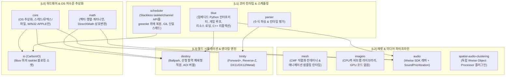

# Carbon Engine 전체 프레임워크 심층 분석서 (Full Ecosystem Architecture)

> **[검증 상태 · 2026-08-24]** 이 문서는 github.com/carbonengine 저장소 원본 및
> `src/` 코드와 대조하여 정정되었습니다. 정정 근거와 전체 내역은
> [Carbon_Source_Audit.md](Carbon_Source_Audit.md)를 참조하십시오.

> **문서 대상**: GitHub `carbonengine` 조직의 공개 저장소 약 35개 가운데 실제로 원본을 확인한 저장소  
> **핵심 모듈**: `scheduler`, `blue`, `core`, `io`, `mesh`, `imageio`, `audio`, `spatial-audio-clustering`, `parser`, `math`, `destiny`, `trinity`  
> **분석 목적**: Carbon Engine의 코어 런타임, 협조적 마이크로스레드 스케줄러, 지오메트리/에셋 직렬화, 공간 음향 클러스터링, C++ 글루 인터페이스 등 엔진 전반의 세부 기술을 확인 가능한 범위에서 해부합니다.

**[정정]** 이전 판은 제목과 머리말에서 "35개 레포지토리 전수"라고 단언했으나, 조직의 공개 저장소 총 개수는 페이지네이션에 따라 달라지므로 정확한 수치로 인용할 수 없습니다. 또한 이 문서가 실제로 원본을 확인한 저장소는 위에 나열한 핵심 모듈에 한정됩니다.

**[정정]** 이전 판은 Carbon을 Unity나 Unreal에 대응하는 통합 게임 엔진으로 전제했으나, Carbon은 애플리케이션 계층이 Python인 C++ 컴포넌트 플랫폼이며 각 저장소가 vcpkg 포트로 개별 소비됩니다. vcpkg-registry의 메타 포트 `carbon`(version 1.1.1, 의존성 26개)에는 `carbon-trinity`, `carbon-audio`, `carbon-resources`, `carbon-videoplayer`, `carbon-grpc`가 포함되지 않습니다. 즉 플랫폼과 렌더러가 의도적으로 별개 제품입니다.

---

## 1. Carbon Engine 서브시스템 생태계 지도

**[정정]** 이전 판의 지도에는 `audio --> spatial-audio-clustering` 의존 간선이 그려져 있었으나, 이 간선은 존재하지 않습니다. 두 저장소는 서로 완전히 독립이며 런타임에 Wwise 사운드 엔진 안에서 버스 이펙트로만 만납니다. 아래 지도는 각 저장소의 `vcpkg.json`으로 확인된 의존 관계만 실선으로 표시합니다.



`spatial-audio-clustering`에는 들어오는 간선도 나가는 간선도 없습니다. 이 플러그인의 의존 대상은 Carbon이 아니라 Wwise SDK(2025.1 이상)뿐입니다.

**[정정]** 이전 판은 `mesh`와 `imageio`가 `trinity`로 흘러들어가는 에셋 파이프라인으로 그렸으나, 두 저장소가 `trinity`의 의존성이라는 근거를 원본에서 확인하지 못했으므로 간선을 제거했습니다. `trinity`에서 확인된 Carbon 의존성은 `parser`(수식 평가)와 `pdm`입니다.

---

## 2. 서브시스템별 심층 기술 분석

---

### 2-1. `scheduler`: Stackless Python tasklet/channel API의 CPython 3.12 복원 확장

**[정정]** 이전 판은 이 저장소를 "Carbon Engine이 수십만 개의 게임 엔티티를 병목 없이 비동기 구동하는 심장부"인 C++ 코루틴 잡 시스템으로 서술했으나, 실제로는 게임 엔티티를 구동하는 C++ 잡 시스템이 전혀 아닙니다.

`scheduler`는 CPython 3.12용 C 확장 모듈 `_scheduler`입니다. EVE는 Stackless Python 2.7 기반이었고, CCP가 2023년 Python 3으로 이전하면서 Stackless를 유지하는 대신 순정 CPython을 택했습니다. 그 과정에서 잃어버린 tasklet/channel API를 `greenlet` 패키지 위에 다시 구현한 것이 이 저장소입니다. 설계 문서의 표현은 다음과 같습니다: "Create a Python 3.12 C extension to offer required functionality from Stackless Python utilising Greenlet." README도 "Only functionality required by Carbon has been implemented from the Stackless Python API."라고 범위를 한정합니다.

```
[Sender Tasklet] --( channel.send(obj) )--> [ Channel: 버퍼 없는 랑데부 ]
                                                        |
[Receiver Tasklet] <--( channel.receive() )-------------+
   (수신자가 없으면 송신자가 블록하고 스케줄러에 양보합니다)
```

#### 1) 실행 모델: GIL 아래 협조적 마이크로스레드

* `src/Tasklet.h`의 private 멤버가 `PyGreenlet* m_greenlet`이며, 스택 전환은 `PyGreenlet_Switch( m_greenlet, args, kwargs )` 한 줄입니다.
* **병렬 실행이 없습니다.** `ScheduleManager::Run`은 한 번에 정확히 하나의 tasklet으로 전환합니다. tasklet은 스레드를 이동할 수 없으며, 시도하면 "Cannot switch tasklet from another thread" 런타임 에러가 납니다.
* **[정정]** 따라서 "수십만 엔티티를 병목 없이"라는 이전 판의 서술은 구조상 성립하지 않습니다. 처리량은 단일 스레드의 GIL 아래 순차 실행으로 상한이 정해집니다.
* **[정정]** "$0.001\text{ms}$ 단위의 초고속 스위칭"이라는 수치는 저장소 어디에도 근거가 없으므로 삭제했습니다.

#### 2) Channel은 버퍼 없는 랑데부입니다

채널은 큐가 아닙니다. 송신자와 수신자가 동시에 만나야 값이 넘어가며, 상대가 없으면 호출자가 블록합니다. 구현은 `AddTaskletToWaitingToSend(current); current->Block(this); scheduleManager->Yield();` 입니다. 락프리 큐가 아니라 GIL 아래의 대기 목록입니다.

#### 3) 원본에 존재하지 않는 것

워커 스레드 풀, 잡 그래프, 의존성 간선, 작업 훔치기(work stealing), SIMD 디스패치가 전부 없습니다. `src/`는 파일 22개이고 그중 절반이 Python 바인딩 셰임입니다. vcpkg 의존성은 `python3>=3.12.9`와 `greenlet>=3.0.3`이며, `GILRAII.h`가 `PyGILState_STATE`를 감쌉니다.

#### 4) Haruka VR 엔진 적용점

**[정정]** 이전 판은 적용점을 "C++20 `std::coroutine` 기반 CSP 채널 작업 큐"로 적었으나, 이것은 범주 오류입니다. Carbon에는 잡 시스템이 없으므로 Haruka의 잡 시스템 설계에 입력을 줄 수 없습니다. 실제로 건질 수 있는 것은 다음 하나입니다.

* **`RunTaskletsForTime`의 프레임 예산 실행 패턴**: 새 스레드를 만들지 않고, 메인 스레드에 쌓인 지연 작업 큐를 정해진 데드라인까지만 소진한 뒤 반환합니다. 90fps VR에서 프레임 시간을 넘기지 않으면서 비필수 작업을 흘려보내는 데 그대로 쓸 수 있는 형태입니다.
* **Carbon은 오히려 Haruka의 `Threading.md`를 지지합니다.** Carbon도 독립적으로 같은 규칙에 도달했습니다: 상태는 정확히 한 스레드가 소유하고, 작업은 스레드를 이동하지 않으며, 스레드 간 상호작용은 소유자 큐에 넣는 것뿐입니다. 설계 문서에는 이 제약을 완화하는 안이 검토되었다가 기각된 기록이 남아 있습니다.
* `Threading.md`가 잡 시스템 도입을 측정 기반 트리거 뒤에 두고 있는 판단은 유효합니다. Carbon의 사례는 그 판단을 뒤집을 근거가 되지 못하며, 오히려 단일 소유 스레드 모델로도 대규모 시뮬레이션 제품이 출하되었다는 사례를 제공합니다.

---

### 2-2. `blue`: 런타임 호스트, C++ 리플렉션 프레임워크, 마셜러

**[정정]** 이전 판은 `blue`를 "C++ ↔ Python 바인딩 구조" 정도로 서술했으나, 이는 과소평가입니다. README의 자기 설명은 다음과 같습니다: "Central library providing the embedded Python interpreter, game loop, resource-loading and other functions." 즉 `blue`는 임베디드 Python 인터프리터, 게임 루프, 리소스 로딩을 **소유**하는 런타임 호스트이며, `BlueResMan`, `BackgroundReader`, `BlueObjectRecycler`가 여기에 있습니다. 바인딩은 그 위에 얹힌 한 부분일 뿐입니다.

#### 1) `blueexposure`: 선언 한 줄로 세 가지를 얻는 리플렉션

`blueexposure`는 완전한 C++ 리플렉션 프레임워크입니다(`IBlueRtti.h`, `ICustomPersist.h`, `INotify.h`, `ICopier.h`, `BlueMemberIterator.h`, `BlueRegistration.h`). 핵심은 다음 한 줄입니다.

```cpp
MAP_ATTRIBUTE("mass", mMass, "Mass of ball (kg)",
              Be::READWRITE | Be::NOTIFY | Be::PERSIST)
```

이 선언 하나로 Python 속성 접근과 변경 알림과 직렬화를 **동시에** 얻습니다. 플래그가 세 가지 능력을 각각 켜고 끄며, 멤버 하나를 노출하기 위해 게터, 세터, 시리얼라이저, 이벤트 발신을 따로 쓰지 않습니다.

* **Haruka 적용점**: Haruka의 `Reflect.hpp`가 참고할 만한 구조입니다. 현재 Haruka는 `SceneSerializer::ActorData`(`SceneSerializer.hpp:18-40`)가 컴포넌트 5종을 구조체 필드로 하드코딩하고 있어 새 컴포넌트가 `.hscene`과 `.hprefab` 왕복을 하지 못합니다. 속성 선언에 직렬화 플래그를 함께 붙이는 방식이면 이 하드코딩이 사라집니다. 변경 알림 플래그는 에디터의 프로퍼티 패널 갱신과 더티 마킹에 그대로 대응합니다.

#### 2) `blue.Marshal`: 바이트 태그 스트림

* 실제 opcode 집합은 `blue/src/Marshal.h`의 `PYTYPES` 열거형입니다. 구조적으로 가장 중요한 점은 **태그 바이트의 상위 비트가 공유 객체 플래그이고 타입은 하위 6비트뿐**이라는 것입니다(`TY_SHAREDFLAG = 0x40`, `TY_TYPEMASK = 0x3F`).
* 객체 메모이제이션이 실재합니다. `isShared`인 객체는 `std::vector<BluePy> mShared`에 등록되고, 재등장 시 `TY_REFERENCE = 27` 뒤에 인덱스만 씁니다.
* **[정정]** float32 태그가 존재하지 않습니다. `TY_FLOAT = 10`은 C `double`이고 `TY_FLOAT_0 = 11`은 리터럴 `0.0`입니다. 즉 스칼라 실수에 항상 8바이트를 씁니다. VR 스냅샷처럼 대역폭이 빠듯한 용도에는 이 부분을 그대로 가져오면 안 됩니다.
* 스트링 테이블 인덱스는 1바이트이고, 테이블 자체가 C++에 컴파일 타임 하드코딩되어 있습니다(`const char* MARSHAL_STRINGS[]`, `Marshal::Init`에서 인터닝). 세션 시작 시 협상하거나 패킷 헤더로 전달하지 않으므로 상한이 255개입니다.
* **[정정]** 이전 판이 서술한 "게임 월드 상태 전체를 메모리 덤프로 직렬화하고 포인터 테이블을 리베이스하는 제로카피 로딩"은 원본에 존재하지 않습니다. 마셜러는 태그 기반 스트림 직렬화기이며 포인터 리베이스 경로가 없습니다.
* 마셜러에는 바이트 스왑이 없습니다. 네이티브 순서로 씁니다. 빅엔디언은 한 계층 아래 `carbon-io`의 4바이트 프레임 헤더에만 있습니다.

---

### 2-3. `mesh`: CMF 직렬화 컨테이너 & QTangent 정점 패킹

**[정정]** 이전 판은 `mesh`를 "고성능 메쉬 조작 라이브러리"로 서술했으나, README의 자기 설명은 다릅니다: "Library that handles serialization of 3D mesh, skeleton and animation data. It also provides basic animation runtime support." 실체는 CMF(Carbon Mesh Format) 직렬화 컨테이너와 애니메이션 샘플링 런타임, 오프라인 CLI(`cmfprocessor`), Vulkan 디버그 뷰어입니다.

```
[임포트 시 정점 레이아웃: 56 Bytes]  (src/processor/fbximport/mesh.cpp:341-402)
Position Float32x3(12B) + Normal Float32x3(12B) + Tangent Float32x3(12B)
                        + Binormal Float32x3(12B) + TexCoord Float32x2(8B)
   |
   v (QTangent 압축 + UV half 변환)
[패킹된 정적 정점: 24 Bytes  (약 57% 절감)]
Position Float32x3(12B) + PackedTangent Int16Normx4(8B) + TexCoord Float16x2(4B)

[스킨드 정점: 32 Bytes]
  위 24B + BoneIndices UInt8x4(4B) + BoneWeights UInt8Normx4(4B)
```

**[정정]** 이전 판의 "48B에서 16B로 67% 압축"은 양 끝이 모두 틀렸습니다. 임포트 레이아웃은 48바이트가 아니라 56바이트이고(Binormal이 별도 스트림으로 들어옵니다), 16바이트 정점은 원본 어디에도 없습니다. 실제 절감은 56에서 24로 약 57%입니다.

#### 1) QTangent: TBN 전체를 8바이트로

**[정정]** 이전 판은 옥타헤드럴 인코딩을 서술했으나, 원본에 옥타헤드럴 인코딩이 없습니다(`octahedr` 검색 0건). 실제로 구현된 것은 **QTangent**이며 `include/cmf/tangents.h`가 이를 "Quaternion-based compression using 16-bit signed normalized integers"로 설명합니다.

* TBN 정규직교 기저를 단위 쿼터니언으로 바꾸고, `w`는 버려서 언팩 때 복원하며 그 자리에 handedness 부호를 넣습니다.
* `Int16Norm x 4 = 8바이트`로 **노멀, 탄젠트, 바이노멀 세 벡터 전부**를 담습니다. 옥타헤드럴은 노멀 하나만 다루므로 애초에 범주가 다릅니다.
* **Haruka 적용 가치가 큽니다.** Haruka의 `Vertex.hpp`는 속성 4개의 48바이트 float 레이아웃입니다. QTangent를 도입하면 노멀과 탄젠트에 쓰이는 float 필드를 8바이트 하나로 대체할 수 있고, 언팩이 셰이더 쿼터니언 회전 한 번이므로 정점 셰이더 비용도 감당 가능합니다. Quest Pro의 정점 대역폭 제약을 고려하면 우선순위가 높은 항목입니다.

#### 2) 위치 양자화와 듀얼 쿼터니언 스키닝은 원본에 존재하지 않습니다

* **[정정] 16비트 위치 양자화가 없습니다.** Position은 무조건 `Float32x3`입니다. 정점 선언을 만드는 두 곳(`mesh.cpp:341`, `:531`)이 모두 하드코딩이고, `MeshImportOptions`는 UV, 색상, 본 인덱스의 타입만 설정 가능하게 하며 위치는 아예 제공하지 않습니다(`quantiz` 검색 0건). 결정적으로 v1 포맷에 scale/bias/origin/extent 필드가 없어서 디코더가 원래 좌표를 복원할 방법 자체가 없습니다.
* **[정정] 듀얼 쿼터니언 스키닝이 없습니다.** 스키닝은 선형 블렌드 스키닝(LBS)입니다. `geometryprepass.comp:475-478`이 4개 `mat4x4` 본 행렬의 가중합을 계산합니다(`dualquat` 검색 0건). 포즈는 `Transform{Vector3 position, Quaternion rotation, Vector3 scale}`이고 바인드 포즈는 `Matrix`입니다.
* 참고로 Haruka에서 듀얼 쿼터니언 도입은 별도의 위험을 동반합니다. `Renderer_render.cpp:234-237`이 모델 행렬의 열 길이에서 스케일을 추출하는데, 듀얼 쿼터니언으로 바꾸면 이 값이 항상 1.0이 되어 컬링이 깨집니다.

#### 3) 저장 모델은 메가버퍼의 반대입니다

* **[정정]** 이전 판은 이 압축이 "메가버퍼 정점 패킹"으로 이어진다고 보았으나, CMF의 저장 모델은 메가버퍼와 반대 방향입니다. `BufferView{sectionIndex, offset, size, stride}` 구조에 버퍼당 섹션 하나, 섹션마다 각자의 `gpuAlignment`를 둡니다. 명시적 목표가 "relocatable in memory, allowing selective loading of data as needed"입니다.
* `meshoptimizer`의 정점/인덱스 스트림 코덱은 **디스크상 섹션 전체**에만 적용되며 상주 메모리를 줄이지 않습니다. 즉 이 압축은 패키지 크기 절감이지 런타임 VRAM 절감이 아닙니다.
* Haruka가 메가버퍼와 selective loading 중 무엇을 택할지는 별개의 설계 결정이며, `mesh`는 후자의 사례를 제공할 뿐 전자를 지지하지 않습니다.

---

### 2-4. `spatial-audio-clustering`: 공간 오디오 오브젝트 슬롯 절약용 k-means 플러그인

이 저장소는 실재하며 빌드 가능한 Wwise Object Processor 플러그인입니다(`AK::IAkOutOfPlaceObjectPlugin`, `bCanProcessObjects = true`, `bIsInPlace = false`, CompanyID 64 / PluginID 6973, Wwise 2025.1 이상). 라이선스는 Apache-2.0이며 `NOTICE` 파일이 있습니다. 알고리즘 전체가 `SpatialClustering.cpp` 약 410줄입니다.

**[정정]** 해결 대상이 이전 판의 서술과 다릅니다. 고갈되는 자원은 **Wwise 보이스가 아니라 시스템 공간 오디오 오브젝트 슬롯**입니다. README의 근거는 "Most spatial audio endpoints (Dolby, Sonic, DTS) offer up to 128 concurrent spatial audio objects"입니다. 보이스 고갈은 다른 저장소의 다른 시스템(`carbonengine/audio`의 `SoundPrioritization`, `maxAwakeGameObjects` 기본 75)이 담당합니다.

```
[N개의 입력 오디오 오브젝트]
      |
      v (평면 분할 k-means, Lloyd 반복 최대 20회, k = floor(sqrt(N)))
      v (그리고 DISTANCE_THRESHOLD 거리 게이트)
[k개의 클러스터: 비가중 산술 평균 중심 + Wwise MixNinNChannels 선형 진폭 합]
      |
      v
[출력 오디오 오브젝트 (시스템 공간 오디오 슬롯 소비량 감소)]
```

#### 1) 실제 알고리즘

* **평면 분할 k-means입니다.** Lloyd 반복 최대 20회, `k = floor(sqrt(N))`, 그리고 거리 게이트가 전부입니다.
* **[정정] 계층적 클러스터링이 아닙니다.** 덴드로그램도, 연결 기준(linkage)도, 병합 트리도 없습니다.
* **[정정] 에너지 가중이 아닙니다.** `calculateCentroid()`는 위치를 그냥 더해 개수로 나누는 **비가중 산술 평균**입니다. `Utilities::CalculateMeanPosition()`도 비가중입니다. 결정적으로 입력 구조체가 `ObjectPosition { AkVector position; AkAudioObjectID key; }` 뿐이라 **볼륨 값을 받지도 않습니다.** 이전 판의 $\vec{P}_{\text{cluster}} = \sum E_i \vec{P}_i / \sum E_i$ 공식은 원본에 존재하지 않습니다.
* 저장소에 등장하는 유일한 가중치는 `initializeCentroids()`가 원점에 가까운 **시드 중심 하나**를 구할 때 쓰는 가우시안 공간 밀도 커널 $w = \exp(-d^2 / 2r^2)$ 입니다. 이마저 첫 반복에서 비가중 평균으로 덮어써지며, 애초에 음량이 아니라 거리 커널입니다.
* **[정정] $I_{\text{cluster}} = \sqrt{\sum I_i^2}$ 같은 공식이 없습니다.** 클러스터 음량은 Wwise의 `MixNinNChannels`가 각 멤버를 자기 `cumulativeGain` 램프와 함께 누적한 결과이며, 이는 **선형 진폭 합**이지 제곱합의 제곱근이 아닙니다.
* **[정정] LPF나 피치 조절이 없습니다.** `ObjectClusterFXParams.h`에 `static const AkUInt32 NUM_PARAMS = 1;`이고 유일한 파라미터가 `DISTANCE_THRESHOLD = 0`입니다. `ObjectClusterNonRTPCParams`는 빈 구조체입니다. 필터도, 바이쿼드도, 컷오프도, 피치도, 리샘플링도 없습니다. **플러그인은 DSP를 전혀 수행하지 않고 라우팅과 믹싱만 합니다.**
* `ClusterState`는 `{AkUInt32 activeInputCount; AkUInt16 maxFrames;}` 뿐입니다. 반경도, 바운딩 볼륨도, 클러스터 간 거리 함수도 없습니다.
* README가 제시하는 수치는 "up to 60% reduction in audio thread CPU usage"이며, 함선 20척 씬에서 출력 오브젝트가 20개에서 24개 수준입니다.

#### 2) 성능 주의사항

`initializeCentroids`는 $O(N^2)$이며 $N^2$회 `std::exp()`를 호출하고, 매 오디오 콜백마다 처음부터 다시 계산합니다. 실시간 오디오 스레드에서 힙 할당도 수행합니다. 그대로 이식하면 안 되는 부분입니다.

#### 3) Haruka VR 엔진 적용점

* 이 플러그인에서 가져갈 가치가 있는 것은 클러스터링 수학이 아니라 **프레임 간 클러스터 정체성 유지**와 **멤버가 바뀔 때의 게인/행렬 보간**입니다. `GeneratedObject::volumeMatrix`가 이전 볼륨 행렬을 캐시하며, 이것 없이는 클러스터 멤버가 바뀔 때마다 파형 불연속이 생깁니다.
* **Haruka에는 `carbonengine/audio`의 `SoundPrioritization`이 더 유용합니다.** 약 150줄, MIT 라이선스이며, 필요한 입력이 위치와 불리언뿐입니다. 거리 제곱을 비용으로 삼고 개별 특징을 감산 보너스로 처리해 정렬한 뒤 예산까지 살리는 구조라 Haruka의 오디오 시스템에 그대로 대응합니다. 다만 상수가 EVE 스케일에 맞춰져 있으므로(EVE는 거리 제곱이 $10^{10}$을 넘어서 보너스에 $10^7$ 배수가 필요합니다) VR 스케일에서는 다시 잡아야 합니다.

---

### 2-5. `imageio`: CPU측 비트맵 라이브러리

**[정정]** 이전 판은 `imageio`를 "압축 해제 없이 GPU VRAM으로 직접 전송하는 파이프라인"으로 서술했으나, 이는 사실이 아닙니다. `imageio`는 2014년경에 작성된 **CPU측 비트맵 라이브러리**이며 **GPU 코드가 0바이트입니다**(`vulkan`, `d3d`, `directx`, `opengl`, `gpu` 검색 전부 0건). 핵심 타입은 `HostBitmap`이고 내용은 `malloc`으로 잡은 픽셀 버퍼와 치수, 그리고 DXGI를 그대로 옮긴 `PixelFormat`입니다.

* 포맷 핸들러: BMP, DDS, JPG, PNG, TGA, PSD, VTA(NanoVDB 기반 CCP 독자 애니메이션 볼륨 텍스처 컨테이너).
* 의존성: libpng, libjpeg-turbo, zlib, carbon-core, openvdb, gtest.

#### 1) ASTC가 없습니다: Quest 타깃에서 가장 중요한 정정

**[정정]** `include/PixelFormat.h`는 `DXGI_FORMAT` 0번부터 99번까지를 그대로 옮긴 것이고 `PIXEL_FORMAT_BC7_UNORM_SRGB = 99`에서 끝납니다. ASTC, ETC1, ETC2, EAC, PVRTC 항목이 하나도 없으며, `astc` 검색은 `imageio`와 `imagetools` 양쪽 모두 0건입니다. 즉 **Adreno가 하드웨어로 지원하는 포맷이 하나도 없습니다.** Quest Pro를 타깃으로 하는 Haruka에게 이 라이브러리는 텍스처 압축 경로로서 쓸 수 없습니다.

* `imagetools`는 NVTT와 (선택적으로) AMD Compressonator를 감싼 Python/Blue 확장이며 **BCn 전용**이고 기본값이 BC1입니다. 여기에도 ASTC 경로가 없습니다.

#### 2) 밉맵 생성은 있으나 제한이 많습니다

**[정정]** 밉맵 체인 자동 생성 자체는 실재합니다. 다만 제약이 큽니다.

* 2D와 CUBE만 지원하고, 이미 밉이 있으면 거부하며, 8비트 무압축 포맷만 허용합니다.
* 필터는 저장 바이트에 대한 2x2 박스 평균에 정수 시프트입니다.
* sRGB에서 선형으로의 변환이 없고, 알파 프리멀티플라이도 없습니다. 따라서 **알베도 밉 체인이 체계적으로 어두워집니다.** 이 구현을 참고 대상으로 삼으면 안 됩니다.

#### 3) 텍스처 아틀라스 패커: 원본에 존재하지 않음

**[정정]** 이전 판은 "텍스처 아틀라스 패킹 알고리즘 내장"이라고 서술했으나, `imageio`에 아틀라스 패커가 없습니다(`atlas` 검색 0건). 참고로 아틀라스 패커가 실제로 있는 곳은 `trinity`이며, 텍스처 아틀라스가 아니라 **섀도맵 아틀라스 패커**입니다.

---

### 2-6. `parser`: 수식 파서

**[정정]** 이전 판은 이 저장소를 "게임 룰 평가기"로 서술하고 "바이트코드 JIT 컴파일", "$0.001\text{ms}$ 내 계산"이라는 구체값을 붙였으나, 근거가 없습니다. 저장소의 자기 설명은 "Math expression parser" 한 줄입니다.

* `trinity`가 `>=1.0.2`로 의존하며, 용도는 **셰이더와 커브 수식 평가**이지 게임 룰이 아닙니다.
* 함선 데미지나 스킬 보정 같은 EVE 게임 룰을 담당하는 Dogma는 저장소로도 vcpkg 포트로도 공개되지 않았습니다(부재로 확인). `carbonengine/fsd`의 README도 "We do not plan on developing FSD further as we now prefer to use cFSD to handle our games' static data"라고 적고 있으며 cFSD는 조직에 없습니다.
* JIT 컴파일 여부와 실행 시간은 **원본 미확인**입니다.

---

## 3. Carbon Engine 서브시스템 $\leftrightarrow$ Haruka VR 엔진 대응표

**[정정]** 이전 판의 대응표는 각 행의 "내부 핵심 알고리즘" 칸이 대부분 원본에 존재하지 않는 기능을 적고 있었고, 그 위에 Haruka 컴포넌트를 대응시켰습니다. 아래 표는 확인된 사실만으로 다시 작성했으며, 가져올 수 없는 것은 그대로 표시했습니다.

| Carbon 모듈 | 원본에서 확인된 실체 | Haruka 적용 판단 |
|---|---|---|
| **`scheduler`** | Stackless의 tasklet/channel API를 greenlet 위에 복원한 CPython 3.12 C 확장. GIL 아래 단일 스레드 협조적 실행, 버퍼 없는 랑데부 채널. 잡 시스템 없음 | 잡 시스템 설계 입력으로는 **사용 불가**. `RunTaskletsForTime`의 프레임 예산 실행 패턴만 채택. `Threading.md`의 단일 소유 스레드 모델을 지지하는 사례 |
| **`mesh`** | CMF 직렬화 컨테이너 + 애니메이션 샘플링. 임포트 56B, 패킹 24B(스킨드 32B). QTangent(`Int16Normx4` 8B로 TBN 전체). 스키닝은 LBS. 위치 양자화 없음 | **QTangent 채택 우선순위 높음**. 현재 `Vertex.hpp`가 48바이트 float 4속성이므로 절감 폭이 큼. 위치 양자화와 듀얼 쿼터니언은 가져올 것이 없음 |
| **`spatial-audio-clustering`** | 비가중 k-means(k = floor(sqrt(N))), 파라미터는 `DISTANCE_THRESHOLD` 하나, DSP 없음. 절약 대상은 시스템 공간 오디오 오브젝트 슬롯 | 클러스터링 수학은 채택 대상이 아님. **프레임 간 클러스터 정체성 유지와 게인 행렬 보간**만 참고. `initializeCentroids`는 $O(N^2)$이므로 그대로 이식 금지 |
| **`audio`** | CCP의 Wwise SDK 래퍼(MIT). 독자적인 부분은 `SoundPrioritization`과 `SpatialAudioSettings` 뿐 | **`SoundPrioritization`이 이 생태계에서 오디오 쪽 최대 수확**. 약 150줄, 위치와 불리언만 필요. 단 상수를 VR 스케일로 재조정해야 함 |
| **`imageio`** | CPU측 비트맵 라이브러리. GPU 코드 0바이트, ASTC/ETC2 없음, 아틀라스 패커 없음, 밉맵은 sRGB 미보정 | **Quest 타깃에 사용 불가**. Adreno가 지원하는 압축 포맷이 하나도 없음. 텍스처 경로는 별도 수단 필요 |
| **`parser`** | 셰이더와 커브 수식 평가용 수식 파서. 게임 룰 평가기가 아님 | 해당 없음. Haruka의 게임 룰 수식 요구는 이 저장소로 충족되지 않음 |
| **`io` (`CarbonIO`)** | CPython의 socket/ssl 모듈을 포크해 libuv 위에 올린 것. IOCP/epoll 직접 호출 없음, 워커 스레드 풀 없음. 4바이트 빅엔디언 프레임 헤더, 상위 비트가 압축 플래그 | 링버퍼나 락프리 구조는 원본에 없으므로 가져올 것이 없음. **4바이트 헤더에 길이와 압축 플래그를 함께 싣는 와이어 설계**만 참고 가능. 라이선스가 PSF-2.0이라 파생물 배포 시 변경 요약 동봉 의무 있음 |
| **`blue`** | 임베디드 Python 인터프리터, 게임 루프, 리소스 로딩 소유. `blueexposure`의 `MAP_ATTRIBUTE` 한 줄로 속성 접근 + 변경 알림 + 직렬화 | **`Reflect.hpp`의 설계 참고 대상**. 현재 `SceneSerializer::ActorData`의 컴포넌트 하드코딩을 해소하는 방향. 마셜러의 double 고정 실수는 채택 금지 |
| **`destiny`** | 1차 선형 항력 ODE를 폐쇄형으로 푸는 완성된 시뮬레이션(약 22,200줄). $\tau = m \cdot \text{agility} / \text{friction}$, 1초 틱. 증분식 floating origin | 항력 적분기와 증분 floating origin은 참고 가치가 있음. **충돌 응답은 가져오면 안 됨**(접선 미끄러짐도 반발 계수도 없음). `Ball` 자료구조는 안티패턴 |
| **`trinity`** | Forward+(타일드), CPU측 프러스텀 컬링, 실재하는 Reverse-Z(전역 렌더 상태 오버라이드 테이블 방식). 셰이더 파일은 저장소에 없음. VR 지원 전무 | **Reverse-Z를 켜는 방식**(비교 함수 매핑 테이블)이 실질적 수확. SDF 쉴드와 절차적 볼류메트릭은 원본에 없음. Vulkan 백엔드는 PR #67로 존재하나 미병합 |
| **`math`** | 27개 헤더의 기본 수학 유틸리티. SIMD 인트린식 없음, 듀얼 쿼터니언 없음, DirectXMath는 연산이 아니라 상호변환용. 표준 Z 투영 | **채택할 것이 없습니다.** Android/Linux 프리셋도 없음. Haruka는 glm을 유지하는 편이 낫습니다 |
| **`core`** | OS 추상화 헤더 30개. 플랫폼 분기가 `if(APPLE)`과 `if(WIN32)`뿐이며 Android/ARM64 경로 없음 | 라이브러리 자체는 사용 불가. **Tracy 계측 관행**(뮤텍스마다 이름과 소유자 부여)과 `CCP_MALLOC` 귀속 할당 추적은 참고 가치가 있고, Tracy는 Android/ARM64를 지원하므로 Haruka에 적합 |

---

## 4. 최종 결론

**[정정]** 이전 판은 "이 전체 스택을 차용하면 대규모 우주 부유 파편과 멀티플레이어를 90fps로 완벽히 구동한다"고 결론지었으나, 이 주장은 근거가 없습니다. 아래는 확인된 사실 위에서 다시 쓴 결론입니다.

Carbon은 Unity나 Unreal 의미의 통합 게임 엔진이 아닙니다. 애플리케이션 계층이 Python인 C++ 컴포넌트 플랫폼이며, 약 35개 저장소가 vcpkg 포트로 개별 소비되고, 실제 배포 타깃은 Fenris Creations(구 CCP Games) 내부의 Perforce 모놀리스입니다. GitHub은 컴포넌트 미러입니다. 조직에 아키텍처 문서가 존재하지 않는다는 점도 함께 고려해야 합니다. `carbonengine/documentation`의 실제 페이지는 8개이고, `index.md`는 문자 그대로 C++ 코딩 가이드라인이며 그마저 오랫동안 갱신되지 않았다는 배너가 붙어 있습니다.

플랫폼 관점에서 결정적인 제약이 있습니다. 확인된 플랫폼 대상은 x64-windows, x64-osx, arm64-osx뿐이며 **Linux도, 콘솔도, Android도, Quest도 없습니다.** `core`의 플랫폼 분기가 `if(APPLE)`과 `if(WIN32)`뿐이고, `imageio`에 Adreno가 지원하는 압축 포맷이 하나도 없으며, `trinity`에 VR 관련 심볼이 전무합니다(foveation, multiview, OpenXR, stereo 전부 0건). 따라서 **Carbon 스택을 통째로 차용하는 경로는 Quest Pro 타깃에서 성립하지 않습니다.**

Haruka가 이 생태계에서 실제로 가져올 수 있는 것은 다음 범위입니다.

1. **`mesh`의 QTangent**: `Int16Normx4` 8바이트로 TBN 전체를 담는 정점 압축입니다. 현재 `Vertex.hpp`가 48바이트 float 레이아웃이므로 정점 대역폭 절감 효과가 명확합니다.
2. **`audio`의 `SoundPrioritization`**: 약 150줄, MIT, 위치와 불리언만 필요한 이미터 컬링 및 보이스 예산 로직입니다. 상수를 VR 스케일로 재조정해야 합니다.
3. **`trinity`의 Reverse-Z 활성화 방식**: 비교 함수 매핑 테이블로 깊이 테스트를 전역 오버라이드하는 구조입니다. Haruka는 Reverse-Z 영향 지점이 열여덟 곳에 흩어져 있어 한 번에 전환해야 하는데, 이 방식이 그 전환을 한 지점으로 모읍니다.
4. **`blue`의 `MAP_ATTRIBUTE` 패턴**: 속성 선언 하나로 접근과 알림과 직렬화를 함께 얻는 구조이며, `Reflect.hpp`와 `SceneSerializer`의 컴포넌트 하드코딩 문제에 직접 대응합니다.
5. **`scheduler`의 `RunTaskletsForTime`**: 새 스레드 없이 프레임 예산까지만 지연 작업을 소진하는 실행 패턴입니다.
6. **`core`의 Tracy 계측 관행**: 뮤텍스마다 이름과 소유자를 부여하는 방식이며, Tracy가 Android/ARM64를 지원하므로 Quest 프로파일링에 그대로 쓸 수 있습니다.
7. **`destiny`의 증분식 floating origin과 폐쇄형 항력 적분**: 다만 충돌 응답과 `Ball` 자료구조는 배제해야 합니다.

반대로 이 생태계가 Haruka에 주지 못하는 것도 분명합니다. 잡 시스템, SIMD 수학, ASTC 텍스처 경로, Vulkan 백엔드, VR 렌더링, 위치 양자화, 듀얼 쿼터니언 스키닝, 그리고 게임 룰 평가기가 여기에 해당합니다. 이 항목들은 Haruka가 자체적으로 해결해야 하며, Carbon 분석을 근거로 우선순위를 앞당길 이유가 없습니다.
