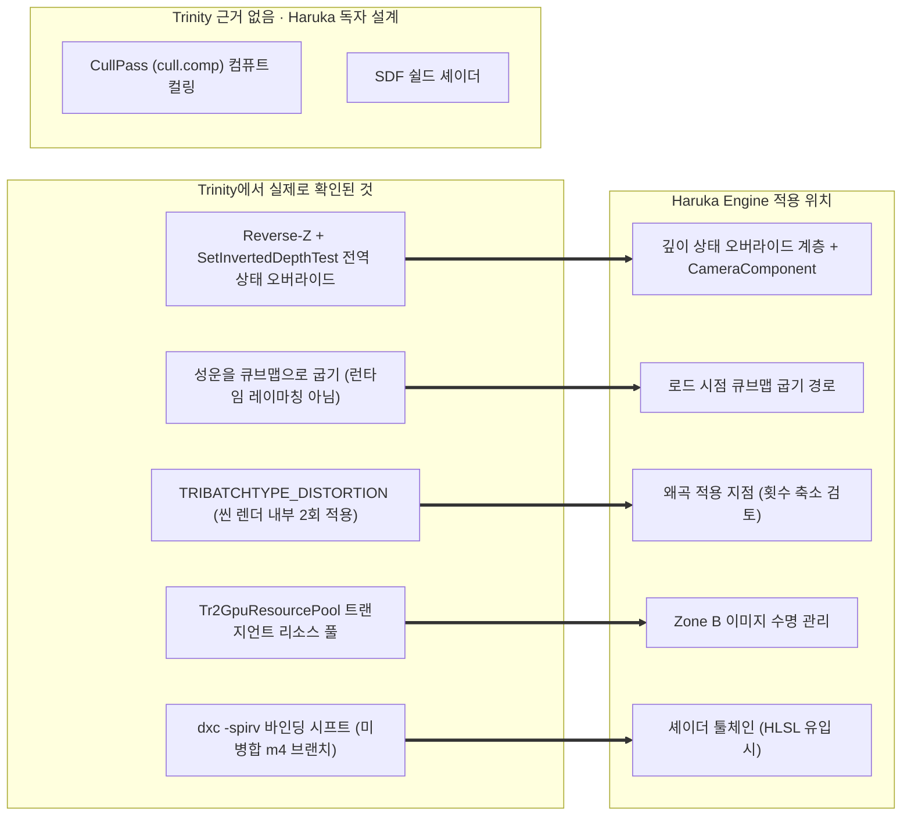

# Trinity 렌더링 엔진 심층 분석 & Haruka Engine 차용 기술 사양서

> **[검증 상태 · 2026-08-24]** 이 문서는 github.com/carbonengine 저장소 원본 및
> `src/` 코드와 대조하여 정정되었습니다. 정정 근거와 전체 내역은
> [Carbon_Source_Audit.md](Carbon_Source_Audit.md)를 참조하십시오.

> **대상**: `carbonengine/trinity`  
> **목적**: EVE Online의 우주 비주얼과 대규모 함대 렌더링을 담당해 온 **Trinity 그래픽스 엔진의 공개된 부분, 즉 렌더 패스 오케스트레이션과 렌더 상태 관리 구조**를 분석하고, **Haruka Engine(Vulkan 1.4 / 모바일 XR VR)**에 차용할 만한 부분을 명세합니다.

**[정정]** 이전 판의 목적문은 "셰이더 기법"을 분석 대상으로 삼았으나, 저장소에는 셰이더가 한 줄도 공개되어 있지 않으므로 분석이 불가능합니다.

---

## 0. 이 문서를 읽기 전에: 공개된 것은 오케스트레이션뿐입니다

이 문서의 이전 판은 전제부터 성립하지 않았습니다. 정정의 출발점이므로 먼저 명시합니다.

* **trinity 저장소에는 셰이더 파일이 없습니다.** `.fx`, `.hlsl`, `.fxh`, `.glsl`을 저장소 전체에서 검색하면 `trinityal/` 안의 Metal 파일 2개만 나옵니다.
* 렌더러가 로드하는 **94개 이펙트는 전부 런타임 리소스 경로**입니다. 예를 들어 `"res:/Graphics/Effect/Managed/Space/PostProcess/ToneMapping.fx"` 같은 문자열이며, 이 경로가 가리키는 번들은 EVE 독점 자산이라 공개되지 않았습니다.
* 따라서 공개된 것은 **오케스트레이션**뿐입니다. 즉 어떤 패스가 어떤 순서로, 어떤 버퍼를 바인딩하고, 어떤 렌더 상태로 도는지는 읽을 수 있지만, **셰이더 수학은 0바이트**입니다.
* `shadercompiler/`는 CCP 자체 HLSL 프론트엔드입니다(`HLSLParser.y` + `HLSLScanner.re`, lemon과 re2c 사용). **HLSL과 MSL만 방출하며 SPIR-V나 GLSL 경로가 없습니다.** `Platforms.h`의 값은 `PLATFORM_DX11=2`, `PLATFORM_DX12=6`, `PLATFORM_METAL=10`입니다.

> **이 문서에 등장하는 모든 GLSL 코드 블록과 LaTeX 수식은 Trinity에서 가져온 것이 아닙니다.** 개념을 보고 새로 작성한 창작물이며, 원본과의 대응 관계가 검증된 바 없습니다. 아래에서는 해당 블록마다 `[창작 · 원본 아님]`으로 표시합니다.

---

## 1. Trinity 렌더링 엔진의 핵심 아키텍처 맵

```
+-------------------------------------------------------------------------------+
|                    Trinity Graphics Pipeline (원본 대조 후)                     |
+-------------------------------------------------------------------------------+
       |
       +---> [1. CPU 컬링 + Indirect 재생]
       |     • EveInstancedMeshManager::PerformFrustumCulling (CPU측, TBB)
       |     • CPU가 기록하는 Tr2IndirectDrawBuffer -> ExecuteIndirect 가 재생
       |
       +---> [2. Forward+ 라이팅과 깊이 수학]
       |     • Tr2LightManager: LightBuffer / LightIndexBuffer (타일 라이트 리스트)
       |     • Reverse-Z (유한 far). Tr2EffectStateManager::SetInvertedDepthTest
       |
       +---> [3. 우주 배경]
       |     • 환경 큐브맵 (주석 표기 "the environment cubemap (aka nebula)")
       |     • froxel 볼류메트릭 안개 (Mie). EveDistanceField가 안개 영역 크기를 결정
       |
       +---> [4. Space VFX]
       |     • TRIBATCHTYPE_DISTORTION + ApplyDistortion (씬 렌더 내부에서 2회)
       |     • GPU 파티클
       |
       +---> [5. Ship PBR Material Model]
             • 미확인 (셰이더 번들이 비공개이므로 이 저장소에서 확인 불가)
```

**[정정] 이 맵에서 뒤집힌 항목**

| 이전 판의 서술 | 원본 대조 결과 |
| --- | --- |
| Compute Shader Frustum & Occlusion Culling | 컬링은 CPU측입니다. 컬링 컴퓨트 셰이더가 없습니다. |
| GPU Indirect Draw Batching (Zero CPU Overhead) | 버퍼는 실재하나 CPU가 기록합니다. "Zero CPU Overhead"가 아닙니다. |
| Reverse-Z & Infinite Far Plane (0.1m ~ 1,000,000 km) | Reverse-Z는 실재하나 **원평면은 유한**합니다. 저 수치는 저장소에 없습니다. |
| Rayleigh / Mie 대기 산란 | **Rayleigh는 저장소 전체 0건입니다.** Mie는 대기 산란이 아니라 볼류메트릭 안개용입니다(`UpdateMieEnvironmentMap.fx`, `FroxelPerFrameData::EnvironmentG`). |
| 거대 행성 고리 렌더링 | **0건입니다.** 근거가 없습니다. |
| Raymarched 3D Noise Nebulae | 성운은 **큐브맵 텍스처**입니다. 레이마칭이 아닙니다. |
| Space Dust & Aurora Particle Fields | GPU 파티클 시스템은 실재하나, "Space Dust"와 "Aurora"라는 구체적 이펙트는 확인되지 않았습니다(리소스 번들 비공개). |
| SDF 에너지 쉴드 & 피격 육각 펄스 | **원본에 존재하지 않습니다.** 아래 2-2절을 참조하십시오. |
| Anisotropy + Detail Micro-Normal Masks | **미확인.** 머티리얼 모델은 셰이더 안에 있고 셰이더가 비공개이므로 이 저장소에서는 확인할 수 없습니다. |

---

## 2. 이전 판이 주장한 5대 기술의 원본 대조 & Haruka 차용 사양

**[정정]** 이 절은 원래 "Trinity의 5대 핵심 렌더링 기술"이었습니다. 대조 결과 다섯 중 **하나(2-5 Reverse-Z)만 원본과 일치**했고, 하나(2-4 왜곡)는 기구는 실재하나 적용 위치가 달랐으며, 나머지 셋은 사실이 아니었습니다. 절 번호와 제목은 독자가 이전 판을 대조할 수 있도록 유지합니다.

---

### 2-1. 인스턴스 렌더링 파이프라인: 컬링은 CPU측입니다

**[정정]** 이전 판은 이 절을 "GPU-Driven 파이프라인"으로 서술하며 컴퓨트 셰이더가 GPU 안에서 컬링과 LOD 판정을 한다고 적었으나, Trinity의 컬링은 전부 CPU에서 돌고 컬링 컴퓨트 셰이더는 저장소에 존재하지 않습니다.

* **원본에서 실제로 확인되는 것**:
  1. **컬링은 CPU측입니다.** `EveInstancedMeshManager::PerformFrustumCulling`(line 480)이 TBB 래퍼인 `Tr2ParallelDo`로 계층적 구 판정을 수행합니다.
  2. **LOD도 같은 CPU 경로에서 정합니다.** 화면 픽셀 크기 추정값으로 LOD 단계를 결정합니다.
  3. `Tr2IndirectDrawBuffer`는 실재합니다. **그러나 이 버퍼를 채우는 주체는 CPU이고**, GPU는 `ExecuteIndirect`로 그 기록을 재생할 뿐입니다.
  4. 따라서 이 구조의 이득은 "CPU 오버헤드 제거"가 아니라 **드로우 콜 제출 횟수의 축약과 CPU 컬링의 병렬화**입니다. `Zero CPU Overhead`라는 서술은 사실이 아닙니다.

* **Haruka Engine에 대한 의미**:
  * Haruka의 `CullPass`(`cull.comp`)는 **Trinity에 대응물이 없는 독자 설계**입니다. Trinity를 근거로 정당화할 수 없으며, 컴퓨트 컬링을 유지할지 CPU 컬링으로 갈지는 Haruka가 자체 판단해야 합니다.
  * 다만 Trinity가 보여 주는 것은, 데스크톱 외장 GPU를 쓰는 상용 우주 MMO조차 **CPU 병렬 컬링 + Indirect 재생 조합으로 대규모 함대를 처리해 왔다**는 사실입니다. 모바일 타일 GPU에서 컴퓨트 디스패치와 그에 따르는 배리어 비용을 감수할 가치가 있는지 재검토할 근거가 됩니다.
  * 관련하여 Haruka 쪽 실측 결함을 함께 기록합니다. `Renderer_render.cpp:215`의 `buildDrawCommands`와 `:296`의 `extractRenderView`가 **서로 다른 카운터로 Transform SSBO 인덱스를 증가시켜 불일치가 남아 있습니다**(DEF-01). 컬링 위치를 어디로 정하든 이 문제가 먼저 해소되어야 합니다.

---

### 2-2. SDF 에너지 쉴드 & 피격 왜곡 셰이더: 원본에 존재하지 않습니다

**[정정]** 이전 판은 이 절 전체에 육각 격자 펄스 수식과 프레넬 림 공식, ASCII 다이어그램을 실었으나, **Trinity 저장소에 SDF 쉴드가 존재하지 않습니다.** 저 수식들은 원본 대조 없이 작성된 창작물입니다.

* **검색 결과**: `signed distance`, `sdf`, `hexagon`, `hexgrid` 네 가지 모두 **저장소 전체에서 0건**입니다. 육각 격자도, 피격 펄스도, 쉴드 굴절 셰이더도 근거가 없습니다.
* 애초에 0절에서 적었듯 **셰이더 파일 자체가 공개되지 않았으므로**, 설령 EVE 클라이언트에 그런 이펙트가 있더라도 이 저장소에서는 그 수학을 확인할 방법이 없습니다.

#### 이름이 비슷해서 혼동하기 쉬운 것: `EveDistanceField`

같은 오해가 반복되지 않도록 실물을 적어 둡니다.

* `EveDistanceField`는 **셰이더가 아니라 CPU측 근접·경계 추적기**입니다.
* 하는 일은 **카메라 거리를 기준으로 볼륨 안개 영역의 크기를 정하는 것**입니다. 쉴드 렌더링과 무관합니다.
* 영역 크기가 프레임마다 튀지 않도록 **히스테리시스**를 둡니다. 진입 0.25초, 이탈 2.0초입니다.
* 즉 이름의 "DistanceField"는 셰이더에서 말하는 signed distance function이 아니라, 문자 그대로 거리에 따른 영역 판정을 뜻합니다.

* **Haruka에 대한 의미**:
  * 쉴드 이펙트를 만들 것이라면 그것은 Haruka의 독자 설계이며, Trinity를 근거로 인용해서는 안 됩니다.
  * 다만 `EveDistanceField`의 **비대칭 히스테리시스(빠르게 켜고 느리게 끄기)**는 그 자체로 참고할 가치가 있습니다. Haruka의 `shaders/include/sdf.glsl`은 현재 존재하지만 **어떤 셰이더도 include 하지 않는 상태**이므로, 쓰기 시작한다면 CMake `add_custom_command`의 `DEPENDS`에 include 파일을 추가해야 합니다. 지금 구조로는 include를 고쳐도 재컴파일이 걸리지 않아 낡은 SPIR-V가 배포됩니다.

---

### 2-3. 우주 배경 성운: 레이마칭이 아니라 환경 큐브맵입니다

**[정정]** 이전 판은 성운이 "고해상도 큐브맵 텍스처가 아니라 3D 프랙탈 노이즈 기반 레이마칭으로 그려진다"고 서술했으나, **정확히 그 반대입니다. 성운은 환경 큐브맵 텍스처입니다.**

* 원본 주석이 직접 말합니다. `EveSpaceScene.cpp:2988`에 `the environment cubemap (aka nebula)`, `:3206`에 `the environment cubemap aka the nebula`라고 적혀 있습니다.
* 헤더에도 큐브맵 리소스 멤버가 그대로 있습니다(`EveSpaceScene.h:449-453`): `m_lowQualityNebulaResPath`, `m_lowQualityNebula`, `m_lowQualityNebulaMixResPath`, `m_lowQualityNebulaMix`.
* 이름에서 보이듯 **저품질 큐브맵과 그 믹스 대상까지 두어 품질 단계를 전환하는 구조**입니다. 런타임 레이마칭이라면 필요 없는 멤버들입니다.
* 따라서 "텍스처 메모리 0MB"라는 이전 판의 결론은 성립하지 않습니다.

#### 그럼에도 Haruka에 유효한 권고: 로드 시점에 큐브맵으로 굽기

방향을 바꾸면 원본과 같은 형태에 도달합니다. **FBM 노이즈로 성운을 만들되, 매 프레임 레이마칭하지 말고 로드 시점에 한 번 큐브맵으로 구워 두는 것**입니다. 런타임이 소비하는 최종 형태가 환경 큐브맵이라는 점에서 Trinity와 동일하므로, 이 권고는 정정 이후에도 그대로 유효합니다. 다만 **Trinity가 그 큐브맵을 FBM으로 구웠다는 근거는 없습니다.** 원본에서 확인되는 것은 큐브맵을 리소스 경로로 로드한다는 사실까지이며, 굽기 방식은 Haruka 쪽 선택입니다.

* 텍스처는 디스크에 두지 않으므로 배포 용량은 절약되고, 상주하는 것은 구워진 큐브맵 한 장뿐입니다.
* 프레임당 비용은 큐브맵 샘플 1회로 고정됩니다.

**모바일 타일 GPU에서 픽셀당 레이마칭이 불가능한 이유**를 함께 적어 둡니다. 이전 판의 코드는 픽셀마다 16스텝을 돌고 스텝마다 4옥타브 FBM을 계산했습니다.

* 스텝당 4옥타브이므로 픽셀당 노이즈 평가가 64회입니다. Quest Pro의 양안 해상도와 90fps 목표를 곱하면 초당 노이즈 평가 횟수가 타일 GPU의 ALU 예산을 크게 벗어납니다.
* 배경은 화면 대부분을 덮으므로 이 비용에 오버드로우 감쇄를 기대할 수 없습니다.
* 타일 기반 GPU는 대역폭을 아끼는 대신 ALU가 데스크톱 외장 GPU보다 훨씬 좁습니다. 레이마칭은 대역폭이 아니라 ALU를 먹는 작업이므로 타일 구조의 이점이 적용되지 않습니다.
* 부수적으로, Haruka의 `FrameUBO`(`RenderTypes.hpp:16-24`)에는 **`invViewProj`가 없습니다.** 레이마칭 배경을 구현하려면 이 멤버부터 추가해야 하며, 굽는 방식을 택하면 필요가 없어집니다.

> `[창작 · 원본 아님]` 아래 코드는 Trinity에서 가져온 것이 아닙니다. 개념 설명용으로 새로 작성한 것이며, **런타임 레이마칭 형태이므로 위에 적은 이유로 모바일에서는 그대로 쓸 수 없습니다.** 굽기 단계의 노이즈 함수 참고용으로만 보십시오.

```glsl
// GLSL Procedural 3D Simplex Noise FBM (Fractional Brownian Motion)
float fbm(vec3 p) {
    float v = 0.0;
    float a = 0.5;
    vec3 shift = vec3(100.0);
    for (int i = 0; i < 4; ++i) {
        v += a * simplexNoise3D(p);
        p = p * 2.0 + shift;
        a *= 0.5;
    }
    return v;
}

// Volumetric Skybox Raymarching
vec4 renderNebula(vec3 rayOrigin, vec3 rayDir) {
    vec4 col = vec4(0.0);
    float t = 1000.0; // Start distance
    for (int i = 0; i < 16; ++i) { // 16 Steps Raymarching
        vec3 pos = rayOrigin + rayDir * t;
        float density = fbm(pos * 0.0001);
        if (density > 0.1) {
            vec4 stepColor = mix(vec4(0.1, 0.3, 0.8, 1.0), vec4(0.9, 0.2, 0.4, 1.0), density);
            col += stepColor * density * 0.05 * (1.0 - col.a);
        }
        t += 200.0;
    }
    return col;
}
```

* **Haruka 차용 방침(정정 후)**:
  * 위 `fbm()`을 **런타임 프래그먼트 셰이더가 아니라 로드 시점 굽기 경로에서** 호출하여 큐브맵 6면을 채웁니다.
  * 디스크에 4K 스카이박스 이미지를 두지 않으므로 **배포 용량**은 절약됩니다. 다만 구워진 큐브맵은 상주하므로 **런타임 텍스처 메모리가 0이 되는 것은 아닙니다.** 이전 판의 "$0\text{MB}$"는 잘못된 서술입니다.
  * 1GB Core Heap 예산 관점에서 실제 이득은 "텍스처가 사라지는 것"이 아니라 **성운 해상도를 코드 상수 하나로 조절할 수 있게 되는 것**입니다. 예산이 빠듯하면 굽는 해상도를 낮추면 됩니다.

---

### 2-4. 추진기 플룸 & 화면 공간 왜곡

**[정정]** 왜곡 기구 자체는 실재하지만 **적용 위치가 다릅니다.** 이전 판은 "PostPass 톤매핑 직전"에 적용된다고 적었으나, 실제로는 포스트 처리 단계가 아니라 **씬 렌더 내부에서 두 번** 적용됩니다.

1. **추진기 플룸 (Thruster Plume)**:
   * **미확인입니다.** 원뿔 지오메트리, 1D 시간 노이즈, 프레넬 결합이라는 이전 판의 서술은 셰이더를 보지 않고 쓴 것입니다. 플룸 셰이더는 비공개 리소스 번들 안에 있습니다.
   * 저장소에서 확인되는 것은 **GPU 파티클 시스템이 존재한다**는 사실까지입니다.

2. **화면 공간 왜곡 (Distortion)**: 여기는 오케스트레이션이 공개되어 있으므로 확인됩니다.
   * `TRIBATCHTYPE_DISTORTION`은 **13개 배치 타입 중 하나**입니다. 즉 왜곡은 별도 포스트 이펙트가 아니라 **배치 분류 체계 안의 한 갈래**입니다.
   * 관련 함수는 `GetDistortionMapIfNeeded`와 `ApplyDistortion`이고, 이펙트 경로는 `res:/.../PostProcess/Distortion.fx`입니다. 경로에 `PostProcess`가 들어 있어 오해하기 쉬우나, 호출 위치는 포스트 체인이 아닙니다.
   * **적용 지점은 두 곳입니다.** `RenderBackgroundPass` 직후 한 번, `RenderMainPass` 직후 한 번입니다.
   * **매번 적용 후 깊이 스텐실을 다시 바인딩합니다.** 왜곡 패스가 렌더 타깃 바인딩을 갈아 끼우기 때문이며, 이 재바인딩을 빠뜨리면 이후 지오메트리의 깊이 테스트가 깨집니다.

* **Haruka에 대한 의미**:
  * 배경과 주 씬을 각각 왜곡한다는 것은, **왜곡원 뒤에 무엇이 있느냐에 따라 굴절 대상이 달라진다**는 뜻입니다. 배경만 왜곡하면 성운은 일렁이되 함선은 멀쩡하고, 주 씬까지 왜곡해야 함선 실루엣이 일렁입니다. 한 번만 적용하는 설계로는 이 구분이 불가능합니다.
  * 다만 타일 기반 GPU에서는 씬 중간에 렌더 타깃을 두 번 갈아 끼우는 것이 타일 메모리를 그때마다 플러시한다는 뜻이므로, 그대로 옮기면 대역폭 손해가 큽니다. Haruka는 **왜곡 적용 횟수를 1회로 줄이거나 서브패스 안에서 처리하는 형태**를 검토해야 합니다.

---

### 2-5. Reverse-Z 깊이 버퍼 (이 문서에서 유일하게 원본과 일치했던 절)

이전 판에서 **원본 대조를 통과한 것은 이 절 하나뿐입니다.** Reverse-Z는 실재하며, 따라서 이 절은 삭제하지 않고 실제 코드로 보강합니다. 다만 두 가지를 정정합니다.

**[정정 1]** 무한 원평면이 아닙니다. `PerspectiveFovMatrix(fov, aspect, zn, zf)`와 `PerspectiveOffCenterMatrix(l, r, b, t, zn, zf)` 모두 **유한 far를 인자로 받습니다.**

**[정정 2]** `0.1m ~ 1,000,000 km`라는 수치와 "서브밀리미터 정밀도"라는 서술은 **저장소에 근거가 없습니다.** 삭제합니다.

#### 1) 실제 구현: 이미 만든 투영 행렬을 뒤집습니다

`Tr2Renderer::GetReversedDepthProjectionTransform()` (`Tr2Renderer.cpp:477-483`):

```cpp
proj._33 = -proj._33 - 1.f;
proj._43 = -proj._43;
```

표준 투영 행렬을 별도로 다시 유도하지 않고, **이미 만들어진 행렬의 두 성분만 후처리로 뒤집습니다.** 유한 far를 그대로 유지한 채 깊이 매핑만 반전시키는 방식입니다.

섀도 경로에도 같은 취지의 주석이 붙어 있습니다: `we flip near and far plane for reverse z` (`EveSpaceScene.cpp:2571`, `:4129`).

#### 2) 핵심은 수식이 아니라 켜는 방식입니다

Reverse-Z에서 실제로 어려운 부분은 투영 행렬이 아니라, **깊이 비교 함수와 클리어 값과 깊이 바이어스를 빠짐없이 함께 뒤집는 것**입니다. 하나라도 놓치면 조용히 깨집니다. Trinity는 이것을 개별 호출 지점에서 손으로 처리하지 않습니다.

* 씬 전역 적용 지점은 한 줄입니다: `EveSpaceSceneRenderDriver.cpp:446`의 `SetInvertedDepthTest(true)`.
* 실물은 `Tr2EffectStateManager::SetInvertedDepthTest`이며, **전역 렌더 상태 오버라이드 테이블**입니다. 각 깊이 비교 함수를 대응하는 반전 함수로 매핑하는 배열을 두고, 플래그가 켜져 있으면 상태 설정이 그 테이블을 통과하도록 합니다.
* 결과적으로 **개별 셰이더와 개별 파이프라인은 Reverse-Z를 알 필요가 없습니다.** 전역 스위치 하나로 씬 전체가 뒤집히고, 섀도처럼 예외가 필요한 경로만 국소적으로 다시 지정합니다.

#### 3) Haruka에 대한 권고: 손으로 뒤집을 지점이 열여덟 곳입니다

Haruka는 현재 Reverse-Z를 쓰고 있지 않으며, 도입하려면 아래 지점을 **전부 함께** 바꿔야 합니다. 실측으로 확인된 목록입니다.

| 파일과 위치 | 뒤집어야 할 것 |
| --- | --- |
| `CameraComponent.cpp:17-18` | `glm::perspective` 후 `proj[1][1] *= -1` |
| `GeometryPass.cpp:89` | 깊이 비교 `LESS_OR_EQUAL` |
| `GeometryPass.cpp:331` | 깊이 비교 `LESS` |
| `GeometryPass.cpp:477` | 깊이 클리어 값 `1.0f` |
| `ShadowPass.cpp:121` | 깊이 비교 `LESS` |
| `ShadowPass.cpp:154` | 클리어 값 `1.0f` |
| `ShadowPass.cpp:26` | 샘플러 `compareOp` `GREATER_OR_EQUAL` |
| `ShadowPass.cpp:106-108` | `depthBias` 상수와 기울기 인자 (**부호를 뒤집어야 합니다**) |
| `ShadowPass.cpp:24` | `borderColor` |
| `linDepth.frag:17` | 깊이 선형화 식 |
| `pbr.frag:72`, `:74` | `proj.z > 1.0` 판정과 `proj.z -= 0.003` 바이어스 |
| `cull.comp:32-33` | Gribb-Hartmann 근/원 평면 행 |
| `Renderer_render.cpp:86-87` | 같은 로직의 CPU 사본 |
| `Renderer_render.cpp:181` | 섀도 ortho 투영 |
| `EditorApp.cpp:1477-1478` | 피킹의 NDC z 리터럴 `0.f`와 `1.f` |
| `ssao.frag:19` | 하드코딩 NDC `z=1.0` (현재는 우연히 안전합니다) |
| `Renderer_swap.cpp:15` | 깊이 포맷 폴백에 `D24_UNORM`이 포함되어 있습니다 |
| `post.vert:7`, `ui.vert:19` | NDC `z=0.0` (현재는 깊이 테스트가 꺼져 있어 잠복 상태입니다) |

이 목록이 곧 권고의 근거입니다. **열여덟 곳을 손으로 뒤집는 대신 Trinity의 구조를 따라야 합니다.** 즉 깊이 비교 함수와 클리어 값과 바이어스 부호를 한 곳에서 결정하는 상태 오버라이드 계층을 두고, 각 패스는 그 계층을 통해서만 깊이 상태를 지정하게 만드는 편이 안전합니다. 손으로 뒤집는 방식은 지금 한 번 맞추더라도 이후 패스가 추가될 때마다 같은 실수가 재발합니다.

두 가지를 덧붙입니다.

* `Renderer_swap.cpp:15`의 `D24_UNORM` 폴백은 특히 주의해야 합니다. **고정소수점 깊이 포맷에서는 Reverse-Z의 정밀도 이득이 0입니다.** Reverse-Z는 float 깊이의 지수부 분포를 이용하는 기법이므로, `D32_SFLOAT`가 확보되지 않으면 도입 자체의 의미가 없습니다.
* 정밀도에 대한 기대치를 현실적으로 잡아야 합니다. 무한 원평면 가정에서 $d = z_{\text{near}} / z$ 이므로 깊이 해상도 $dz$는 대략 $z \cdot 2^{-24}$입니다. $z = 10^8\,\text{m}$에서 이 값은 **약 6m**입니다. 서브밀리미터가 아닙니다.

---

## 3. 이전 판이 언급하지 않은 Trinity의 실제 기능

이전 판은 존재하지 않는 기능 다섯 가지를 서술하느라, **실제로 공개되어 있고 참고 가치가 있는 기능들을 통째로 빠뜨렸습니다.** 아래는 저장소에서 확인되는 것들입니다. 다만 0절의 전제가 여기에도 적용됩니다. 각 기능의 **존재와 배치 구조는 읽을 수 있으나 내부 셰이더 수학은 비공개**입니다.

| 기능 | 저장소에서 확인되는 내용 |
| --- | --- |
| TAA | `Tr2PPTaaEffect`. 시간적 안티에일리어싱 이펙트가 독립 클래스로 존재합니다. |
| ACES 톤매퍼 | ACES 기반 톤매퍼 3종이 기본으로 제공됩니다. |
| 히스토그램 동적 노출 | 휘도 히스토그램으로 노출을 자동 조절합니다. |
| 시간적 업스케일링과 프레임 생성 | 두 경로가 모두 존재합니다. |
| froxel 볼류메트릭 안개 | 프러스텀 정렬 3D 그리드(froxel) 기반입니다. `FroxelPerFrameData`에 `float EnvironmentG`가 있고 `UpdateMieEnvironmentMap.fx`를 씁니다. 앞서 적었듯 이것이 저장소에서 Mie가 쓰이는 유일한 자리입니다. |
| SH 2차 바운스 조명 | `Tr2ShLightingManager`. 구면 조화 함수 기반 간접광입니다. |
| 섀도맵 아틀라스 패커 | 여러 광원의 섀도맵을 한 아틀라스에 패킹합니다. |
| 레이트레이스드 섀도 | 디노이징 단계가 붙어 있습니다. |
| GPU 파티클 | 파티클 시뮬레이션이 GPU측에 있습니다. |
| `Tr2GpuResourcePool` | **트랜지언트 리소스 풀**입니다. |

### 3-1. `Tr2GpuResourcePool`이 Haruka에 갖는 참고 가치

위 목록 중 Haruka에 가장 직접적으로 쓸모 있는 것은 `Tr2GpuResourcePool`입니다. Haruka의 **Zone B 이미지 수명 관리**와 문제 영역이 정확히 겹칩니다.

* 트랜지언트 리소스란 프레임 안에서만 살아 있는 렌더 타깃과 깊이 버퍼, 중간 이미지를 뜻합니다. 패스마다 따로 잡으면 피크 메모리가 패스 개수에 비례해 커집니다. 풀을 두면 **수명이 겹치지 않는 이미지끼리 같은 메모리를 재사용**할 수 있습니다.
* Haruka는 1GB Core Heap이라는 강한 제약 아래 있으므로 이 절감이 곧바로 예산으로 돌아옵니다.
* 관련하여 Haruka 쪽 실측을 함께 적습니다. `GeometryPass.cpp:239`에는 이미 `VK_IMAGE_USAGE_TRANSIENT_ATTACHMENT_BIT`가 붙어 있습니다. **빠진 것은 메모리 속성 쪽이며, `LAZILY_ALLOCATED`가 코드베이스 전체에 0건입니다.** 타일 기반 GPU에서 트랜지언트 어태치먼트의 이득은 대부분 이 메모리 속성에서 나오므로, 풀 도입 이전에 이 부분부터 채우는 편이 순서상 맞습니다.

---

## 4. Trinity의 백엔드 구성과 Vulkan 브랜치

Haruka는 Vulkan 1.4 엔진이므로, Trinity의 백엔드 구성이 어디까지 옮겨올 수 있는지 명확히 해 둡니다.

### 4-1. 공개 저장소에 Vulkan 백엔드가 없습니다

* `trinityal/` 백엔드 디렉터리는 정확히 **`dx11`, `dx12`, `metal`, `stub` 넷**입니다. **`vulkan`이 없습니다.**
* CMake 옵션도 그에 맞습니다: `BUILD_DX11` / `BUILD_DX12` / `BUILD_METAL` / `BUILD_SHADER_COMPILER` / `WITH_GRANNY` / `BUILD_DOCUMENTATION`.
* 셰이더 컴파일러도 HLSL과 MSL만 방출하므로 **SPIR-V 경로가 없습니다**(0절 참조).

### 4-2. `vcpkg.json`의 Vulkan 항목을 오해하면 안 됩니다

`vcpkg.json`에 `vulkan-headers`와 `vulkan-memory-allocator`가 들어 있지만, 이것이 Vulkan 백엔드의 근거가 되지 않습니다.

* `trinity/Tr2VirtualAllocator.cpp`가 VMA를 **CPU측 가상 서브할당자로만** 사용합니다.
* `VMA_STATIC_VULKAN_FUNCTIONS`와 `VMA_DYNAMIC_VULKAN_FUNCTIONS`가 모두 `0`입니다.
* 호출하는 함수는 `vmaCreateVirtualBlock`, `vmaVirtualAllocate`, `vmaVirtualFree`, `vmaDestroyVirtualBlock` 넷뿐입니다.
* 즉 **Vulkan 디바이스도 Vulkan 메모리도 사용하지 않습니다.** VMA의 오프셋 관리 자료구조만 빌려 쓰는 것입니다.

이 사실 자체가 Haruka에 참고가 됩니다. Haruka는 VMA 도입 여부를 보류 중인데, **VMA를 메모리 할당자로 쓰지 않고 순수 오프셋 서브할당 로직으로만 쓰는 사용법이 상용 엔진에서 실제로 통용된다**는 선례이기 때문입니다. Zone 기반 커스텀 힙을 유지하면서 그 안의 서브할당만 VMA에 맡기는 절충안이 가능해집니다.

### 4-3. CCP 상하이의 미병합 Vulkan 브랜치

공개 저장소 본류에는 없지만, **Vulkan 백엔드 작업 자체는 존재합니다.**

* `carbonengine/trinity` PR **#67 "M4 vulkan trinity al"**, 작성자 `wuyuntao`, 브랜치 `ccpshanghai/trinity:m4-vulkan-trinity-al`, **48커밋, closed(미병합)**입니다.
* 포함 파일: `trinityal/vulkan/Tr2RenderContextVulkan.cpp/h`, `trinityal/vulkan/UtilitiesVulkan.h`, `TrinityAL_vulkan` CMake 타깃, `Shaders.vulkan` 디렉터리.
* 셰이더는 HLSL을 `dxc -spirv -fvk-b-shift ... -fvk-t-shift ...` 로 SPIR-V 컴파일합니다.
* `ccpshanghai/trinity`의 브랜치 목록에는 `m1-foundation-2`, `m3-ios-metal-al`, **`m4-vulkan-trinity-al`**, **`m6-android-vulkan-al`**, `main`, `mobile-exp`, `s4-vulkan-revival`이 있습니다.

### 4-4. Haruka에 왜 참고 가치가 있습니까

* **`m6-android-vulkan-al` 브랜치의 존재가 핵심입니다.** Haruka와 타깃이 겹치는 유일한 지점, 즉 Android/Vulkan 위에서 Trinity를 돌리려는 시도가 실제로 있었다는 뜻입니다. 데스크톱 전용 엔진을 모바일 Vulkan으로 옮길 때 어떤 부분을 갈아엎어야 하는지에 대한 실물 사례입니다.
* **디스크립터 바인딩 이식 방식**이 구체적으로 참고됩니다. `-fvk-b-shift`와 `-fvk-t-shift`는 HLSL의 레지스터 공간(`b`, `t`)을 Vulkan 디스크립터 바인딩 번호로 밀어 넣는 옵션입니다. Haruka가 HLSL 자산을 받아들일 일이 생기면 같은 매핑 규칙을 쓰게 됩니다.
* 다만 **미병합(closed)이라는 점을 반드시 감안해야 합니다.** 본류에 들어가지 못한 이유가 공개되어 있지 않으므로, 이 브랜치를 검증된 설계로 취급해서는 안 됩니다. 방향 참고용입니다.
* 그리고 **본류 툴체인이 Haruka와 맞지 않습니다.** `trinity/README.md`가 VS2017 **v141** 툴셋을 요구합니다(`cmake --preset x64-windows-internal -A x64 -T v141`). 이는 Python 2.7 레거시 클라이언트를 위한 trinity 전용 핀이며, 조직 vcpkg 레지스트리에는 v145 트리플렛도 있습니다. Trinity를 빌드해서 참고할 계획이라면 이 제약을 먼저 확인해야 합니다.

---

## 5. Haruka Engine 렌더러 $\leftrightarrow$ Trinity 차용 로드맵

**[정정]** 이전 판의 로드맵은 다섯 갈래 중 네 갈래가 존재하지 않는 기술을 가리키고 있었습니다. 원본에서 확인된 것만 남기고, 근거가 사라진 항목은 "Haruka 독자 설계"로 옮깁니다.



---

## 6. 최종 결론

**[정정]** 이전 판의 결론은 Trinity가 Haruka의 목표와 "100% 일치"하며 "가장 이상적인 렌더링 차용 모델"이라고 단언했습니다. 그 결론은 앞 절들에서 무너진 전제 위에 세워진 것이므로 다시 씁니다.

### 6-1. 맞았던 것

**Forward 렌더링이라는 점은 사실입니다.** 그것도 우연이 아닙니다.

* Trinity는 **Forward+ (타일드/클러스터드)**입니다. `Tr2LightManager`가 `LightBuffer`와 `LightIndexBuffer`를 관리하며, 깊이 프리패스 이후 타일 라이트 리스트에 대해 포워드 셰이딩합니다.
* **저장소 전체에 G-buffer가 없습니다.** 디퍼드 경로가 아예 존재하지 않습니다.
* Haruka가 Forward를 택한 결정은 이 선례로 뒷받침됩니다.

Reverse-Z 역시 실재하며, 2-5절에 적었듯 **켜는 방식(전역 상태 오버라이드 테이블)이 Haruka에 그대로 유효한 권고**가 됩니다. 이 두 가지가 이 문서에서 살아남은 실질적 수확입니다.

### 6-2. 틀렸던 것

* GPU-Driven 컬링은 존재하지 않습니다. 컬링은 CPU측입니다.
* SDF 에너지 쉴드는 존재하지 않습니다.
* 절차적 레이마칭 성운은 존재하지 않습니다. 성운은 큐브맵입니다.
* Rayleigh 대기 산란과 행성 고리는 0건입니다.
* 무한 원평면이 아니며, 인용된 거리 수치와 정밀도 수치는 근거가 없습니다.
* 그리고 애초에 **셰이더가 0바이트 공개되었으므로, "셰이더 기법 분석"이라는 이 문서의 원래 목적 자체가 성립하지 않았습니다.**

### 6-3. 가장 중요한 단절: VR 지원이 전무합니다

이전 판이 "Quest Pro 모바일 90fps 우주 VR" 목표와의 일치를 주장한 부분은 특히 정정이 필요합니다.

**Trinity에는 VR 지원이 전혀 없습니다.** 다음 키워드가 저장소 전체에서 **모두 0건**입니다: `foveat`, `multiview`, `VK_KHR_multiview`, `stereo`, `OpenXR`, `OpenVR`, `HMD`, `per-eye`, `Oculus`, `Vive`, `Rift`, `headset`, `InstancedStereo`, `SV_ViewportArrayIndex`, `VRS`, `VariableRateShading`.

이것이 뜻하는 바는 단순히 "기능이 하나 없다"가 아닙니다.

* **Trinity는 데스크톱 외장 GPU를 전제로 설계된 엔진입니다.** 지원 플랫폼도 x64-windows, x64-osx, arm64-osx뿐이며 Android나 Quest 프리셋이 없습니다.
* 따라서 **Trinity의 대역폭 가정이 타일 기반 GPU로 넘어오지 않습니다.** 외장 GPU는 넉넉한 전용 VRAM 대역폭을 전제로 렌더 타깃을 자유롭게 갈아 끼울 수 있지만(2-4절의 왜곡 2회 적용이 그 예입니다), 타일 GPU에서 같은 행위는 타일 메모리 플러시를 매번 유발합니다.
* 스테레오 렌더링 비용, 멀티뷰를 통한 드로우 콜 절감, 포비티드 렌더링 같은 **VR 고유의 최적화에 대해 Trinity는 아무 정보도 제공하지 않습니다.** 이 영역은 Haruka가 참고 없이 스스로 풀어야 합니다.
* 참고로 Haruka의 멀티뷰는 현재 절반만 구현되어 있습니다. 디바이스 피처는 `Renderer.cpp:577-583`에서 켜지지만, `Renderer_render.cpp:169`가 `viewProj[1] = viewProj[0]`으로 두고, 어떤 렌더패스도 `viewMask`를 설정하지 않으며, 모든 셰이더가 `viewProj[0]`만 인덱싱합니다. `Renderer.hpp:167-170`의 FFR 멤버는 선언만 되어 있고 사용되지 않습니다.

### 6-4. 정직한 결론

Trinity는 **Haruka의 렌더링 모델이 아닙니다.** Forward 렌더링 선택을 뒷받침하는 선례이고, Reverse-Z를 안전하게 켜는 구조와 트랜지언트 리소스 풀이라는 구체적 참고 항목 두어 개를 제공하는 저장소입니다. 그 이상을 기대하면 안 됩니다.

차용할 수 있는 것을 우선순위 순으로 정리하면 다음과 같습니다.

1. **깊이 상태 오버라이드 계층** (2-5절). 열여덟 곳을 손으로 뒤집는 대신 한 곳에서 결정합니다. 가장 즉시적이고 확실한 수확입니다.
2. **`Tr2GpuResourcePool` 형태의 트랜지언트 리소스 풀** (3-1절). Zone B 이미지 수명 관리에 직접 대응합니다. 다만 `LAZILY_ALLOCATED` 메모리 속성부터 채우는 것이 순서상 먼저입니다.
3. **성운을 로드 시점에 큐브맵으로 굽기** (2-3절). 원본과 같은 접근이며 모바일에서 유일하게 성립하는 형태입니다.
4. **VMA를 CPU측 가상 서브할당자로만 쓰는 사용법** (4-2절). Haruka의 VMA 보류 상태에 대한 절충안이 됩니다.
5. **`m6-android-vulkan-al` 브랜치의 존재** (4-3절). 방향 참고용이며, 미병합이므로 검증된 설계로 취급하지 않습니다.
